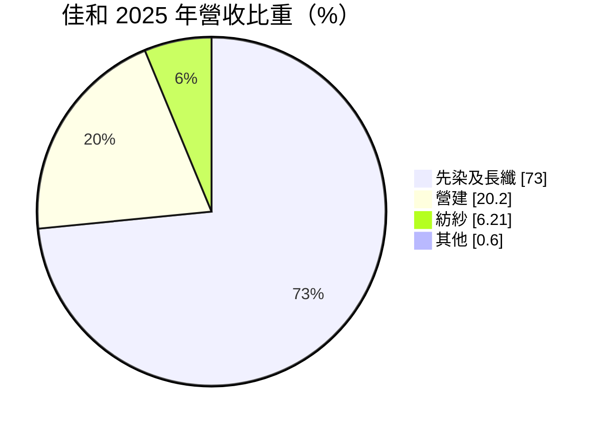
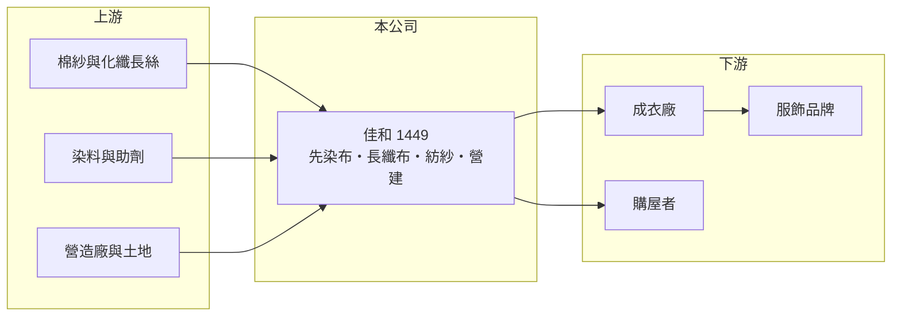

# 1449 佳和

> 上市｜[[產業索引-紡織纖維|紡織纖維]]｜上市（櫃）日期 1992/03/12

# 第一章：企業模式與商業藍圖

> [!info] 撰寫說明
> 精簡版，由 Claude 依公開資料整理，架構比照 [[2330台積電]]，資料截至 2026-10-08。來源：MoneyDJ 理財網個股基本資料（2025 年營收比重）與財務比率年表（2021 至 2025 年）；證交所開放資料快照（基本資料、2026 年第二季資產負債與上半年損益、2025 年度股利、2026 年 8 月營收備註）。產品用途、據點與轉投資明細為憑記憶整理或未查得，已標「待校對」。#待校對

佳和實業（以下簡稱佳和）成立於 1972 年 12 月、1992 年 5 月上市，總公司與工廠在台南市新市區，董事長兼總經理翁偉翔。它以先染布與長纖布為主業，另有約兩成營收來自營建，加上持有可觀的金融資產，是「紡織本業、營建與投資」三者並存的公司。

- **核心業務：** 佳和的主力是[[先染布]]與長纖布，2025 年合計占營收 73%，紡紗占 6.21%。先染布是先把紗染色再織成格子、條紋等花色，常用於襯衫與休閒服（用途待校對）；因為花色要在織布時就決定，打樣、交期與色差管理的要求比一般素布高，是台灣布廠較能保有利潤的品項。
- **營收結構：** 依 MoneyDJ 每股營業額與營收成長率推算，2025 年營收約 26.7 億元（推算），2026 年上半年證交所資料為 18.4 億元；2026 年 8 月營收備註為「訂單增加及合併子公司營收」，代表 2026 年起有新子公司併入，營收基礎已改變。營建占 20.20%，收入隨建案交屋時點跳動。
- **營運據點：** 總部與主要工廠在台南新市（海外據點待校對）。台南科學園區周邊的土地近年增值，紡織廠的自有土地若用於推案或出租，可以成為本業以外的重要收入來源。
- **長期方向：** 佳和的長期方向是維持先染布的利基，同時透過營建與轉投資擴大資產收益。2026 年第二季其他權益約 8.6 億元、非控制權益約 6.5 億元，前者代表持有金融資產的未實現利益，後者代表有持股未達百分之百的子公司，兩者都讓佳和的獲利結構比單純布廠複雜。

# 第二章：護城河深度與競爭優勢

佳和的優勢在先染布的打樣與交期能力，以及土地與投資資產；但織布本業規模小，2025 年營業利益率跌到 -11.16%，競爭壓力明顯。

- **競爭優勢：** 先染布需要染紗、整經、織布的一貫配合，花色多、批量小，大型低價布廠不容易做得又快又好，這讓佳和能服務重視設計與交期的品牌與成衣廠。自有土地與金融資產則提供營建與股利收入，分散了紡織景氣的風險。
- **主要對手：** 色織布與長纖布的同業包括 [[1460宏遠]]、[[1467南緯]]、[[1474弘裕]]，以及中國的大型色織布廠；營建部分則與台南地區建商競爭，同類型公司有 [[1446宏和]]。
- **觀察重點：** 佳和近 5 年平均 [[ROE]] 約 5.9%（推算），但 2025 年稅後淨利率 6.83%、EPS 卻只有 0.12 元，代表大部分淨利歸屬非控制權益，母公司股東分到的很少。觀察重點是 2026 年新併入子公司對母公司獲利的貢獻，以及織布本業能否回到 2024 年營業利益率 3.27% 的水準。

# 第三章：財務體質與盈利規模

資料日期：2026-10-08，表格是撰寫當時的快照；最新月營收、毛利率、累計 EPS 由自動排程寫在本筆記的屬性欄位（月營收、毛利率、累計EPS 等）。#待校對

佳和的營業利益多數年度為負，淨利主要靠業外收益與營建，且有相當比例歸屬子公司的少數股東。

| 年度 | 營收（億元） | [[毛利率]] | [[營業利益率]] | EPS（元） | [[ROE]] |
|---|---|---|---|---|---|
| 2021 | 約 27.9（推算） | 9.09% | -6.18% | 0.83 | 5.82% |
| 2022 | 約 24.8（推算） | 11.38% | -2.35% | 1.09 | 6.47% |
| 2023 | 約 26.6（推算） | 15.05% | -0.52% | 0.61 | 4.58% |
| 2024 | 約 28.9（推算） | 20.11% | 3.27% | 0.93 | 5.00% |
| 2025 | 約 26.7（推算） | 9.32% | -11.16% | 0.12 | 7.38% |

註：2025 年營收以每股營業額 20.97 元乘以約 1.27 億股推算，其他年度依 MoneyDJ 營收成長率回推；期間股本可能變動，各年營收僅供參考。ROE 為 MoneyDJ 數字，2025 年與 EPS 差距大，推估是含非控制權益的口徑，待校對。

- **長期指標：** 2021 至 2025 年營收年複合成長率約 -1.1%（推算），近 5 年平均 ROE 約 5.9%（推算）。2025 年度未配發股利；每股現金流量 2021 至 2024 年為正、2025 年轉為 -1.01 元，可能與營建投入有關（推估）。負債比率從 2021 年 76.93% 逐年降到 2025 年 63.52%，仍屬偏高。
- **[[ROIC]] 與 [[WACC]]：** 2025 年營業損失約 3.0 億元（營業利益率 -11.16% × 營收約 26.7 億元，虧損不計稅），投入資本約 57.9 億元（2026 年第二季權益總計 31.2 億元，加上以總負債 53.5 億元的一半推估的有息負債約 26.8 億元），ROIC 約 -5.1%（推算）。WACC 約 4.5%（推算：無風險利率 1.75%、市場風險溢酬 6%、β 取紡織同業常見值 0.8，股東權益成本 6.55%；稅前負債成本 2.5%、稅率 20%；權益比重約 54%），考量負債比偏高，實際 WACC 可能在 5% 以上。ROIC 為負，本業目前並未創造價值，獲利來源主要是業外與營建。
- **財務特色：** 2026 年第二季負債比率約 63%（負債 53.5 億元 ÷ 資產 84.7 億元），保留盈餘約 2.0 億元，其他權益約 8.6 億元。2026 年上半年營業損失 0.57 億元、業外收入 0.75 億元，母公司每股虧損 0.28 元；股價淨值比約 0.64 倍。

# 第四章：總體風險與地緣政治

佳和的風險在於織布本業的競爭、營建的時點波動，以及偏高的負債比率。

- **產業週期：** 先染布與長纖布的需求跟著國際服飾品牌的庫存週期走，2025 年毛利率由 20.11% 掉到 9.32%，說明需求轉弱時價格與稼動率同時受壓。營建收入則受房市景氣與利率影響，交屋年度不同會讓營收大幅起伏。
- **營運風險：** 負債比率超過六成，營建開發期間需要借款，利率上升或房市降溫時資金壓力較大。新併入的子公司若整合不順，或少數股東分走大部分利潤，母公司股東的實際回報可能低於合併報表所見。
- **其他風險：** 外銷布料以美元計價，匯率變動影響毛利；持有的金融資產價格下跌會減少其他權益；台灣工資與電價上升，持續墊高織布與染整成本。

# 專有名詞解析

## 金融

- **[[業外收益]]**：本業以外的收入，例如投資收益、處分資產利益或匯兌利益，通常不具持續性。
- **[[非控制權益]]**：合併報表中屬於子公司其他股東的權益與淨利，不歸母公司股東所有。
- **[[ROIC]]**：投入資本報酬率，稅後營業利益除以股東權益加有息負債，衡量本業運用資本的效率。
- **[[WACC]]**：加權平均資金成本，股東與債權人要求報酬率的加權平均，是 ROIC 要超越的門檻。

## 產業

- **[[先染布]]**：先把紗線染色、再織成格紋或條紋等花色的布料，又稱色織布，常用於襯衫與休閒服。

# 核心供應鏈

- 上游：棉紗與化纖長絲供應商未查得；化纖業者如 [[1402遠東新]]、[[1409新纖]]（是否為佳和供應商未查得）。
- 下游／客戶：成衣廠與服飾品牌，客戶名單未查得；營建部分為台南地區購屋者。
- 同業：[[1460宏遠]]、[[1467南緯]]、[[1474弘裕]]；兼營營建的 [[1446宏和]]。

## 最新新聞
<!-- news:start（自動產生，請勿手動編輯此範圍） -->
- 2026-10-08 📰 媒體 19:50｜營收速報 - 佳和(1449)9月營收3.43億元年增率高達152.16％｜[鉅亨網](https://news.cnyes.com/news/id/6625857)

完整紀錄：[[1449佳和 新聞]]
<!-- news:end -->

## 相關連結
- [公開資訊觀測站](https://mopsov.twse.com.tw/mops/web/t05st03?step=1&firstin=1&co_id=1449)
- [Goodinfo](https://goodinfo.tw/tw/StockDetail.asp?STOCK_ID=1449)
- [Yahoo 股市](https://tw.stock.yahoo.com/quote/1449)
- [鉅亨網新聞](https://www.cnyes.com/twstock/1449/news)
