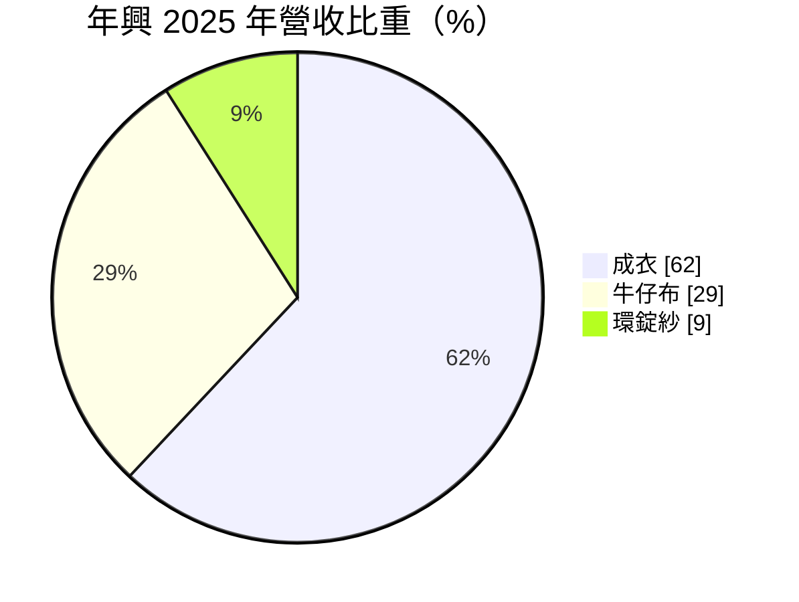
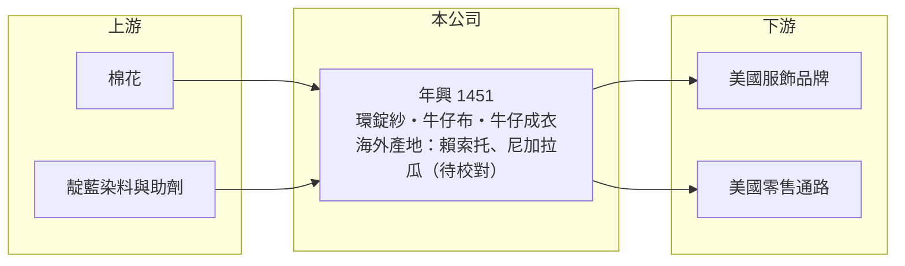

# 1451 年興

> 上市｜[[產業索引-紡織纖維|紡織纖維]]｜上市（櫃）日期 1992/12/21

# 第一章：企業模式與商業藍圖

> [!info] 撰寫說明
> 精簡版，由 Claude 依公開資料整理，架構比照 [[2330台積電]]，資料截至 2026-10-08。來源：MoneyDJ 理財網個股基本資料（2025 年營收比重）與財務比率年表（2021 至 2025 年）；證交所開放資料快照（基本資料、2026 年第二季資產負債與上半年損益、2025 年度股利）。海外產地、客戶與貿易協定為憑記憶整理，已標「待校對」。#待校對

年興紡織（以下簡稱年興）成立於 1986 年 10 月、1992 年 12 月上市，總公司在台北市內湖區，董事長陳威翰、總經理蔡樹軒。它是台灣少數從紡紗、牛仔布一路做到牛仔褲成衣的垂直整合廠，產能主要放在海外，替美國的服飾品牌與零售通路代工。

- **核心業務：** 年興的營收以成衣為主，2025 年占 62%，其次是[[牛仔布]] 29% 與環錠紗 9%。公司自己紡紗、織牛仔布，再車縫成牛仔褲等成衣交給品牌客戶，這種從紗到成衣的[[垂直整合]]，可以縮短交期、控制布料品質，對追求快速補貨的美國零售通路很重要。
- **營收結構：** 依 MoneyDJ 每股營業額 31.62 元乘以約 1.98 億股推算，2025 年營收約 63 億元（推算），2026 年上半年證交所資料為 32.1 億元，規模相符。營收在 2022 年約 87 億元後下滑，2023 年年減 27%，之後穩定在 63 億元上下。
- **營運據點：** 年興的產能主要在非洲賴索托與中美洲尼加拉瓜（待校對），利用這些國家對美國出口的關稅優惠與較低工資，就近供應北美市場。這種「遠離中國、靠近美國」的產地布局，是年興相較中國同業的主要差異。
- **長期方向：** 年興的長期課題是在美國貿易政策變化下維持產地優勢。非洲產地依賴美國《非洲成長與機會法案》（[[AGOA]]）的免關稅待遇，該法案的延續與否直接影響賴索托工廠的競爭力（法案現況待校對）；中美洲產地則受美國對當地政治情勢的政策影響。

# 第二章：護城河深度與競爭優勢

年興的護城河來自垂直整合與海外產地布局，但牛仔成衣代工的議價能力有限，獲利率長期在低檔。

- **競爭優勢：** 從紡紗、織布到成衣一條龍生產，讓年興可以替客戶從布料開發到成衣交貨一次完成，減少中間商與運輸時間。海外工廠設在享有美國關稅優惠的國家，在美中貿易摩擦後，這種非中國產地成為品牌分散供應鏈的選項。
- **主要對手：** 台灣的牛仔布同業有 [[4414如興]]、[[1474弘裕]]，成衣代工同業有 [[1477聚陽]]、[[1476儒鴻]]、[[1473台南]]；國際上則面對孟加拉、巴基斯坦、墨西哥與中國的大型牛仔布與成衣廠。
- **觀察重點：** 年興近 5 年平均 [[ROE]] 約 2.5%（推算），營業利益率長期在 2% 至 4% 之間，代工利潤偏薄。觀察重點是美國關稅與貿易協定的變化，以及公司能否把毛利率維持在 2025 年 11.51% 以上。

# 第三章：財務體質與盈利規模

資料日期：2026-10-08，表格是撰寫當時的快照；最新月營收、毛利率、累計 EPS 由自動排程寫在本筆記的屬性欄位（月營收、毛利率、累計EPS 等）。#待校對

年興除 2023 年因品牌庫存調整而虧損外，多數年度小幅獲利；財務結構非常保守，淨值高但報酬率低。

| 年度 | 營收（億元） | [[毛利率]] | [[營業利益率]] | EPS（元） | [[ROE]] |
|---|---|---|---|---|---|
| 2021 | 約 80（推算） | 8.40% | 3.09% | 1.23 | 3.30% |
| 2022 | 約 87（推算） | 9.28% | 3.57% | 2.15 | 5.68% |
| 2023 | 約 64（推算） | -0.18% | -7.08% | -1.83 | -5.00% |
| 2024 | 約 64（推算） | 10.86% | 2.41% | 1.22 | 3.45% |
| 2025 | 約 63（推算） | 11.51% | 1.79% | 1.76 | 4.82% |

註：2025 年營收以每股營業額 31.62 元乘以約 1.98 億股推算，其他年度依 MoneyDJ 營收成長率回推。

- **長期指標：** 2021 至 2025 年營收年複合成長率約 -6.0%（推算），近 5 年平均 ROE 約 2.5%（推算）。2025 年度配發現金股利 1.0 元，配息率約 57%；每股現金流量除 2025 年小幅為負外皆為正值。2025 年稅後淨利率 5.58% 高於營業利益率 1.79%，有部分獲利來自業外收益（如利息與匯兌）。
- **[[ROIC]] 與 [[WACC]]：** 2025 年稅後營業利益約 0.9 億元（營業利益率 1.79% × 營收約 62.6 億元 × 0.8），投入資本約 81 億元（2026 年第二季股東權益 74.0 億元，加上以總負債 14.8 億元的一半推估的有息負債約 7.4 億元），ROIC 約 1.1%（推算）。WACC 約 6.1%（推算：無風險利率 1.75%、市場風險溢酬 6%、β 取紡織同業常見值 0.8，股東權益成本 6.55%；稅前負債成本 2.5%、稅率 20%；權益比重約 91%）。ROIC 長期低於 WACC，原因是公司保留大量現金與淨值、但代工本業利潤薄，資本沒有被有效運用；這也是股價淨值比長期偏低的原因。
- **財務特色：** 2026 年第二季負債比率約 17%（負債 14.8 億元 ÷ 資產 88.7 億元），保留盈餘約 54.8 億元、每股淨值 37.35 元，股價淨值比約 0.46 倍。其他權益約 -4.9 億元，推估主要是海外子公司的換算損失，反映新台幣與美元匯率的長期變動。

# 第四章：總體風險與地緣政治

年興的風險集中在美國貿易政策、海外產地的政治環境，以及品牌客戶的庫存週期。

- **產業週期：** 牛仔成衣的需求跟著美國零售通路的庫存週期走，2023 年品牌大幅去化庫存，年興營收年減 27%、毛利率轉負。牛仔布原料以棉花為主，棉價大幅波動時，成本轉嫁會有時間落差。
- **營運風險：** 營收高度依賴美國市場與少數大型客戶（客戶名單待校對），單一客戶砍單就會明顯影響稼動率。海外工廠集中在少數國家，當地罷工、政局動盪或工資大幅調漲，都會直接衝擊生產。
- **其他風險：** 美國關稅政策與 AGOA 等貿易協定若改變，非洲產地的免稅優勢可能消失；營收以美元計價，新台幣升值會壓縮台幣計價的毛利；品牌對勞動條件、用水與化學品管理的稽核標準越來越嚴格。

# 專有名詞解析

## 金融

- **[[ROIC]]**：投入資本報酬率，稅後營業利益除以股東權益加有息負債，衡量本業運用資本的效率。
- **[[WACC]]**：加權平均資金成本，股東與債權人要求報酬率的加權平均，是 ROIC 要超越的門檻。

## 產業

- **[[牛仔布]]**：以靛藍染色的經紗和白色緯紗織成的斜紋棉布，是牛仔褲的主要布料。
- **[[垂直整合]]**：同一家公司掌握從原料、加工到成品的多個生產環節，以控制成本、品質與交期。
- **[[AGOA]]**：美國《非洲成長與機會法案》，讓符合資格的撒哈拉以南非洲國家產品免關稅進入美國。

# 核心供應鏈

- 上游：棉花進口與染料供應商未查得。
- 下游／客戶：美國服飾品牌與大型零售通路，客戶名單未查得。
- 同業：牛仔布 [[4414如興]]、[[1474弘裕]]；成衣代工 [[1477聚陽]]、[[1476儒鴻]]、[[1473台南]]。

## 最新新聞
<!-- news:start -->
<!-- news:end -->

## 相關連結
- [公開資訊觀測站](https://mopsov.twse.com.tw/mops/web/t05st03?step=1&firstin=1&co_id=1451)
- [Goodinfo](https://goodinfo.tw/tw/StockDetail.asp?STOCK_ID=1451)
- [Yahoo 股市](https://tw.stock.yahoo.com/quote/1451)
- [鉅亨網新聞](https://www.cnyes.com/twstock/1451/news)
