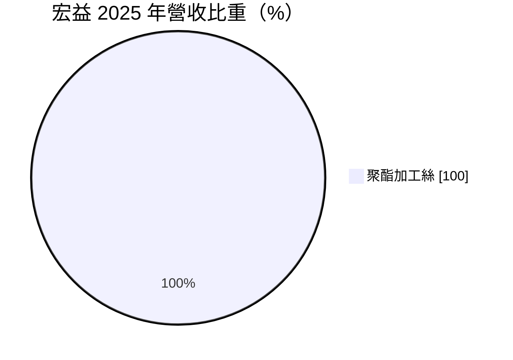
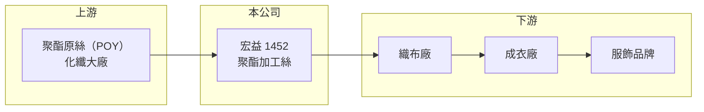

# 1452 宏益

> 上市｜[[產業索引-紡織纖維|紡織纖維]]｜上市（櫃）日期 1992/12/28

# 第一章：企業模式與商業藍圖

> [!info] 撰寫說明
> 精簡版，由 Claude 依公開資料整理，架構比照 [[2330台積電]]，資料截至 2026-10-08。來源：MoneyDJ 理財網個股基本資料（2025 年營收比重）與財務比率年表（2021 至 2025 年）；證交所開放資料快照（基本資料、2026 年第二季資產負債與上半年損益、2025 年度股利）。公開資料有限，廠區、產能與客戶未查得。#待校對

宏益纖維工業（以下簡稱宏益）成立於 1968 年 8 月、1992 年 12 月上市，總公司在台北市大同區塔城街，董事長施淑賢、總經理王慶榮。它是一家只做聚酯加工絲的專業廠，產品單一、營收約 14 億元，財務結構非常保守，幾乎沒有負債。

- **核心業務：** 宏益 2025 年營收 100% 來自[[聚酯]][[加工絲]]。加工絲是向上游買進聚酯原絲（POY），經加熱、假撚做成有彈性與蓬鬆感的紗線，再賣給織布廠做成衣料。這是紡織供應鏈中段的加工環節，附加價值主要來自規格齊全、品質穩定與交期快。
- **營收結構：** 依 MoneyDJ 每股營業額 10.22 元乘以約 1.33 億股推算，2025 年營收約 13.6 億元（推算），2026 年上半年證交所資料為 7.2 億元，規模相符。營收在 2021 年約 21 億元的高峰後明顯縮小，產品單一的公司完全跟著加工絲景氣起落。
- **營運據點：** 生產廠區與產能這次未查得。加工絲廠的成本主要是原絲、電力與折舊，產地若在台灣，電價與工資上升對利潤影響較大。
- **長期方向：** 產品單一是宏益的最大特徵，好處是專注、管理單純，壞處是沒有其他事業分散風險。長期來看，宏益需要往回收聚酯、機能性加工絲等差異化規格移動，才能避開與中國大宗加工絲的直接價格競爭。

# 第二章：護城河深度與競爭優勢

宏益的優勢在於專注單一產品與極低的負債，但加工絲是高度競爭的中間材料，護城河很窄。

- **競爭優勢：** 長期專做加工絲，在設備調校、規格開發與品質控制上累積經驗，能依織布廠的需求快速調整產品。負債比率只有約 5% 至 6%，景氣低迷時不必擔心還款壓力，可以撐過產業的谷底。
- **主要對手：** 台灣加工絲同業包括 [[1455集盛]]、[[1444力麗]]、[[1454台富]]、[[1409新纖]]，其中不少同業同時生產上游的原絲與酯粒，成本結構較完整；中國加工絲廠的產能規模更大、報價更低。
- **觀察重點：** 宏益近 5 年平均 [[ROE]] 約 4.2%（推算），2021 年曾達 13.17%，2025 年轉為 -2.00%。觀察重點是加工絲價差能否回升，讓[[毛利率]]從 2025 年的 1.92% 回到 2022 年 12% 左右的水準。

# 第三章：財務體質與盈利規模

資料日期：2026-10-08，表格是撰寫當時的快照；最新月營收、毛利率、累計 EPS 由自動排程寫在本筆記的屬性欄位（月營收、毛利率、累計EPS 等）。#待校對

宏益的獲利完全取決於加工絲景氣，2021 年是高峰，之後毛利率一路下滑，2023 年起營業利益轉為虧損。

| 年度 | 營收（億元） | [[毛利率]] | [[營業利益率]] | EPS（元） | [[ROE]] |
|---|---|---|---|---|---|
| 2021 | 約 21.0（推算） | 17.94% | 11.18% | 2.65 | 13.17% |
| 2022 | 約 18.2（推算） | 12.00% | 5.63% | 0.97 | 4.64% |
| 2023 | 約 12.0（推算） | 3.22% | -5.21% | 0.39 | 1.92% |
| 2024 | 約 17.0（推算） | 4.50% | -1.87% | 0.64 | 3.07% |
| 2025 | 約 13.6（推算） | 1.92% | -4.97% | -0.41 | -2.00% |

註：2025 年營收以每股營業額 10.22 元乘以約 1.33 億股推算，其他年度依 MoneyDJ 營收成長率回推。

- **長期指標：** 2021 至 2025 年營收年複合成長率約 -10.3%（推算），近 5 年平均 ROE 約 4.2%（推算）。2023 與 2024 年本業虧損，但稅後淨利率仍為正，靠[[業外收益]]支撐；2025 年度虧損仍配發現金股利 0.2 元。每股現金流量正負交錯，2022 年高達 5.11 元、2025 年為 -1.89 元，隨營運資金變動。
- **[[ROIC]] 與 [[WACC]]：** 2025 年營業損失約 0.67 億元（營業利益率 -4.97% × 營收約 13.6 億元，虧損不計稅），投入資本約 28.2 億元（2026 年第二季股東權益 27.2 億元，加上以總負債 1.9 億元的一半推估的有息負債約 0.9 億元），ROIC 約 -2.4%（推算）。WACC 約 6.4%（推算：無風險利率 1.75%、市場風險溢酬 6%、β 取紡織同業常見值 0.8，股東權益成本 6.55%；稅前負債成本 2.5%、稅率 20%；權益比重約 97%）。宏益幾乎全用股東資金營運，所以 WACC 接近股東權益成本；ROIC 在 2021 年景氣高峰時明顯高於 WACC，近三年則低於 WACC，屬於「景氣好時創造價值、景氣差時消耗價值」的週期型公司。
- **財務特色：** 2026 年第二季負債比率約 6%（負債 1.9 億元 ÷ 資產 29.1 億元），流動資產 20.4 億元占總資產七成，財務非常穩健。其他權益約 3.1 億元，代表持有的金融資產有未實現利益；每股淨值 20.52 元，股價淨值比約 0.52 倍。

# 第四章：總體風險與地緣政治

宏益的風險高度集中在加工絲單一產品的景氣與價格，財務風險反而很低。

- **產業週期：** 加工絲價格跟著原油、[[PTA]] 與聚酯原絲波動，需求則受國際品牌庫存週期影響。2023 年營收年減 34%、毛利率跌到 3.22%，說明景氣反轉時單一產品公司沒有緩衝。
- **營運風險：** 營收全部來自加工絲，任何一項產品被中國低價貨取代，就直接衝擊整體營收。向外購買原絲的成本結構，讓宏益在原料上漲時較難比一貫廠更快轉嫁。
- **其他風險：** 外銷產品以美元計價，匯率變動影響毛利；台灣電價上漲推高加工成本；歐美品牌對回收聚酯比例的要求提高，若不跟進可能失去部分客戶。

# 專有名詞解析

## 金融

- **[[業外收益]]**：本業以外的收入，例如投資收益、處分資產利益或匯兌利益，通常不具持續性。
- **[[ROIC]]**：投入資本報酬率，稅後營業利益除以股東權益加有息負債，衡量本業運用資本的效率。
- **[[WACC]]**：加權平均資金成本，股東與債權人要求報酬率的加權平均，是 ROIC 要超越的門檻。

## 產業

- **[[聚酯]]**：以 PTA 與乙二醇聚合而成的合成纖維與塑膠原料，用於衣料、寶特瓶與工業用布。
- **[[加工絲]]**：把聚酯或尼龍原絲經加熱、假撚加工，使其具有彈性與蓬鬆感的紗線，英文簡稱 DTY。
- **[[PTA]]**：純對苯二甲酸，與乙二醇聚合成聚酯，是紡織與包裝用聚酯的基礎原料。

# 核心供應鏈

- 上游：聚酯原絲供應商如 [[1402遠東新]]、[[1409新纖]]、[[1444力麗]]（是否為宏益供應商未查得）。
- 下游／客戶：織布廠，客戶名單未查得。
- 同業：[[1455集盛]]、[[1444力麗]]、[[1454台富]]、[[1409新纖]]。

## 最新新聞
<!-- news:start -->
<!-- news:end -->

## 相關連結
- [公開資訊觀測站](https://mopsov.twse.com.tw/mops/web/t05st03?step=1&firstin=1&co_id=1452)
- [Goodinfo](https://goodinfo.tw/tw/StockDetail.asp?STOCK_ID=1452)
- [Yahoo 股市](https://tw.stock.yahoo.com/quote/1452)
- [鉅亨網新聞](https://www.cnyes.com/twstock/1452/news)
