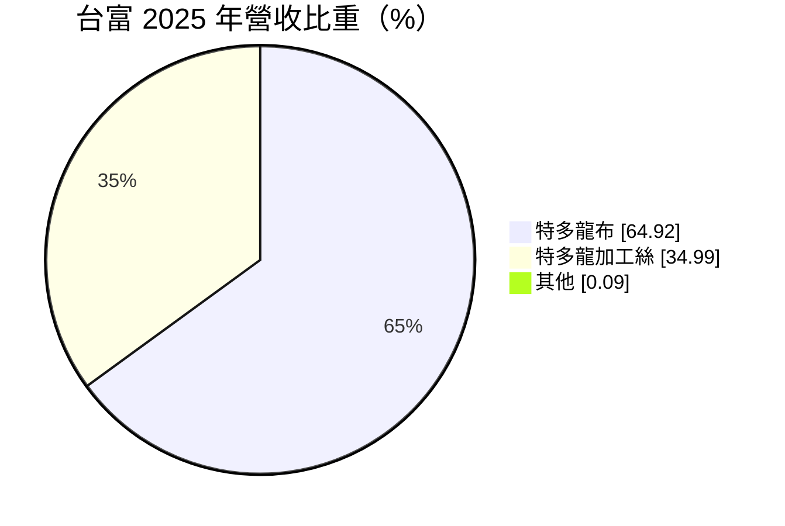
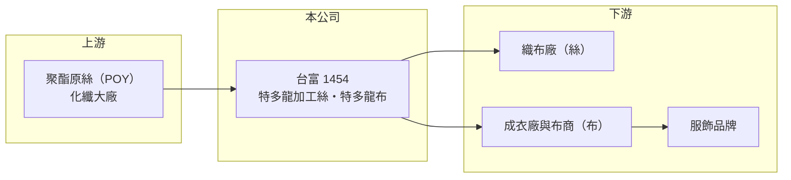

# 1454 台富

> 上市｜[[產業索引-紡織纖維|紡織纖維]]｜上市（櫃）日期 1993/05/07

# 第一章：企業模式與商業藍圖

> [!info] 撰寫說明
> 精簡版，由 Claude 依公開資料整理，架構比照 [[2330台積電]]，資料截至 2026-10-08。來源：MoneyDJ 理財網個股基本資料（2025 年營收比重）與財務比率年表（2021 至 2025 年）；證交所開放資料快照（基本資料、2026 年第二季資產負債與上半年損益、2025 年度股利）。公開資料有限，廠區、產能與客戶未查得。#待校對

台灣富綢纖維（以下簡稱台富）成立於 1973 年 6 月、1993 年 5 月上市，總公司在台北市大同區西寧北路，董事長兼總經理莊燿銘。它從特多龍（聚酯）加工絲做到織布，營收約 16 億元，近年本業連續虧損，2025 年虧損明顯擴大。

- **核心業務：** 台富的產品是[[特多龍]]布與特多龍[[加工絲]]，2025 年分別占營收 64.92% 與 34.99%。特多龍是聚酯纖維的商品名，台富把聚酯原絲加工成絲，一部分直接賣給織布廠，一部分自己織成布，屬於中游的「絲布一貫」廠。
- **營收結構：** 依 MoneyDJ 每股營業額 12.59 元乘以約 1.30 億股推算，2025 年營收約 16.3 億元（推算），2026 年上半年證交所資料為 6.4 億元，規模縮小。過去五年營收在 16 億至 19 億元之間起伏，沒有明顯成長。
- **營運據點：** 生產廠區與海外據點這次未查得。總公司所在的台北西寧北路一帶是台灣紡織業傳統的聚集地，[[1445大宇]]、[[1455集盛]] 的總公司也在附近。
- **長期方向：** 台富的長期課題是讓本業回到損益兩平。絲與布兩段製程雖然可以互相支援，但在規模不大的情況下，面對中國大廠的低價競爭，需要轉向機能、回收材質等差異化產品，才能改善毛利。

# 第二章：護城河深度與競爭優勢

台富沒有明顯的護城河，競爭力取決於成本控制與既有客戶關係；2025 年毛利率跌到 1.96%，顯示價格競爭非常激烈。

- **競爭優勢：** 加工絲與織布一貫生產，讓台富可以自行供應織布所需的紗線，控制品質與交期。經營五十多年，與下游布商、成衣廠有長期往來，這是小型廠在景氣低迷時維持訂單的基礎。
- **主要對手：** 加工絲同業如 [[1455集盛]]、[[1452宏益]]、[[1444力麗]]，聚酯布同業如 [[1445大宇]]、[[1460宏遠]]，以及中國與越南的大量織布廠。多數對手規模更大，或像力麗一樣自產原絲，成本結構比台富更完整。
- **觀察重點：** 台富近 5 年平均 [[ROE]] 約 -1.0%（推算），2025 年降到 -9.29%。觀察重點是[[毛利率]]能否回到 2021 至 2023 年的 8% 至 10%，以及負債比率由 18% 升到約 31% 後的財務變化。

# 第三章：財務體質與盈利規模

資料日期：2026-10-08，表格是撰寫當時的快照；最新月營收、毛利率、累計 EPS 由自動排程寫在本筆記的屬性欄位（月營收、毛利率、累計EPS 等）。#待校對

台富 2021 至 2024 年大致在損益兩平附近，2025 年毛利率驟降，虧損擴大到每股 1.12 元。

| 年度 | 營收（億元） | [[毛利率]] | [[營業利益率]] | EPS（元） | [[ROE]] |
|---|---|---|---|---|---|
| 2021 | 約 16.8（推算） | 8.15% | -0.73% | 0.04 | 0.33% |
| 2022 | 約 19.1（推算） | 10.53% | 1.61% | 0.26 | 2.00% |
| 2023 | 約 16.1（推算） | 9.19% | -1.51% | 0.16 | 1.22% |
| 2024 | 約 17.3（推算） | 7.18% | -3.06% | 0.10 | 0.77% |
| 2025 | 約 16.3（推算） | 1.96% | -8.35% | -1.12 | -9.29% |

註：2025 年營收以每股營業額 12.59 元乘以約 1.30 億股推算，其他年度依 MoneyDJ 營收成長率回推。

- **長期指標：** 2021 至 2025 年營收年複合成長率約 -0.6%（推算），近 5 年平均 ROE 約 -1.0%（推算）。2025 年度以資本公積配發現金 0.1 元，而非用當年盈餘；每股淨值從 2021 年 13.23 元降到 2026 年第二季 10.68 元。
- **[[ROIC]] 與 [[WACC]]：** 2025 年營業損失約 1.4 億元（營業利益率 -8.35% × 營收約 16.3 億元，虧損不計稅），投入資本約 16.2 億元（2026 年第二季股東權益 13.0 億元，加上以總負債 6.4 億元的一半推估的有息負債約 3.2 億元），ROIC 約 -8.4%（推算）。WACC 約 5.7%（推算：無風險利率 1.75%、市場風險溢酬 6%、β 取紡織同業常見值 0.8，股東權益成本 6.55%；稅前負債成本 2.5%、稅率 20%；權益比重約 80%）。ROIC 近五年都低於 WACC，2025 年差距擴大到 14 個百分點，本業正在消耗股東資本。
- **財務特色：** 2026 年第二季負債比率約 33%（負債 6.4 億元 ÷ 資產 19.4 億元），幾乎都是流動負債。保留盈餘只剩約 0.5 億元，若虧損延續將轉為累積虧損；2026 年上半年營業損失 0.59 億元、每股虧損 0.41 元，股價淨值比約 1.14 倍。

# 第四章：總體風險與地緣政治

台富的風險在於規模小、產品同質，加上本業虧損擴大後的財務壓力。

- **產業週期：** 聚酯加工絲與布的價格跟著原油、[[PTA]] 與中國產能波動，需求則受國際品牌庫存週期影響。2025 年毛利率從 7.18% 跌到 1.96%，說明在需求疲弱時，小型廠幾乎沒有定價空間。
- **營運風險：** 營業虧損占營收比重已達 8%，保留盈餘接近用盡，若無法改善，可能需要縮減產能或處分資產。流動負債占負債絕大部分，短期資金調度需要留意。
- **其他風險：** 外銷產品以美元計價，匯率變動影響毛利；台灣電價與工資上漲持續墊高成本；歐美品牌對回收聚酯與碳排的要求，需要額外投資才能跟上。

# 專有名詞解析

## 金融

- **[[ROIC]]**：投入資本報酬率，稅後營業利益除以股東權益加有息負債，衡量本業運用資本的效率。
- **[[WACC]]**：加權平均資金成本，股東與債權人要求報酬率的加權平均，是 ROIC 要超越的門檻。

## 產業

- **[[特多龍]]**：聚酯纖維的商品名稱，源自日本東麗與帝人的 Tetoron 品牌，台灣紡織業常用來泛指聚酯纖維。
- **[[加工絲]]**：把聚酯或尼龍原絲經加熱、假撚加工，使其具有彈性與蓬鬆感的紗線，英文簡稱 DTY。
- **[[PTA]]**：純對苯二甲酸，與乙二醇聚合成聚酯，是紡織與包裝用聚酯的基礎原料。

# 核心供應鏈

- 上游：聚酯原絲供應商如 [[1402遠東新]]、[[1409新纖]]（是否為台富供應商未查得）。
- 下游／客戶：織布廠、成衣廠與布商，客戶名單未查得。
- 同業：[[1455集盛]]、[[1452宏益]]、[[1444力麗]]、[[1445大宇]]、[[1460宏遠]]。

## 最新新聞
<!-- news:start -->
<!-- news:end -->

## 相關連結
- [公開資訊觀測站](https://mopsov.twse.com.tw/mops/web/t05st03?step=1&firstin=1&co_id=1454)
- [Goodinfo](https://goodinfo.tw/tw/StockDetail.asp?STOCK_ID=1454)
- [Yahoo 股市](https://tw.stock.yahoo.com/quote/1454)
- [鉅亨網新聞](https://www.cnyes.com/twstock/1454/news)
