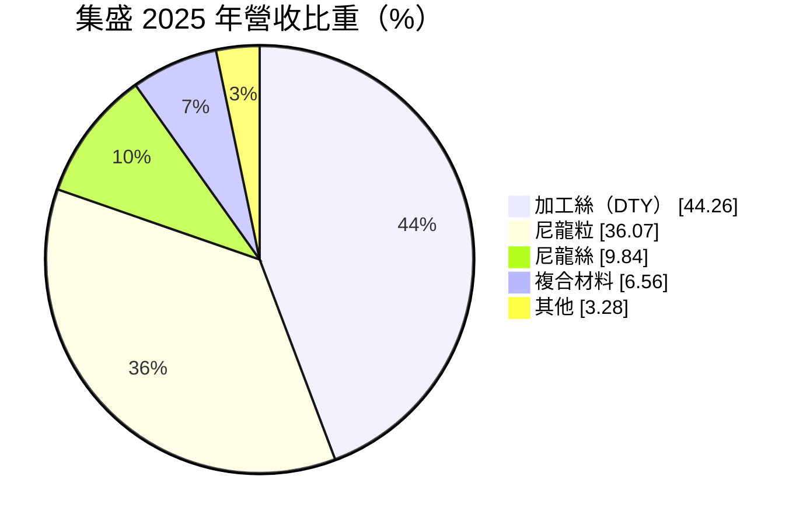
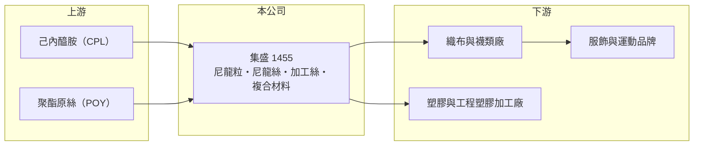

# 1455 集盛

> 上市｜[[產業索引-紡織纖維|紡織纖維]]｜上市（櫃）日期 1993/10/07

# 第一章：企業模式與商業藍圖

> [!info] 撰寫說明
> 精簡版，由 Claude 依公開資料整理，架構比照 [[2330台積電]]，資料截至 2026-10-08。來源：MoneyDJ 理財網個股基本資料（2025 年營收比重）與財務比率年表（2021 至 2025 年）；證交所開放資料快照（基本資料、2026 年第二季資產負債與上半年損益、2025 年度股利）。廠區、產能與 2026 年上半年業外收益的來源未查得。#待校對

集盛實業（以下簡稱集盛）成立於 1969 年 8 月、1993 年 10 月上市，總公司在台北市大同區西寧北路，董事長蘇百煌、總經理葉必祿。它是台灣主要的加工絲與尼龍粒廠之一，從尼龍聚合、紡絲到加工絲都有布局，2024 年營收約 94 億元，2025 年降到約 62 億元。

- **核心業務：** 集盛最大的產品是[[加工絲]]（DTY），2025 年占營收 44.26%，其次是[[尼龍]]粒 36.07%、尼龍絲 9.84%、複合材料 6.56%。公司以[[己內醯胺]]聚合成尼龍粒，一部分外賣給紡絲與塑膠廠，一部分自己紡成尼龍絲、再加工成加工絲，供應運動服、內衣與襪類等需要彈性與耐磨的衣料。
- **營收結構：** 依 MoneyDJ 每股營業額 11.67 元乘以約 5.32 億股推算，2025 年營收約 62 億元（推算），2026 年上半年證交所資料為 28.7 億元，規模相符。營收在 2021 年約 112 億元的高點後下滑，2025 年年減 34%，反映需求疲弱與中國低價競爭，也可能包含公司縮減低毛利訂單的影響（推估）。
- **營運據點：** 生產廠區與產能這次未查得。尼龍聚合與紡絲需要連續生產與大量電力，台灣的電價變化對成本影響明顯。
- **長期方向：** 集盛的長期課題是從大宗尼龍粒與一般加工絲，轉向機能性與回收尼龍等高附加價值產品，並發展複合材料等非衣料應用。在中國同業大舉擴產的壓力下，把重點從衝產量轉為顧利潤是較務實的方向，能否帶動毛利率回升，是判斷轉型成效的關鍵。

# 第二章：護城河深度與競爭優勢

集盛的優勢在尼龍與加工絲的一貫生產與產品廣度，但尼龍粒屬於大宗原料，受中國產能擴張壓抑，護城河偏窄。

- **競爭優勢：** 從尼龍粒到尼龍絲、加工絲的垂直整合，讓集盛能掌握原料品質並提供多樣規格，對需要穩定供貨的織布與襪類客戶有吸引力。同時經營尼龍與聚酯兩種加工絲，可以依市場需求調整產品組合。
- **主要對手：** 尼龍粒與尼龍絲的同業包括 [[1447力鵬]]、[[1466聚隆]]、[[1402遠東新]]，加工絲同業包括 [[1444力麗]]、[[1452宏益]]、[[1454台富]]、[[1457宜進]]，以及產能規模龐大的中國尼龍與加工絲廠。
- **觀察重點：** 集盛近 5 年平均 [[ROE]] 約 -0.6%（推算），2022 年起本業連續虧損，2025 年毛利率為 -2.02%。觀察重點是營收縮小後[[毛利率]]能否轉正並回到 2021 年 10% 左右的水準，以及複合材料等新產品的比重能否提升。

# 第三章：財務體質與盈利規模

資料日期：2026-10-08，表格是撰寫當時的快照；最新月營收、毛利率、累計 EPS 由自動排程寫在本筆記的屬性欄位（月營收、毛利率、累計EPS 等）。#待校對

集盛 2021 年景氣高峰時 ROE 達 13.3%，之後本業連續四年虧損，2025 年營收與毛利率同時探底。

| 年度 | 營收（億元） | [[毛利率]] | [[營業利益率]] | EPS（元） | [[ROE]] |
|---|---|---|---|---|---|
| 2021 | 約 112（推算） | 10.89% | 5.78% | 1.73 | 13.30% |
| 2022 | 約 93（推算） | 2.30% | -2.64% | -0.53 | -4.05% |
| 2023 | 約 77（推算） | -1.93% | -6.65% | -0.45 | -3.72% |
| 2024 | 約 94（推算） | 1.49% | -2.82% | 0.01 | 0.08% |
| 2025 | 約 62（推算） | -2.02% | -7.28% | -0.99 | -8.66% |

註：2025 年營收以每股營業額 11.67 元乘以約 5.32 億股推算，其他年度依 MoneyDJ 營收成長率回推。

- **長期指標：** 2021 至 2025 年營收年複合成長率約 -13.8%（推算），近 5 年平均 ROE 約 -0.6%（推算）。2025 年度以資本公積配發現金 0.16 元，而非當年盈餘；每股淨值從 2021 年 13.75 元降到 2025 年 10.91 元。每股現金流量 2025 年為 2.85 元，營收縮小釋出了營運資金。
- **[[ROIC]] 與 [[WACC]]：** 2025 年營業損失約 4.5 億元（營業利益率 -7.28% × 營收約 62 億元，虧損不計稅），投入資本約 81 億元（2026 年第二季股東權益 62.1 億元，加上以總負債 37.8 億元的一半推估的有息負債約 18.9 億元），ROIC 約 -5.6%（推算）。WACC 約 5.5%（推算：無風險利率 1.75%、市場風險溢酬 6%、β 取紡織與化纖同業常見值 0.8，股東權益成本 6.55%；稅前負債成本 2.5%、稅率 20%；權益比重約 77%）。ROIC 自 2022 年起持續低於 WACC，只有 2021 年景氣高峰時創造價值，屬於典型的大宗化纖週期股。
- **財務特色：** 2026 年第二季負債比率約 38%（負債 37.8 億元 ÷ 資產 99.9 億元），比 2024 年的 42.71% 下降。2026 年上半年營業利益 0.78 億元、業外收入 4.3 億元，EPS 0.91 元主要來自業外（來源未查得），本業雖轉為小幅獲利，仍不能把上半年 EPS 視為常態。

# 第四章：總體風險與地緣政治

集盛的風險集中在尼龍與聚酯原料價格、中國產能擴張，以及營收規模縮小。

- **產業週期：** 尼龍粒價格跟著己內醯胺與原油波動，加工絲需求則受國際品牌庫存週期影響。2022 至 2025 年毛利率在 -2% 至 2% 之間徘徊，反映中國尼龍與加工絲產能過剩對報價的長期壓抑。
- **營運風險：** 營收從 2021 年約 112 億元降到約 62 億元，固定成本攤提變重，若無法轉向高毛利產品，縮小規模可能只是縮小虧損而非轉盈。原料價格急跌時，庫存跌價損失會放大虧損。
- **其他風險：** 外銷與原料採購以美元計價，匯率同時影響成本與售價；台灣電價上漲推高聚合與紡絲成本；歐美品牌對回收尼龍、碳足跡的要求提高，需要投入設備與認證。

# 專有名詞解析

## 金融

- **[[ROIC]]**：投入資本報酬率，稅後營業利益除以股東權益加有息負債，衡量本業運用資本的效率。
- **[[WACC]]**：加權平均資金成本，股東與債權人要求報酬率的加權平均，是 ROIC 要超越的門檻。

## 產業

- **[[加工絲]]**：把聚酯或尼龍原絲經加熱、假撚加工，使其具有彈性與蓬鬆感的紗線，英文簡稱 DTY。
- **[[尼龍]]**：以己內醯胺或己二胺聚合而成的合成纖維與塑膠，強度高、耐磨，用於衣料、漁網與工程塑膠。
- **[[己內醯胺]]**：生產尼龍 6 的單體原料，簡稱 CPL，製程副產品為硫酸銨肥料。

# 核心供應鏈

- 上游：己內醯胺國內生產者為 [[1314中石化]]，聚酯原絲業者如 [[1409新纖]]、[[1402遠東新]]（是否為集盛供應商未查得）。
- 下游／客戶：織布、襪類與塑膠加工廠，客戶名單未查得。
- 同業：[[1447力鵬]]、[[1466聚隆]]、[[1444力麗]]、[[1452宏益]]、[[1454台富]]、[[1457宜進]]。

## 最新新聞
<!-- news:start -->
<!-- news:end -->

## 相關連結
- [公開資訊觀測站](https://mopsov.twse.com.tw/mops/web/t05st03?step=1&firstin=1&co_id=1455)
- [Goodinfo](https://goodinfo.tw/tw/StockDetail.asp?STOCK_ID=1455)
- [Yahoo 股市](https://tw.stock.yahoo.com/quote/1455)
- [鉅亨網新聞](https://www.cnyes.com/twstock/1455/news)
