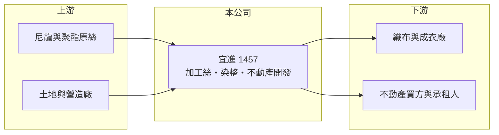

# 1457 宜進

> 上市｜[[產業索引-紡織纖維|紡織纖維]]｜上市（櫃）日期 1994/10/20

# 第一章：企業模式與商業藍圖

> [!info] 撰寫說明
> 精簡版，由 Claude 依公開資料整理，架構比照 [[2330台積電]]，資料截至 2026-10-08。來源：nStock 公司概況（營業項目與產品）、Goodinfo 經營績效年表（2020 至 2025 年）；證交所開放資料快照（基本資料、2026 年第二季資產負債與上半年損益、2025 年度股利）。營收比重、客戶與生產據點未查得，公開資料有限。#待校對

宜進實業（以下簡稱宜進）成立於 1981 年 3 月、1994 年 10 月上市，總公司在台北市內湖區，董事長為詹正田。它表面上是一家做尼龍與聚酯[[加工絲]]的紡織廠，實際上獲利有很大一部分來自土地與不動產，屬於「紡織本業加上資產開發」的混合型公司。

- **核心業務：** 宜進的紡織本業是把尼龍、聚酯長纖做成蓬鬆、有彈性的加工絲，產品包括伸縮尼龍絲、特多龍絲與合成纖維蓬鬆絲，也做染整與成衣布買賣。加工絲是織布廠的原料，產品同質性高，價格主要跟著石化原料與下游織布需求走，因此本業毛利率長期只有個位數到一成多。
- **營收結構：** 依 Goodinfo，2025 年合併營收約 29.8 億元，2026 年上半年證交所資料為 14.3 億元。產品別的營收比重這次未查得；營業項目除了紡織，還包括委託營造廠興建住宅與商業大樓出租出售、開發工業區，以及不動產買賣租賃，這些收入讓公司的損益結構與一般紡織廠很不一樣。
- **營運據點：** 生產廠區與海外據點這次未查得。合併報表中[[非控制權益]]高達約 34.4 億元，占權益總計 87.1 億元的四成左右，代表宜進合併了持股未達百分之百的重要子公司；市場常把 [[4440宜新實業]] 視為同集團公司（待校對）。
- **長期方向：** 從近年財報看，宜進的長期方向是一邊維持加工絲本業，一邊透過[[資產活化]]把土地與不動產轉成收益。這種模式讓獲利在處分資產的年度跳升，但也讓長期獲利能力很難只用紡織景氣解釋，投資人需要分開看本業與資產收益。

# 第二章：護城河深度與競爭優勢

宜進的護城河主要不在紡織技術，而在集團長期累積的土地與不動產資源；本業則屬於高度競爭、靠成本取勝的市場。

- **競爭優勢：** 宜進經營加工絲超過四十年，與下游織布廠有長期往來，集團內有上游關聯企業可互相支援。真正較難複製的是早年取得、帳面成本低的土地，開發或出售時能帶來遠高於本業的利潤，這也是 2022、2023 年營業利益率遠高於毛利率的原因。
- **主要對手：** 加工絲同業包括 [[1466聚隆]]、[[1459聯發]]、[[1465偉全]]，上游一貫化纖大廠如 [[1402遠東新]]、[[1434福懋]]、[[1409新纖]] 也有自己的加工絲產能，另外還有大量中國與東南亞業者。這些對手多半規模更大，宜進在價格上沒有明顯優勢。
- **觀察重點：** 觀察重點是剔除資產處分後的本業毛利率能否穩定在一成以上，以及剩餘可開發土地還有多少。若土地逐年處分完畢而本業沒有改善，公司的長期獲利會回到加工絲的薄利水準。

# 第三章：財務體質與盈利規模

資料日期：2026-10-08，表格是撰寫當時的快照；最新月營收、毛利率、累計 EPS 由自動排程寫在本筆記的屬性欄位（月營收、毛利率、累計EPS 等）。#待校對

宜進的營業利益率多數年度高於毛利率，代表營業利益中含有大量不動產處分或開發收益；閱讀它的財報時，要把這部分與紡織本業分開。

| 年度 | 營收（億元） | [[毛利率]] | [[營業利益率]] | EPS（元） | [[ROE]] |
|---|---|---|---|---|---|
| 2020 | 27.1 | 7.58% | 33.4% | 2.89 | 7.34% |
| 2021 | 41.5 | 13.4% | 7.96% | 0.90 | 4.68% |
| 2022 | 43.4 | 13.2% | 53.4% | 4.55 | 24.0% |
| 2023 | 31.2 | 6.64% | 45.4% | 2.55 | 11.6% |
| 2024 | 33.9 | 9.52% | 15.5% | 0.91 | 3.46% |
| 2025 | 29.8 | 9.66% | 20.1% | 1.18 | 4.71% |
| 2026 上半年 | 14.3 | 9.21% | 9.41% | 0.57 | 未查得 |

註：2020 至 2025 年取自 Goodinfo，2026 年上半年取自證交所開放資料。

- **長期指標：** 2020 至 2025 年營收年複合成長率約 1.9%（推算），2021 至 2025 年平均 ROE 約 9.7%（推算），但其中 2022、2023 年的高 ROE 主要來自不動產收益，本業貢獻有限。2025 年度配發現金股利 1.0 元，以 EPS 1.18 元計算配息率約 85%（推算），屬於把資產收益大方分給股東的做法。
- **[[交叉持股]]：** 2026 年第二季資料顯示，母公司與子公司共持有宜進股票約 8,321 萬股，列為庫藏股。股本 31.67 億元對應約 3.17 億股，扣除後流通在外約 2.34 億股，因此 2025 年本期淨利 2.75 億元換算的 EPS 為 1.18 元；這也讓每股淨值（22.57 元）與 ROE 的計算基礎比表面股本小。
- **[[ROIC]] 與 [[WACC]]：** 2025 年營業利益約 5.99 億元（營收 29.8 億 × 20.1%），稅後約 4.79 億元；投入資本以權益總計 87.1 億元加上總負債 80.7 億元的一半（推估有息負債約 40.4 億元）計約 127.4 億元，ROIC 約 3.8%（推算）。WACC 以無風險利率 1.75%、市場風險溢酬 6%、β 0.8（紡織同業常見值）、稅前負債成本 2.5%、稅率 20%、權益比重約 68% 計算約 5.1%（推算）。ROIC 即使包含資產處分收益仍低於 WACC，若只看紡織本業差距更大，代表大量資本壓在土地與子公司上，帳面報酬偏低。
- **財務特色：** 2026 年第二季負債比率約 48%（負債 80.7 億 ÷ 資產 167.8 億），其中非流動負債 57.5 億元，推估與不動產開發的長期融資有關（待校對）。資產以非流動資產為主（146.9 億元），符合「土地與長期投資多、營運資金少」的資產型公司特徵。

# 第四章：總體風險與地緣政治

宜進的風險分成兩層：紡織本業的景氣循環，以及不動產收益能否延續。

- **產業週期：** 加工絲的價格跟著尼龍、聚酯原料與下游品牌庫存週期波動，品牌去化庫存時織布廠會大幅減少採購。2023 年毛利率降到 6.64%，就是需求下滑與原料成本難以轉嫁的結果。
- **營運風險：** 獲利對不動產處分與開發的依賴高，每年的 EPS 會隨資產出售時點大幅跳動，不容易預估。非控制權益與交叉持股使股權結構較複雜，小股東實際享有的盈餘比例需要細看。
- **其他風險：** 不動產業務受房市景氣、利率與土地法規影響；紡織外銷受匯率、美國[[對等關稅]]與中國低價產品競爭影響；台灣電價與工資上升也會墊高加工成本。

# 專有名詞解析

## 金融

- **[[非控制權益]]**：合併報表中子公司不屬於母公司股東的那部分權益，比重高代表子公司有大量外部股東。
- **[[交叉持股]]**：子公司持有母公司股票的情形，會計上列為庫藏股，會降低流通股數並影響每股數字。
- **[[ROIC]]**：投入資本報酬率，稅後營業利益除以股東權益加有息負債，衡量本業運用資本的效率。
- **[[WACC]]**：加權平均資金成本，股東與債權人要求報酬率的加權平均，是 ROIC 要超越的門檻。

## 產業

- **[[加工絲]]**：把聚酯或尼龍長纖維經假撚等加工，使紗線變得蓬鬆、有彈性的半成品，是織布廠的主要原料。
- **[[資產活化]]**：把閒置或低度利用的土地、建物透過開發、出租或出售，轉為收益或現金。

# 核心供應鏈

- 上游：尼龍與聚酯原絲供應商未查得，化纖原料業者如 [[1402遠東新]]、[[1409新纖]]、[[4440宜新實業]]（是否供貨給宜進待校對）；不動產開發委託營造廠興建。
- 下游／客戶：織布、染整與成衣廠，以及住宅、商業大樓與工業區的買方或承租人，客戶名單未查得。
- 同業：[[1466聚隆]]、[[1459聯發]]、[[1465偉全]]、[[1434福懋]]。

## 最新新聞
<!-- news:start（自動產生，請勿手動編輯此範圍） -->
- 2026-10-19 📰 媒體 19:55｜宜進近3個月買進廣達940張 每股均價320.4元｜[鉅亨網](https://news.cnyes.com/news/id/6633604)
- 2026-10-19 🏛️ 重訊 15:28｜公告本公司及子公司一年內累積取得有價證券達三億元｜[觀測站](https://mops.twse.com.tw/mops/#/web/t05st01)

完整紀錄：[[1457宜進 新聞]]
<!-- news:end -->

## 相關連結
- [公開資訊觀測站](https://mopsov.twse.com.tw/mops/web/t05st03?step=1&firstin=1&co_id=1457)
- [Goodinfo](https://goodinfo.tw/tw/StockDetail.asp?STOCK_ID=1457)
- [Yahoo 股市](https://tw.stock.yahoo.com/quote/1457)
- [鉅亨網新聞](https://www.cnyes.com/twstock/1457/news)
