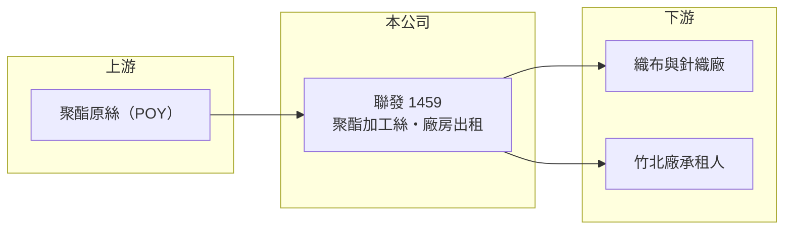

# 1459 聯發

> 上市｜[[產業索引-紡織纖維|紡織纖維]]｜上市（櫃）日期 1994/10/26

# 第一章：企業模式與商業藍圖

> [!info] 撰寫說明
> 精簡版，由 Claude 依公開資料整理，架構比照 [[2330台積電]]，資料截至 2026-10-08。來源：nStock 公司概況（沿革、竹北廠停產與出租、2025 年營收）；證交所開放資料快照（基本資料、2026 年第二季資產負債與上半年損益、2025 年度股利）。多年度財務數據這次未能取得，公開資料有限。#待校對

聯發紡織（以下簡稱聯發）成立於 1972 年 12 月、1994 年 10 月上市，總公司在台北市大同區，董事長為葉清澤。它原本是一家聚酯[[加工絲]]廠，2025 年起把主力工廠停產改為出租，正在從紡織製造轉向以[[不動產出租]]為主的經營模式。

- **核心業務：** 聯發 1972 年從針織布起家，1985 年加入加工絲，之後以伸縮聚酯加工絲為主要營收來源。加工絲是把聚酯長纖做成蓬鬆、有彈性的紗線，賣給織布廠做成運動服與休閒服布料，產品同質性高、價格競爭激烈。
- **營收結構：** 依 nStock，2025 年營收約 11.81 億元；2026 年上半年證交所資料為 4.88 億元，1 至 8 月營收較前一年減少約 16.7%。竹北廠停產後營收仍維持每月約 0.8 億元，來源推估為子公司或其他產線，產品與地區比重未查得。
- **營運據點：** 2025 年 2 月董事會決議竹北廠停止生產，3 月成立不動產租賃部門，並把竹北廠出租。這代表台灣主要生產基地退出製造，土地與廠房改為穩定收租的資產；其他廠區與子公司名稱這次未查得。
- **長期方向：** 聯發的長期方向是[[資產活化]]：把在台灣已不具成本優勢的加工絲產能收掉，改用廠房土地換取租金收入。這種轉型可以降低本業虧損風險，但也意味著公司未來的成長將取決於不動產的運用，而不是紡織技術。

# 第二章：護城河深度與競爭優勢

聯發的競爭力正從紡織轉向資產，護城河主要是早年取得、位於竹北的工業土地與廠房。

- **競爭優勢：** 竹北位於新竹科學園區周邊，工業用地與廠房需求長期穩定，自有廠房出租可以產生不太受紡織景氣影響的租金。相較於持續在台灣與中國、東南亞加工絲廠比價，收租的現金流更可預期，風險也較低。
- **主要對手：** 原本的加工絲本業對手包括 [[1457宜進]]、[[1466聚隆]]、[[1465偉全]]，以及一貫化纖大廠 [[1402遠東新]]、[[1434福懋]]；轉型後的不動產出租則與周邊工業地產業者競爭承租人。
- **觀察重點：** 觀察重點是租金收入能否穩定支撐獲利、剩餘紡織業務是否持續縮減，以及大筆業外收益是一次性還是可持續。2026 年上半年稅前淨利 4.40 億元中，業外收入約 3.92 億元，本業營業利益只有 0.48 億元。

# 第三章：財務體質與盈利規模

資料日期：2026-10-08，表格是撰寫當時的快照；最新月營收、毛利率、累計 EPS 由自動排程寫在本筆記的屬性欄位（月營收、毛利率、累計EPS 等）。#待校對

聯發的財務正在轉型期，2026 年上半年的獲利主要來自[[業外收益]]，不能直接當成長期獲利水準。

| 年度 | 營收（億元） | [[毛利率]] | [[營業利益率]] | EPS（元） | [[ROE]] |
|---|---|---|---|---|---|
| 2021 | 未查得 | 未查得 | 未查得 | 未查得 | 未查得 |
| 2022 | 未查得 | 未查得 | 未查得 | 未查得 | 未查得 |
| 2023 | 未查得 | 未查得 | 未查得 | 未查得 | 未查得 |
| 2024 | 未查得 | 未查得 | 未查得 | 未查得 | 未查得 |
| 2025 | 11.81 | 未查得 | 未查得 | 約 0.71（推算） | 未查得 |
| 2026 上半年 | 4.88 | 21.28% | 9.77% | 1.28 | 未查得 |

註：2025 年 EPS 以股利公告的本期淨利 2.56 億元除以約 3.59 億股（依現金股利總額 7,173 萬元 ÷ 每股 0.2 元推算）估得。

- **股本變動：** 2026 年第二季股本為 26.90 億元，比 2025 年度股利配發時推算的約 35.9 億元少了約四分之一，推估期間辦理了減資（待校對）。減資會讓流通股數變少，使 EPS 與每股淨值（13.06 元）看起來提高，比較不同年度時要留意。
- **長期指標：** 2025 年度配發現金股利 0.2 元，以推算 EPS 0.71 元計算配息率約 28%（推算）。2025 年初累積虧損約 1.97 億元，2025 年獲利後才轉正，過去的長期 ROE 與配息穩定度未查得。
- **[[ROIC]] 與 [[WACC]]：** 以 2026 年上半年營業利益 0.48 億元年化約 0.95 億元，稅後約 0.76 億元；投入資本以權益總計 31.1 億元加上總負債 21.2 億元的一半（推估有息負債約 10.6 億元）計約 41.7 億元，ROIC 約 1.8%（推算）。WACC 以無風險利率 1.75%、市場風險溢酬 6%、β 0.8（紡織同業常見值）、稅前負債成本 2.5%、稅率 20%、權益比重約 75% 計算約 5.4%（推算）。本業 ROIC 低於 WACC，代表紡織本業尚未創造價值，轉型後能否靠租金把資本報酬拉到資金成本以上，是長期評價的關鍵。
- **財務特色：** 2026 年第二季負債比率約 41%（負債 21.2 億 ÷ 資產 52.3 億），負債幾乎都是流動負債（20.3 億元），非流動負債只有 0.9 億元。流動負債偏高的原因未查得，推估與減資退還股款或短期借款有關（待校對）。

# 第四章：總體風險與地緣政治

聯發的風險已從單純的紡織景氣，轉為轉型能否順利的執行風險。

- **產業週期：** 剩餘的加工絲業務仍受聚酯原料價格與下游品牌庫存週期影響，需求下滑時營收會明顯縮減，2026 年前 8 個月營收年減約 16.7% 就是例子。
- **營運風險：** 獲利對業外收益與單一廠房出租的依賴提高，承租人若退租或租約條件改變，收入會大幅波動。大筆業外收益的來源未查得，若屬一次性處分利益，後續年度獲利可能明顯回落。
- **其他風險：** 不動產出租受工業地產景氣、利率與土地使用法規影響；剩餘紡織外銷則受匯率、美國[[對等關稅]]與中國低價加工絲競爭影響。

# 專有名詞解析

## 金融

- **[[業外收益]]**：本業以外的收入，例如投資收益、處分資產利益或匯兌利益，通常不具持續性。
- **[[ROIC]]**：投入資本報酬率，稅後營業利益除以股東權益加有息負債，衡量本業運用資本的效率。
- **[[WACC]]**：加權平均資金成本，股東與債權人要求報酬率的加權平均，是 ROIC 要超越的門檻。

## 產業

- **[[加工絲]]**：把聚酯或尼龍長纖維經假撚等加工，使紗線變得蓬鬆、有彈性的半成品，是織布廠的主要原料。
- **[[不動產出租]]**：將自有土地或建物出租收取租金，收入穩定但規模受資產多寡限制。
- **[[資產活化]]**：把閒置或低度利用的土地、建物透過開發、出租或出售，轉為收益或現金。

# 核心供應鏈

- 上游：聚酯原絲供應商未查得，化纖原料業者如 [[1402遠東新]]、[[1409新纖]]、[[1444力麗]]（是否供貨給聯發未查得）。
- 下游／客戶：織布、針織廠，以及竹北廠的承租人，名單未查得。
- 同業：[[1457宜進]]、[[1466聚隆]]、[[1465偉全]]、[[1441大東]]。

## 最新新聞
<!-- news:start（自動產生，請勿手動編輯此範圍） -->
- 2026-10-07 🏛️ 重訊 16:55｜代子公司聯捷開發(股)公司公告取得有價證券｜[觀測站](https://mops.twse.com.tw/mops/#/web/t05st01)
- 2026-10-06 🏛️ 重訊 15:43｜係因本公司有價證券於集中交易市場達公布注意交易資訊 標準，故公布相關財務業務等重大訊息，以利投資人區別瞭解｜[觀測站](https://mops.twse.com.tw/mops/#/web/t05st01)

完整紀錄：[[1459聯發 新聞]]
<!-- news:end -->

## 相關連結
- [公開資訊觀測站](https://mopsov.twse.com.tw/mops/web/t05st03?step=1&firstin=1&co_id=1459)
- [Goodinfo](https://goodinfo.tw/tw/StockDetail.asp?STOCK_ID=1459)
- [Yahoo 股市](https://tw.stock.yahoo.com/quote/1459)
- [鉅亨網新聞](https://www.cnyes.com/twstock/1459/news)
