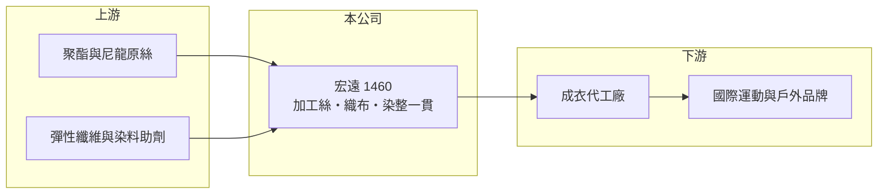

# 1460 宏遠

> 上市｜[[產業索引-紡織纖維|紡織纖維]]｜上市（櫃）日期 1995/04/28

# 第一章：企業模式與商業藍圖

> [!info] 撰寫說明
> 精簡版，由 Claude 依公開資料整理，架構比照 [[2330台積電]]，資料截至 2026-10-08。來源：Goodinfo 基本資料（主要業務、重要子公司）與經營績效年表（2020 至 2025 年）；證交所開放資料快照（基本資料、2026 年第二季資產負債與上半年損益、2025 年度股利）。營收比重與客戶名單未查得，品牌客戶為整理性描述。#待校對

宏遠興業（以下簡稱宏遠）成立於 1988 年 2 月、1995 年 4 月上市，總部與主要廠區位於台南市山上區，董事長為席家宜。它是台灣少數從加工絲、織布到染整都在同一廠區完成的[[機能性布料]]廠，以年營收七、八十億元的規模，是台灣中型布廠中最具代表性的一家。

- **核心業務：** 宏遠的業務涵蓋[[加工絲]]、追撚絲、胚布、成品布與[[染整]]，也就是從紗線加工、織布到染色後整理全部自己做。這種[[垂直整合]]讓公司能替運動與戶外品牌開發吸濕排汗、彈性、防風等功能布料，並較快把樣品轉成量產。
- **營收結構：** 依 Goodinfo，2025 年合併營收約 74.9 億元，2021 年高峰時約 100 億元；2026 年上半年證交所資料為 30.3 億元。產品別比重這次未查得，客戶以國際運動品牌為主，市場常提及的客戶包括 Nike、Under Armour 等（待校對）。
- **營運據點：** 主要生產集中在台南山上的一貫廠區。重要子公司包括 2013 年登錄、設在百慕達的 Everest Investment (Holding) Ltd.（投資控股），以及 2020 年登錄的宏遠發展（上海）有限公司（紡織業務）。生產幾乎都在台灣，讓宏遠在品牌客戶要求分散中國產地時具備「非中國產能」的條件，但也承受台灣較高的電價與工資。
- **長期方向：** 宏遠的長期課題是在台灣成本偏高的環境下，靠功能性與環保布料維持溢價。品牌商愈來愈要求回收材料與低碳製程，一貫廠在追溯原料與控制排放上較有優勢，能否把這些能力轉成穩定的價格與訂單，決定它能否擺脫近年的虧損。

# 第二章：護城河深度與競爭優勢

宏遠的護城河來自一貫化生產與長期品牌認證，但近年虧損顯示這道護城河不足以抵擋景氣與成本壓力。

- **競爭優勢：** 運動品牌導入新布料前，要經過材質測試、環保與勞工稽核，認證週期長，供應商一旦進入名單就不容易被替換。宏遠從紗到布都在同一廠區完成，品質與交期較容易掌握，也較能配合品牌的開發節奏。
- **主要對手：** 台灣機能布同業包括 [[1434福懋]]、[[1474弘裕]]、[[1464得力]]、[[1467南緯]]，以及上游一貫大廠 [[1402遠東新]]；國外則有中國、越南的大型布廠，以及往上游整合布料的成衣大廠如 [[1476儒鴻]]。對手多半在越南或中國設廠，人力與能源成本較低。
- **觀察重點：** 2021 年毛利率 19.2% 時才能勉強獲利，2023 年毛利率掉到 3.9% 就大幅虧損，顯示獲利對產能利用率非常敏感。觀察重點是毛利率能否穩定在 18% 以上、營業利益轉正，以及品牌庫存回補時訂單能否回到 2021 年水準。

# 第三章：財務體質與盈利規模

資料日期：2026-10-08，表格是撰寫當時的快照；最新月營收、毛利率、累計 EPS 由自動排程寫在本筆記的屬性欄位（月營收、毛利率、累計EPS 等）。#待校對

宏遠近六年只有 2021、2022 年小幅獲利，其他年度都是虧損；作為固定成本高的一貫廠，營收與毛利率的小幅變化就會讓損益大幅擺盪。

| 年度 | 營收（億元） | [[毛利率]] | [[營業利益率]] | EPS（元） | [[ROE]] |
|---|---|---|---|---|---|
| 2020 | 73.4 | 7.79% | -11.6% | -1.94 | -21.7% |
| 2021 | 100 | 19.2% | 3.64% | 0.39 | 3.42% |
| 2022 | 98.1 | 17.3% | 0.99% | 0.03 | 0.31% |
| 2023 | 78.4 | 3.90% | -13.2% | -1.80 | -18.8% |
| 2024 | 82.6 | 11.5% | -2.43% | -0.41 | -4.75% |
| 2025 | 74.9 | 15.0% | -0.97% | -0.27 | -3.10% |
| 2026 上半年 | 30.3 | 16.11% | -2.47% | -0.11 | 未查得 |

註：2020 至 2025 年取自 Goodinfo，2026 年上半年取自證交所開放資料。

- **長期指標：** 2020 至 2025 年營收年複合成長率約 0.4%（推算），營收規模停滯；2021 至 2025 年平均 ROE 約 -4.6%（推算）。2025 年虧損 1.79 億元，未配發現金股利；每股淨值約 8.36 元，已低於面額 10 元，代表多年虧損已侵蝕原始股本。
- **[[ROIC]] 與 [[WACC]]：** 2025 年營業損失約 0.73 億元（營收 74.9 億 × -0.97%，虧損不計稅）；投入資本以權益總計 56.4 億元加上總負債 51.5 億元的一半（推估有息負債約 25.8 億元）計約 82.2 億元，ROIC 約 -0.9%（推算）。WACC 以無風險利率 1.75%、市場風險溢酬 6%、β 0.8（紡織同業常見值）、稅前負債成本 2.5%、稅率 20%、權益比重約 69% 計算約 5.1%（推算）。ROIC 長期為負且遠低於 WACC，代表一貫廠的龐大設備投資目前沒有賺回資金成本，持續侵蝕股東價值。
- **財務特色：** 2026 年第二季負債比率約 48%（負債 51.5 億 ÷ 資產 107.8 億），流動負債 38.9 億元占大部分。資產規模約百億元、以廠房設備為主，折舊與人事成本固定，是典型的高[[營運槓桿]]結構：景氣好時獲利放大，景氣差時虧損也放大。

# 第四章：總體風險與地緣政治

宏遠的主要風險是固定成本高、生產集中台灣，遇到品牌去庫存時虧損會迅速擴大。

- **產業週期：** 運動品牌的庫存週期大約二至三年一輪，2022 至 2023 年品牌大幅去化庫存時，宏遠營收從近 100 億元掉到 78 億元，毛利率跌到 3.9%。下一次去庫存週期仍可能造成類似衝擊。
- **營運風險：** 客戶集中在少數國際品牌，單一品牌訂單轉移就會明顯影響產能利用率。總經理職位在證交所資料中顯示為暫缺，經營團隊的穩定性也值得留意（待校對）。
- **其他風險：** 外銷以美元計價，新台幣升值會壓縮毛利；台灣電價、水資源與染整排放法規持續墊高成本；美國[[對等關稅]]與品牌的[[中國加一]]策略則同時帶來轉單機會與價格壓力。

# 專有名詞解析

## 金融

- **[[營運槓桿]]**：固定成本占比高的企業，營收小幅變動就會造成獲利大幅變動的特性。
- **[[ROIC]]**：投入資本報酬率，稅後營業利益除以股東權益加有息負債，衡量本業運用資本的效率。

## 產業

- **[[機能性布料]]**：具備吸濕排汗、防水透氣、抗紫外線等功能的布料，主要用於運動與戶外服飾。
- **[[加工絲]]**：把聚酯或尼龍長纖維經假撚等加工，使紗線變得蓬鬆、有彈性的半成品，是織布廠的主要原料。
- **[[染整]]**：對布料進行染色、印花與後整理（如防水、抗菌、定型）的工序，耗水耗能高，也是決定布料手感與功能的關鍵。
- **[[垂直整合]]**：同一家公司掌握上下游多個生產環節，例如從織布、染整到成衣縫製都自己做，可縮短交期並保留更多利潤。

# 核心供應鏈

- 上游：聚酯與尼龍原絲供應商未查得，化纖原料業者如 [[1402遠東新]]、[[1409新纖]]、[[1326台化]]（是否供貨給宏遠未查得）。
- 下游／客戶：品牌指定的成衣代工廠，例如 [[1476儒鴻]]、[[1477聚陽]]、[[1473台南]]（是否為宏遠客戶未查得），最終客戶為國際運動與戶外品牌。
- 同業：[[1434福懋]]、[[1474弘裕]]、[[1464得力]]、[[1467南緯]]。

## 最新新聞
<!-- news:start -->
<!-- news:end -->

## 相關連結
- [公開資訊觀測站](https://mopsov.twse.com.tw/mops/web/t05st03?step=1&firstin=1&co_id=1460)
- [Goodinfo](https://goodinfo.tw/tw/StockDetail.asp?STOCK_ID=1460)
- [Yahoo 股市](https://tw.stock.yahoo.com/quote/1460)
- [鉅亨網新聞](https://www.cnyes.com/twstock/1460/news)
