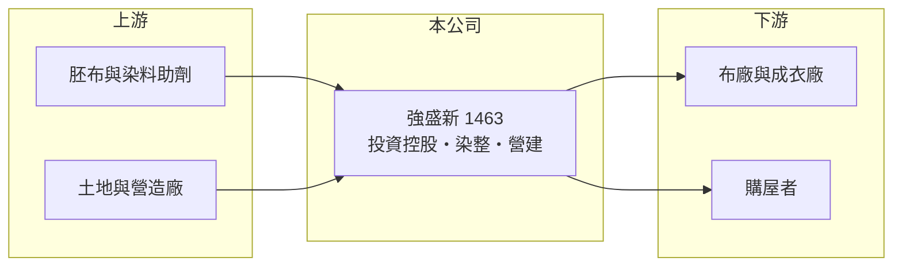

# 1463 強盛新

> 上市｜[[產業索引-紡織纖維|紡織纖維]]｜上市（櫃）日期 1996/12/05

# 第一章：企業模式與商業藍圖

> [!info] 撰寫說明
> 精簡版，由 Claude 依公開資料整理，架構比照 [[2330台積電]]，資料截至 2026-10-08。來源：證交所開放資料快照（基本資料、2026 年第二季資產負債與上半年損益、2025 年度股利、每月營收備註）；科技新報公司資料頁標題（公司全名）。多年度財務數據與營收比重未能取得，公開資料有限，紡織業務沿革為整理性描述。#待校對

強盛新投資控股（以下簡稱強盛新）成立於 1983 年 10 月、1996 年 12 月上市，總公司位於桃園市大園區，董事長為成漢傑。公司前身為強盛染整（待校對），目前以[[控股公司]]型態運作，旗下同時有紡織與營建事業，營收規模很小、各年度損益受建案入帳時點影響很大。

- **核心業務：** 從前身名稱來看，強盛新的紡織根基在[[染整]]，也就是替布料染色與後整理的加工服務（待校對）。改制為投資控股後，母公司主要持有子公司股權，子公司保強建設經營住宅開發，讓公司跨足營建業。
- **營收結構：** 2026 年上半年合併營收只有 1.15 億元；證交所每月營收備註說明，前一年第一季有子公司保強建設的房屋售出入帳，因此 2026 年 1 至 9 月累計營收年減約 78%。這說明營建收入占比在交屋年度會遠高於紡織，產品別比重這次未查得。
- **營運據點：** 總公司與廠區登記在桃園市大園區大工路（大園工業區內）。其他廠區與海外據點未查得；合併報表中有約 1.1 億元的[[非控制權益]]，代表部分子公司有外部股東。
- **長期方向：** 強盛新的長期方向看起來是以控股架構管理紡織與營建兩種事業，並運用自有土地與資金參與住宅開發。這種模式讓公司不必完全依賴競爭激烈的染整本業，但營建收入集中在交屋年度，每年的獲利會呈現「有建案大賺、沒建案虧損」的跳動。

# 第二章：護城河深度與競爭優勢

強盛新規模小，目前看不出明確的護城河；它的主要保障是低負債與可運用的資產，而非產業地位。

- **競爭優勢：** 公司負債比率只有約 16%，資產以流動資產為主，財務體質穩健，可以在不大量舉債的情況下推動建案或等待景氣。染整本業若仍持續，與下游布廠的長期合作關係是主要資產，但難以轉成較高的毛利。
- **主要對手：** 染整同業如 [[1464得力]]、[[1470大統新創]]、[[1410南染]]；營建方面則與桃園地區眾多中小型建商競爭，規模與品牌知名度都有限。
- **觀察重點：** 觀察重點是下一個建案的推案與交屋時程、紡織本業是否持續縮減，以及控股架構下的資金是否被有效運用。2026 年上半年營業損失約 0.26 億元，若沒有新建案入帳，本業很難轉盈。

# 第三章：財務體質與盈利規模

資料日期：2026-10-08，表格是撰寫當時的快照；最新月營收、毛利率、累計 EPS 由自動排程寫在本筆記的屬性欄位（月營收、毛利率、累計EPS 等）。#待校對

強盛新的財報受建案交屋影響很大，單一年度的營收與 EPS 不能代表長期水準；多年度資料這次未能取得。

| 年度 | 營收（億元） | [[毛利率]] | [[營業利益率]] | EPS（元） | [[ROE]] |
|---|---|---|---|---|---|
| 2021 | 未查得 | 未查得 | 未查得 | 未查得 | 未查得 |
| 2022 | 未查得 | 未查得 | 未查得 | 未查得 | 未查得 |
| 2023 | 未查得 | 未查得 | 未查得 | 未查得 | 未查得 |
| 2024 | 未查得 | 未查得 | 未查得 | 未查得 | 未查得 |
| 2025 | 未查得 | 未查得 | 未查得 | 約 0.13（推算） | 約 0.9%（推算） |
| 2026 上半年 | 1.15 | 8.55% | -22.39% | -0.13 | 未查得 |

註：2025 年 EPS 以股利公告的本期淨利 0.23 億元除以約 1.73 億股推算；ROE 以本期淨利除以 2026 年第二季母公司權益 25.7 億元推算。

- **長期指標：** 2025 年度配發現金股利約 0.127 元，與推算 EPS 0.13 元相當，配息率接近 100%（推算），代表公司把當年獲利幾乎全部發放。長期的營收成長率、平均 ROE 與自由現金流這次未查得。
- **[[ROIC]] 與 [[WACC]]：** 以 2026 年上半年營業損失 0.26 億元年化約 -0.52 億元（虧損不計稅）；投入資本以權益總計 26.8 億元加上總負債 4.9 億元的一半（推估有息負債約 2.5 億元）計約 29.2 億元，ROIC 約 -1.8%（推算）。WACC 以無風險利率 1.75%、市場風險溢酬 6%、β 0.8（紡織同業常見值）、稅前負債成本 2.5%、稅率 20%、權益比重約 92% 計算約 6.2%（推算）。沒有建案入帳的年度 ROIC 為負，遠低於 WACC；公司能否創造價值，取決於建案的利潤能否彌補其他年度的本業虧損。
- **財務特色：** 2026 年第二季負債比率約 16%（負債 4.9 億 ÷ 資產 31.7 億），流動資產 20.0 億元占總資產六成以上，推估包含建案存貨與現金（待校對）。每股淨值約 14.96 元，資產負債表相當保守。

# 第四章：總體風險與地緣政治

強盛新的風險在於收入來源少而集中，營建與紡織兩邊都缺乏規模。

- **產業週期：** 染整業務跟著下游品牌與布廠的庫存週期波動；營建業務則受房市景氣、利率與信用管制影響，兩者同時走弱時公司幾乎沒有穩定收入。
- **營運風險：** 營收與獲利高度依賴少數建案的交屋時點，年度之間落差極大，例如 2026 年前 9 個月營收年減約 78%。控股架構下子公司的經營資訊揭露有限，投資人較難評估各事業的實際獲利。
- **其他風險：** 台灣央行的不動產信用管制與房貸利率會影響建案銷售；染整業面臨嚴格的廢水排放法規與能源成本上升，規模小的業者負擔相對較重。

# 專有名詞解析

## 金融

- **[[非控制權益]]**：合併報表中子公司不屬於母公司股東的那部分權益，比重高代表子公司有大量外部股東。
- **[[ROIC]]**：投入資本報酬率，稅後營業利益除以股東權益加有息負債，衡量本業運用資本的效率。
- **[[WACC]]**：加權平均資金成本，股東與債權人要求報酬率的加權平均，是 ROIC 要超越的門檻。

## 產業

- **[[控股公司]]**：本身不直接經營，而是持有子公司股權並收取其獲利的公司型態。
- **[[染整]]**：對布料進行染色、印花與後整理（如防水、抗菌、定型）的工序，耗水耗能高，也是決定布料手感與功能的關鍵。

# 核心供應鏈

- 上游：染整所需的胚布、染料與助劑供應商未查得；營建所需土地與營造廠未查得。
- 下游／客戶：委託染整的布廠與成衣廠，以及保強建設建案的購屋者，名單未查得。
- 同業：[[1464得力]]、[[1470大統新創]]、[[1410南染]]。

## 最新新聞
<!-- news:start -->
<!-- news:end -->

## 相關連結
- [公開資訊觀測站](https://mopsov.twse.com.tw/mops/web/t05st03?step=1&firstin=1&co_id=1463)
- [Goodinfo](https://goodinfo.tw/tw/StockDetail.asp?STOCK_ID=1463)
- [Yahoo 股市](https://tw.stock.yahoo.com/quote/1463)
- [鉅亨網新聞](https://www.cnyes.com/twstock/1463/news)
