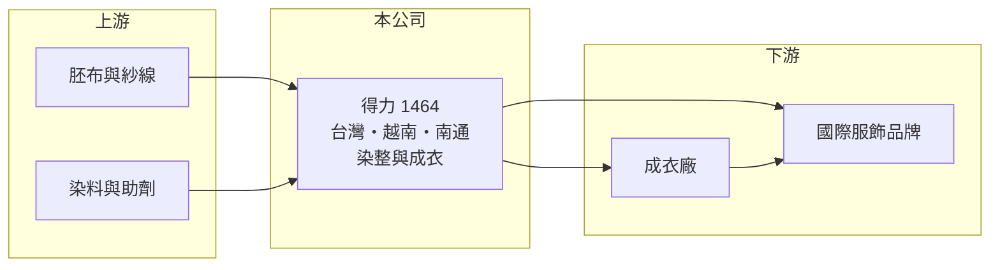

# 1464 得力

> 上市｜[[產業索引-紡織纖維|紡織纖維]]｜上市（櫃）日期 1997/01/18

# 第一章：企業模式與商業藍圖

> [!info] 撰寫說明
> 精簡版，由 Claude 依公開資料整理，架構比照 [[2330台積電]]，資料截至 2026-10-08。來源：Goodinfo 基本資料（主要業務、重要子公司）與經營績效年表（2020 至 2025 年）；證交所開放資料快照（基本資料、2026 年第二季資產負債與上半年損益、2025 年度股利）。營收比重與客戶名單未查得。#待校對

得力實業（以下簡稱得力）成立於 1982 年 7 月、1997 年 1 月上市，總部位於台南市新市區，董事長為葉家銘。它以[[染整]]起家，近年透過越南子公司延伸到成衣製作，營收從 2020 年約 86 億元成長到 2025 年約 126 億元，是這一群中型紡織股裡少數規模持續擴大的公司。

- **核心業務：** 得力的主要業務是各種紡織品的印花、染色與整理加工，並買賣與加工紗類原料。染整決定布料的顏色、手感與防水、抗菌等功能，是品牌布料開發中技術門檻較高的一段；得力再往下延伸到成衣，讓它能提供從布料到成品的服務。
- **營收結構：** 依 Goodinfo，2025 年合併營收約 126 億元，2026 年上半年證交所資料為 59.5 億元。產品與地區別比重這次未查得；以營收規模遠大於一般染整代工來看，推估布料與成衣銷售占了相當比重（推估）。
- **營運據點：** 台灣廠區在台南新市。重要子公司包括 2019 年登錄的越南得力實業責任有限公司（印染整理、成衣製作及買賣），以及開曼、英屬維京群島的投資控股公司；2026 年 3 月新登錄的南通得力紡織科技有限公司，在中國從事長短纖維布料加工整理。台灣、越南、中國三地布局，符合品牌客戶分散產地的需求。
- **長期方向：** 得力的長期方向是把台灣的染整技術複製到越南，並以「布料加成衣」的[[垂直整合]]服務綁住品牌客戶。越南廠能享有較低的人力成本與品牌的[[中國加一]]訂單，2026 年再增加南通據點，顯示公司仍在擴充產能版圖。

# 第二章：護城河深度與競爭優勢

得力的護城河來自染整技術與台越兩地的一條龍服務，但成衣業務的利潤率低，讓整體獲利仍偏薄。

- **競爭優勢：** 染整需要長期累積的配方、色差控制與環保處理能力，加上品牌對供應商的稽核與認證，新進者不容易短期取代。得力能在越南同時做布料染整與成衣縫製，品牌下單時可以減少跨廠協調，交期也較短。
- **主要對手：** 台灣布料與染整同業包括 [[1460宏遠]]、[[1434福懋]]、[[1474弘裕]]、[[1470大統新創]]，成衣端則與 [[1476儒鴻]]、[[1477聚陽]]、[[1473台南]] 等在越南設廠的業者重疊；另外還有中國與越南當地的大型染整廠。
- **觀察重點：** 2024 年毛利率 18.9%、營業利益率 4.94% 是近年最好的一年，2025 年毛利率維持 19.3% 但營業利益率降到 2.88%，代表費用或新產能的成本上升。觀察重點是越南與南通產能開出後，營業利益率能否回到 5% 左右。

# 第三章：財務體質與盈利規模

資料日期：2026-10-08，表格是撰寫當時的快照；最新月營收、毛利率、累計 EPS 由自動排程寫在本筆記的屬性欄位（月營收、毛利率、累計EPS 等）。#待校對

得力的營收成長明顯，但毛利率長期在一成五至兩成、營業利益率在 5% 以下，屬於規模擴張型、薄利的紡織公司。

| 年度 | 營收（億元） | [[毛利率]] | [[營業利益率]] | EPS（元） | [[ROE]] |
|---|---|---|---|---|---|
| 2020 | 85.9 | 14.5% | 0.04% | -0.54 | -3.53% |
| 2021 | 105 | 15.3% | 3.54% | 0.48 | 3.61% |
| 2022 | 123 | 14.5% | 1.07% | 0.95 | 7.31% |
| 2023 | 98.3 | 15.8% | -1.16% | 0.13 | 2.06% |
| 2024 | 120 | 18.9% | 4.94% | 1.04 | 8.95% |
| 2025 | 126 | 19.3% | 2.88% | 0.35 | 約 2.8%（推算） |
| 2026 上半年 | 59.5 | 19.57% | 2.99% | 0.36 | 未查得 |

註：2020 至 2025 年取自 Goodinfo，2026 年上半年取自證交所開放資料。Goodinfo 列 2025 年 ROE 為 0.95%，與 EPS 0.35 元、母公司權益約 54 億元推算的約 2.8% 不一致，表中採推算值。

- **長期指標：** 2020 至 2025 年營收年複合成長率約 8.0%（推算），在紡織股中相對突出；2021 至 2025 年平均 ROE 約 4.9%（推算），代表成長沒有同步轉成高報酬。2025 年度配發現金 0.25 元（盈餘 0.2 元加資本公積 0.05 元），以 EPS 0.35 元計算配發率約 71%（推算）。
- **[[ROIC]] 與 [[WACC]]：** 2025 年營業利益約 3.63 億元（營收 126 億 × 2.88%），稅後約 2.90 億元；投入資本以權益總計 60.9 億元加上總負債 113.4 億元的一半（推估有息負債約 56.7 億元）計約 117.6 億元，ROIC 約 2.5%（推算）。WACC 以無風險利率 1.75%、市場風險溢酬 6%、β 0.8（紡織同業常見值）、稅前負債成本 2.5%、稅率 20%、權益比重約 52% 計算約 4.4%（推算）。ROIC 低於 WACC，表示擴張帶來的營收尚未轉成足以覆蓋資金成本的報酬。
- **財務特色：** 2026 年第二季負債比率約 65%（負債 113.4 億 ÷ 資產 174.2 億），流動負債 83.6 億元，財務槓桿在紡織股中偏高，推估與海外擴廠及營運資金需求有關。合併報表中[[非控制權益]]約 7.0 億元，代表部分海外子公司有其他股東。

# 第四章：總體風險與地緣政治

得力的風險集中在高槓桿下的擴張與薄利結構，任何一個環節失手都會明顯影響獲利。

- **產業週期：** 品牌去化庫存時，染整與成衣訂單會同步下滑，2023 年營收從 123 億元降到 98 億元、營業利益轉為虧損，就是一次完整的下行。成衣業務占比愈高，受品牌庫存週期的影響愈直接。
- **營運風險：** 負債比率約六成五，利率上升或景氣轉差時財務壓力較大；越南與南通新據點的產能爬坡、良率與管理若不順，會拖累利潤。客戶集中度未查得，若過度依賴少數品牌，訂單轉移風險較高。
- **其他風險：** 美國[[對等關稅]]對越南與中國產品的稅率變動，會直接影響品牌下單地點；染整屬高耗水、高排放產業，各國環保法規趨嚴會提高成本；外銷以美元計價，匯率也會影響毛利。

# 專有名詞解析

## 金融

- **[[非控制權益]]**：合併報表中子公司不屬於母公司股東的那部分權益，比重高代表子公司有大量外部股東。
- **[[ROIC]]**：投入資本報酬率，稅後營業利益除以股東權益加有息負債，衡量本業運用資本的效率。

## 產業

- **[[染整]]**：對布料進行染色、印花與後整理（如防水、抗菌、定型）的工序，耗水耗能高，也是決定布料手感與功能的關鍵。
- **[[垂直整合]]**：同一家公司掌握上下游多個生產環節，例如從織布、染整到成衣縫製都自己做，可縮短交期並保留更多利潤。
- **[[中國加一]]**：品牌商為分散風險，在中國以外再增加至少一個生產基地的供應鏈策略。
- **[[對等關稅]]**：美國自 2025 年起依各國貿易條件訂定的進口關稅，稅率依國家而異，影響企業的生產地選擇。

# 核心供應鏈

- 上游：胚布、紗線與染料助劑供應商未查得，化纖原料業者如 [[1402遠東新]]、[[1409新纖]]（是否供貨給得力未查得）。
- 下游／客戶：成衣代工廠與國際服飾品牌，名單未查得。
- 同業：[[1460宏遠]]、[[1434福懋]]、[[1474弘裕]]、[[1470大統新創]]。

## 最新新聞
<!-- news:start -->
<!-- news:end -->

## 相關連結
- [公開資訊觀測站](https://mopsov.twse.com.tw/mops/web/t05st03?step=1&firstin=1&co_id=1464)
- [Goodinfo](https://goodinfo.tw/tw/StockDetail.asp?STOCK_ID=1464)
- [Yahoo 股市](https://tw.stock.yahoo.com/quote/1464)
- [鉅亨網新聞](https://www.cnyes.com/twstock/1464/news)
