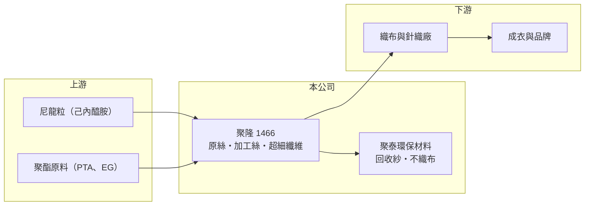

# 1466 聚隆

> 上市｜[[產業索引-紡織纖維|紡織纖維]]｜上市（櫃）日期 1998/04/04

# 第一章：企業模式與商業藍圖

> [!info] 撰寫說明
> 精簡版，由 Claude 依公開資料整理，架構比照 [[2330台積電]]，資料截至 2026-10-08。來源：Goodinfo 基本資料（主要業務、重要子公司）與經營績效年表（2020 至 2025 年）；證交所開放資料快照（基本資料、2026 年第二季資產負債與上半年損益、2025 年度股利）。營收比重與客戶名單未查得。#待校對

聚隆纖維（以下簡稱聚隆）成立於 1988 年 7 月、1998 年 4 月上市，總部與廠區位於彰化縣埔鹽鄉，董事長兼總經理為周文東。它是一家從抽絲做起的化纖廠，產品涵蓋尼龍與聚酯原絲、[[加工絲]]、[[超細纖維]]與彈性纖維，並透過子公司發展回收與不織布材料。

- **核心業務：** 聚隆的營業項目包括尼龍原絲、假撚絲與仿棉絲，聚酯原絲與空氣加工絲，超細纖維與超細纖維布，以及彈性纖維與彈性布的製造買賣。和只做加工的同業相比，聚隆從聚合後的抽絲階段就開始做，能自行調整纖維粗細與截面，開發仿棉、超細等差異化紗線。
- **營收結構：** 依 Goodinfo，2025 年合併營收約 26.0 億元，2021 年高峰時約 35.7 億元；2026 年上半年證交所資料為 11.1 億元。各產品的營收比重這次未查得，從營業項目推估以尼龍與聚酯紗線為主、布料為輔（推估）。
- **營運據點：** 主要廠區在彰化埔鹽，海外據點這次未查得。重要子公司聚泰環保材料科技股份有限公司於 2018 年登錄，在台灣從事紗線與不織布業務，是聚隆往環保材料延伸的主要載體。
- **長期方向：** 聚隆的長期方向是從一般化纖紗線轉向差異化與環保材料，例如超細纖維、仿棉尼龍與回收紗。品牌商對回收材料比例的要求逐年提高，具備抽絲能力的廠商較能把回收原料做成穩定的紗線，這是聚隆相對於純加工廠的潛在優勢。

# 第二章：護城河深度與競爭優勢

聚隆的護城河在於抽絲到加工的一貫能力與差異化紗線開發，但近年毛利率偏低，顯示這項能力還沒有轉成穩定的定價力。

- **競爭優勢：** 尼龍仿棉絲與超細纖維需要控制纖維的細度、截面與染色均勻性，技術門檻高於一般加工絲。聚隆自己抽絲，可以小量多樣地替布廠開發特殊紗線，交期也較依賴外購原絲的同業靈活。
- **主要對手：** 尼龍紗線同業如 [[1434福懋]]、[[1447力鵬]]、[[1455集盛]]，聚酯與加工絲同業如 [[1457宜進]]、[[1459聯發]]，以及中國的大型尼龍與聚酯廠。中國同業產能大、價格低，是壓縮聚隆毛利的主要來源。
- **觀察重點：** 2021 年毛利率 17.4% 時 EPS 可達 1.60 元，2022 至 2023 年毛利率掉到 3% 至 6% 就轉為虧損。觀察重點是 2026 年上半年回到 13.42% 的毛利率能否維持，以及聚泰環保材料的回收紗與不織布能否成為穩定的獲利來源。

# 第三章：財務體質與盈利規模

資料日期：2026-10-08，表格是撰寫當時的快照；最新月營收、毛利率、累計 EPS 由自動排程寫在本筆記的屬性欄位（月營收、毛利率、累計EPS 等）。#待校對

聚隆的獲利隨化纖景氣大幅擺盪，近六年有三年虧損；化纖廠的固定成本高，毛利率是判斷它處於景氣哪個位置的最好指標。

| 年度 | 營收（億元） | [[毛利率]] | [[營業利益率]] | EPS（元） | [[ROE]] |
|---|---|---|---|---|---|
| 2020 | 26.4 | 10.7% | 0.56% | 0.38 | 2.59% |
| 2021 | 35.7 | 17.4% | 6.66% | 1.60 | 10.7% |
| 2022 | 27.9 | 6.13% | -4.28% | -0.60 | -3.98% |
| 2023 | 24.5 | 3.29% | -6.30% | -1.36 | -9.96% |
| 2024 | 29.4 | 10.1% | 0.07% | 0.14 | 1.18% |
| 2025 | 26.0 | 6.74% | -3.43% | -1.07 | -7.46% |
| 2026 上半年 | 11.1 | 13.42% | 2.51% | 0.37 | 未查得 |

註：2020 至 2025 年取自 Goodinfo，2026 年上半年取自證交所開放資料。

- **長期指標：** 2020 至 2025 年營收年複合成長率約 -0.3%（推算），規模停滯；2021 至 2025 年平均 ROE 約 -1.9%（推算）。2025 年虧損 1.19 億元，仍以資本公積發放每股 0.2 元現金，股利來源是資本而非當年獲利。
- **[[ROIC]] 與 [[WACC]]：** 2025 年營業損失約 0.89 億元（營收 26.0 億 × -3.43%，虧損不計稅）；投入資本以權益總計 16.6 億元加上總負債 19.8 億元的一半（推估有息負債約 9.9 億元）計約 26.5 億元，ROIC 約 -3.4%（推算）。WACC 以無風險利率 1.75%、市場風險溢酬 6%、β 0.8（紡織同業常見值）、稅前負債成本 2.5%、稅率 20%、權益比重約 63% 計算約 4.9%（推算）。2026 年上半年營業利益轉正，年化 ROIC 約 1.7%（推算），仍低於 WACC；只有在 2021 年那樣的景氣高點，聚隆的資本報酬才可能超過資金成本。
- **財務特色：** 2026 年第二季負債比率約 54%（負債 19.8 億 ÷ 資產 36.4 億），其中非流動負債 14.9 億元，推估為長期借款，可能與子公司或設備投資有關（待校對）。每股淨值約 14.10 元，合併報表中[[非控制權益]]約 0.9 億元。

# 第四章：總體風險與地緣政治

聚隆的主要風險是化纖景氣循環與中國產能競爭，加上借款不低，虧損年度的財務壓力會放大。

- **產業週期：** 尼龍與聚酯紗線的價格跟著原油、己內醯胺與 PTA 等原料，以及下游品牌庫存週期波動。原料下跌時庫存跌價、需求下滑時產能閒置，兩者常同時發生，造成 2022、2023 年的連續虧損。
- **營運風險：** 長期借款約 15 億元，景氣差時利息負擔會侵蝕本已偏薄的獲利；以資本公積配息會逐步降低資本緩衝。轉型環保材料需要持續投資，若市場接受度不如預期，投資回收期會拉長。
- **其他風險：** 中國尼龍與聚酯產能持續擴張，低價紗線出口壓縮全球價格；台灣電價上升直接推高抽絲成本；美國[[對等關稅]]與品牌供應鏈調整也會影響下游布廠的接單地點。

# 專有名詞解析

## 金融

- **[[非控制權益]]**：合併報表中子公司不屬於母公司股東的那部分權益，比重高代表子公司有大量外部股東。
- **[[ROIC]]**：投入資本報酬率，稅後營業利益除以股東權益加有息負債，衡量本業運用資本的效率。
- **[[WACC]]**：加權平均資金成本，股東與債權人要求報酬率的加權平均，是 ROIC 要超越的門檻。

## 產業

- **[[加工絲]]**：把聚酯或尼龍長纖維經假撚等加工，使紗線變得蓬鬆、有彈性的半成品，是織布廠的主要原料。
- **[[超細纖維]]**：單絲細度遠小於一般纖維的化學纖維，觸感柔軟、吸附力強，用於高級布料、拭布與人工皮革。

# 核心供應鏈

- 上游：尼龍粒與聚酯原料，供應商未查得；相關原料業者如 [[4440宜新實業]]、[[1326台化]]、[[1303南亞]]（是否供貨給聚隆未查得）。
- 下游／客戶：織布、針織廠與成衣品牌，名單未查得。
- 同業：[[1434福懋]]、[[1447力鵬]]、[[1455集盛]]、[[1457宜進]]。

## 最新新聞
<!-- news:start -->
<!-- news:end -->

## 相關連結
- [公開資訊觀測站](https://mopsov.twse.com.tw/mops/web/t05st03?step=1&firstin=1&co_id=1466)
- [Goodinfo](https://goodinfo.tw/tw/StockDetail.asp?STOCK_ID=1466)
- [Yahoo 股市](https://tw.stock.yahoo.com/quote/1466)
- [鉅亨網新聞](https://www.cnyes.com/twstock/1466/news)
