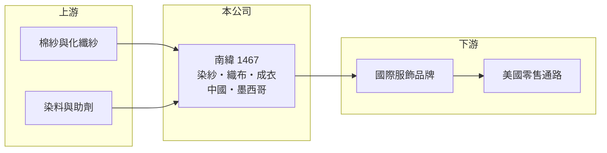

# 1467 南緯

> 上市｜[[產業索引-紡織纖維|紡織纖維]]｜上市（櫃）日期 1998/12/21

# 第一章：企業模式與商業藍圖

> [!info] 撰寫說明
> 精簡版，由 Claude 依公開資料整理，架構比照 [[2330台積電]]，資料截至 2026-10-08。來源：Goodinfo 基本資料（主要業務、重要子公司）與經營績效年表（2020 至 2025 年）；證交所開放資料快照（基本資料、2026 年第二季資產負債與上半年損益、2025 年度股利）。營收比重與品牌客戶未查得。#待校對

南緯實業（以下簡稱南緯，英文 Tex-Ray）成立於 1978 年 8 月、1998 年 12 月上市，總公司在台北市中山區，董事長為林瑞岳、總經理為林宗頤。它是從染紗、織布一路做到成衣的[[垂直整合]]廠，生產據點橫跨中國與墨西哥，但近年營收從 2020 年約 86 億元萎縮到約 50 億元，處於調整期。

- **核心業務：** 南緯的主要業務是「染紗、織布、成衣」，也就是先把紗線染色，再織成布料，最後縫製成衣服交給品牌。一條龍的好處是品牌可以把布料開發與成衣生產一次交給同一家，南緯也能保留布料與成衣兩段利潤。
- **營收結構：** 依 Goodinfo，2025 年合併營收約 51.5 億元，2026 年上半年證交所資料為 24.6 億元。布料與成衣的營收比重、品牌客戶名單這次未查得；以業務型態推估，成衣占營收的大部分（推估）。
- **營運據點：** 重要子公司包括墨西哥的 TEXRAY MEXICO（染整廠），以及中國的江蘇南緯纖維科技有限公司（成衣加工、紡紗、紡織、高檔面料、漂染、印花），另有設在汶萊、模里西斯、美國、貝里斯、開曼群島的投資控股公司。墨西哥廠鄰近美國市場，可服務要求[[近岸外包]]與快速補貨的美國品牌。
- **長期方向：** 南緯的長期方向是利用墨西哥與中國兩地產能，分別服務美國與亞洲市場，並靠染紗到成衣的一貫能力爭取高附加價值訂單。美國品牌在關稅壓力下增加北美採購，若南緯能擴大墨西哥產能的利用率，有機會扭轉營收下滑趨勢。

# 第二章：護城河深度與競爭優勢

南緯的護城河在於跨國一貫產能與墨西哥據點，但營收連年下滑，顯示這些優勢目前沒有轉成足夠的訂單。

- **競爭優勢：** 同時具備色紗、布料與成衣能力的廠商不多，品牌在開發機能服與色織服飾時，可以減少多家供應商之間的協調。墨西哥染整廠是台灣紡織業較少見的北美布局，在美國對亞洲產品課徵關稅時具有地理優勢。
- **主要對手：** 成衣同業包括 [[1476儒鴻]]、[[1477聚陽]]、[[1473台南]]、[[4438廣越]]，布料同業如 [[1460宏遠]]、[[1464得力]]；國外則有中美洲與越南的大型成衣廠。儒鴻、聚陽規模與客戶組合都明顯優於南緯，是品牌分配訂單時的主要比較對象。
- **觀察重點：** 南緯毛利率長期維持在 17% 至 26%，不算低，但營業利益率多在 0% 上下，代表費用占比過高、規模不足以攤提。觀察重點是營收能否止跌回升到 60 億元以上，讓營業利益率穩定轉正。

# 第三章：財務體質與盈利規模

資料日期：2026-10-08，表格是撰寫當時的快照；最新月營收、毛利率、累計 EPS 由自動排程寫在本筆記的屬性欄位（月營收、毛利率、累計EPS 等）。#待校對

南緯毛利率不低，但營收萎縮使費用無法攤提，近五年多數年度虧損；它的問題在規模，而不在單位利潤。

| 年度 | 營收（億元） | [[毛利率]] | [[營業利益率]] | EPS（元） | [[ROE]] |
|---|---|---|---|---|---|
| 2020 | 86.0 | 25.8% | 5.03% | 0.72 | 5.58% |
| 2021 | 66.4 | 20.0% | 1.42% | -0.13 | -1.33% |
| 2022 | 61.3 | 21.2% | 0.50% | -0.16 | -1.32% |
| 2023 | 45.6 | 16.9% | -3.99% | -0.71 | -5.40% |
| 2024 | 50.4 | 21.1% | 1.31% | 0.46 | 2.68% |
| 2025 | 51.5 | 19.2% | -0.04% | -0.45 | -4.01% |
| 2026 上半年 | 24.6 | 18.83% | -0.27% | -0.09 | 未查得 |

註：2020 至 2025 年取自 Goodinfo，2026 年上半年取自證交所開放資料。

- **長期指標：** 2020 至 2025 年營收年複合成長率約 -9.7%（推算），是這群紡織股中衰退最明顯的之一；2021 至 2025 年平均 ROE 約 -1.9%（推算）。2025 年虧損 1.05 億元，未配發股利，配息的穩定度不佳。
- **[[ROIC]] 與 [[WACC]]：** 2025 年營業損失約 0.02 億元（營收 51.5 億 × -0.04%），接近損益兩平；投入資本以權益總計 30.1 億元加上總負債 61.3 億元的一半（推估有息負債約 30.6 億元）計約 60.8 億元，ROIC 約 0%（推算）。WACC 以無風險利率 1.75%、市場風險溢酬 6%、β 0.8（紡織同業常見值）、稅前負債成本 2.5%、稅率 20%、權益比重約 50% 計算約 4.3%（推算）；考量負債比率高，實際資金成本可能更高。ROIC 長期低於 WACC，代表跨國產能目前沒有創造價值。
- **財務特色：** 2026 年第二季負債比率約 67%（負債 61.3 億 ÷ 資產 91.4 億），流動負債 39.0 億元，財務槓桿偏高。每股淨值約 12.30 元，合併報表中[[非控制權益]]約 1.7 億元。高負債加上本業微利，是南緯最需要留意的財務結構。

# 第四章：總體風險與地緣政治

南緯的風險來自營收萎縮下的高槓桿，以及跨國據點的管理成本。

- **產業週期：** 成衣訂單直接跟著品牌庫存週期波動，2022 至 2023 年品牌去庫存時，南緯營收從 61 億元降到 46 億元，營業利益轉為虧損。成衣占比高，使它比布料廠更早、更直接感受到需求變化。
- **營運風險：** 負債比率接近七成，景氣再度下滑時可能需要處分資產或增資；據點分散在中國、墨西哥與多個控股地，管理與匯兌成本高。品牌客戶集中度未查得，若主要客戶轉單，營收會明顯縮減。
- **其他風險：** 美國[[對等關稅]]與美墨加協定的原產地規則，會決定墨西哥廠的實際優勢；中國廠面臨美國對中國產品的關稅與強迫勞動相關進口限制；匯率波動影響多幣別營運的獲利。

# 專有名詞解析

## 金融

- **[[非控制權益]]**：合併報表中子公司不屬於母公司股東的那部分權益，比重高代表子公司有大量外部股東。
- **[[ROIC]]**：投入資本報酬率，稅後營業利益除以股東權益加有息負債，衡量本業運用資本的效率。
- **[[WACC]]**：加權平均資金成本，股東與債權人要求報酬率的加權平均，是 ROIC 要超越的門檻。

## 產業

- **[[垂直整合]]**：同一家公司掌握上下游多個生產環節，例如從織布、染整到成衣縫製都自己做，可縮短交期並保留更多利潤。
- **[[近岸外包]]**：把生產基地移到鄰近消費市場的國家，例如美國品牌在墨西哥、中美洲採購，以縮短運輸時間並降低關稅風險。
- **[[對等關稅]]**：美國自 2025 年起依各國貿易條件訂定的進口關稅，稅率依國家而異，影響企業的生產地選擇。

# 核心供應鏈

- 上游：棉紗、化纖紗與染料供應商未查得，紗線業者如 [[1402遠東新]]、[[1419新紡]]（是否供貨給南緯未查得）。
- 下游／客戶：國際服飾品牌與美國零售通路，名單未查得。
- 同業：[[1476儒鴻]]、[[1477聚陽]]、[[1473台南]]、[[4438廣越]]。

## 最新新聞
<!-- news:start -->
<!-- news:end -->

## 相關連結
- [公開資訊觀測站](https://mopsov.twse.com.tw/mops/web/t05st03?step=1&firstin=1&co_id=1467)
- [Goodinfo](https://goodinfo.tw/tw/StockDetail.asp?STOCK_ID=1467)
- [Yahoo 股市](https://tw.stock.yahoo.com/quote/1467)
- [鉅亨網新聞](https://www.cnyes.com/twstock/1467/news)
