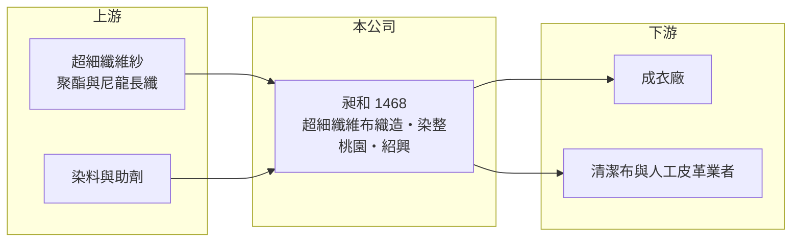

# 1468 昶和

> 上市｜[[產業索引-紡織纖維|紡織纖維]]｜上市（櫃）日期 1999/01/21

# 第一章：企業模式與商業藍圖

> [!info] 撰寫說明
> 精簡版，由 Claude 依公開資料整理，架構比照 [[2330台積電]]，資料截至 2026-10-08。來源：Goodinfo 基本資料（主要業務、重要子公司）與經營績效年表（2020 至 2025 年）；證交所開放資料快照（基本資料、2026 年第二季資產負債與上半年損益、2025 年度股利、每月營收備註）。營收比重與客戶名單未查得，公開資料有限。#待校對

昶和纖維（以下簡稱昶和）成立於 1982 年 4 月、1999 年 1 月上市，總公司位於桃園市蘆竹區，董事長兼總經理為陳明澤。它是以[[超細纖維]]布料為主的小型織布與[[染整]]廠，生產重心在中國紹興，年營收約 8 至 14 億元，本業多數年度在損益兩平附近，獲利常需要業外收入支撐。

- **核心業務：** 昶和的業務涵蓋纖維、超細纖維紗與布料的織造、染色、整理加工，以及紡織品的製造買賣。超細纖維布手感細緻、吸附力強，常用於高級服裝布、拭鏡布與清潔布、人工皮革基布等用途，產品可依客戶需求做差異化。
- **營收結構：** 依 Goodinfo，2025 年合併營收約 8.27 億元，2022 年高峰時約 14.1 億元；2026 年上半年證交所資料為 2.64 億元，1 至 9 月累計營收年減約 45%，公司在月營收備註中說明原因是終端市場需求下降、客戶下單保守。產品與地區比重這次未查得。
- **營運據點：** 重要子公司為 2008 年登錄的昶和纖維（紹興）有限公司，在中國從事布料製造與銷售，另有英屬維京群島的 Holy Finance Group Limited 負責國際貿易與投資。紹興是中國最大的化纖織造與染整聚落，昶和在當地設廠可以就近取得原料與配套加工。
- **長期方向：** 昶和的長期課題是在中國同業大量擴產的環境下，靠超細纖維的專業化維持利潤。2024 年毛利率一度達到 16.3%、EPS 0.94 元，顯示產品組合調整得當時仍有獲利空間；但 2025 年後需求轉弱，營收快速縮減。

# 第二章：護城河深度與競爭優勢

昶和的護城河很窄，主要是超細纖維布的專業經驗與紹興聚落的就近生產，規模與議價能力都有限。

- **競爭優勢：** 超細纖維在織造與染色時容易出現色差、起毛等問題，需要長期累積的製程經驗，昶和專注這類布料四十多年，能做小量、多樣的訂單。紹興據點靠近原料與加工配套，交期與成本相較台灣生產有優勢。
- **主要對手：** 超細纖維與化纖布同業包括 [[1466聚隆]]、[[1434福懋]]、[[1460宏遠]]，以及紹興當地大量的中國織布與染整廠。中國同業規模大、價格低，是昶和在需求轉弱時最直接的競爭壓力。
- **觀察重點：** 2026 年上半年毛利率 30.65%、營業利益率 11.46%，比過去幾年明顯提高，但營收大幅縮減，可能反映產品組合改變或一次性因素（待校對）。觀察重點是營收能否止跌，以及高毛利率能否在營收回升時維持。

# 第三章：財務體質與盈利規模

資料日期：2026-10-08，表格是撰寫當時的快照；最新月營收、毛利率、累計 EPS 由自動排程寫在本筆記的屬性欄位（月營收、毛利率、累計EPS 等）。#待校對

昶和六年中有五年營業利益率為負或接近零，但 EPS 每年都是正數，代表獲利主要來自[[業外收益]]；評估時應把本業與業外分開看。

| 年度 | 營收（億元） | [[毛利率]] | [[營業利益率]] | EPS（元） | [[ROE]] |
|---|---|---|---|---|---|
| 2020 | 9.62 | 12.3% | -0.24% | 0.26 | 3.70% |
| 2021 | 11.4 | 11.4% | -0.18% | 0.06 | 1.14% |
| 2022 | 14.1 | 1.29% | -7.36% | 0.23 | 2.94% |
| 2023 | 10.5 | 7.30% | -5.57% | 0.17 | 4.50% |
| 2024 | 10.8 | 16.3% | 3.86% | 0.94 | 12.4% |
| 2025 | 8.27 | 12.8% | -0.27% | 0.21 | 1.88% |
| 2026 上半年 | 2.64 | 30.65% | 11.46% | 0.30 | 未查得 |

註：2020 至 2025 年取自 Goodinfo，2026 年上半年取自證交所開放資料。2026 年上半年稅前淨利 0.80 億元中，業外收入約 0.49 億元。

- **長期指標：** 2020 至 2025 年營收年複合成長率約 -3.0%（推算），2021 至 2025 年平均 ROE 約 4.6%（推算），其中 2024 年的 12.4% 是例外的高點。2025 年度未配發股利，每股淨值約 9.09 元，低於面額 10 元，顯示過去的累積虧損尚未完全彌補。
- **[[ROIC]] 與 [[WACC]]：** 2025 年營業損失約 0.02 億元（營收 8.27 億 × -0.27%），ROIC 約 -0.1%（推算）；以 2026 年上半年營業利益 0.30 億元年化並扣稅後約 0.48 億元計算，ROIC 約 2.0%（推算）。投入資本以權益總計 15.4 億元加上總負債 17.2 億元的一半（推估有息負債約 8.6 億元）計約 24.0 億元。WACC 以無風險利率 1.75%、市場風險溢酬 6%、β 0.8（紡織同業常見值）、稅前負債成本 2.5%、稅率 20%、權益比重約 64% 計算約 4.9%（推算）。本業 ROIC 長期低於 WACC，尚未創造價值。
- **財務特色：** 2026 年第二季負債比率約 53%（負債 17.2 億 ÷ 資產 32.5 億），流動負債 13.1 億元占大部分。以營收規模不到 10 億元來看，資產與負債規模偏大，推估包含業外投資或不動產相關資產（待校對），這也是業外收益的可能來源。

# 第四章：總體風險與地緣政治

昶和的主要風險是需求快速萎縮與對中國單一產地的依賴。

- **產業週期：** 超細纖維布的需求跟著服飾品牌與清潔用品市場波動，2026 年前 9 個月營收年減約 45%，顯示景氣下行時小型布廠的訂單可能在一年內腰斬。
- **營運風險：** 本業規模小、獲利依賴業外，一旦業外收益減少，EPS 會直接轉為虧損；負債比率五成以上，需求持續低迷時財務彈性有限。生產集中在紹興，當地環保限產或政策變化會直接影響產能。
- **其他風險：** 美國對中國產品的關稅與[[對等關稅]]政策，會讓品牌減少採購中國製布料；人民幣與新台幣匯率變動影響合併損益；中國同業的價格競爭也持續壓縮利潤。

# 專有名詞解析

## 金融

- **[[業外收益]]**：本業以外的收入，例如投資收益、處分資產利益或匯兌利益，通常不具持續性。
- **[[ROIC]]**：投入資本報酬率，稅後營業利益除以股東權益加有息負債，衡量本業運用資本的效率。
- **[[WACC]]**：加權平均資金成本，股東與債權人要求報酬率的加權平均，是 ROIC 要超越的門檻。

## 產業

- **[[超細纖維]]**：單絲細度遠小於一般纖維的化學纖維，觸感柔軟、吸附力強，用於高級布料、拭布與人工皮革。
- **[[染整]]**：對布料進行染色、印花與後整理（如防水、抗菌、定型）的工序，耗水耗能高，也是決定布料手感與功能的關鍵。
- **[[對等關稅]]**：美國自 2025 年起依各國貿易條件訂定的進口關稅，稅率依國家而異，影響企業的生產地選擇。

# 核心供應鏈

- 上游：超細纖維紗與化纖長纖供應商未查得，相關業者如 [[1466聚隆]]、[[1402遠東新]]（是否供貨給昶和未查得）。
- 下游／客戶：成衣廠、清潔布與人工皮革業者，名單未查得。
- 同業：[[1466聚隆]]、[[1434福懋]]、[[1460宏遠]]。

## 最新新聞
<!-- news:start -->
<!-- news:end -->

## 相關連結
- [公開資訊觀測站](https://mopsov.twse.com.tw/mops/web/t05st03?step=1&firstin=1&co_id=1468)
- [Goodinfo](https://goodinfo.tw/tw/StockDetail.asp?STOCK_ID=1468)
- [Yahoo 股市](https://tw.stock.yahoo.com/quote/1468)
- [鉅亨網新聞](https://www.cnyes.com/twstock/1468/news)
