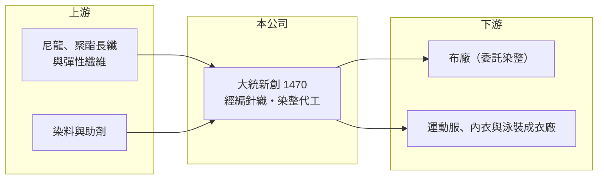

# 1470 大統新創

> 上市｜[[產業索引-紡織纖維|紡織纖維]]｜上市（櫃）日期 1999/05/21

# 第一章：企業模式與商業藍圖

> [!info] 撰寫說明
> 精簡版，由 Claude 依公開資料整理，架構比照 [[2330台積電]]，資料截至 2026-10-08。來源：Goodinfo 基本資料（主要業務）與經營績效年表（2020 至 2025 年）；證交所開放資料快照（基本資料、2026 年第二季資產負債與上半年損益、股利）。營收比重、廠區與客戶未查得，公開資料有限。#待校對

大統新創（以下簡稱大統）成立於 1986 年 12 月、1999 年 5 月上市，總公司在台北市大同區，董事長兼總經理為葉柏亮。它是一家以[[經編針織]]布與[[染整]]代工為主的小型紡織廠，年營收約 6 至 9 億元；和多數同業不同的是，近五年本業每年都有獲利，負債也很低。

- **核心業務：** 大統的主要業務是染整代工、經編針織布的織造，以及經編、圓編針織布成品的貿易銷售。經編布結構緊密、彈性與尺寸穩定性好，常用於運動服、內衣、泳裝與鞋材；染整代工則是替其他布廠把胚布染色並做功能性整理，收取加工費。
- **營收結構：** 依 Goodinfo，2025 年合併營收約 8.04 億元，2026 年上半年證交所資料為 3.72 億元。織布、染整代工與貿易三者的比重這次未查得；染整代工收取加工費、不需承擔布料原料價格，通常毛利率較穩定（推估）。
- **營運據點：** 總公司在台北市，生產廠區與海外據點這次未查得。公司資產規模約 12 億元，負債不到 2 億元，屬於輕資本、低槓桿的經營型態。
- **長期方向：** 公司名稱中的「新創」顯示它有意從傳統紡織轉向新的發展方向，但具體的轉型內容與年份這次未查得。就財報看，大統的長期方向是維持高附加價值的經編與染整代工，並以穩定的獲利與配息回饋股東。

# 第二章：護城河深度與競爭優勢

大統的護城河來自經編與染整的專業化，以及低負債帶來的穩定性；規模雖小，但毛利率在同業中相對較高。

- **競爭優勢：** 經編針織與彈性布的染整需要控制縮率、色牢度與彈性回復，製程經驗是主要門檻。大統近五年毛利率維持在 18% 至 25%，營業利益率多在 5% 至 11%，在中小型紡織股中屬於少數本業穩定賺錢的公司，顯示它在利基市場有一定的定價能力。
- **主要對手：** 針織布與染整同業包括 [[1464得力]]、[[1434福懋]]、[[1460宏遠]]、[[1463強盛新]]，以及大量中國與東南亞染整廠。大統規模遠小於這些對手，主要靠專業與服務守住既有客戶。
- **觀察重點：** 2024 年毛利率 25.3%、營業利益率 11.2% 是近五年高點，2026 年上半年仍有 27.35% 與 12.55%。觀察重點是營收規模能否突破 9 億元，以及高毛利率在景氣下行時能否守住。

# 第三章：財務體質與盈利規模

資料日期：2026-10-08，表格是撰寫當時的快照；最新月營收、毛利率、累計 EPS 由自動排程寫在本筆記的屬性欄位（月營收、毛利率、累計EPS 等）。#待校對

大統是這群紡織股中財務最穩健的一家：營業利益率每年為正、負債極低，ROE 雖然不高但沒有大起大落。

| 年度 | 營收（億元） | [[毛利率]] | [[營業利益率]] | EPS（元） | [[ROE]] |
|---|---|---|---|---|---|
| 2020 | 6.31 | 18.0% | 3.01% | 0.41 | 3.63% |
| 2021 | 8.95 | 21.4% | 8.90% | 0.76 | 6.61% |
| 2022 | 8.45 | 20.6% | 8.09% | 0.38 | 3.32% |
| 2023 | 6.55 | 19.8% | 5.26% | 0.58 | 5.04% |
| 2024 | 7.88 | 25.3% | 11.2% | 1.13 | 9.63% |
| 2025 | 8.04 | 24.2% | 10.4% | 0.78 | 6.57% |
| 2026 上半年 | 3.72 | 27.35% | 12.55% | 0.58 | 未查得 |

註：2020 至 2025 年取自 Goodinfo，2026 年上半年取自證交所開放資料。

- **長期指標：** 2020 至 2025 年營收年複合成長率約 5.0%（推算），2021 至 2025 年平均 ROE 約 6.2%（推算）。證交所股利資料顯示公司以半年為期間決議股利，2025 年下半年配發現金 0.65 元，2026 年上半年則未配發；整體而言配息尚稱穩定（待校對）。
- **[[ROIC]] 與 [[WACC]]：** 2025 年營業利益約 0.84 億元（營收 8.04 億 × 10.4%），稅後約 0.67 億元；投入資本以權益總計 10.1 億元加上總負債 2.0 億元的一半（推估有息負債約 1.0 億元）計約 11.1 億元，ROIC 約 6.1%（推算）；以 2026 年上半年年化計算約 6.7%（推算）。WACC 以無風險利率 1.75%、市場風險溢酬 6%、β 0.8（紡織同業常見值）、稅前負債成本 2.5%、稅率 20%、權益比重約 91% 計算約 6.1%（推算）。ROIC 大致與 WACC 持平、近期略高，代表本業已能賺回資金成本，但創造的超額價值仍有限。
- **財務特色：** 2026 年第二季負債比率約 16%（負債 2.0 億 ÷ 資產 12.1 億），非流動負債不到 0.1 億元，幾乎沒有長期借款。每股淨值約 11.76 元，資產負債表乾淨，景氣下行時的抗壓性在同業中較佳。

# 第四章：總體風險與地緣政治

大統的財務風險低，主要風險是規模小、客戶與產品集中，以及紡織景氣循環。

- **產業週期：** 經編布的需求跟著運動、內衣與泳裝品牌的庫存週期波動，2023 年營收從 8.45 億元降到 6.55 億元，就是品牌去庫存的影響。染整代工雖然不承擔原料價格，但加工量同樣隨景氣起伏。
- **營運風險：** 營收規模不到 10 億元，少數客戶的訂單變化就會明顯影響全年營收；2026 年 9 月單月營收年減約 39%，顯示訂單波動不小。轉型方向若需要新的投資，可能改變目前輕資本的財務結構。
- **其他風險：** 染整屬高耗水、高排放產業，環保法規趨嚴與水電費調漲會墊高成本；外銷布料受匯率與美國[[對等關稅]]影響；中國與東南亞染整產能擴張也會帶來價格壓力。

# 專有名詞解析

## 金融

- **[[ROIC]]**：投入資本報酬率，稅後營業利益除以股東權益加有息負債，衡量本業運用資本的效率。
- **[[WACC]]**：加權平均資金成本，股東與債權人要求報酬率的加權平均，是 ROIC 要超越的門檻。

## 產業

- **[[經編針織]]**：以多根紗線沿縱向同時成圈編織的針織方法，布料彈性好、不易脫散，常用於運動服、內衣與鞋材。
- **[[染整]]**：對布料進行染色、印花與後整理（如防水、抗菌、定型）的工序，耗水耗能高，也是決定布料手感與功能的關鍵。
- **[[對等關稅]]**：美國自 2025 年起依各國貿易條件訂定的進口關稅，稅率依國家而異，影響企業的生產地選擇。

# 核心供應鏈

- 上游：長纖與彈性纖維供應商未查得，化纖業者如 [[1434福懋]]、[[1402遠東新]]（是否供貨給大統未查得）。
- 下游／客戶：委託染整的布廠，以及運動服、內衣與泳裝成衣廠，名單未查得。
- 同業：[[1464得力]]、[[1460宏遠]]、[[1463強盛新]]。

## 最新新聞
<!-- news:start -->
<!-- news:end -->

## 相關連結
- [公開資訊觀測站](https://mopsov.twse.com.tw/mops/web/t05st03?step=1&firstin=1&co_id=1470)
- [Goodinfo](https://goodinfo.tw/tw/StockDetail.asp?STOCK_ID=1470)
- [Yahoo 股市](https://tw.stock.yahoo.com/quote/1470)
- [鉅亨網新聞](https://www.cnyes.com/twstock/1470/news)
