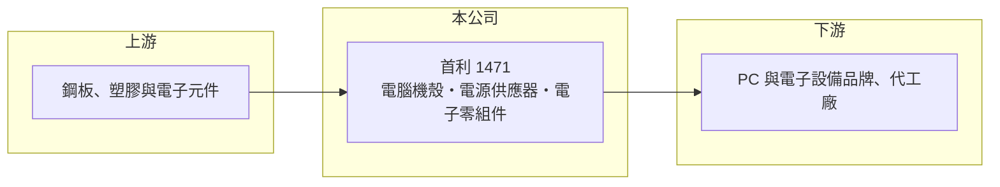

# 1471 首利

> 上市｜[[產業索引-電子零組件業|電子零組件業]]｜上市（櫃）日期 2000/03/06

# 第一章：企業模式與商業藍圖

> [!info] 撰寫說明
> 精簡版，由 Claude 依公開資料整理，架構比照 [[2330台積電]]，資料截至 2026-10-08。來源：證交所開放資料快照（基本資料、2026 年第二季資產負債、損益與營益分析、股利、月營收）、Goodinfo 經營績效頁、nStock 公司介紹頁。公開資料有限，產品與據點細節多未查得。#待校對

首利實業（以下簡稱首利）是一家本業規模已大幅萎縮的老牌電子零組件公司，理解它的重點不在成長故事，而在於本業虧損、資產以流動資產為主的特殊財務結構。

- **核心業務：** 首利成立於 1982 年，2000 年在證交所上市，主要營業項目為[[電源供應器]]、電腦機殼與電子零組件的製造銷售。這類產品屬於個人電腦的周邊機構與電源零件，技術成熟、競爭者眾多。公司近年的產品組合與營收比重，公開資料未查得。
- **營收結構：** 依 Goodinfo 年度資料，營收由 2020 年約 10.9 億元降到 2021 年 3.56 億元，2025 年只剩約 1.83 億元。營收規模縮小到原本的兩成以下，代表公司已退出多數主力產品線或大幅縮減產能（具體原因未查得，#待校對）。月營收資料的公司說明把近期減少歸因於客戶需求下降。
- **營運據點：** 總部設在新北市五股。生產據點與子公司的名稱與分布，這次查到的公開資料未列出；從財報有非控制權益可知集團內有非全資子公司。
- **長期方向：** 公司目前沒有公開的明確轉型計畫可查。截至 2026 年第二季，總資產約 16.9 億元中流動資產約 14.0 億元，負債僅約 1.25 億元，資產負債表相當保守。長期來看，首利的價值與其說取決於本業，不如說取決於經營層如何運用這筆以流動資產為主的資本。

# 第二章：護城河深度與競爭優勢

在本業長期虧損的情況下，首利很難談傳統意義的護城河，比較值得討論的是它的資產品質與經營層的資本運用。

- **競爭優勢：** 從財務數字看，首利的本業目前沒有明顯的競爭優勢，連續多年營業利益為負，毛利率甚至曾經為負。它真正的「防守力」在於負債極低、流動資產充足，短期內沒有財務壓力。這種體質讓公司有時間調整，但不等於有能力重建獲利。
- **主要對手：** 電腦機殼與電源供應器市場由大型廠商主導，例如 [[2308台達電]]、[[2301光寶科]] 等電源大廠，以及眾多中國機殼廠。規模小的業者在採購成本與客戶議價上都處於劣勢，這也是首利營收萎縮的產業背景。
- **觀察重點：** 長期應觀察三件事：本業是否止血或找到新產品、帳上流動資產的用途（轉投資、新事業或回饋股東），以及[[累積虧損]]何時彌補完畢。依 2025 年度股利資料，期初待彌補虧損約 1.54 億元，公司章程規定須先彌補虧損才能分配盈餘，因此近幾年都未配息。

# 第三章：財務體質與盈利規模

資料日期：2026-10-08，表格是撰寫當時的快照；最新月營收、毛利率、累計 EPS 由自動排程寫在本筆記的屬性欄位（月營收、毛利率、累計EPS 等）。#待校對

首利的財務數字顯示本業虧損、靠[[業外收入]]勉強打平，是一家需要用資產角度而非獲利角度理解的公司。

| 年度 | 營收（億元） | [[毛利率]] | [[營業利益率]] | EPS（元） | [[ROE]] |
|---|---|---|---|---|---|
| 2020 | 10.9 | 9.99% | -9.69% | 2.63 | 46.8% |
| 2021 | 3.56 | 2.19% | -39.7% | -0.12 | -1.79% |
| 2022 | 2.38 | -1.07% | -64.2% | -1.05 | -12.0% |
| 2023 | 2.57 | 12.2% | -33.1% | -0.29 | -2.80% |
| 2024 | 2.78 | 12.1% | -28.5% | 0.04 | 0.43% |
| 2025 | 1.83 | 8.53% | -52.4% | 0.03 | 0.33% |

（來源：Goodinfo 經營績效頁。2020 年業外損益約 5.25 億元，是當年 EPS 與 ROE 偏高的原因，屬一次性收益。）

- **營收規模：** 2020 至 2025 年營收年複合成長率約 -30%（推算），本業規模持續萎縮。2026 年上半年營收約 0.47 億元，毛利率約 -19%，顯示縮小後的營收連製造成本都難以涵蓋。
- **獲利：** 近五年（2021 至 2025）平均 ROE 約 -3.2%（推算）。2024、2025 年 EPS 雖小幅轉正，但營業利益仍為負，獲利來自利息、投資等業外收入；2026 年上半年也是營業損失約 0.65 億元、業外收入約 0.88 億元，才得到 EPS 0.16 元。
- **財務特色：** 2026 年第二季股東權益約 15.7 億元（含非控制權益約 1.07 億元），每股淨值約 9.71 元，負債比不到一成。保留盈餘仍為負（約 -1.23 億元），近五年未配發現金股利。自由現金流資料未查得。
- **[[ROIC]] 與 [[WACC]]：** 2025 年營業利益約 -0.96 億元（1.83 億元 × -52.4%），虧損不計稅；有息負債極少，投入資本以權益約 15.7 億元計，ROIC 約 -6%（推算）。若只算本業實際使用的資產（扣除大量流動資產），本業 ROIC 會更負。WACC 以 CAPM 推估：無風險利率 1.75%、市場風險溢酬 6%、β 假設 0.8（小型電子股常見值），幾乎無負債，WACC 約 6.5%（推算）。ROIC 遠低於 WACC，代表本業長期在消耗股東價值，公司的價值主要由帳上資產支撐。

# 第四章：總體風險與地緣政治

首利的風險不是財務危機，而是本業持續萎縮與資本長期閒置。

- **產業週期：** 電腦機殼與電源零件跟著 PC 出貨週期起伏，而 PC 市場整體已經成熟。小廠在景氣下行時最先被客戶刪減訂單，首利營收從 10 億元級距縮到 2 億元以下，正是這種結構性劣勢的結果。
- **營運風險：** 營收規模過小，固定成本無法攤提，毛利率容易轉負。客戶需求減少時，月營收年減幅度可達五成以上，獲利對少數訂單高度敏感。
- **其他風險：** 業外收入成為主要獲利來源，容易受利率與投資市場波動影響。帳上資本的運用方式（新投資、轉型或閒置）決定長期股東報酬，經營層的資本配置決策是最大的不確定因素。

# 專有名詞解析

## 金融

- **[[業外收入]]**：本業營運以外的收入，例如利息、投資收益、處分資產利益，持續性通常低於本業獲利。
- **[[累積虧損]]**：歷年虧損累積後尚未彌補的金額，依公司法須先彌補完畢才能分配盈餘。

## 產業

- **[[電源供應器]]**：把市電轉換為電子設備所需穩定直流電的裝置，PC、伺服器與網通設備都需要，大廠集中在台灣。

# 核心供應鏈

- 上游：機殼用鋼板與塑膠料、電源供應器用的被動元件、功率半導體與變壓器等。
- 下游／客戶：個人電腦與電子設備品牌及其代工廠，具體客戶公開資料未查得。
- 同業：電源供應器大廠 [[2308台達電]]、[[2301光寶科]]、[[3078僑威]]，以及兩岸眾多電腦機殼廠。

## 最新新聞
<!-- news:start -->
<!-- news:end -->

## 相關連結
- [公開資訊觀測站](https://mopsov.twse.com.tw/mops/web/t05st03?step=1&firstin=1&co_id=1471)
- [Goodinfo](https://goodinfo.tw/tw/StockDetail.asp?STOCK_ID=1471)
- [Yahoo 股市](https://tw.stock.yahoo.com/quote/1471)
- [鉅亨網新聞](https://www.cnyes.com/twstock/1471/news)
