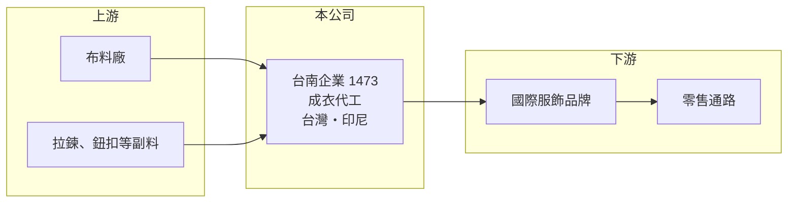

# 1473 台南

> 上市｜[[產業索引-紡織纖維|紡織纖維]]｜上市（櫃）日期 2000/09/11

# 第一章：企業模式與商業藍圖

> [!info] 撰寫說明
> 精簡版，由 Claude 依公開資料整理，架構比照 [[2330台積電]]，資料截至 2026-10-08。來源：Goodinfo 基本資料（主要業務、重要子公司）與經營績效年表（2020 至 2025 年）；證交所開放資料快照（基本資料、2026 年第二季資產負債與上半年損益、2025 年度股利）。營收比重、品牌客戶與完整產地分布未查得。#待校對

台南企業（以下簡稱台南）成立於 1961 年 8 月、2000 年 9 月上市，總部位於台南市歸仁區，董事長為楊青峯、總經理為蘇炯忠。它是台灣歷史最久的[[成衣代工]]廠之一，替國際服飾品牌生產衣服，年營收約 60 至 75 億元，生產主力在印尼等海外據點。

- **核心業務：** 台南的主要業務是成衣，也就是依品牌客戶的設計與規格，採購布料、裁剪、縫製、整燙後出貨。成衣代工是紡織供應鏈中最勞力密集的一段，競爭關鍵在於工廠管理、交期與產地的人力成本，而不在設備或專利。
- **營收結構：** 依 Goodinfo，2025 年合併營收約 66.8 億元，2026 年上半年證交所資料為 33.9 億元。產品類別、品牌客戶與各產地的營收比重這次未查得。
- **營運據點：** 重要子公司為 2013 年登錄的印尼台南企業股份有限公司，從事各式成衣的加工製造與買賣，是公司主要的海外生產基地；其他國家的據點這次未查得。印尼人力充沛、工資低於中國，符合品牌分散產地的[[中國加一]]需求。
- **長期方向：** 台南的長期方向是以東南亞產能承接品牌的代工訂單，並透過產品組合調整提升毛利率。2020 至 2024 年毛利率從 11.2% 一路提高到 18.3%，代表公司在客戶與產品結構上有實質改善；能否在景氣循環中守住這個水準，是長期觀察重點。

# 第二章：護城河深度與競爭優勢

台南的護城河是六十多年的成衣管理經驗與海外產能，但成衣代工的進入門檻低，品牌議價力強，護城河相對窄。

- **競爭優勢：** 國際品牌挑選成衣廠時，除了價格，更看重交期穩定、品質與勞工、環保稽核紀錄。台南經營超過一甲子，與品牌有長期合作基礎，海外工廠通過稽核後，品牌通常不會輕易更換供應商。
- **主要對手：** 台灣成衣同業包括 [[1476儒鴻]]、[[1477聚陽]]、[[4438廣越]]、[[1467南緯]]，以及越南、孟加拉、印尼當地的大型成衣廠。儒鴻、聚陽的規模與獲利能力明顯較高，是品牌分配訂單時的主要比較對象。
- **觀察重點：** 2024 年 EPS 3.02 元、ROE 11.3% 是近年高點，2025 年營業利益率降到 1.35%、EPS 只有 0.57 元。觀察重點是 2026 年上半年 EPS 0.69 元的回升能否延續，以及毛利率能否回到 18% 左右。

# 第三章：財務體質與盈利規模

資料日期：2026-10-08，表格是撰寫當時的快照；最新月營收、毛利率、累計 EPS 由自動排程寫在本筆記的屬性欄位（月營收、毛利率、累計EPS 等）。#待校對

台南在 2020、2021 年虧損後，2022 至 2024 年連續三年獲利並逐年成長，2025 年回落；獲利對品牌訂單與匯率相當敏感。

| 年度 | 營收（億元） | [[毛利率]] | [[營業利益率]] | EPS（元） | [[ROE]] |
|---|---|---|---|---|---|
| 2020 | 59.7 | 11.2% | -5.49% | -2.45 | -10.0% |
| 2021 | 57.6 | 13.5% | -2.72% | -0.92 | -4.27% |
| 2022 | 75.3 | 16.2% | 3.13% | 2.06 | 9.13% |
| 2023 | 65.1 | 17.9% | 4.40% | 2.13 | 8.61% |
| 2024 | 74.5 | 18.3% | 4.99% | 3.02 | 11.3% |
| 2025 | 66.8 | 15.7% | 1.35% | 0.57 | 2.10% |
| 2026 上半年 | 33.9 | 18.27% | 2.15% | 0.69 | 未查得 |

註：2020 至 2025 年取自 Goodinfo，2026 年上半年取自證交所開放資料。

- **長期指標：** 2020 至 2025 年營收年複合成長率約 2.3%（推算），2021 至 2025 年平均 ROE 約 5.4%（推算）。2025 年度配發現金股利 0.5 元，以 EPS 0.57 元計算配息率約 88%（推算）；每股淨值約 26.41 元，在紡織股中相對高。
- **[[ROIC]] 與 [[WACC]]：** 2025 年營業利益約 0.90 億元（營收 66.8 億 × 1.35%），稅後約 0.72 億元；投入資本以權益總計 38.6 億元加上總負債 20.5 億元的一半（推估有息負債約 10.2 億元）計約 48.9 億元，ROIC 約 1.5%（推算）；2024 年營業利益率 4.99% 時，ROIC 推估約 6%（推算）。WACC 以無風險利率 1.75%、市場風險溢酬 6%、β 0.8（紡織同業常見值）、稅前負債成本 2.5%、稅率 20%、權益比重約 79% 計算約 5.6%（推算）。只有在景氣好的年度 ROIC 才接近或超過 WACC，長期平均而言創造的價值有限。
- **財務特色：** 2026 年第二季負債比率約 35%（負債 20.5 億 ÷ 資產 59.1 億），非流動負債只有 2.8 億元，財務結構穩健。合併報表沒有非控制權益，子公司皆為全資或接近全資持有。

# 第四章：總體風險與地緣政治

台南的主要風險是品牌訂單的週期波動，以及成衣產地政策與成本的變化。

- **產業週期：** 品牌庫存週期直接決定成衣代工的訂單，2023 年與 2025 年營收分別下滑約 14% 與 10%，營業利益率也同步下降。成衣廠位於供應鏈最下游，最先感受到品牌下單的變化。
- **營運風險：** 營業利益率長期在 5% 以下，工資上漲、匯率或訂單小幅變動就可能讓獲利大幅縮水。品牌客戶集中度未查得，若主要客戶轉單，營收會明顯受到影響。
- **其他風險：** 美國[[對等關稅]]對印尼等東南亞國家的稅率，會影響品牌在各產地的下單比例；印尼的基本工資調整與勞動法規、外銷的美元匯率變動，都會影響毛利率。

# 專有名詞解析

## 金融

- **[[ROIC]]**：投入資本報酬率，稅後營業利益除以股東權益加有息負債，衡量本業運用資本的效率。
- **[[WACC]]**：加權平均資金成本，股東與債權人要求報酬率的加權平均，是 ROIC 要超越的門檻。

## 產業

- **[[成衣代工]]**：依品牌客戶的設計與規格生產服裝、以客戶品牌出貨的代工模式，勞力密集，產地人力成本是競爭關鍵。
- **[[中國加一]]**：品牌商為分散風險，在中國以外再增加至少一個生產基地的供應鏈策略。
- **[[對等關稅]]**：美國自 2025 年起依各國貿易條件訂定的進口關稅，稅率依國家而異，影響企業的生產地選擇。

# 核心供應鏈

- 上游：布料供應商未查得，台灣布料業者如 [[1460宏遠]]、[[1434福懋]]、[[1464得力]]（是否供貨給台南未查得）；副料業者如 [[9938百和]]（是否供貨給台南未查得）。
- 下游／客戶：國際服飾品牌與零售通路，名單未查得。
- 同業：[[1476儒鴻]]、[[1477聚陽]]、[[4438廣越]]、[[1467南緯]]。

## 最新新聞
<!-- news:start -->
<!-- news:end -->

## 相關連結
- [公開資訊觀測站](https://mopsov.twse.com.tw/mops/web/t05st03?step=1&firstin=1&co_id=1473)
- [Goodinfo](https://goodinfo.tw/tw/StockDetail.asp?STOCK_ID=1473)
- [Yahoo 股市](https://tw.stock.yahoo.com/quote/1473)
- [鉅亨網新聞](https://www.cnyes.com/twstock/1473/news)
