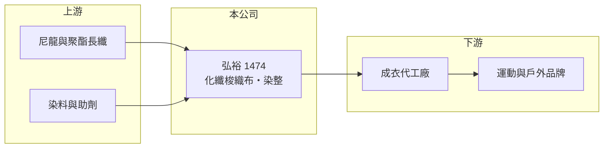

# 1474 弘裕

> 上市｜[[產業索引-紡織纖維|紡織纖維]]｜上市（櫃）日期 2000/10/31

# 第一章：企業模式與商業藍圖

> [!info] 撰寫說明
> 精簡版，由 Claude 依公開資料整理，架構比照 [[2330台積電]]，資料截至 2026-10-08。來源：Goodinfo 經營績效年表（2020 至 2025 年）；證交所開放資料快照（基本資料、2026 年第二季資產負債與上半年損益、2025 年度股利）。主要產品、營收比重、據點與客戶這次未能從來源查得，業務描述為整理性內容，公開資料有限。#待校對

弘裕企業（以下簡稱弘裕）成立於 1970 年 9 月、2000 年 10 月上市，總部與廠區位於彰化縣伸港鄉全興工業區，董事長為葉博宇、總經理為郭正沛。它是一家年營收約 27 至 35 億元的中型布廠，一般認為以化纖[[梭織布]]的織造與[[染整]]為主（待校對），近年本業在損益兩平附近徘徊。

- **核心業務：** 弘裕的業務一般被歸類為尼龍、聚酯等化纖梭織布的織造與染整加工（待校對）。梭織布結構穩定，經過防水、透氣等後整理後，常用於外套、戶外與運動服飾；這類布料的附加價值主要來自染整與功能性處理，而非織造本身。
- **營收結構：** 依 Goodinfo，2025 年合併營收約 29.2 億元，2021 年高峰時約 35 億元；2026 年上半年證交所資料為 13.7 億元。產品、客戶與地區的營收比重這次未查得。
- **營運據點：** 總部與主要廠區登記在彰化伸港的全興工業區，周邊是台灣中部的化纖織布聚落。海外據點與子公司這次未查得；合併報表中[[非控制權益]]只有約 0.17 億元，推估主要營運由母公司與全資子公司進行。
- **長期方向：** 對台灣的化纖布廠來說，長期出路在於提高功能性布料與環保材料的比重，以差異化抵銷台灣較高的人力與能源成本。弘裕近年毛利率從 2021 年的 14.7% 降到 2023 年的 7.85%，再回升到 2025 年的 11.3%，能否回到一成五以上，取決於產品組合能否往高附加價值移動。

# 第二章：護城河深度與競爭優勢

弘裕的護城河主要是台灣中部聚落內的織染整合能力與長期客戶關係，但毛利率偏低，顯示定價力有限。

- **競爭優勢：** 同時具備織布與染整能力的布廠，可以在同一體系內控制布料的品質與交期，品牌開發新布料時溝通成本較低。弘裕經營超過五十年，位於化纖織布聚落之中，原料與配套加工取得方便。
- **主要對手：** 台灣化纖布同業包括 [[1434福懋]]、[[1460宏遠]]、[[1464得力]]、[[1465偉全]]，以及中國江浙與越南的大型織染廠。福懋、宏遠規模更大且垂直整合程度更高，在爭取國際品牌訂單時較具優勢。
- **觀察重點：** 2023 至 2025 年營業利益率分別為 -3.42%、-1.98%、0.12%，本業仍在損益兩平附近；2024 年 EPS 0.82 元主要來自業外收入。觀察重點是營業利益率能否穩定轉正到 3% 以上，讓獲利不再依賴業外。

# 第三章：財務體質與盈利規模

資料日期：2026-10-08，表格是撰寫當時的快照；最新月營收、毛利率、累計 EPS 由自動排程寫在本筆記的屬性欄位（月營收、毛利率、累計EPS 等）。#待校對

弘裕在 2020 至 2022 年本業尚能小幅獲利，2023 年起營業利益率轉為負數或接近零，EPS 主要靠[[業外收益]]維持。

| 年度 | 營收（億元） | [[毛利率]] | [[營業利益率]] | EPS（元） | [[ROE]] |
|---|---|---|---|---|---|
| 2020 | 28.6 | 14.1% | 2.40% | 0.83 | 5.18% |
| 2021 | 35.0 | 14.7% | 4.02% | 1.11 | 6.91% |
| 2022 | 31.9 | 12.7% | 1.85% | 0.60 | 3.81% |
| 2023 | 26.9 | 7.85% | -3.42% | -0.34 | -2.08% |
| 2024 | 31.7 | 9.12% | -1.98% | 0.82 | 5.12% |
| 2025 | 29.2 | 11.3% | 0.12% | 0.34 | 1.91% |
| 2026 上半年 | 13.7 | 10.43% | -1.13% | 0.07 | 未查得 |

註：2020 至 2025 年取自 Goodinfo，2026 年上半年取自證交所開放資料。

- **長期指標：** 2020 至 2025 年營收年複合成長率約 0.4%（推算），規模停滯；2021 至 2025 年平均 ROE 約 3.1%（推算）。2025 年度配發現金股利 0.25 元，以 EPS 0.34 元計算配息率約 74%（推算），除 2023 年虧損外大致維持配息（待校對）。
- **[[ROIC]] 與 [[WACC]]：** 2025 年營業利益約 0.04 億元（營收 29.2 億 × 0.12%），稅後約 0.03 億元；投入資本以權益總計 22.0 億元加上總負債 15.7 億元的一半（推估有息負債約 7.9 億元）計約 29.9 億元，ROIC 約 0.1%（推算）；2021 年營業利益率 4.02% 時，ROIC 推估約 3.8%（推算）。WACC 以無風險利率 1.75%、市場風險溢酬 6%、β 0.8（紡織同業常見值）、稅前負債成本 2.5%、稅率 20%、權益比重約 74% 計算約 5.4%（推算）。即使在景氣較好的年度，ROIC 也低於 WACC，代表本業長期沒有賺回資金成本。
- **財務特色：** 2026 年第二季負債比率約 42%（負債 15.7 億 ÷ 資產 37.7 億），非流動負債約 6.0 億元。每股淨值約 16.80 元，財務結構中等，尚無立即的償債壓力。

# 第四章：總體風險與地緣政治

弘裕的主要風險是本業微利下對景氣與成本變化的高度敏感。

- **產業週期：** 化纖梭織布的訂單跟著運動與戶外品牌的庫存週期波動，2023 年營收從 31.9 億元降到 26.9 億元、毛利率跌到 7.85%，就是品牌去庫存與原料成本難以轉嫁的結果。
- **營運風險：** 營業利益率在 0% 上下，小幅的價格或產能利用率變化就會造成虧損；獲利依賴業外收入，業外減少時 EPS 會直接轉負。主要客戶與產地分布未查得，集中度風險無法評估。
- **其他風險：** 染整屬高耗水、高排放產業，台灣環保法規與水電費調漲會持續墊高成本；外銷以美元計價，新台幣升值會壓縮毛利；美國[[對等關稅]]與中國低價布料出口也會影響訂單與售價。

# 專有名詞解析

## 金融

- **[[非控制權益]]**：合併報表中子公司不屬於母公司股東的那部分權益，比重高代表子公司有大量外部股東。
- **[[業外收益]]**：本業以外的收入，例如投資收益、處分資產利益或匯兌利益，通常不具持續性。
- **[[ROIC]]**：投入資本報酬率，稅後營業利益除以股東權益加有息負債，衡量本業運用資本的效率。

## 產業

- **[[梭織布]]**：經紗與緯紗上下交錯織成的布料，結構穩定、不易變形，常用於外套、襯衫與戶外服飾。
- **[[染整]]**：對布料進行染色、印花與後整理（如防水、抗菌、定型）的工序，耗水耗能高，也是決定布料手感與功能的關鍵。
- **[[對等關稅]]**：美國自 2025 年起依各國貿易條件訂定的進口關稅，稅率依國家而異，影響企業的生產地選擇。

# 核心供應鏈

- 上游：長纖與染料供應商未查得，化纖業者如 [[1434福懋]]、[[1402遠東新]]、[[1409新纖]]（是否供貨給弘裕未查得）。
- 下游／客戶：成衣代工廠與運動、戶外品牌，名單未查得。
- 同業：[[1434福懋]]、[[1460宏遠]]、[[1464得力]]、[[1465偉全]]。

## 最新新聞
<!-- news:start -->
<!-- news:end -->

## 相關連結
- [公開資訊觀測站](https://mopsov.twse.com.tw/mops/web/t05st03?step=1&firstin=1&co_id=1474)
- [Goodinfo](https://goodinfo.tw/tw/StockDetail.asp?STOCK_ID=1474)
- [Yahoo 股市](https://tw.stock.yahoo.com/quote/1474)
- [鉅亨網新聞](https://www.cnyes.com/twstock/1474/news)
