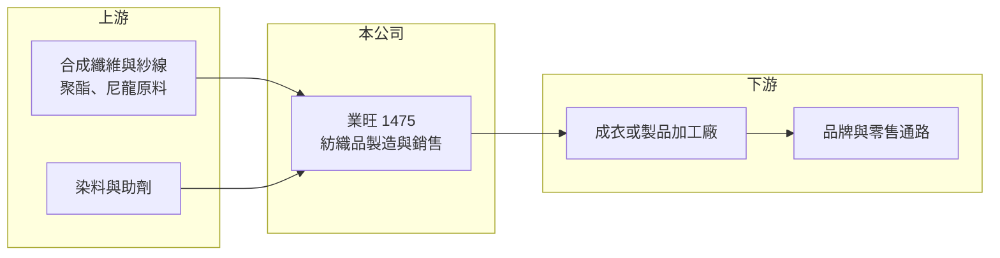

# 1475 業旺

> 上市｜[[產業索引-紡織纖維|紡織纖維]]｜上市（櫃）日期 2000/10/27

# 第一章：企業模式與商業藍圖

> [!info] 撰寫說明
> 精簡版，由 Claude 依公開資料整理，架構比照 [[2330台積電]]，資料截至 2026-10-08。來源：Goodinfo 經營績效年表（2020 至 2025 年）、富邦 MoneyDJ 基本資料（2025 年營收比重）；證交所開放資料快照（基本資料、2026 年上半年資產負債與損益、2025 年度股利、每月營收）。公開資料有限，具體產品、客戶與產地這次未查得，相關描述為推估。#待校對

台灣業旺成立於 1990 年 11 月、2000 年 10 月上市，股本約 6.6 億元，董事長陳坤木、總經理陳坤松，屬於典型的家族經營中小型紡織股。它最值得注意的地方是 2021 年起營收與獲利急速放大，從年營收不到 2 億元成長到 2024 年近 20 億元，經營型態在這幾年出現明顯轉變。

- **核心業務：** 依富邦 MoneyDJ 資料，業旺 2025 年營收 100% 來自紡織，但具體是紗、布或成品，以及主要應用領域，這次未查得。紡織業者的利潤高低主要取決於產品是否具有功能性或專利門檻，業旺 2022 至 2024 年[[毛利率]]維持在 23% 至 28%，明顯高於一般紡織同業的 10% 上下，代表它的產品或接單模式具有一定差異化（推估）。
- **營收結構：** 營收從 2020 年的 1.68 億元，一路成長到 2022 年 12.0 億元、2024 年 19.6 億元，2025 年回落到 14.7 億元。這種幾倍數的跳升，通常來自新產品線、新客戶或新的接單模式，而不是原有業務自然成長；成長來源這次未查得，讀者應把它視為需要追蹤驗證的關鍵問題。
- **營運據點：** 公司登記地址在台北市中正區，總機電話為桃園區碼，生產或倉儲據點可能在桃園一帶（推估）。2026 年第二季非流動資產僅約 3.9 億元，占總資產不到兩成，顯示業旺的固定資產不重，可能以較輕資產的生產或委外模式營運（推估）。
- **長期方向：** 2025 年營收與獲利從高點回落，2026 年 1 至 8 月累計營收 9.80 億元，與前一年同期的 9.74 億元持平。長期觀察重點在於近年拉高的營收規模能否穩定維持，以及高毛利是否具有持續性，而不只是單一景氣循環的產物。

# 第二章：護城河深度與競爭優勢

業旺的護城河資料有限，從財務數字只能推論它在某些產品上具有定價能力，但這種能力能否延續仍待驗證。

- **競爭優勢：** 2022 至 2024 年[[營業利益率]]介於 19.6% 至 24.9%，對紡織業而言屬於少見的高水準，代表產品組合或客戶結構帶來了溢價。紡織業中能維持高利潤的公司，多半具備功能性材料技術、少量多樣的快速接單能力，或切入特定利基應用；業旺屬於哪一種，這次未查得。
- **主要對手：** 由於主要產品未查得，無法明確指出直接對手。同屬台灣中小型紡織股、以利基產品求生存的公司包括 [[1464得力]]、[[1460宏遠]]、[[4433興采]] 等，可作為比較基準。
- **觀察重點：** 2025 年營業利益率從 24.9% 降到 16.9%，2026 年上半年再降到 8.58%，獲利率呈現逐年下滑。若高利潤來自少數客戶或特定訂單，客戶需求變化就會讓獲利大幅波動，這是評估業旺長期價值時最需要釐清的地方。

# 第三章：財務體質與盈利規模

資料日期：2026-10-08，表格是撰寫當時的快照；最新月營收、毛利率、累計 EPS 由自動排程寫在本筆記的屬性欄位（月營收、毛利率、累計EPS 等）。#待校對

業旺近 5 年的財務呈現「快速放大、再回落」的形狀，資本效率高但波動也大。

| 年度 | 營收（億元） | [[毛利率]] | [[營業利益率]] | EPS（元） | [[ROE]] |
|---|---|---|---|---|---|
| 2021 | 4.79 | 22.9% | 17.0% | 3.66 | 15.7% |
| 2022 | 12.0 | 25.0% | 19.6% | 11.82 | 35.9% |
| 2023 | 12.9 | 23.3% | 20.1% | 7.90 | 24.5% |
| 2024 | 19.6 | 27.9% | 24.9% | 7.22 | 33.2% |
| 2025 | 14.7 | 22.2% | 16.9% | 2.72 | 11.4% |

註：EPS 在 2022 年後下降幅度大於獲利，可能與股本變動有關（推估）；2026 年上半年營收 7.24 億元、毛利率 17.69%、營業利益率 8.58%、EPS 1.06 元（證交所資料）。

- **長期指標：** 2021 至 2025 年營收年複合成長率約 32%（推算），近 5 年平均 [[ROE]] 約 24.1%（推算），在紡織股中相當突出。2025 年度擬配現金 1.5 元，其中盈餘配息 0.5 元、資本公積配發 1.0 元，相對當年 EPS 2.72 元的配發率約 55%；用資本公積配發代表部分股利不是來自當年獲利，評估殖利率時要分開看。
- **[[ROIC]] 與 [[WACC]]：** 2025 年稅後營業利益約 1.99 億元（營業利益率 16.9% × 營收 14.7 億元 × 0.8），投入資本約 18.4 億元（2026 年第二季股東權益 15.25 億元，加上以總負債 6.34 億元的一半推估的有息負債約 3.2 億元），ROIC 約 10.8%（推算），2022 至 2024 年高峰期更在 20% 以上（推算）。WACC 約 5.8%（推算：無風險利率 1.75%、市場風險溢酬 6%、β 取紡織同業常見值 0.8，股東權益成本 6.55%；稅前負債成本 2.5%、稅率 20%；權益比重約 83%）。ROIC 明顯高於 WACC，代表近年確實為股東創造價值，但利差正隨獲利率下滑而縮小。
- **財務特色：** 2026 年第二季負債比率約 29%（負債 6.34 億元 ÷ 資產 21.59 億元），流動資產 17.66 億元占總資產八成以上，財務結構健康、資產流動性高。2026 年上半年[[業外收益]]約 0.35 億元，占稅前淨利約三成六，觀察獲利時要區分本業與業外。

# 第四章：總體風險與地緣政治

業旺的風險主要集中在營收來源的透明度與獲利的持續性。

- **產業週期：** 紡織業跟著國際品牌與零售通路的庫存週期走，品牌去化庫存時訂單會同時減少，2025 年營收年減約 25% 就顯示業旺同樣受到週期影響。快速成長後的公司在需求反轉時，營收與獲利的回落幅度往往比成熟同業更大。
- **營運風險：** 主要產品與客戶結構未公開揭露細節，若營收集中於少數客戶或單一產品，一旦客戶轉單或產品生命週期結束，衝擊會很直接。家族經營的公司決策效率高，但資本配置與資訊揭露的透明度，是外部股東需要持續觀察的地方。
- **其他風險：** 紡織品外銷多以美元計價，新台幣升值會壓縮毛利；石油價格會影響合成纖維原料成本；美國關稅與歐美品牌對環保材料、化學品管理的要求，也會影響接單條件。

# 專有名詞解析

## 金融

- **[[ROIC]]**：投入資本報酬率，稅後營業利益除以股東權益加有息負債，衡量本業運用資本的效率。
- **[[WACC]]**：加權平均資金成本，股東與債權人要求報酬率的加權平均，是 ROIC 要超越的門檻。
- **[[業外收益]]**：本業以外的收入，例如利息、投資收益或處分資產利益，通常不具持續性。

## 產業

- **[[長鞭效應]]**：終端需求的小幅變動沿供應鏈往上游傳遞時被逐級放大，造成上游庫存與訂單劇烈波動。

# 核心供應鏈

- 上游：合成纖維原料供應商如 [[1326台化]]、[[1303南亞]]、[[1409新纖]]（是否為業旺供應商未查得）。
- 下游／客戶：成衣或製品加工廠與品牌客戶，名單未查得。
- 同業：[[1464得力]]、[[1460宏遠]]、[[4433興采]]。

## 最新新聞
<!-- news:start -->
<!-- news:end -->

## 相關連結
- [公開資訊觀測站](https://mopsov.twse.com.tw/mops/web/t05st03?step=1&firstin=1&co_id=1475)
- [Goodinfo](https://goodinfo.tw/tw/StockDetail.asp?STOCK_ID=1475)
- [Yahoo 股市](https://tw.stock.yahoo.com/quote/1475)
- [鉅亨網新聞](https://www.cnyes.com/twstock/1475/news)
