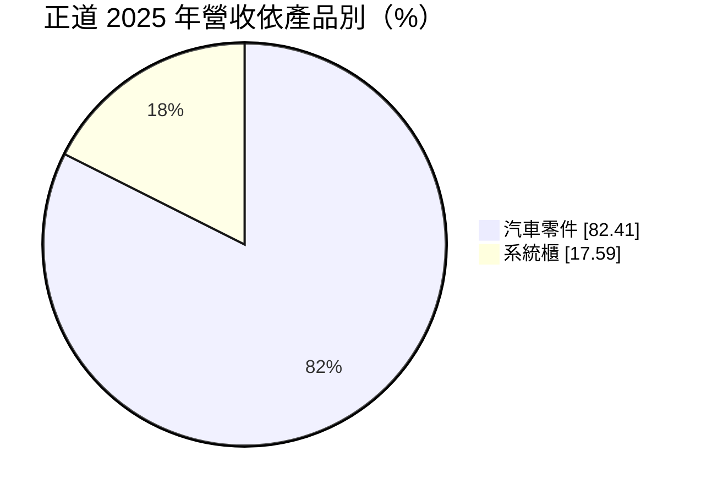
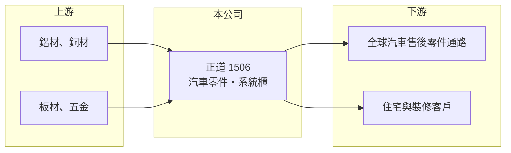

# 1506 正道

> 上市｜[[產業索引-電機機械|電機機械]]｜上市（櫃）日期 1980/08/11

# 第一章：企業模式與商業藍圖

> [!info] 撰寫說明
> 精簡版，由 Claude 依公開資料整理，架構比照 [[2330台積電]]，資料截至 2026-10-08。來源：證交所開放資料快照（基本資料、2026 年第二季資產負債與損益、股利、本益比殖利率）、Goodinfo 經營績效頁、MoneyDJ 個股基本資料（2025 年營收比重）。汽車零件的產品內容與市場依記憶整理，已標註待校對。公開資料有限。#待校對

正道工業（以下簡稱正道）是一家歷史悠久的汽車零件製造商，近年另外發展系統櫃業務，在證交所歸類為電機機械類股。理解它的關鍵在於：公司經歷多年虧損與股權重整，目前的長期價值取決於重整後的新業務能否帶來穩定獲利。

- **核心業務：** 正道成立於 1965 年，1980 年在證交所上市，是台灣最早一批上市的製造業公司之一，實收資本額約 30.0 億元，董事長為謝麗雲、總經理為鄭平山。依 MoneyDJ 資料，2025 年汽車零件約占營收 82%、系統櫃約 18%。依記憶，正道的汽車零件以散熱器（水箱）、冷凝器等熱交換產品為主，主要銷往全球汽車[[售後維修市場]]（待校對）。
- **營收結構：** 汽車零件仍是營收主體，系統櫃則是跨入家居與建材的新事業，兩者的客戶與通路完全不同。售後市場的需求來自車輛老化與維修，比新車市場穩定，但訂單小量多樣、價格競爭激烈。系統櫃事業的規模與獲利能力未查得。
- **營運據點：** 生產與營運據點以台灣為主，海外據點未查得（待校對）。資產負債表上的非流動資產約 25.0 億元，占總資產約四分之三，推估包含廠房、土地或長期投資。
- **長期方向：** 基本資料顯示公司有約 1.66 億股[[私募]]股份，占已發行股數約 55%，代表經營權結構已由私募投資人主導（推估）。2026 年上半年營收約 6.16 億元，已達 2025 年全年 10.7 億元的五成八，營收規模明顯擴大，但新增營收的來源與獲利性仍待觀察。

# 第二章：護城河深度與競爭優勢

正道目前的護城河很薄，優勢主要來自長年經營的製造經驗與通路，而不是技術或規模。

- **競爭優勢：** 售後維修零件需要涵蓋大量車型，長年累積的模具與型號資料庫，讓老牌廠商能快速供應各種規格，這是新進者需要時間才能建立的能力（待校對）。公司負債極低，財務上有承受轉型虧損的空間。
- **主要對手：** 汽車售後零件市場的台灣同業包括 [[1522堤維西]]、[[1524耿鼎]]、[[1338廣華-KY]] 等，散熱器領域則面對大量中國廠商的低價競爭。系統櫃市場進入門檻低，競爭者多為地區性的家具與裝修業者。
- **觀察重點：** 毛利率多年在 14% 至 18% 之間，營業利益率在零附近擺盪，代表公司缺乏訂價能力。長期要追蹤營收擴大後營業利益率能否穩定轉正，以及[[累積虧損]]何時彌補完畢、恢復配息。

# 第三章：財務體質與盈利規模

資料日期：2026-10-08，表格是撰寫當時的快照；最新月營收、毛利率、累計 EPS 由自動排程寫在本筆記的屬性欄位（月營收、毛利率、累計EPS 等）。#待校對

正道的財務呈現轉型中的老牌製造業樣貌：營收約 10 億元，獲利在損益兩平附近，資產負債表卻相當乾淨。

| 年度 | 營收（億元） | [[毛利率]] | [[營業利益率]] | EPS（元） | [[ROE]] |
|---|---|---|---|---|---|
| 2021 | 10.6 | 14.5% | -2.88% | 0.26 | 4.93% |
| 2022 | 11.4 | 17.7% | 1.44% | 0.43 | 5.27% |
| 2023 | 11.4 | 16.2% | 5.17% | 0.29 | 3.41% |
| 2024 | 10.4 | 16.3% | 1.90% | 0.14 | 1.45% |
| 2025 | 10.7 | 16.3% | -0.09% | 0.06 | 0.68% |
| 2026 上半年 | 6.16 | 14.2% | -2.28% | -0.05 | 未查得 |

（來源：Goodinfo 經營績效頁；2026 上半年取自證交所開放資料。2020 年營收 8.45 億元、EPS -2.19 元。）

- **營收規模：** 2020 至 2025 年營收由 8.45 億元增至 10.7 億元，年複合成長率約 4.8%（推算），但 2021 年以後大致停在 10 億至 11 億元。2026 年上半年營收明顯放大，是近年最大的變化。
- **獲利：** 2021 至 2025 年平均 ROE 約 3.1%（推算），遠低於資金成本。多數年度營業利益接近零，EPS 主要靠業外收益撐住；2020 年曾大虧約 3.3 億元。2026 年上半年營收成長但營業利益率為 -2.3%，顯示新增營收的毛利率偏低或仍在投入期。
- **財務特色：** 依 2026 年第二季資料，總資產約 33.1 億元、權益總計約 28.8 億元、負債僅約 4.3 億元，負債比約 13%，財務槓桿極低。保留盈餘為負約 5.07 億元，屬累積虧損狀態，2025 年度雖有小額淨利仍未配發股利。股價淨值比約 1.04 倍，市場大致以帳面淨值評價這家公司。
- **[[ROIC]] 與 [[WACC]]：** 2025 年營業利益約為零（10.7 億元 × -0.09%），2026 年上半年營業虧損約 0.14 億元，ROIC 為零至小幅負值；投入資本以權益 28.8 億元到「權益加全部負債」33.1 億元計算，2026 年上半年年化後約 -0.8% 至 -1.0%（推算，虧損不扣稅）。WACC 以 CAPM 推估：無風險利率 1.75%、市場風險溢酬 6%、β 假設 0.8（傳產零件股常見值），權益成本約 6.6%；負債極少，WACC 約 6.5%（推算）。ROIC 長期低於 WACC，代表公司多年來沒有替股東創造經濟價值，資本主要以低報酬的形式閒置在資產負債表上。

# 第四章：總體風險與地緣政治

正道的風險來自本業競爭力不足、轉型的不確定性與股權結構。

- **產業週期：** 汽車售後零件需求相對穩定，但受全球景氣、運費與通路庫存影響；電動車普及後，傳統引擎散熱器的需求長期會下降，熱管理產品必須轉向電池與電驅系統（待校對）。系統櫃需求則跟著房地產與裝修景氣走。
- **營運風險：** 本業毛利率低、營業利益長期接近零，若新業務的獲利能力也不佳，營收擴大反而可能擴大虧損。私募股東持有過半股份，公司策略高度取決於少數股東的規劃，一般股東的影響力有限。
- **其他風險：** 鋁、銅等金屬原料價格影響散熱器成本；外銷產品受匯率與美國關稅影響；中國同業的低價競爭長期壓抑售價。

# 專有名詞解析

## 金融

- **[[私募]]**：公司向特定人募集股票或債券，不需公開發行，常用於引進策略投資人或在財務困難時籌資，私募股票有轉讓限制。
- **[[累積虧損]]**：歷年虧損累積後尚未彌補的金額，依公司法須先彌補完畢才能分配盈餘。

## 產業

- **[[售後維修市場]]**：汽車出廠後，用於維修與更換的零件市場（AM 市場），需求隨車輛老化而來，品項多、批量小。

# 核心供應鏈

- 上游：鋁材與銅材等金屬原料，以及系統櫃使用的板材與五金；實際供應商未查得，#待校對。
- 下游／客戶：全球汽車售後零件經銷商與維修通路，以及住宅、裝修與建商客戶（待校對）。
- 同業：汽車售後零件的 [[1522堤維西]]、[[1524耿鼎]]、[[1338廣華-KY]]；系統櫃領域多為未上市的地區業者。

## 最新新聞
<!-- news:start -->
<!-- news:end -->

## 相關連結
- [公開資訊觀測站](https://mopsov.twse.com.tw/mops/web/t05st03?step=1&firstin=1&co_id=1506)
- [Goodinfo](https://goodinfo.tw/tw/StockDetail.asp?STOCK_ID=1506)
- [Yahoo 股市](https://tw.stock.yahoo.com/quote/1506)
- [鉅亨網新聞](https://www.cnyes.com/twstock/1506/news)
