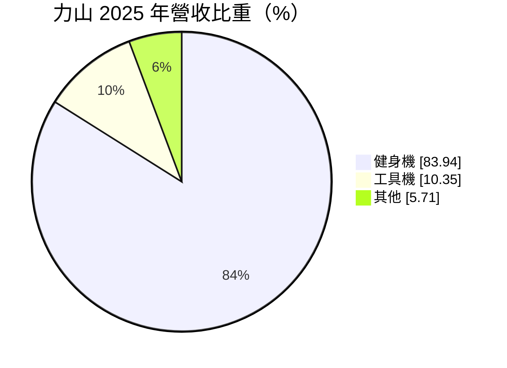
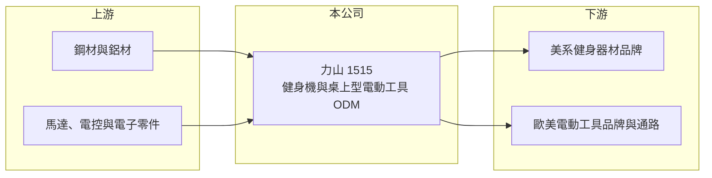

# 1515 力山

> 上市｜[[產業索引-電機機械|電機機械]]｜上市（櫃）日期 1995/02/04

# 第一章：企業模式與商業藍圖

> [!info] 撰寫說明
> 精簡版，由 Claude 依公開資料整理，架構比照 [[2330台積電]]，資料截至 2026-10-08。來源：證交所開放資料快照（基本資料、2026 年第二季資產負債與損益、股利）、Goodinfo 經營績效頁與基本資料頁、MoneyDJ 基本資料頁（2025 年營收比重）。主要客戶為 Peloton 一事係憑記憶整理，尚未比對原始文件。#待校對

力山工業（以下簡稱力山）是一家替國際品牌代工健身器材與桌上型電動工具的製造商。理解力山的關鍵在於：它的營收高度依賴少數品牌客戶的訂單，客戶需求一變，營收就會出現數倍的起落。

- **核心業務：** 力山成立於 1973 年，1995 年在證交所上市，總部位於台中大里。公司早年以桌上型鑽床、砂輪機、木工機等居家用電動工具起家，替歐美通路品牌代工，後來把機械設計與量產能力延伸到健身器材。這種「替品牌設計並量產」的模式屬於 [[ODM]]，力山賺的是製造與工程能力的錢，而不是品牌溢價。
- **營收結構：** 依 MoneyDJ 資料，2025 年健身機占營收 83.94%、工具機 10.35%、其他 5.71%。健身機已是絕對主力，代表公司的興衰大致綁在家用健身市場與少數健身品牌的訂單上。工具機比重雖小，但屬於較成熟、需求較平穩的業務，可視為公司的基本盤。
- **營運據點：** 台灣總部負責研發與部分生產，中國浙江的桐鄉力山工業負責鑽床、砂輪機、工具機零件與健身機的生產，另有英屬維京群島與香港的控股公司。兩岸分工讓公司可以依成本與關稅安排出貨地點，但也讓它暴露在美中貿易政策的變動之下。
- **長期方向：** 力山在 2020 至 2021 年疫情期間，因居家健身熱潮與美國[[連網健身器材]]品牌（一般認為是 Peloton，#待校對）的大量訂單，營收由 2019 年的 79 億元衝到 2021 年的 184 億元。熱潮退去後營收在 2022 年跌回 45.5 億元，近年維持在 50 至 70 億元。公司長期的課題是分散客戶、提高自有設計比重，避免再度出現單一客戶主導營收的局面。

# 第二章：護城河深度與競爭優勢

力山的護城河主要來自量產經驗與大型品牌客戶的認證，屬於「窄護城河」，對客戶的議價能力有限。

- **競爭優勢：** 健身器材需要結合機構設計、馬達與電控、安全認證與大量組裝，能在短時間把產能放大數倍的代工廠並不多。力山在疫情期間證明了這種快速擴產能力，也累積了與美系品牌合作的經驗。不過這種優勢的價值取決於客戶是否持續下單，本身不構成獨占地位。
- **主要對手：** 健身器材方面，台灣有以自有品牌為主的 [[1736喬山]]、[[1598岱宇]]，中國也有大量健身器材代工廠，品牌客戶可在多家供應商之間調配訂單。電動工具方面，中國代工廠以成本優勢占據大宗市場，台灣同業包括 [[1527鑽全]]、[[1538正峰]] 等。代工模式下的競爭主要比價格、交期與品質，差異化空間不大。
- **觀察重點：** 長期最該追蹤的是客戶集中度是否下降，以及毛利率能否回到疫情前約 20% 的水準。2025 年毛利率降到 12.7%、營業利益率轉為 -0.38%，顯示訂單縮減後固定成本攤提不足。若公司能找到新的長期品牌客戶，或在工具機業務取得更高附加價值的產品，獲利才有結構性的改善。

# 第三章：財務體質與盈利規模

資料日期：2026-10-08，表格是撰寫當時的快照；最新月營收、毛利率、累計 EPS 由自動排程寫在本筆記的屬性欄位（月營收、毛利率、累計EPS 等）。#待校對

力山的財務數字是「單一客戶週期」的典型案例：營收在五年內先暴增再腰斬，獲利與 ROE 也隨之大起大落。

| 年度 | 營收（億元） | [[毛利率]] | [[營業利益率]] | EPS（元） | [[ROE]] |
|---|---|---|---|---|---|
| 2019 | 79.0 | 19.9% | 8.78% | 7.01 | 42.4% |
| 2020 | 114 | 17.3% | 10.2% | 4.50 | 22.8% |
| 2021 | 184 | 13.7% | 7.76% | 5.80 | 26.4% |
| 2022 | 45.5 | 3.40% | -9.44% | -1.65 | -7.71% |
| 2023 | 67.1 | 16.6% | 7.15% | 1.70 | 8.48% |
| 2024 | 61.0 | 15.4% | 3.64% | 1.76 | 8.18% |
| 2025 | 54.2 | 12.7% | -0.38% | 0.97 | 4.37% |

（來源：Goodinfo 經營績效頁，合併報表。2019 年 EPS 7.01 元明顯高於營業利益所能支撐的水準，可能含業外或一次性收益，未查得明細。）

- **營收規模：** 2020 至 2025 年營收由 114 億元降到 54.2 億元，年複合成長率約 -13.8%（推算），但這主要是疫情高峰的基期效應。若從 2016 年的 36.7 億元算起，公司規模其實仍比十年前大。2026 年上半年營收 22.2 億元，與前一年同期大致持平。
- **獲利：** 近五年（2021 至 2025）平均 ROE 約 7.9%（推算），但年度間由 26.4% 到 -7.71% 落差極大。2021 年營收最高時毛利率反而只有 13.7%，代表大量訂單多半是低毛利的量產單；2022 年訂單驟減時毛利率跌到 3.40%，是[[營業槓桿]]反向作用的結果。
- **財務特色：** 依 2026 年第二季資料，總資產約 81.4 億元，負債約 42.2 億元（其中流動負債約 36.0 億元），股東權益約 39.3 億元，負債比約五成，在代工廠中偏高。2025 年度現金股利每股 0.6 元，配息隨獲利調整、並不固定。自由現金流是否長期為正未查得。
- **[[ROIC]] 與 [[WACC]]：** 以 2025 年營業利益約 -0.21 億元（54.2 億元 × -0.38%）計算，稅後營業利益為負，ROIC 約 -0.4% 至 -0.2%（推算；投入資本以 2026 年第二季股東權益 39.3 億元到權益加全部負債 81.4 億元為區間，有息負債未查得）。2023 年用同一資本基礎估算約 5% 至 10%（推算）。WACC 以 [[CAPM]] 推估：無風險利率 1.75%、市場風險溢酬 6%、β 假設 1.0（客戶集中、波動大的代工股），權益成本約 7.75%；稅後負債成本假設 2%、負債占四成，WACC 約 5.5%（推算）。近兩年 ROIC 低於 WACC，代表公司目前未創造經濟價值；只有在大客戶訂單滿載的年份，報酬才明顯高於資金成本。

# 第四章：總體風險與地緣政治

力山的風險集中在客戶、終端需求與兩岸生產布局三個面向。

- **產業週期：** 家用健身器材屬於非必需的耐久財，需求受消費景氣、利率與流行趨勢影響，疫情期間的爆發就是一次性的需求提前。終端需求小幅變動，傳到代工廠時會因品牌去化庫存而被放大，也就是[[長鞭效應]]，力山 2022 年營收驟減四分之三正是此現象。
- **營運風險：** 營收高度依賴少數健身品牌客戶，客戶的財務狀況、產品召回或轉單都會直接衝擊力山。健身器材涉及人身安全，一旦發生設計或品質問題，可能牽涉召回與求償。代工毛利率薄，原物料、運費或工資上升時，若無法轉嫁就直接侵蝕獲利。
- **其他風險：** 產品主要銷往美國，美國對中國製造商品的關稅政策會影響兩岸產能的配置與成本。營收以美元計價為主，新台幣升值會壓縮毛利。鋼材、馬達與電子零件價格波動也會影響成本。

# 專有名詞解析

## 應用

- **[[連網健身器材]]**：內建螢幕與網路連線、可搭配線上課程訂閱的健身車或跑步機，疫情期間需求爆發。

## 金融

- **[[營業槓桿]]**：固定成本占比高的公司，營收增加時利潤增幅大於營收增幅，反之亦然。
- **[[長鞭效應]]**：終端需求的小幅變動，沿供應鏈往上游傳遞時被逐級放大，造成上游庫存與訂單劇烈波動。
- **[[ROIC]]**：投入資本報酬率，稅後營業利益除以股東權益加有息負債，衡量本業運用資本的效率。
- **[[WACC]]**：加權平均資金成本，依股東權益與負債的比重，加權計算公司取得資金的平均成本。
- **[[CAPM]]**：資本資產定價模型，以無風險利率加上 β 乘以市場風險溢酬估算股東要求報酬率。

## 產業

- **[[ODM]]**：原廠委託設計製造，代工廠負責產品設計與生產，品牌商負責銷售。

# 核心供應鏈

- 上游：鋼材、鋁材等金屬原料（例如 [[2002中鋼]]），以及馬達、控制板與電子零件供應商。
- 下游／客戶：美系健身器材品牌（一般認為以 Peloton 為主要客戶，#待校對），以及歐美電動工具品牌與居家修繕通路。
- 同業：健身器材 [[1736喬山]]、[[1598岱宇]]；電動工具 [[1527鑽全]]、[[1538正峰]]。

## 最新新聞
<!-- news:start -->
<!-- news:end -->

## 相關連結
- [公開資訊觀測站](https://mopsov.twse.com.tw/mops/web/t05st03?step=1&firstin=1&co_id=1515)
- [Goodinfo](https://goodinfo.tw/tw/StockDetail.asp?STOCK_ID=1515)
- [Yahoo 股市](https://tw.stock.yahoo.com/quote/1515)
- [鉅亨網新聞](https://www.cnyes.com/twstock/1515/news)
