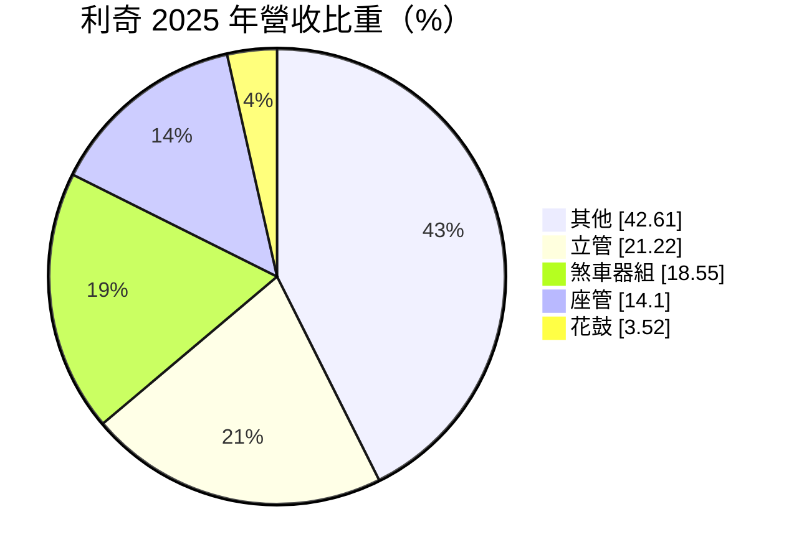
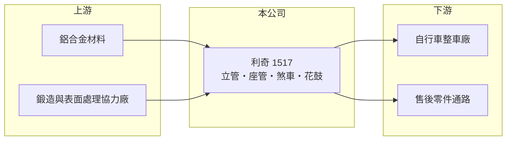

# 1517 利奇

> 上市｜[[產業索引-電機機械|電機機械]]｜上市（櫃）日期 1995/11/14

# 第一章：企業模式與商業藍圖

> [!info] 撰寫說明
> 精簡版，由 Claude 依公開資料整理，架構比照 [[2330台積電]]，資料截至 2026-10-08。來源：證交所開放資料快照（基本資料、2026 年第二季資產負債與損益、股利）、Goodinfo 經營績效頁、MoneyDJ 基本資料頁（2025 年營收比重）。公開資料有限，「其他」產品內容與海外據點未查得。#待校對

利奇機械（以下簡稱利奇）是一家自行車零組件製造商，主要生產立管、座管、煞車器與花鼓等鋁合金零件。理解利奇的關鍵在於：它位在自行車產業鏈的中游，營收隨整車廠的庫存週期大起大落，而且在近年的產業低潮中仍未恢復獲利。

- **核心業務：** 利奇成立於 1973 年，1995 年在證交所上市，總部位於彰化市。公司生產自行車上連接車架與把手的[[立管]]、支撐坐墊的[[座管]]、煞車器與花鼓等零件，以鋁合金加工為核心技術。這類零件規格多、款式多，需要配合整車廠每年的新車款開發，屬於少量多樣的代工型態。
- **營收結構：** 依 MoneyDJ 資料，2025 年立管占 21.22%、煞車器組 18.55%、座管 14.10%、花鼓 3.52%，另有 42.61% 歸為「其他」。「其他」的實際內容公開資料未說明，可能包含其他自行車零件或非自行車產品，#待校對。主力產品集中在自行車，代表公司業績幾乎完全跟著自行車景氣走。
- **營運據點：** 公司總部與主要工廠位於彰化，彰化與台中一帶本就是台灣自行車零組件的產業聚落，上下游供應商與整車廠距離近。海外生產據點公開資料未查得；從合併報表存在[[非控制權益]]來看，集團內有非全資子公司。
- **長期方向：** 2020 至 2022 年疫情帶動自行車熱潮，利奇營收由約 34 億元升到 51 億元；2023 年起全球自行車通路庫存過高，營收驟降到 19 億元左右並轉為虧損。公司長期的課題是在電動輔助自行車（e-bike）等較高單價的產品上取得份量，並降低成本結構，讓營收在 20 億元的規模下也能損益兩平。

# 第二章：護城河深度與競爭優勢

利奇的護城河相當有限，主要來自長年配合整車廠的開發經驗，產品本身差異化不高。

- **競爭優勢：** 立管、座管、煞車器屬於涉及騎乘安全的零件，需要通過整車廠的品質認證，供應商一旦導入車款，通常會配合該車系數年。利奇在彰化產業聚落經營五十年，熟悉整車廠的開發流程與品質規範。不過這類零件技術門檻不高，認證帶來的轉換成本有限。
- **主要對手：** 自行車零件市場由日本 Shimano 與美國 SRAM 主導變速與煞車系統，利奇主要在立管、座管等「非系統」零件競爭，對手包括台灣眾多中小型零件廠與中國、東南亞的低成本工廠。下游客戶包括 [[9921巨大]]、[[9914美利達]] 等整車廠（實際往來未查得，#待校對），客戶議價能力明顯高於零件廠。
- **觀察重點：** 長期最該追蹤的是毛利率能否回到疫情前 10% 至 15% 的水準。2023 至 2025 年毛利率只有約 3% 至 4%，代表產能利用率過低、固定成本無法攤提，賣愈多也只是少虧。若自行車庫存去化完成、訂單回到正常水準，營業槓桿會讓獲利快速改善；反之若需求長期停在低檔，公司就需要縮減產能或轉型。

# 第三章：財務體質與盈利規模

資料日期：2026-10-08，表格是撰寫當時的快照；最新月營收、毛利率、累計 EPS 由自動排程寫在本筆記的屬性欄位（月營收、毛利率、累計EPS 等）。#待校對

利奇的財務紀錄顯示，它只有在自行車景氣高峰時能賺到像樣的報酬，其餘年份多在損益兩平附近或虧損。

| 年度 | 營收（億元） | [[毛利率]] | [[營業利益率]] | EPS（元） | [[ROE]] |
|---|---|---|---|---|---|
| 2020 | 33.8 | 15.4% | 4.04% | 0.76 | 6.14% |
| 2021 | 48.8 | 18.7% | 9.33% | 2.00 | 13.8% |
| 2022 | 50.8 | 19.8% | 11.8% | 2.55 | 13.9% |
| 2023 | 18.9 | 2.68% | -16.3% | -0.75 | -3.97% |
| 2024 | 20.3 | 3.90% | -14.1% | -0.42 | -2.44% |
| 2025 | 20.2 | 3.17% | -16.3% | -0.69 | -3.82% |

（來源：Goodinfo 經營績效頁，合併報表。2016 至 2019 年營收約 27 至 30 億元，營業利益率在 -5% 至 3.5% 之間。）

- **營收規模：** 2020 至 2025 年營收由 33.8 億元降到 20.2 億元，年複合成長率約 -9.8%（推算）。若從 2016 年的 27.2 億元算起，現在的營收甚至低於十年前，代表疫情期間的成長沒有留下來。2026 年上半年營收約 10.0 億元，與前一年大致持平，尚未看到回升。
- **獲利：** 近五年（2021 至 2025）平均 ROE 約 3.5%（推算），高峰兩年接近 14%，之後連續三年虧損。2026 年上半年毛利率只有 1.17%、營業利益率 -16.6%、EPS -0.45 元，虧損仍在持續。這種結構代表公司目前的費用與產能是為 40 至 50 億元營收規模設計的，營收回不去就很難轉盈。
- **財務特色：** 依 2026 年第二季資料，總資產約 43.6 億元，負債僅約 9.2 億元，股東權益約 34.4 億元，負債比約兩成，財務結構保守，短期沒有償債壓力。每股淨值約 15.2 元。2025 年雖然虧損，仍配發每股 0.2 元現金股利，顯示公司動用過去累積的盈餘維持配息。自由現金流是否長期為正未查得。
- **[[ROIC]] 與 [[WACC]]：** 以 2025 年營業利益約 -3.29 億元（20.2 億元 × -16.3%）、稅率 20% 計算，稅後營業利益約 -2.63 億元；有息負債未查得，投入資本以股東權益 34.4 億元到權益加全部負債 43.6 億元為區間，ROIC 約 -7.7% 至 -6.0%（推算）。景氣高峰的 2022 年以同一資本基礎估算約 11% 至 14%（推算）。WACC 以 [[CAPM]] 推估：無風險利率 1.75%、市場風險溢酬 6%、β 假設 0.9（自行車零件股常見值），權益成本約 7.2%；稅後負債成本 2%、負債占兩成，WACC 約 6.1%（推算）。近三年 ROIC 明顯低於 WACC，公司正在侵蝕股東價值；只有景氣高峰年才創造價值。

# 第四章：總體風險與地緣政治

利奇的風險集中在自行車產業的庫存週期與公司本身的成本結構。

- **產業週期：** 自行車屬於非必需消費品，需求受景氣、天氣與流行影響，疫情期間的熱潮讓品牌與通路大量備貨，2023 年起進入漫長的去庫存期。零件廠位在供應鏈上游，承受的是被放大的[[長鞭效應]]，營收下滑幅度往往大於終端銷售。
- **營運風險：** 連續虧損若持續，會逐步侵蝕淨值與保留盈餘，未來配息能力也會受限。產品差異化不高，整車廠在景氣低迷時會壓價或轉單給成本更低的供應商。電動輔助自行車的零件規格與傳統自行車不同，若公司未能跟上，會失去成長最快的市場。
- **其他風險：** 鋁材價格波動直接影響成本。外銷比重高，新台幣升值會壓縮毛利。美國關稅政策與歐盟對中國自行車的反傾銷措施，會改變整車廠的採購地點，影響台灣零件廠的接單。

# 專有名詞解析

## 應用

- **[[立管]]**：連接自行車前叉與把手的零件，長度與角度會影響騎乘姿勢，多以鋁合金製造。
- **[[座管]]**：插入車架、用來支撐坐墊並調整高度的管狀零件，有鋁合金與碳纖維等材質。

## 金融

- **[[非控制權益]]**：子公司中不屬於母公司的股權，其分得的淨利不計入母公司股東的 EPS。
- **[[長鞭效應]]**：終端需求的小幅變動，沿供應鏈往上游傳遞時被逐級放大，造成上游庫存與訂單劇烈波動。
- **[[ROIC]]**：投入資本報酬率，稅後營業利益除以股東權益加有息負債，衡量本業運用資本的效率。
- **[[WACC]]**：加權平均資金成本，依股東權益與負債的比重，加權計算公司取得資金的平均成本。
- **[[CAPM]]**：資本資產定價模型，以無風險利率加上 β 乘以市場風險溢酬估算股東要求報酬率。

# 核心供應鏈

- 上游：鋁合金錠與鋁擠型材料供應商，以及彰化、台中一帶的鍛造、熱處理與陽極處理協力廠。
- 下游／客戶：自行車整車廠與品牌，例如 [[9921巨大]]、[[9914美利達]]、[[8933愛地雅]]（實際往來未查得，#待校對），以及售後維修零件通路。
- 同業：自行車零組件廠 [[1526日馳]]、[[5306桂盟]]；國際系統件大廠 Shimano、SRAM。

## 最新新聞
<!-- news:start -->
<!-- news:end -->

## 相關連結
- [公開資訊觀測站](https://mopsov.twse.com.tw/mops/web/t05st03?step=1&firstin=1&co_id=1517)
- [Goodinfo](https://goodinfo.tw/tw/StockDetail.asp?STOCK_ID=1517)
- [Yahoo 股市](https://tw.stock.yahoo.com/quote/1517)
- [鉅亨網新聞](https://www.cnyes.com/twstock/1517/news)
