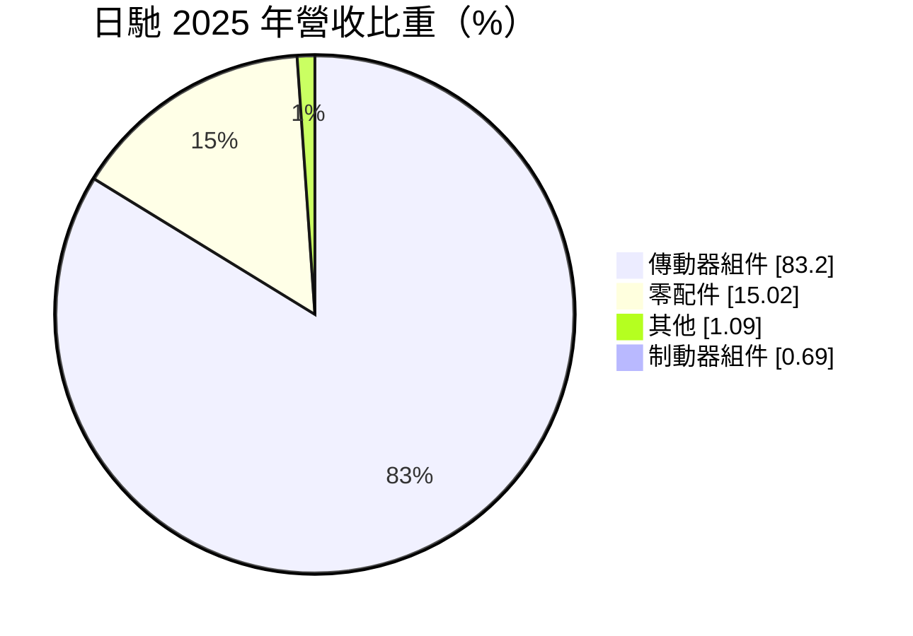
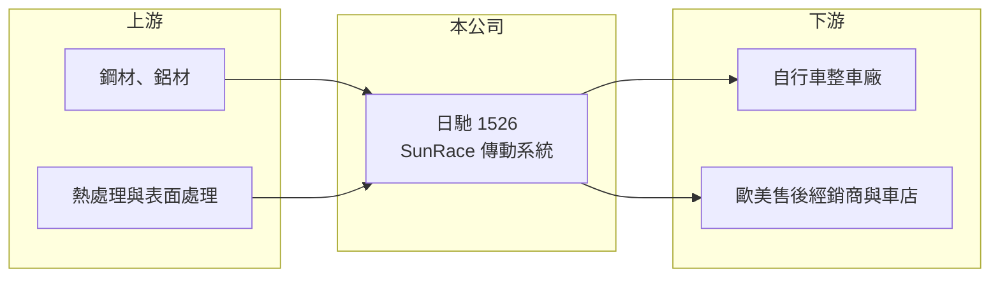

# 1526 日馳

> 上市｜[[產業索引-電機機械|電機機械]]｜上市（櫃）日期 2000/03/27

# 第一章：企業模式與商業藍圖

> [!info] 撰寫說明
> 精簡版，由 Claude 依公開資料整理，架構比照 [[2330台積電]]，資料截至 2026-10-08。來源：證交所開放資料快照（基本資料、2026 年第二季資產負債與損益、股利、每月營收）、Goodinfo 經營績效頁、MoneyDJ 基本資料頁（2025 年營收比重）、Cycling Industry News 2026 年 7 月報導標題。Sturmey-Archer 品牌歸屬係憑記憶整理。公開資料有限。#待校對

日馳企業（以下簡稱日馳，品牌 SunRace）是一家以自行車傳動系統為主的零組件公司，產品包括飛輪、變速器、變把等。理解日馳的關鍵在於：它是少數在變速系統這個被日本 Shimano 與美國 SRAM 主導的市場中，以自有品牌存活下來的台灣廠商。

- **核心業務：** 日馳成立於 1972 年，2000 年掛牌，總部位於桃園蘆竹。公司以 SunRace 品牌銷售自行車的[[飛輪]]、後變速器與變把，並經營英國老牌內變速花鼓品牌 Sturmey-Archer（一般認為由日馳持有，#待校對）。傳動系統是自行車上技術含量最高的零件之一，日馳靠著與主流規格相容、價格較低的產品，切入整車廠的中低階車款與售後維修市場。
- **營收結構：** 依 MoneyDJ 資料，2025 年傳動器組件占營收 83.20%、零配件 15.02%、其他 1.09%、制動器組件 0.69%。傳動系統是絕對主力，代表日馳的命運幾乎完全繫於自行車的變速零件需求。售後市場的飛輪屬於耗材，換車週期之外仍有替換需求，是相對穩定的收入來源。
- **營運據點：** 總部與研發位於桃園，實收資本額僅 6 億元，在上市公司中屬於小型規模。生產據點與海外子公司的細節公開資料未查得。依 2026 年 7 月的產業新聞，SunRace 與 Sturmey-Archer 品牌透過歐洲經銷商拓展售後通路。
- **長期方向：** 日馳的長期方向是以「相容 Shimano／SRAM 規格的平價替代品」與內變速花鼓等利基產品，在整車廠與售後通路兩端累積份額。電動輔助自行車普及後，對耐用、低維護的傳動系統需求提高，內變速花鼓有機會受惠。不過公司規模小，研發與行銷資源有限，能否跟上規格演進是長期課題。

# 第二章：護城河深度與競爭優勢

日馳的護城河主要來自品牌與傳動系統的技術累積，在台灣零件廠中屬於較有差異化的一家，但面對國際大廠仍是小眾挑戰者。

- **競爭優勢：** 變速系統需要精密的齒片設計、熱處理與換檔性能調校，進入門檻高於一般鋁合金零件，因此全球主要供應商不多。日馳擁有自有品牌與售後通路，毛利率在 2022 年高峰時達 34.5%，明顯高於一般代工型零件廠。自有品牌讓它能直接面對車友與維修店，而不只依賴整車廠的採購。
- **主要對手：** 市場由 Shimano 與 SRAM 寡占，兩者掌握高階系統與規格制定權；中國的平價變速零件廠則在低價市場競爭。台灣同業包括鏈條大廠 [[5306桂盟]]，以及立管、煞車等零件廠 [[1517利奇]]。日馳夾在國際大廠與低價廠之間，必須靠相容性與性價比取勝。
- **觀察重點：** 長期應追蹤毛利率能否回到 25% 以上，以及營收能否回到 10 億元以上的規模。2024 年起公司連續虧損，2026 年上半年營業利益率約 -16.7%，代表在營收萎縮時，品牌經營與研發的固定費用壓力明顯。售後市場的耗材需求能否撐起基本營收，是判斷品牌價值的關鍵。

# 第三章：財務體質與盈利規模

資料日期：2026-10-08，表格是撰寫當時的快照；最新月營收、毛利率、累計 EPS 由自動排程寫在本筆記的屬性欄位（月營收、毛利率、累計EPS 等）。#待校對

日馳的財務數字呈現「高峰很亮、低谷很深」的特性：疫情期間 ROE 一度接近三成，自行車庫存修正後則轉為虧損。

| 年度 | 營收（億元） | [[毛利率]] | [[營業利益率]] | EPS（元） | [[ROE]] |
|---|---|---|---|---|---|
| 2020 | 12.5 | 22.6% | 10.6% | 2.97 | 16.7% |
| 2021 | 18.9 | 28.7% | 18.0% | 4.38 | 21.7% |
| 2022 | 22.0 | 34.5% | 20.9% | 6.44 | 28.4% |
| 2023 | 9.95 | 28.9% | 3.08% | 0.76 | 3.22% |
| 2024 | 7.21 | 21.0% | -9.47% | -0.91 | -3.98% |
| 2025 | 7.71 | 21.8% | -6.69% | -0.11 | -0.49% |

（來源：Goodinfo 經營績效頁，合併報表。2016 至 2019 年營收約 9.6 至 13.4 億元、營業利益率約 10% 至 16%。）

- **營收規模：** 2020 至 2025 年營收由 12.5 億元降到 7.71 億元，年複合成長率約 -9.2%（推算），也低於 2016 年的 9.55 億元。2026 年 1 至 8 月累計營收約 4.32 億元，較前一年同期減少約 19.9%，產業低潮仍未結束。
- **獲利：** 近五年（2021 至 2025）平均 ROE 約 9.8%（推算），但完全由 2021、2022 兩年撐起。值得注意的是，即使在虧損的 2024、2025 年，毛利率仍維持在 21% 左右，代表產品本身仍有定價力，虧損主要來自營收規模不足以支撐營業費用。2026 年上半年 EPS 為 -0.81 元。
- **財務特色：** 依 2026 年第二季資料，總資產約 22.9 億元，負債約 9.7 億元，股東權益約 13.2 億元，每股淨值約 22 元。股本只有 6 億元，每股獲利對營收變化非常敏感。2025 年度因虧損未配發股利；2016 至 2023 年持續獲利期間的配息細節未查得。自由現金流是否長期為正未查得。
- **[[ROIC]] 與 [[WACC]]：** 以 2025 年營業利益約 -0.52 億元（7.71 億元 × -6.69%）計算，稅後營業利益約 -0.41 億元；有息負債未查得，投入資本以股東權益 13.2 億元到權益加全部負債 22.9 億元為區間，ROIC 約 -3.1% 至 -1.8%（推算）。2022 年以同一資本基礎估算約 16% 至 28%（推算）。WACC 以 [[CAPM]] 推估：無風險利率 1.75%、市場風險溢酬 6%、β 假設 0.9，權益成本約 7.2%；稅後負債成本 2%、負債占三成五，WACC 約 5.4%（推算）。景氣正常時日馳的 ROIC 明顯高於 WACC，屬於能創造價值的利基品牌；近兩年則低於資金成本，關鍵在營收能否回到損益兩平以上。

# 第四章：總體風險與地緣政治

日馳的風險來自自行車產業週期、國際大廠的規格主導權，以及小規模公司的經營穩定性。

- **產業週期：** 疫情期間全球自行車通路大量備貨，2023 年起的去庫存讓上游零件廠訂單驟減，屬於典型的[[長鞭效應]]。自行車需求也受景氣、利率與天候影響，零件廠很難自行調節。
- **營運風險：** 變速系統的規格（例如齒片數、電子變速）由 Shimano 與 SRAM 主導，若主流規格快速升級，日馳的相容產品需要持續投入研發追趕。公司規模小，營收萎縮時費用占比快速上升，連續虧損會削弱研發與品牌投資的能力。
- **其他風險：** 產品以外銷為主，匯率波動影響毛利；鋼材與鋁材價格影響成本。歐美對中國自行車與零件的關稅與反傾銷措施，會改變整車廠的採購地點，對台灣零件廠有利有弊。

# 專有名詞解析

## 應用

- **[[飛輪]]**：裝在自行車後輪上的多片齒輪組，與鏈條和後變速器搭配換檔，屬於會磨耗的耗材。
- **[[內變速花鼓]]**：把變速齒輪藏在後輪花鼓內部的設計，耐用、低維護，常見於城市車與電動輔助自行車。

## 金融

- **[[長鞭效應]]**：終端需求的小幅變動，沿供應鏈往上游傳遞時被逐級放大，造成上游庫存與訂單劇烈波動。
- **[[ROIC]]**：投入資本報酬率，稅後營業利益除以股東權益加有息負債，衡量本業運用資本的效率。
- **[[WACC]]**：加權平均資金成本，依股東權益與負債的比重，加權計算公司取得資金的平均成本。
- **[[CAPM]]**：資本資產定價模型，以無風險利率加上 β 乘以市場風險溢酬估算股東要求報酬率。

# 核心供應鏈

- 上游：鋼材與鋁材供應商（例如 [[2002中鋼]]），以及熱處理、電鍍等協力廠。
- 下游／客戶：自行車整車廠與品牌，例如 [[9921巨大]]、[[9914美利達]]（實際往來未查得，#待校對），以及歐美售後零件經銷商與自行車店。
- 同業：國際大廠 Shimano、SRAM；台灣 [[5306桂盟]]、[[1517利奇]]。

## 最新新聞
<!-- news:start -->
<!-- news:end -->

## 相關連結
- [公開資訊觀測站](https://mopsov.twse.com.tw/mops/web/t05st03?step=1&firstin=1&co_id=1526)
- [Goodinfo](https://goodinfo.tw/tw/StockDetail.asp?STOCK_ID=1526)
- [Yahoo 股市](https://tw.stock.yahoo.com/quote/1526)
- [鉅亨網新聞](https://www.cnyes.com/twstock/1526/news)
