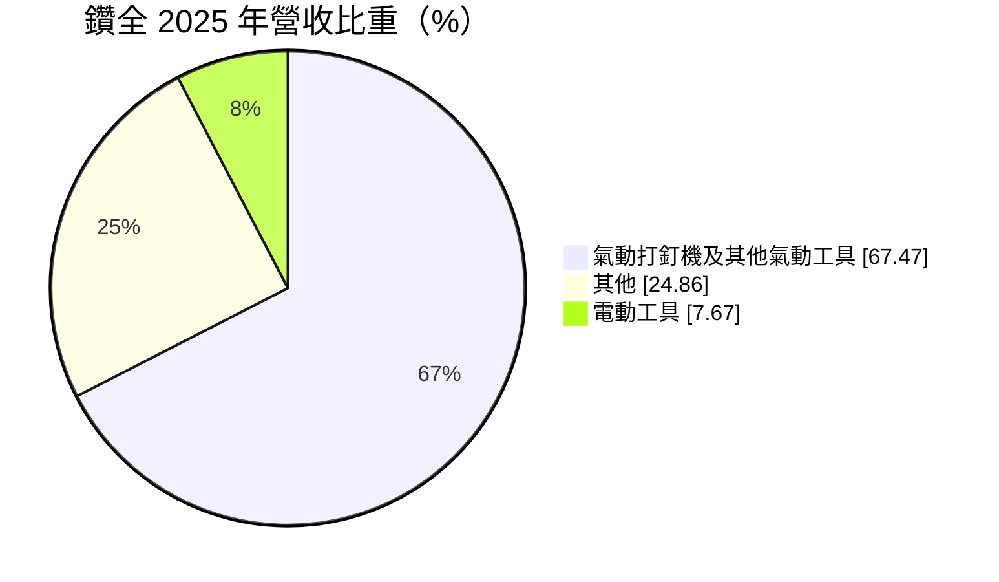
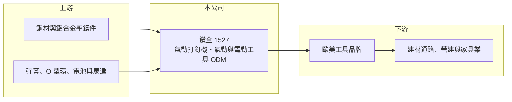

# 1527 鑽全

> 上市｜[[產業索引-電機機械|電機機械]]｜上市（櫃）日期 2000/06/21

# 第一章：企業模式與商業藍圖

> [!info] 撰寫說明
> 精簡版，由 Claude 依公開資料整理，架構比照 [[2330台積電]]，資料截至 2026-10-08。來源：證交所開放資料快照（基本資料、2026 年第二季資產負債與損益、股利、每月營收）、Goodinfo 經營績效頁、MoneyDJ 基本資料頁（2025 年營收比重）、MOI Global 2016 年研究報告標題。主要客戶名單公開資料未點名。#待校對

鑽全實業（以下簡稱鑽全，英文 Basso）是全球主要的氣動打釘機代工廠之一，替歐美工具品牌設計與製造打釘槍、釘書機等氣動工具。理解鑽全的關鍵在於：它在一個規模不大但門檻不低的利基市場中做到領先，同時累積了大量現金與金融資產，獲利有相當一部分來自本業以外。

- **核心業務：** 鑽全成立於 1983 年，總部位於台中工業區，2000 年掛牌上市。主力產品是以壓縮空氣驅動的[[氣動打釘機]]，用於木造房屋、家具、棧板與裝潢工程。公司以 [[ODM]] 模式替國際工具品牌設計並生產，2016 年 MOI Global 的研究報告將它稱為全球最大的氣動工具 ODM 廠。
- **營收結構：** 依 MoneyDJ 資料，2025 年氣動打釘機及其他氣動工具占營收 67.47%、其他 24.86%、電動工具 7.67%。「其他」可能包含零件、釘材與售後維修件，實際內容未查得。電動工具比重仍低，但代表公司正在因應工具市場由氣動轉向鋰電池的趨勢。
- **營運據點：** 總部與主要工廠位於台中，中部是台灣手工具與氣動工具的產業聚落，零件協力廠密集。海外生產據點的細節公開資料未查得。產品主要銷往北美與歐洲的建築與木工市場。
- **長期方向：** 鑽全的長期課題是因應「無線化」：鋰電池打釘機省去空壓機與氣管，正在侵蝕傳統氣動打釘機的市場。公司已發展電動工具產品線，但目前比重不到一成。能否把氣動工具累積的擊發機構與耐用度設計，延伸到鋰電打釘機，將決定它下一個十年的地位。

# 第二章：護城河深度與競爭優勢

鑽全的護城河來自利基市場的規模與長年 ODM 合作關係，屬於「窄而深」的類型。

- **競爭優勢：** 打釘機需要承受高頻率衝擊，擊發機構的耐用度、安全設計與量產良率都需要長時間累積，客戶更換代工廠的驗證成本高。鑽全在這個領域經營四十年，規模大到能同時服務多個國際品牌，具備成本與交期優勢。過去營業利益率長期維持在 12% 至 22%，在代工業中屬於高水準，顯示利基地位帶來的定價力。
- **主要對手：** 國際工具品牌本身也有自製能力，可能把部分產品收回自己生產；中國的氣動工具代工廠則以價格競爭。台灣的電動工具與相關同業包括 [[1515力山]]、[[1538正峰]]，以及工具電池與充電器廠 [[1533車王電]]。鋰電工具的主導權主要在品牌商與電池平台手中，對 ODM 廠的議價不利。
- **觀察重點：** 長期最該追蹤的是本業營業利益率能否守住。2025 年營業利益率降到 6.04%，2026 年上半年只剩 1.56%，獲利主要靠業外收入支撐。若這是北美住宅景氣低迷造成的週期性下滑，景氣回升後可望恢復；若是鋰電化造成的結構性流失，則需要看電動工具能否接棒。

# 第三章：財務體質與盈利規模

資料日期：2026-10-08，表格是撰寫當時的快照；最新月營收、毛利率、累計 EPS 由自動排程寫在本筆記的屬性欄位（月營收、毛利率、累計EPS 等）。#待校對

鑽全是一家財務體質很強、但本業成長停滯的公司：營收十年來由 40 億元降到 30 億元左右，獲利能力也逐步下滑。

| 年度 | 營收（億元） | [[毛利率]] | [[營業利益率]] | EPS（元） | [[ROE]] |
|---|---|---|---|---|---|
| 2020 | 35.9 | 25.3% | 15.4% | 2.94 | 10.2% |
| 2021 | 44.8 | 21.7% | 13.4% | 3.37 | 11.2% |
| 2022 | 39.2 | 28.1% | 18.7% | 5.36 | 16.6% |
| 2023 | 27.8 | 24.5% | 12.9% | 2.67 | 7.87% |
| 2024 | 31.3 | 26.8% | 12.7% | 3.21 | 9.25% |
| 2025 | 29.0 | 20.9% | 6.04% | 1.52 | 4.34% |

（來源：Goodinfo 經營績效頁，合併報表。2016 至 2019 年營收約 35 至 41 億元，營業利益率 17% 至 23%；2016 與 2018 年 EPS 分別為 6.88、7.48 元，2017 年僅 1.48 元，起伏可能來自業外損益，未查得明細。）

- **營收規模：** 2020 至 2025 年營收由 35.9 億元降到 29.0 億元，年複合成長率約 -4.2%（推算）；與 2016 年的 40.6 億元相比也明顯縮小。2026 年 1 至 8 月累計營收約 18.6 億元，較前一年同期減少約 11.2%。
- **獲利：** 近五年（2021 至 2025）平均 ROE 約 9.9%（推算）。由於股東權益中有大量現金與金融資產，ROE 會被拉低，本業的資本效率其實高於帳面數字。2026 年上半年營業利益約 0.21 億元，但業外收入約 1.22 億元，EPS 0.83 元主要來自[[業外收入]]，這種獲利結構的持續性低於本業。
- **財務特色：** 依 2026 年第二季資料，總資產約 57.5 億元，負債僅約 9.2 億元，股東權益約 48.2 億元，負債比約一成六，每股淨值約 34.8 元。配息政策大方，2025 年度 EPS 1.52 元、配發現金股利 1.5 元，配息率接近百分之百。自由現金流是否長期為正未查得，但長期高配息與低負債顯示現金創造能力不差。
- **[[ROIC]] 與 [[WACC]]：** 以 2025 年營業利益約 1.75 億元（29.0 億元 × 6.04%）、稅率 20% 計算，稅後營業利益約 1.40 億元；有息負債未查得，投入資本以股東權益 48.2 億元到權益加全部負債 57.5 億元為區間，ROIC 約 2.4% 至 2.9%（推算）。2022 年以同一資本基礎估算約 10% 至 12%（推算）。若扣除帳上金融資產，本業 ROIC 會更高，但金融資產金額未查得。WACC 以 [[CAPM]] 推估：無風險利率 1.75%、市場風險溢酬 6%、β 假設 0.8，權益成本約 6.6%；稅後負債成本 2%、負債占一成五，WACC 約 5.9%（推算）。過去多數年份 ROIC 高於 WACC，屬於能創造價值的公司；2025 年起利差轉負，需觀察是週期性還是結構性。

# 第四章：總體風險與地緣政治

鑽全的風險集中在北美住宅景氣、工具無線化，以及客戶集中。

- **產業週期：** 打釘機的需求與北美新屋開工、房屋修繕及家具生產高度相關，而這些活動又受房貸利率影響。利率高檔時新屋開工減少，工具品牌會降低庫存，訂單傳到 ODM 廠時被放大。
- **營運風險：** ODM 模式下客戶數量有限，單一品牌調整採購策略或收回自製，就可能造成營收明顯下滑。工具鋰電化是長期結構風險，若鋰電打釘機持續取代氣動產品，鑽全的主力市場會逐步縮小。業外收入占獲利比重升高，會讓 EPS 受金融市場波動影響。
- **其他風險：** 產品以美元計價為主，新台幣升值會壓縮毛利。鋼材與鋁材價格影響成本。美國關稅政策會影響客戶對台灣、中國與東南亞產能的配置。

# 專有名詞解析

## 應用

- **[[氣動打釘機]]**：以壓縮空氣推動擊錘把釘子打入木材的工具，廣泛用於木造建築、家具與棧板生產。

## 金融

- **[[業外收入]]**：本業營運以外的收入，例如利息、投資收益、處分資產利益，持續性通常低於本業獲利。
- **[[ROIC]]**：投入資本報酬率，稅後營業利益除以股東權益加有息負債，衡量本業運用資本的效率。
- **[[WACC]]**：加權平均資金成本，依股東權益與負債的比重，加權計算公司取得資金的平均成本。
- **[[CAPM]]**：資本資產定價模型，以無風險利率加上 β 乘以市場風險溢酬估算股東要求報酬率。

## 產業

- **[[ODM]]**：原廠委託設計製造，代工廠負責產品設計與生產，品牌商負責銷售。

# 核心供應鏈

- 上游：鋼材與鋁合金壓鑄件供應商（例如 [[2002中鋼]]），以及彈簧、密封件、馬達與鋰電池等零件供應商。
- 下游／客戶：歐美工具品牌（具體名單公開資料未點名，#待校對），終端為木造建築、家具、棧板與裝修工程。
- 同業：[[1515力山]]、[[1538正峰]]、[[1533車王電]]；中國氣動工具代工廠。

## 最新新聞
<!-- news:start -->
<!-- news:end -->

## 相關連結
- [公開資訊觀測站](https://mopsov.twse.com.tw/mops/web/t05st03?step=1&firstin=1&co_id=1527)
- [Goodinfo](https://goodinfo.tw/tw/StockDetail.asp?STOCK_ID=1527)
- [Yahoo 股市](https://tw.stock.yahoo.com/quote/1527)
- [鉅亨網新聞](https://www.cnyes.com/twstock/1527/news)
