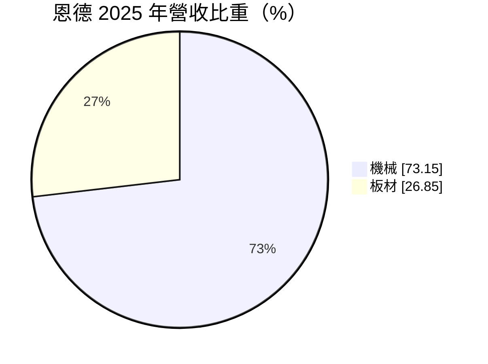
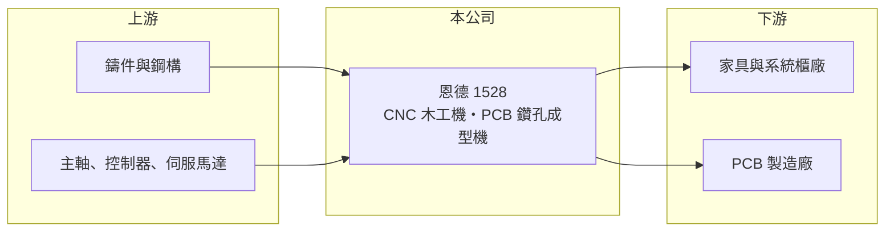

# 1528 恩德

> 上市｜[[產業索引-電機機械|電機機械]]｜上市（櫃）日期 2000/09/11

# 第一章：企業模式與商業藍圖

> [!info] 撰寫說明
> 精簡版，由 Claude 依公開資料整理，架構比照 [[2330台積電]]，資料截至 2026-10-08。來源：證交所開放資料快照（基本資料、2026 年第二季資產負債與損益、股利、每月營收）、Goodinfo 經營績效頁、MoneyDJ 基本資料頁（2025 年營收比重）、Winvest 2026 年 8 月營收快訊標題。產品細項與海外據點係憑記憶整理，「板材」業務內容未查得。#待校對

恩德科技（以下簡稱恩德，英文 Anderson）是一家 CNC 電腦數值控制加工機製造商，主要生產用於木工、板材加工與印刷電路板（[[PCB]]）鑽孔成型的機台。理解恩德的關鍵在於：它的毛利率不差，但營業費用高，長年在損益兩平附近徘徊，近年則寄望 PCB 設備需求帶動轉機。

- **核心業務：** 恩德成立於 1972 年，總部位於台北士林，是台灣較早投入 [[CNC]] 雕刻與鑽銑機的廠商之一。產品線包括家具與系統櫃用的木工板材加工機，以及 PCB 製程中的[[鑽孔機]]與成型機（依記憶整理，#待校對）。這類機台需要結合機械結構、主軸、控制器與軟體，賣的是整套加工解決方案。
- **營收結構：** 依 MoneyDJ 資料，2025 年機械占營收 73.15%、板材 26.85%。機械是公司本業；「板材」的實際內容公開資料未說明，可能是集團內銷售加工板材或相關材料的業務，#待校對。兩者的景氣來源不同，木工機跟著家具與住宅景氣走，PCB 設備則跟著電子業資本支出走。
- **營運據點：** 公司總部在台北，生產基地與海外銷售子公司的細節公開資料未查得（一般認為在中國與歐美設有銷售或服務據點，#待校對）。合併報表中有[[非控制權益]]，代表集團內有非全資子公司。
- **長期方向：** 恩德的長期機會在於 PCB 設備：AI 伺服器使用的電路板層數更多、孔數更密，帶動鑽孔與成型設備需求。2026 年 8 月單月營收約 3.83 億元、年增約 70.8%，1 至 8 月累計年增約 19.7%，顯示設備訂單回溫。這股動能能否從景氣循環轉為結構性的成長，要看公司在高階 PCB 設備上的技術能否被大型板廠長期採用。

# 第二章：護城河深度與競爭優勢

恩德的護城河偏窄，主要來自機台整合經驗與裝機客戶的維修服務，面對國際大廠與台灣同業的競爭都不輕鬆。

- **競爭優勢：** CNC 機台的價值不只在硬體，還包括製程參數、軟體與售後服務，客戶裝機後通常會持續向原廠購買耗材、零件與維修，形成一定的黏著度。恩德經營五十多年，累積了木工與 PCB 兩個應用領域的客戶基礎。毛利率長年維持在 25% 至 33%，說明產品有一定的技術附加價值。
- **主要對手：** 木工板材加工機方面，德國 HOMAG、義大利 Biesse 等歐洲大廠主導高階市場，中國廠商則以價格搶占中低階。PCB 鑽孔成型設備方面，台灣同業 [[3167大量]] 是直接對手，日本與中國也有設備廠競爭；相關的鑽針耗材廠為 [[8021尖點]]。在兩個市場，恩德都不是領導者，必須靠性價比與服務取勝。
- **觀察重點：** 長期最該追蹤的是營業利益率能否穩定轉正。2016 至 2025 年恩德的營業利益率多數年份介於 -7% 到 4% 之間，毛利不差但費用吃掉大部分利潤；2026 年上半年營收成長、毛利率約 29.9%，營業利益率仍為 -4.0%。若 PCB 訂單放量後營業利益率能拉到 5% 以上，才代表商業模式真正改善。

# 第三章：財務體質與盈利規模

資料日期：2026-10-08，表格是撰寫當時的快照；最新月營收、毛利率、累計 EPS 由自動排程寫在本筆記的屬性欄位（月營收、毛利率、累計EPS 等）。#待校對

恩德的財務特徵是「毛利率尚可、營業利益率接近零、負債比偏高」，長期資本報酬率偏低。

| 年度 | 營收（億元） | [[毛利率]] | [[營業利益率]] | EPS（元） | [[ROE]] |
|---|---|---|---|---|---|
| 2020 | 32.1 | 26.6% | -4.10% | -0.61 | -5.20% |
| 2021 | 35.9 | 25.9% | 1.98% | 1.14 | 9.79% |
| 2022 | 37.9 | 29.6% | 3.11% | 0.81 | 6.43% |
| 2023 | 38.8 | 25.0% | -0.28% | -0.08 | -1.19% |
| 2024 | 36.7 | 25.3% | -3.53% | -0.81 | -6.50% |
| 2025 | 28.0 | 31.1% | 1.73% | -0.35 | -3.11% |

（來源：Goodinfo 經營績效頁，合併報表。2016 至 2018 年營收 37 至 49 億元、毛利率 26% 至 33%、營業利益率 1.8% 至 4.0%。）

- **營收規模：** 2020 至 2025 年營收由 32.1 億元降到 28.0 億元，年複合成長率約 -2.7%（推算）；2018 年曾達 49.1 億元的高點。2026 年上半年營收約 14.9 億元，1 至 8 月累計年增約 19.7%，是近年少見的成長。
- **獲利：** 近五年（2021 至 2025）平均 ROE 約 1.1%（推算），2019 年以來有五年虧損。2025 年營業利益為正，但 EPS 仍為 -0.35 元，代表業外或非控制權益等因素拖累歸屬母公司的獲利。2026 年上半年 EPS 為 -0.60 元。這種長期低報酬的紀錄，是評估恩德時必須正視的基本事實。
- **財務特色：** 依 2026 年第二季資料，總資產約 55.1 億元，負債約 33.4 億元（流動負債約 27.8 億元），股東權益約 21.7 億元，負債比約六成，在設備廠中偏高。每股淨值約 11.1 元，股價淨值比約 2.2 倍，反映市場對 PCB 設備題材的期待高於帳面價值。2025 年度未配發股利。自由現金流是否長期為正未查得。
- **[[ROIC]] 與 [[WACC]]：** 以 2025 年營業利益約 0.48 億元（28.0 億元 × 1.73%）、稅率 20% 計算，稅後營業利益約 0.39 億元；有息負債未查得，投入資本以股東權益 21.7 億元到權益加全部負債 55.1 億元為區間，ROIC 約 0.7% 至 1.8%（推算）。WACC 以 [[CAPM]] 推估：無風險利率 1.75%、市場風險溢酬 6%、β 假設 1.0（設備股景氣敏感度高），權益成本約 7.75%；稅後負債成本 2%、負債占五成五，WACC 約 4.6%（推算）。ROIC 長期低於 WACC，代表過去十年恩德整體未替股東創造經濟價值，轉機必須反映在營業利益率的持續改善上。

# 第四章：總體風險與地緣政治

恩德的風險來自兩個不同景氣循環的疊加，以及偏高的財務槓桿。

- **產業週期：** 設備業屬於資本財，客戶在景氣好時集中擴產、景氣差時幾乎停止採購，訂單起伏遠大於終端需求。PCB 設備需求取決於 AI 伺服器等電子產品的擴產節奏，一旦擴產告一段落，訂單可能快速回落；木工機則受住宅與家具景氣影響。
- **營運風險：** 營業費用結構偏高，營收若無法持續成長，獲利很容易再度轉虧。負債比約六成、流動負債占大宗，景氣反轉時資金調度的彈性較小。高階 PCB 設備的技術門檻持續提高，若研發跟不上，訂單會流向日本或台灣同業。
- **其他風險：** 外銷比重高，匯率波動影響毛利與匯兌損益。中國設備廠在中低階機台的價格競爭激烈。主軸、控制器等關鍵零件部分仰賴進口，供應與價格變動會影響交期與成本。

# 專有名詞解析

## 金融

- **[[非控制權益]]**：子公司中不屬於母公司的股權，其分得的淨利不計入母公司股東的 EPS。
- **[[ROIC]]**：投入資本報酬率，稅後營業利益除以股東權益加有息負債，衡量本業運用資本的效率。
- **[[WACC]]**：加權平均資金成本，依股東權益與負債的比重，加權計算公司取得資金的平均成本。
- **[[CAPM]]**：資本資產定價模型，以無風險利率加上 β 乘以市場風險溢酬估算股東要求報酬率。

## 產業

- **[[CNC]]**：電腦數值控制，用程式控制機台的刀具路徑進行切削、鑽孔或雕刻，是現代工具機的基礎。
- **[[鑽孔機]]**：在印刷電路板上鑽出導通孔的設備，AI 伺服器板層數多、孔數密，對鑽孔精度與產能要求更高。
- **[[PCB]]**：印刷電路板，用銅線路連接電子元件的基板，是所有電子產品的骨架。

# 核心供應鏈

- 上游：機台鑄件與鋼構、線性滑軌（例如 [[2049上銀]]）、主軸、控制器與伺服馬達供應商。
- 下游／客戶：家具、系統櫃與板材加工廠，以及 [[PCB]] 製造廠（具體客戶名單公開資料未點名，#待校對）。
- 同業：PCB 設備 [[3167大量]]；鑽針耗材 [[8021尖點]]；國際木工機大廠 HOMAG、Biesse。

## 最新新聞
<!-- news:start -->
<!-- news:end -->

## 相關連結
- [公開資訊觀測站](https://mopsov.twse.com.tw/mops/web/t05st03?step=1&firstin=1&co_id=1528)
- [Goodinfo](https://goodinfo.tw/tw/StockDetail.asp?STOCK_ID=1528)
- [Yahoo 股市](https://tw.stock.yahoo.com/quote/1528)
- [鉅亨網新聞](https://www.cnyes.com/twstock/1528/news)
