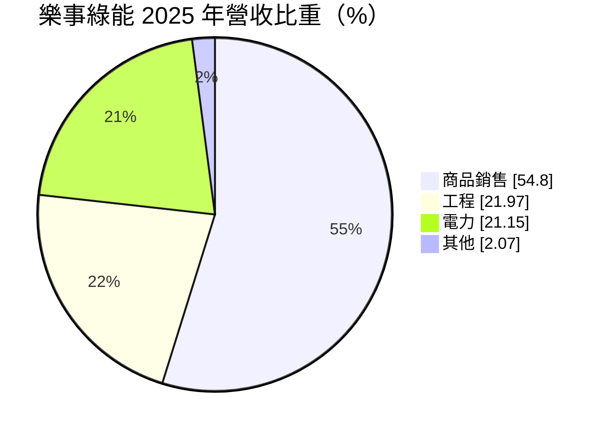
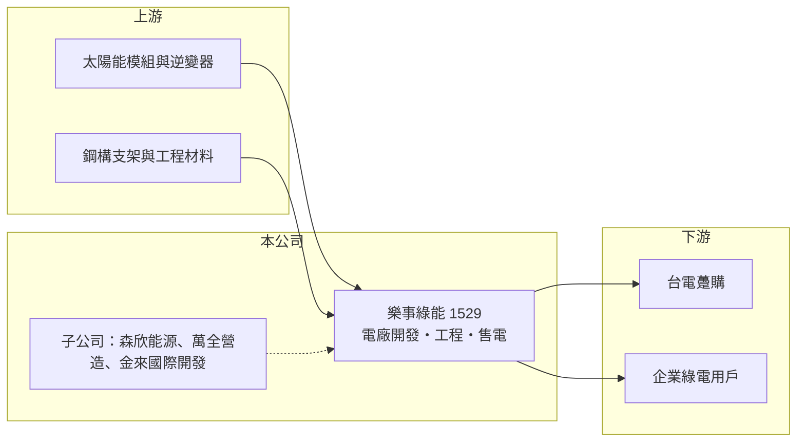

# 1529 樂事綠能

> 上市｜[[產業索引-電機機械|電機機械]]｜上市（櫃）日期 2000/09/11

# 第一章：企業模式與商業藍圖

> [!info] 撰寫說明
> 精簡版，由 Claude 依公開資料整理，架構比照 [[2330台積電]]，資料截至 2026-10-08。來源：證交所開放資料快照（基本資料、2026 年第二季資產負債與損益、股利、每月營收）、Goodinfo 經營績效頁（含重要子公司公告標題）、MoneyDJ 基本資料頁（2025 年營收比重）。「商品銷售」的實際內容與公司轉型沿革未查得。公開資料有限。#待校對

樂事綠能科技（以下簡稱樂事綠能）是一家以綠能為主軸的小型控股型公司，業務涵蓋太陽能電廠售電、工程承攬與商品銷售。理解它的關鍵在於：營收規模不到 10 億元、項目組合多元，獲利品質取決於售電這類長期穩定收入占多少，以及工程與商品銷售的波動有多大。

- **核心業務：** 樂事綠能成立於 1978 年，總部位於台南，是證交所「電機機械」類股中少數以綠能為主業的公司。從公告可知，集團的重要子公司包括從事能源業務的森欣能源、從事營造的萬全營造，以及從事開發的金來國際開發。整體來看，公司把[[太陽能電廠]]的開發、建置與營運，和營造工程、開發案結合在一起。
- **營收結構：** 依 MoneyDJ 資料，2025 年商品銷售占 54.80%、工程 21.97%、電力 21.15%、其他 2.07%。電力收入來自自有電廠售電，屬於長期、可預期的現金流；工程收入依承攬案進度認列，起伏較大；商品銷售占比最高，但實際銷售的是太陽能設備、建材或不動產，公開資料未說明，#待校對。
- **營運據點：** 總部位於台南，南台灣日照充足，是台灣太陽能電廠最集中的區域，對開發地面型與屋頂型電廠有地利之便。電廠的實際裝置容量與分布未查得。
- **長期方向：** 台灣以 2050 淨零排放為目標，太陽能是再生能源擴張的主力，企業對綠電的需求也因 RE100 與碳費而增加。樂事綠能的長期方向是持續累積自有電廠容量，讓售電收入成為穩定的基本盤，再搭配工程與開發業務擴大規模。從 2025 年實收資本額 20.3 億元高於帳上股本 16.3 億元來看，公司近期有增資（含[[現金增資]]與盈餘轉增資），資金主要用於擴張。

# 第二章：護城河深度與競爭優勢

樂事綠能的護城河不深，比較像是「區域型開發商」，優勢在於在地案源與工程整合，而非技術。

- **競爭優勢：** 太陽能電廠開發需要取得土地或屋頂、處理併網與審查，這些流程高度在地化，熟悉南部地方的開發商有一定的案源優勢。公司同時擁有營造與能源子公司，可把開發、施工與營運整合在集團內，降低外包成本。已併網的電廠只要依合約售電，就能產生長期穩定的收入。
- **主要對手：** 國內太陽能開發與售電業者眾多，包括 [[6806森崴能源]]、[[6869雲豹能源]] 等上市櫃公司，以及大型電力開發商與外資基金。這個市場的競爭重點是土地取得、融資成本與工程成本，規模較大的業者在融資與採購上更有優勢。
- **觀察重點：** 長期最該追蹤的是電力收入的占比與規模。電力收入愈高，公司的現金流愈像公用事業，估值也較能穩定；若營收主要靠商品銷售與工程，獲利就會隨個案大幅波動。2021 至 2022 年營收僅約 3 億元時毛利率高達 42% 至 46%，可推測售電本身毛利率高，而商品銷售與工程拉低了整體毛利率。

# 第三章：財務體質與盈利規模

資料日期：2026-10-08，表格是撰寫當時的快照；最新月營收、毛利率、累計 EPS 由自動排程寫在本筆記的屬性欄位（月營收、毛利率、累計EPS 等）。#待校對

樂事綠能的財務數字規模小、波動大，營收與毛利率主要受當年度商品銷售與工程案的比重影響。

| 年度 | 營收（億元） | [[毛利率]] | [[營業利益率]] | EPS（元） | [[ROE]] |
|---|---|---|---|---|---|
| 2020 | 6.09 | 17.9% | 10.6% | 0.65 | 5.82% |
| 2021 | 3.24 | 46.0% | 32.9% | 1.03 | 8.29% |
| 2022 | 2.82 | 42.5% | 26.6% | 0.31 | 2.76% |
| 2023 | 7.52 | 21.0% | 12.6% | 0.91 | 8.17% |
| 2024 | 6.96 | 18.6% | 10.3% | -0.13 | -1.04% |
| 2025 | 9.25 | 18.6% | 7.69% | 1.01 | 9.18% |

（來源：Goodinfo 經營績效頁，合併報表。2016 至 2019 年營收在 2.5 至 7.9 億元之間。）

- **營收規模：** 2020 至 2025 年營收由 6.09 億元增至 9.25 億元，年複合成長率約 8.7%（推算），但各年起伏很大，主要隨工程與商品銷售案量變動。2026 年 1 至 8 月累計營收約 5.34 億元，較前一年同期減少約 14.9%。
- **獲利：** 近五年（2021 至 2025）平均 ROE 約 5.5%（推算），偏低且不穩定。營業利益率長年為正，顯示本業有基本獲利；2026 年上半年營業利益率約 10.3%，但業外收入約 0.54 億元、高於營業利益 0.45 億元，EPS 0.50 元有不少比重來自本業以外。
- **財務特色：** 依 2026 年第二季資料，總資產約 32.3 億元，負債約 13.4 億元（其中非流動負債約 8.8 億元，可能多為電廠的長期融資，#待校對），股東權益約 18.9 億元。電廠屬於前期投入大、回收期長的資產，長期借款是常見的資金來源。2025 年度配發每股現金股利 0.3 元、資本公積發放 0.2 元與股票股利 0.5 元，股本持續膨脹，對每股獲利有稀釋效果。自由現金流是否長期為正未查得。
- **[[ROIC]] 與 [[WACC]]：** 以 2025 年營業利益約 0.71 億元（9.25 億元 × 7.69%）、稅率 20% 計算，稅後營業利益約 0.57 億元；有息負債未查得，投入資本以股東權益 18.9 億元到權益加全部負債 32.3 億元為區間，ROIC 約 1.8% 至 3.0%（推算）。WACC 以 [[CAPM]] 推估：無風險利率 1.75%、市場風險溢酬 6%、β 假設 0.8（售電收入穩定，但公司規模小），權益成本約 6.6%；稅後負債成本 2%、負債占四成，WACC 約 4.7%（推算）。ROIC 目前低於 WACC，代表投入的資本尚未產生足夠報酬；電廠類資產需要多年回收，關鍵在新電廠併網後，售電收入能否把 ROIC 拉到資金成本以上。

# 第四章：總體風險與地緣政治

樂事綠能的風險來自政策、融資成本與業務組合的不透明。

- **產業週期：** 太陽能電廠的收益取決於售電價格與日照，[[躉購費率]]由政府逐年調降，新電廠的報酬率會比早期案場低。太陽能模組價格與工程成本的變化，也會影響新案的投資報酬。
- **營運風險：** 商品銷售與工程占營收七成以上，個案起伏大，使營收與獲利難以預測。電廠開發涉及土地、環評與併網，任何環節延誤都會推遲收入。業外收入占獲利比重偏高，降低了獲利的可預測性。
- **其他風險：** 電廠資產主要以長期借款支應，利率上升會增加資金成本、壓縮利差。再生能源政策（例如躉購費率、綠電交易制度、土地使用規範）一旦調整，會直接影響商業模式。股本持續膨脹也會稀釋原有股東的每股價值。

# 專有名詞解析

## 金融

- **[[現金增資]]**：公司發行新股向投資人募集現金，可補充資金但會稀釋原股東持股。
- **[[ROIC]]**：投入資本報酬率，稅後營業利益除以股東權益加有息負債，衡量本業運用資本的效率。
- **[[WACC]]**：加權平均資金成本，依股東權益與負債的比重，加權計算公司取得資金的平均成本。
- **[[CAPM]]**：資本資產定價模型，以無風險利率加上 β 乘以市場風險溢酬估算股東要求報酬率。

## 產業

- **[[太陽能電廠]]**：以太陽能板發電並售電的電廠，可躉售給台電或以綠電轉供給企業，收入隨日照與合約電價而定。
- **[[躉購費率]]**：政府公告的再生能源收購電價，由台電以固定價格長期收購，通常合約期 20 年。

# 核心供應鏈

- 上游：太陽能模組（例如 [[3576聯合再生]]）、逆變器、鋼構支架與工程材料供應商。
- 下游／客戶：以[[躉購費率]]收購電力的台電，以及透過綠電交易購電的企業用戶；工程與商品銷售的客戶名單未查得。
- 同業：太陽能開發與售電業者 [[6806森崴能源]]、[[6869雲豹能源]]。

## 最新新聞
<!-- news:start -->
<!-- news:end -->

## 相關連結
- [公開資訊觀測站](https://mopsov.twse.com.tw/mops/web/t05st03?step=1&firstin=1&co_id=1529)
- [Goodinfo](https://goodinfo.tw/tw/StockDetail.asp?STOCK_ID=1529)
- [Yahoo 股市](https://tw.stock.yahoo.com/quote/1529)
- [鉅亨網新聞](https://www.cnyes.com/twstock/1529/news)
