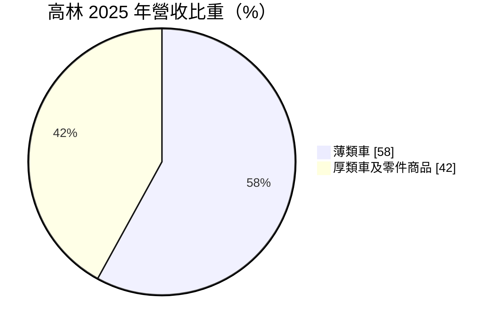
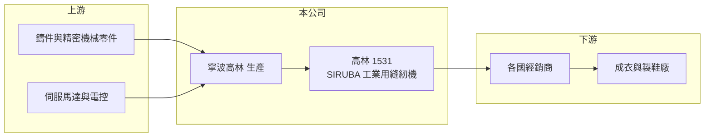

# 1531 高林股

> 上市｜[[產業索引-電機機械|電機機械]]｜上市（櫃）日期 2000/09/11

# 第一章：企業模式與商業藍圖

> [!info] 撰寫說明
> 精簡版，由 Claude 依公開資料整理，架構比照 [[2330台積電]]，資料截至 2026-10-08。來源：證交所開放資料快照（基本資料、2026 年第二季資產負債與損益、股利、每月營收）、Goodinfo 經營績效頁（含子公司公告標題）、MoneyDJ 基本資料頁（2025 年營收比重）、產品分類說明與競爭格局部分憑記憶整理。公開資料有限。#待校對

高林股份有限公司（以下簡稱高林，品牌 SIRUBA）是台灣老牌的工業用縫紉機製造商，產品供成衣廠生產 T 恤、內衣、牛仔褲等服飾使用。理解高林的關鍵在於：它身處一個由中國與日本大廠主導、價格競爭激烈的成熟市場，靠著品牌與中國生產基地維持營運，但本業獲利能力已長期偏弱。

- **核心業務：** 高林成立於 1965 年，總部位於台北，以 SIRUBA 品牌在全球銷售[[工業用縫紉機]]，包括平車、拷克車（包縫機）、繃縫車等機種。工業縫紉機是成衣廠最基本的生產設備，每家成衣廠動輒擁有數百至數千台，屬於量大、需持續汰換的資本財。
- **營收結構：** 依 MoneyDJ 資料，2025 年薄類車占營收 58%，厚類車及零件商品占 42%。薄類車用於針織衫、內衣等輕薄布料，厚類車用於牛仔布、帆布、皮件等厚重材料（分類說明依產業慣例整理，#待校對）。零件與耗材的替換需求，讓公司在設備銷售之外還有一部分持續性收入。
- **營運據點：** 從公告可知，重要子公司包括中國的寧波高林與新加坡喜路堡（SIRUBA 的英文音譯），生產主要在寧波，台灣總部負責品牌、研發與管理。產品銷往東南亞、南亞、中東與中南美等成衣生產國，因為成衣產業本身就隨著工資成本在各國之間移動。
- **長期方向：** 縫紉機產業的長期趨勢是自動化與直驅化，也就是以伺服馬達直接驅動並加入電子控制，讓機台更省電、可程式化。高林的長期課題在於，能否在自動化機種上維持與中國對手的競爭力，同時讓龐大的資產產生更好的報酬。

# 第二章：護城河深度與競爭優勢

高林擁有六十年的品牌歷史，但護城河已經相當薄弱，主要對手在規模與價格上都占優勢。

- **競爭優勢：** SIRUBA 在新興市場的成衣廠與經銷商之間有長期的知名度，經銷網路與售後零件供應是設備業不可或缺的基礎。工業縫紉機需要現場維修與零件補給，有在地經銷與零件庫存的品牌，才能讓成衣廠放心大量採購。這是高林目前最主要的無形資產。
- **主要對手：** 日本 JUKI 與 Brother 在中高階市場擁有品牌與技術優勢，中國的杰克（Jack）等大廠則以龐大規模、低成本與快速推出自動化機種，取得全球最大的市場份額（依記憶整理，#待校對）。台灣同業有 [[1558伸興]]。夾在日系品牌與中國大廠之間，高林的定價空間有限。
- **觀察重點：** 長期最該追蹤的是本業能否轉正。2016 至 2025 年高林的毛利率由約 21% 至 26% 降到 12% 至 20%，營業利益率在 2023 年後連續為負，2026 年上半年約 -7.4%，獲利主要靠業外收入彌補。若公司無法在產品組合上提高附加價值，本業可能持續萎縮。

# 第三章：財務體質與盈利規模

資料日期：2026-10-08，表格是撰寫當時的快照；最新月營收、毛利率、累計 EPS 由自動排程寫在本筆記的屬性欄位（月營收、毛利率、累計EPS 等）。#待校對

高林的財務特徵是「資產多、本業薄、報酬低」：股東權益約 35 億元，但每年本業獲利多在損益兩平附近。

| 年度 | 營收（億元） | [[毛利率]] | [[營業利益率]] | EPS（元） | [[ROE]] |
|---|---|---|---|---|---|
| 2020 | 16.1 | 12.5% | -4.97% | -0.30 | -1.53% |
| 2021 | 29.5 | 18.0% | 7.33% | 0.94 | 4.77% |
| 2022 | 21.0 | 19.3% | 4.50% | 1.02 | 5.05% |
| 2023 | 14.2 | 14.3% | -7.41% | 0.08 | 0.38% |
| 2024 | 16.4 | 18.2% | -1.61% | 0.47 | 2.34% |
| 2025 | 14.9 | 20.2% | -2.82% | -0.12 | -0.58% |

（來源：Goodinfo 經營績效頁，合併報表。2016 至 2019 年營收 21.7 至 26.6 億元、營業利益率 0.9% 至 12.2%。）

- **營收規模：** 2020 至 2025 年營收由 16.1 億元變為 14.9 億元，年複合成長率約 -1.5%（推算）；與 2018 年的 26.6 億元高點相比幾乎腰斬。2021 年營收跳升到 29.5 億元，反映疫情後成衣廠集中補單，之後又迅速回落，是典型的設備業週期。
- **獲利：** 近五年（2021 至 2025）平均 ROE 約 2.4%（推算），十年來 ROE 從未超過 6%。2023、2024 年營業利益為負，EPS 卻為正，說明業外收入（例如利息、投資或租金收益）是維持獲利的重要來源。2026 年上半年營業損失約 0.58 億元，業外收入約 0.53 億元，EPS 約 -0.02 元。
- **財務特色：** 依 2026 年第二季資料，總資產約 46.6 億元，負債約 11.8 億元，股東權益約 34.8 億元，負債比約二成五，財務穩健。每股淨值約 19.1 元，[[股價淨值比]]約 0.58 倍，市場明顯不認為這些資產能產生足夠報酬。2025 年度以資本公積發放每股 1.0 元現金，屬於把過去累積的資本退還股東，而非來自當年獲利。自由現金流是否長期為正未查得。
- **[[ROIC]] 與 [[WACC]]：** 以 2025 年營業利益約 -0.42 億元（14.9 億元 × -2.82%）計算，稅後營業利益約 -0.34 億元；有息負債未查得，投入資本以股東權益 34.8 億元到權益加全部負債 46.6 億元為區間，ROIC 約 -1.0% 至 -0.7%（推算）。景氣最好的 2021 年以同一資本基礎估算也只有約 3.7% 至 5.0%（推算）。WACC 以 [[CAPM]] 推估：無風險利率 1.75%、市場風險溢酬 6%、β 假設 0.8，權益成本約 6.6%；稅後負債成本 2%、負債占二成五，WACC 約 5.4%（推算）。即使在景氣高峰，ROIC 也只與 WACC 相當，長期而言高林未替股東創造經濟價值，股價長期低於淨值即是反映。

# 第四章：總體風險與地緣政治

高林的風險來自成衣產業的資本支出週期、中國對手的競爭，以及本業長期萎縮。

- **產業週期：** 成衣廠購買縫紉機的時點跟著品牌訂單與產能移轉走，品牌庫存過高時，成衣廠會延後設備投資，縫紉機廠的訂單起伏遠大於服飾消費本身。產能從中國移往東南亞、南亞的過程會帶來新設備需求，但也會改變區域競爭格局。
- **營運風險：** 中國縫紉機大廠規模大、成本低、產品更新快，可能持續擠壓高林的市占與售價。本業連續虧損若無法扭轉，依賴業外收入與資本公積配息的模式難以長期維持。生產集中在中國寧波，面臨當地人工成本上升與政策變動。
- **其他風險：** 主要市場為新興國家，當地貨幣貶值與政治不穩會影響成衣廠的投資意願。美國對中國商品的關稅，可能影響在中國生產、銷往特定市場的價格競爭力。人民幣與新台幣匯率變動影響換算後的獲利。

# 專有名詞解析

## 金融

- **[[股價淨值比]]**：股價除以每股淨值，低於 1 倍代表市價低於帳面淨值，常反映市場對資產報酬率的疑慮。
- **[[ROIC]]**：投入資本報酬率，稅後營業利益除以股東權益加有息負債，衡量本業運用資本的效率。
- **[[WACC]]**：加權平均資金成本，依股東權益與負債的比重，加權計算公司取得資金的平均成本。
- **[[CAPM]]**：資本資產定價模型，以無風險利率加上 β 乘以市場風險溢酬估算股東要求報酬率。

## 產業

- **[[工業用縫紉機]]**：成衣廠使用的高速縫製設備，依用途分為平車、拷克車、繃縫車等，需搭配零件與維修服務。

# 核心供應鏈

- 上游：機殼鑄件、精密機械零件、針與梭等耗材，以及伺服馬達與電子控制板供應商。
- 下游／客戶：各國縫紉機經銷商，終端為東南亞、南亞等地的成衣與製鞋廠，例如 [[1476儒鴻]]、[[1477聚陽]] 這類成衣代工廠所屬的產業（實際往來未查得，#待校對）。
- 同業：[[1558伸興]]；國際品牌 JUKI、Brother；中國杰克等縫紉機大廠。

## 最新新聞
<!-- news:start -->
<!-- news:end -->

## 相關連結
- [公開資訊觀測站](https://mopsov.twse.com.tw/mops/web/t05st03?step=1&firstin=1&co_id=1531)
- [Goodinfo](https://goodinfo.tw/tw/StockDetail.asp?STOCK_ID=1531)
- [Yahoo 股市](https://tw.stock.yahoo.com/quote/1531)
- [鉅亨網新聞](https://www.cnyes.com/twstock/1531/news)
