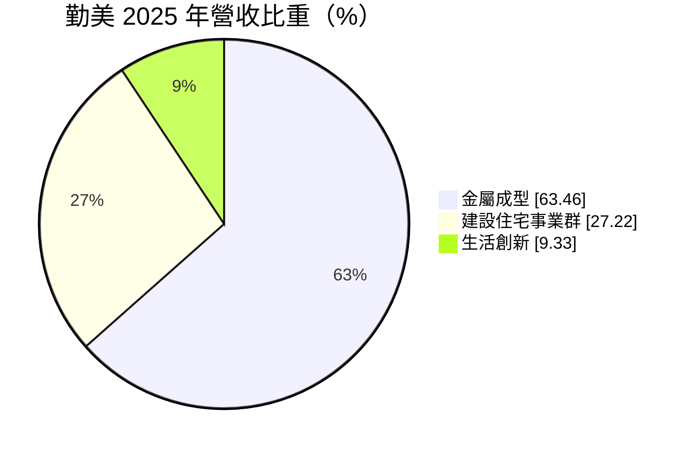
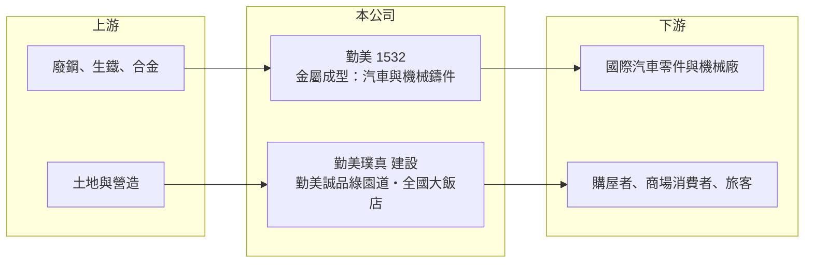

# 1532 勤美

> 上市｜[[產業索引-電機機械|電機機械]]｜上市（櫃）日期 2000/09/11

# 第一章：企業模式與商業藍圖

> [!info] 撰寫說明
> 精簡版，由 Claude 依公開資料整理，架構比照 [[2330台積電]]，資料截至 2026-10-08。來源：證交所開放資料快照（基本資料、2026 年第二季資產負債與損益、股利、每月營收）、Goodinfo 經營績效頁（含子公司公告標題）、MoneyDJ 基本資料頁（2025 年營收比重）、勤美公司網站永續報告書連結。鑄造廠區與客戶結構係憑記憶整理。#待校對

勤美股份有限公司（以下簡稱勤美）是一家「雙引擎」集團：一邊是以汽車與機械鑄件為主的金屬成型本業，另一邊是以台中為核心的建設、商場與飯店事業。理解勤美的關鍵在於：製造業提供營收規模，不動產則決定資產價值與獲利起伏，兩者的經營邏輯與週期完全不同。

- **核心業務：** 勤美成立於 1972 年，總部位於台北，早年以[[鑄造]]起家，生產灰鑄鐵與球墨鑄鐵件，供應汽車煞車、底盤與工業機械使用（產品細項依記憶整理，#待校對）。2000 年代起集團跨足不動產，成立建設子公司勤美璞真，並在台中經營勤美誠品綠園道商場與全國大飯店等生活事業。
- **營收結構：** 依 MoneyDJ 資料，2025 年金屬成型占營收 63.46%、建設住宅事業群 27.22%、生活創新 9.33%。鑄件是穩定的基本營收，但屬於薄利的製造業；建設案則採完工交屋才認列營收，所以每年的營收與獲利會隨交屋時點大幅跳動。生活創新包含商場、飯店等營運型資產，收入較為平穩。
- **營運據點：** 鑄造產能分布在台灣與中國（一般認為包括天津等地，#待校對），客戶以國際汽車零件與機械廠為主。不動產事業集中在台中，以勤美綠園道一帶為核心，透過建案、商場與飯店形成區域品牌。合併報表中有大額[[非控制權益]]，代表部分事業由集團與其他股東共同持有。
- **長期方向：** 勤美的長期方向是以鑄造本業的現金流支撐不動產的開發，並在台中累積商圈品牌與自持資產。鑄件方面，電動車普及會減少引擎相關鑄件，但煞車、底盤與傳動零件仍需鑄件，產品組合需要隨之調整。不動產方面，持續推案與自持商用資產的比重，將決定集團未來的獲利穩定度。

# 第二章：護城河深度與競爭優勢

勤美的護城河分成兩塊：鑄造業的客戶認證與規模，以及台中商圈的品牌與土地，兩者都屬「窄護城河」。

- **競爭優勢：** 汽車鑄件涉及行車安全，需要通過 [[IATF 16949]] 品質系統與車廠零件認證，供應商一旦導入車型，通常會供應到車型生命週期結束，轉換成本不低。勤美經營鑄造五十多年，規模在台灣同業中名列前茅。不動產方面，勤美在台中綠園道一帶的長期經營建立了「勤美」的區域品牌，有助於建案銷售與商場招商。
- **主要對手：** 鑄造業的對手包括中國與印度的大型鑄造廠，以及台灣同業 1589永冠-KY、[[4557永新-KY]] 等，價格競爭激烈。不動產方面，台中有眾多在地與全國型建商競爭，例如 [[2501國建]]、[[5534長虹]] 等也在中部推案。商場與飯店則與台中其他百貨、飯店集團競爭。
- **觀察重點：** 長期應分別追蹤兩條線：鑄件的毛利率是否能隨產品升級而改善，以及建設推案與交屋的節奏。2025 年營業利益率由前一年的 10.9% 降到 7.28%，EPS 由 3.05 元降到 0.98 元，起伏主要來自交屋認列的時間差。投資人若只看單一年度，容易誤判公司的長期獲利能力。

# 第三章：財務體質與盈利規模

資料日期：2026-10-08，表格是撰寫當時的快照；最新月營收、毛利率、累計 EPS 由自動排程寫在本筆記的屬性欄位（月營收、毛利率、累計EPS 等）。#待校對

勤美的財務數字結合了製造業的穩定與建設業的跳動：營收長年在 130 至 190 億元之間，EPS 則隨交屋年份在 1 至 5 元之間擺盪。

| 年度 | 營收（億元） | [[毛利率]] | [[營業利益率]] | EPS（元） | [[ROE]] |
|---|---|---|---|---|---|
| 2020 | 131 | 25.1% | 9.89% | 1.47 | 4.99% |
| 2021 | 189 | 23.1% | 9.87% | 3.22 | 10.3% |
| 2022 | 146 | 22.5% | 7.18% | 2.14 | 5.92% |
| 2023 | 176 | 23.4% | 9.71% | 2.56 | 7.73% |
| 2024 | 180 | 25.4% | 10.9% | 3.05 | 8.31% |
| 2025 | 154 | 24.0% | 7.28% | 0.98 | 3.76% |

（來源：Goodinfo 經營績效頁，合併報表。2016 至 2019 年營收 138 至 181 億元，2018 年 EPS 4.76 元為近十年高點。）

- **營收規模：** 2020 至 2025 年營收由 131 億元增至 154 億元，年複合成長率約 3.3%（推算），整體規模大致持平。2026 年 1 至 8 月累計營收約 98.5 億元，與前一年同期大致相當。
- **獲利：** 近五年（2021 至 2025）平均 ROE 約 7.2%（推算），在 3.8% 到 10.3% 之間波動。毛利率長年維持在 22% 至 25%，但營業利益轉成 EPS 的比例偏低，原因包括建設業務的利息負擔，以及部分獲利歸屬非控制權益。2026 年上半年營業利益率約 3.6%、EPS 0.10 元，屬交屋空窗期的低點。
- **財務特色：** 依 2026 年第二季資料，總資產約 550 億元，負債約 357 億元（流動負債約 257 億元，主要應為建案存貨相關的借款與預收房款，#待校對），權益總計約 193 億元，其中歸屬母公司約 151.5 億元。負債比約 65%，是建設業常見的高槓桿結構。每股淨值約 36.4 元、[[股價淨值比]]約 0.59 倍。2025 年度現金股利每股 0.8 元，大致跟隨獲利調整。自由現金流受土地購置與建案進度影響大，是否長期為正未查得。
- **[[ROIC]] 與 [[WACC]]：** 以 2025 年營業利益約 11.2 億元（154 億元 × 7.28%）、稅率 20% 計算，稅後營業利益約 9.0 億元；有息負債未查得，投入資本以權益總計 193 億元到權益加全部負債 550 億元為區間，ROIC 約 1.6% 至 4.6%（推算）。WACC 以 [[CAPM]] 推估：無風險利率 1.75%、市場風險溢酬 6%、β 假設 0.9，權益成本約 7.2%；稅後負債成本 2%、有息負債與權益各占一半（假設），WACC 約 4.6%（推算）。ROIC 大致落在 WACC 附近或以下，代表集團整體只勉強賺回資金成本；不動產資產若有未反映在帳上的增值，經濟報酬可能高於帳面計算。

# 第四章：總體風險與地緣政治

勤美的風險分成製造與不動產兩條線，加上高槓桿帶來的財務風險。

- **產業週期：** 鑄件需求跟著全球汽車與工業機械景氣走，車市或機械景氣下滑時，訂單會沿供應鏈放大下修。不動產則受房貸利率、信用管制與房市景氣影響，建案從購地到交屋需數年，景氣反轉時容易出現餘屋與跌價風險。
- **營運風險：** 電動車普及會改變鑄件的產品結構，引擎與變速箱相關鑄件需求下降，公司需轉向電動車適用的底盤與煞車零件。建設業務的獲利集中在交屋年度，使集團 EPS 難以預測。商場與飯店的營運受消費景氣與觀光人潮影響。
- **其他風險：** 鑄造業屬高耗能產業，電價上漲、碳費與環保法規會增加成本；廢鋼、生鐵等原料價格波動影響毛利。中國廠區面臨地緣政治與當地政策風險。高負債比使集團對利率變動敏感，央行升息或選擇性信用管制會同時影響買方與公司本身的資金成本。

# 專有名詞解析

## 應用

- **[[IATF 16949]]**：汽車產業的品質管理系統標準，車用零件供應商通常必須取得此認證才能進入車廠供應鏈。

## 金融

- **[[非控制權益]]**：子公司中不屬於母公司的股權，其分得的淨利不計入母公司股東的 EPS。
- **[[股價淨值比]]**：股價除以每股淨值，低於 1 倍代表市價低於帳面淨值，常反映市場對資產報酬率的疑慮。
- **[[ROIC]]**：投入資本報酬率，稅後營業利益除以股東權益加有息負債，衡量本業運用資本的效率。
- **[[WACC]]**：加權平均資金成本，依股東權益與負債的比重，加權計算公司取得資金的平均成本。
- **[[CAPM]]**：資本資產定價模型，以無風險利率加上 β 乘以市場風險溢酬估算股東要求報酬率。

## 產業

- **[[鑄造]]**：把熔融金屬倒入模具冷卻成形的製程，可大量生產形狀複雜的零件，例如煞車碟盤與機械底座。

# 核心供應鏈

- 上游：廢鋼、生鐵與合金原料（例如 [[2002中鋼]]），以及建設所需的土地與營造廠。
- 下游／客戶：國際汽車零件與工業機械廠（具體客戶名單公開資料未點名，#待校對）；台中地區購屋者、商場消費者與飯店旅客。
- 同業：鑄造 1589永冠-KY、[[4557永新-KY]]；建設 [[2501國建]]、[[5534長虹]]；飯店 [[2707晶華]]。

## 最新新聞
<!-- news:start -->
<!-- news:end -->

## 相關連結
- [公開資訊觀測站](https://mopsov.twse.com.tw/mops/web/t05st03?step=1&firstin=1&co_id=1532)
- [Goodinfo](https://goodinfo.tw/tw/StockDetail.asp?STOCK_ID=1532)
- [Yahoo 股市](https://tw.stock.yahoo.com/quote/1532)
- [鉅亨網新聞](https://www.cnyes.com/twstock/1532/news)
