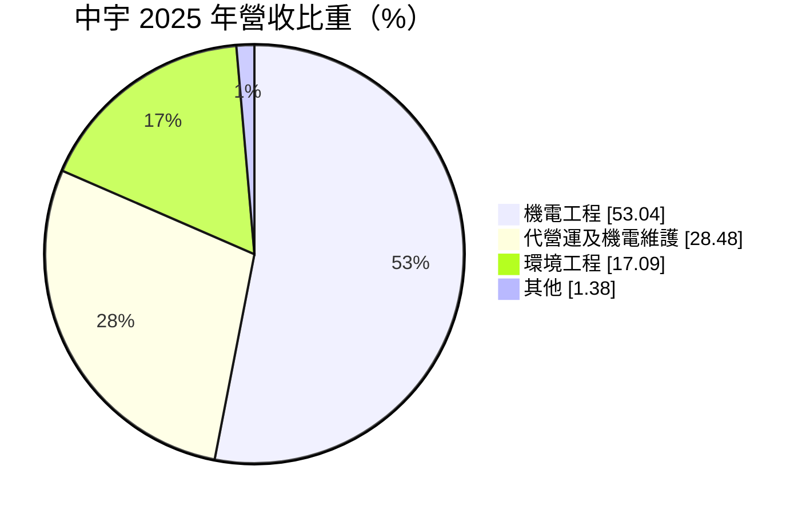
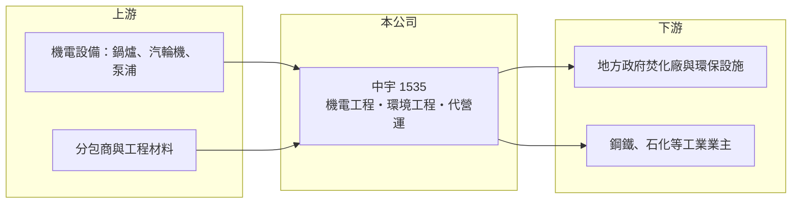

# 1535 中宇

> 上市｜[[產業索引-電機機械|電機機械]]｜上市（櫃）日期 2001/09/17

# 第一章：企業模式與商業藍圖

> [!info] 撰寫說明
> 精簡版，由 Claude 依公開資料整理，架構比照 [[2330台積電]]，資料截至 2026-10-08。來源：證交所開放資料快照（基本資料、2026 年第二季資產負債與損益、股利、每月營收）、Goodinfo 經營績效頁、MoneyDJ 基本資料頁（2025 年營收比重）。與中鋼集團的關係、代營運廠別與客戶結構係憑記憶整理。#待校對

中宇環保工程（以下簡稱中宇）是一家以機電工程、環保工程與焚化廠[[代營運]]為主的工程服務公司。理解中宇的關鍵在於：它不靠工廠與機器賺錢，而是靠工程管理與長期營運合約，毛利率雖低，但資本需求小，所以股東權益報酬率反而穩定在一成以上。

- **核心業務：** 中宇成立於 1993 年，總部位於高雄，2000 年掛牌上市，一般認為屬於 [[2002中鋼]] 集團的轉投資事業（#待校對）。公司承攬工廠與公共設施的機電工程，建置污水處理、空污防制等環保設施，並受政府或業主委託營運垃圾焚化廠與相關設備。這三項業務共同的核心能力，是大型機電系統的設計整合與長期運轉維護。
- **營收結構：** 依 MoneyDJ 資料，2025 年機電工程占營收 53.04%、代營運及機電維護 28.48%、環境工程 17.09%、其他 1.38%。工程收入依完工進度認列，會隨大案的開工與完工而起伏；代營運則是多年期合約，每年收入相對固定，是公司的穩定基本盤。
- **營運據點：** 總部與主要業務集中在高雄與南台灣，這裡是鋼鐵、石化等重工業與焚化廠的集中地。各代營運廠的名單與合約年限未查得。工程業務需要大量現場工程人員，人力與分包商管理能力是營運重點。
- **長期方向：** 台灣的焚化廠多建於 1990 至 2000 年代，正陸續進入[[整改]]與延役階段，需要大規模的設備更新與長期營運；淨零政策也帶動工廠節能、廢棄物資源化與水資源回收的投資。中宇的長期機會在於把工程能力與營運合約結合，承接「整改加長期代營運」的案件，讓穩定收入的比重持續提高。

# 第二章：護城河深度與競爭優勢

中宇的護城河來自實績、集團背景與長期營運經驗，屬於「穩定但不寬」的類型。

- **競爭優勢：** 焚化廠與大型環保設施的標案，通常要求投標廠商具備同類設施的建造或營運實績，新進者很難取得第一張門票。中宇累積多年代營運經驗，熟悉焚化爐、發電機組與空污設備的運轉維護，這種現場經驗難以快速複製。若中鋼集團背景屬實，集團內的機電與環保工程需求也提供了穩定的案源。
- **主要對手：** 環保設施營運方面，[[6803崑鼎]] 是國內焚化廠營運的主要業者；大型統包工程則有 [[9933中鼎]] 等工程公司；廢棄物處理與水處理相關同業包括 [[8473山林水]]、[[8422可寧衛]]。在公共工程標案上，價格與實績是主要競爭條件。
- **觀察重點：** 長期最該追蹤的是代營運與維護收入的比重與合約續約狀況，以及工程毛利率能否維持在近年約 9% 至 10% 的水準。2017 至 2020 年中宇的毛利率曾跌到 4% 至 7%，營業利益率接近零，顯示工程業務若遇到成本上升或低價搶標，獲利會迅速被侵蝕。2021 年後毛利率回升並維持穩定，是經營改善的訊號。

# 第三章：財務體質與盈利規模

資料日期：2026-10-08，表格是撰寫當時的快照；最新月營收、毛利率、累計 EPS 由自動排程寫在本筆記的屬性欄位（月營收、毛利率、累計EPS 等）。#待校對

中宇是「低毛利、高周轉、穩報酬」的工程服務股，近五年 ROE 穩定在 13% 至 15%，在本批電機機械類公司中表現最穩。

| 年度 | 營收（億元） | [[毛利率]] | [[營業利益率]] | EPS（元） | [[ROE]] |
|---|---|---|---|---|---|
| 2020 | 88.4 | 5.70% | 0.73% | 1.60 | 6.66% |
| 2021 | 84.8 | 8.33% | 2.86% | 3.26 | 13.0% |
| 2022 | 88.4 | 9.19% | 3.76% | 4.21 | 15.4% |
| 2023 | 97.6 | 9.98% | 4.76% | 4.50 | 15.5% |
| 2024 | 109 | 9.31% | 4.42% | 4.06 | 13.6% |
| 2025 | 114 | 9.46% | 4.15% | 4.00 | 13.1% |

（來源：Goodinfo 經營績效頁，合併報表。2016 至 2019 年營收 84.7 至 108 億元，2018 年營業利益率僅 0.26%。）

- **營收規模：** 2020 至 2025 年營收由 88.4 億元增至 114 億元，年複合成長率約 5.2%（推算），2023 年起連續成長。2026 年 1 至 8 月累計營收約 55.6 億元，較前一年同期減少約 26.8%，反映工程案認列的時間差，屬工程業常見的波動。
- **獲利：** 近五年（2021 至 2025）平均 ROE 約 14.1%（推算），而且年度間差距不大。營業利益率只有 4% 左右，但因為工程業的資產主要是應收款與合約資產，資本周轉快，所以 ROE 仍然穩定。2020 年 EPS 1.60 元高於營業利益所能支撐的水準，顯示當年業外收益占比較高。2026 年上半年 EPS 1.64 元。
- **財務特色：** 依 2026 年第二季資料，總資產約 75.1 億元，負債約 37.7 億元（其中流動負債約 35.4 億元，多為工程業常見的應付款與預收工程款，#待校對），股東權益約 37.3 億元，每股淨值約 30.2 元。2025 年度配發現金股利每股 3.0 元，以 EPS 4.00 元計配息率約 75%，屬高配息政策。自由現金流受工程收款時點影響，是否長期為正未查得。
- **[[ROIC]] 與 [[WACC]]：** 以 2025 年營業利益約 4.73 億元（114 億元 × 4.15%）、稅率 20% 計算，稅後營業利益約 3.78 億元；有息負債未查得，投入資本以股東權益 37.3 億元到權益加全部負債 75.1 億元為區間，ROIC 約 5.0% 至 10.1%（推算）。由於負債多屬不計息的營運負債，實際 ROIC 應較接近上限。WACC 以 [[CAPM]] 推估：無風險利率 1.75%、市場風險溢酬 6%、β 假設 0.7（公共工程與長約營運收入較穩定），權益成本約 6.0%；有息負債比重低，WACC 約 5.8%（推算）。ROIC 高於 WACC 約 3 至 4 個百分點（推算），代表中宇長期能為股東創造價值。

# 第四章：總體風險與地緣政治

中宇的風險主要來自工程業的執行風險、公共標案的政策依賴，以及人力成本。

- **產業週期：** 機電與環保工程需求跟著工業投資與公共建設預算走，重工業景氣下滑時，工廠的擴建與更新會延後。焚化廠整改與延役的時程取決於政府預算與政策，標案釋出的時點不易預測。
- **營運風險：** 工程業採完工比例認列，若遇到工期延誤、材料與人工成本上升，或設計變更未獲業主補償，單一案件就可能侵蝕整年度的獲利。代營運合約到期需要重新投標，若續約失利，穩定收入會減少。焚化廠營運涉及環保與工安，一旦發生事故，可能面臨罰款與商譽損失。
- **其他風險：** 營建業缺工使人工成本持續上升，固定價格合約下難以轉嫁。環保法規（例如排放標準與碳費）提高時，既是業務機會，也可能增加營運中廠房的合規成本。主要業務在國內，匯率影響相對小，但設備採購部分以外幣計價。

# 專有名詞解析

## 金融

- **[[ROIC]]**：投入資本報酬率，稅後營業利益除以股東權益加有息負債，衡量本業運用資本的效率。
- **[[WACC]]**：加權平均資金成本，依股東權益與負債的比重，加權計算公司取得資金的平均成本。
- **[[CAPM]]**：資本資產定價模型，以無風險利率加上 β 乘以市場風險溢酬估算股東要求報酬率。

## 產業

- **[[代營運]]**：業主（多為政府）把焚化廠、污水廠等設施委託民間廠商長期操作維護，按合約收取營運費。
- **[[整改]]**：既有焚化廠或公共設施在使用年限屆滿前進行設備汰換與功能提升，以延長營運年限。

# 核心供應鏈

- 上游：鍋爐、汽輪發電機、泵浦、空污與水處理設備供應商（例如 [[1503士電]]、[[1504東元]] 這類機電設備廠所屬的產業，實際往來未查得），以及各類工程分包商。
- 下游／客戶：地方政府委託營運的焚化廠與環保設施，以及鋼鐵、石化等工業業主（可能包括 [[2002中鋼]] 集團，#待校對）。
- 同業：[[6803崑鼎]]、[[9933中鼎]]、[[8473山林水]]、[[8422可寧衛]]。

## 最新新聞
<!-- news:start -->
<!-- news:end -->

## 相關連結
- [公開資訊觀測站](https://mopsov.twse.com.tw/mops/web/t05st03?step=1&firstin=1&co_id=1535)
- [Goodinfo](https://goodinfo.tw/tw/StockDetail.asp?STOCK_ID=1535)
- [Yahoo 股市](https://tw.stock.yahoo.com/quote/1535)
- [鉅亨網新聞](https://www.cnyes.com/twstock/1535/news)
