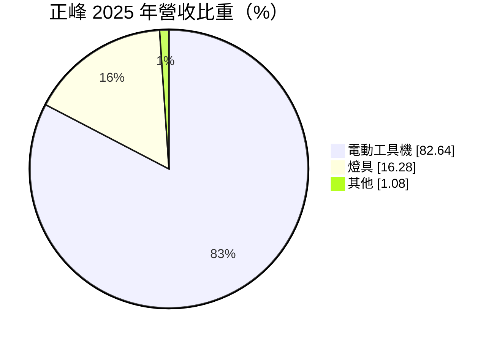
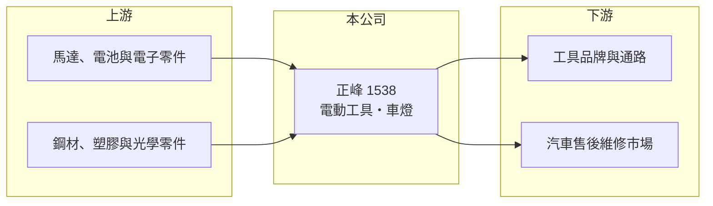

# 1538 正峰

> 上市｜[[產業索引-電機機械|電機機械]]｜上市（櫃）日期 2002/08/26

# 第一章：企業模式與商業藍圖

> [!info] 撰寫說明
> 精簡版，由 Claude 依公開資料整理，架構比照 [[2330台積電]]，資料截至 2026-10-08。來源：證交所開放資料快照（基本資料、2026 年第二季資產負債與損益、股利、每月營收）、Goodinfo 經營績效頁、MoneyDJ 基本資料頁（2025 年營收比重）、CMoney 投資快訊標題（業務涵蓋電動工具機與車燈）。產品細項與客戶結構未查得。公開資料有限。#待校對

正峰工業（以下簡稱正峰）是一家規模很小的電動工具與燈具製造商。理解正峰的關鍵在於：它的營收在十年內由近 7 億元萎縮到 1 億元出頭，而且每一年本業都在虧損，評估這家公司首先要看的是它能否持續經營，而不是成長性。

- **核心業務：** 正峰成立於 1976 年，總部位於桃園中壢，2002 年在證交所上市。公司生產電動工具，並有燈具業務，依財經媒體整理，燈具以車燈為主。電動工具屬於國際品牌主導、代工廠以成本競爭的市場，小型廠商很難靠規模取勝。
- **營收結構：** 依 MoneyDJ 資料，2025 年電動工具機占營收 82.64%、燈具 16.28%、其他 1.08%。兩項業務都屬於成熟的製造業，而正峰在這兩個市場的規模都很小。電動工具的具體品項與主要客戶公開資料未說明。
- **營運據點：** 總部與工廠位於桃園中壢。實收資本額 3.23 億元，在上市公司中屬於極小型規模。海外生產或銷售據點的資料未查得。
- **長期方向：** 公開資料沒有說明明確的轉型或擴張計畫。從財務數字來看，公司當前的首要課題是止血：營收若無法回到能攤提固定成本的規模，就需要縮減業務、處分資產或引進新的資金與策略夥伴。投資人追蹤時應關注公司是否有增資、減資、處分資產或經營權變動等改變結構的事件。

# 第二章：護城河深度與競爭優勢

正峰幾乎沒有可辨識的護城河，在主要市場中缺乏規模、品牌與成本優勢。

- **競爭優勢：** 正峰經營製造業五十年，具備基本的電動工具與燈具生產能力與工廠設備。但從營業利益率長年為負、毛利率多在 8% 至 23% 之間來看，產品並沒有足夠的定價力，生產規模也不足以攤提費用。公開資料中看不到明顯的技術或客戶優勢。
- **主要對手：** 電動工具市場由國際品牌主導，代工端則有大量中國與東南亞工廠，台灣同業包括 [[1515力山]]、[[1527鑽全]]，以及工具電池與充電器廠 [[1533車王電]]，規模都遠大於正峰。車燈方面，台灣有 [[1522堤維西]]、[[1339昭輝]] 等專業車燈廠，在售後與原廠市場都有較完整的產品線。
- **觀察重點：** 長期最該觀察的是營收能否止跌，以及淨值是否繼續下降。2026 年 1 至 8 月累計營收約 0.42 億元，比前一年同期減少約一半；上半年營業利益率約 -88.5%。在這樣的規模下，即使毛利率改善，也很難轉為獲利，必須有業務結構上的改變。

# 第三章：財務體質與盈利規模

資料日期：2026-10-08，表格是撰寫當時的快照；最新月營收、毛利率、累計 EPS 由自動排程寫在本筆記的屬性欄位（月營收、毛利率、累計EPS 等）。#待校對

正峰的財務紀錄是長期虧損的案例：2016 至 2025 年每一年的營業利益都是負數，股東權益已經大幅縮水。

| 年度 | 營收（億元） | [[毛利率]] | [[營業利益率]] | EPS（元） | [[ROE]] |
|---|---|---|---|---|---|
| 2020 | 2.76 | 12.5% | -30.5% | -0.57 | -7.74% |
| 2021 | 2.66 | 11.4% | -26.7% | -5.13 | -131% |
| 2022 | 2.85 | 14.9% | -13.4% | -0.88 | -57.8% |
| 2023 | 1.94 | 8.87% | -28.2% | -0.64 | -20.3% |
| 2024 | 1.13 | 8.25% | -48.8% | -1.70 | -27.0% |
| 2025 | 1.15 | 23.1% | -44.5% | -1.59 | -31.4% |

（來源：Goodinfo 經營績效頁，合併報表。2016 年營收 6.81 億元、2018 年 4.23 億元、2019 年 3.63 億元，營業利益率介於 -12% 至 -28%；2017 年資料未查得。ROE 劇烈波動反映股東權益基數很小，期間股本可能有變動，未查得明細。）

- **營收規模：** 2020 至 2025 年營收由 2.76 億元降到 1.15 億元，年複合成長率約 -16.1%（推算）；若從 2016 年的 6.81 億元算起，營收已減少超過八成。2026 年上半年營收僅約 0.34 億元。
- **獲利：** 近五年（2021 至 2025）平均 ROE 約 -53.5%（推算），代表股東權益平均每年縮水一半以上，這個數字之所以極端，是因為權益基數已經很小。2021 年 EPS -5.13 元遠大於營業虧損，顯示當年有大額業外損失。2026 年上半年業外損失約 0.27 億元、EPS -1.76 元，本業與業外同時虧損。
- **財務特色：** 依 2026 年第二季資料，總資產約 2.46 億元，負債約 1.28 億元，股東權益僅約 1.18 億元，每股淨值約 3.63 元，已低於面額 10 元的一半，帳上存在大額[[累積虧損]]。依台灣證券交易規範，每股淨值低於面額的股票通常不能進行融資融券（#待校對）。公司近年未配發股利。自由現金流長期為負的可能性高（推估），具體數字未查得。
- **[[ROIC]] 與 [[WACC]]：** 以 2025 年營業利益約 -0.51 億元（1.15 億元 × -44.5%）計算，稅後營業利益約 -0.41 億元（虧損不計稅盾）；有息負債未查得，投入資本以 2026 年第二季股東權益 1.18 億元到權益加全部負債 2.46 億元為區間，ROIC 約 -35% 至 -17%（推算）。WACC 以 [[CAPM]] 推估：無風險利率 1.75%、市場風險溢酬 6%、β 假設 1.2（小型虧損股風險較高），權益成本約 9.0%；稅後負債成本 2.5%、負債占五成，WACC 約 5.8%（推算）。ROIC 為大幅負值，與 WACC 的差距代表公司每年都在消耗股東投入的資本；在本業轉盈之前，這個缺口不會縮小。

# 第四章：總體風險與地緣政治

正峰最主要的風險是持續經營本身，其次才是產業與市場風險。

- **產業週期：** 電動工具需求跟著住宅修繕與營建景氣走，品牌商在景氣下行時會先砍代工訂單；車燈售後市場則受汽車保有量與事故維修需求影響。小廠在景氣下行時往往最先被削減訂單。
- **營運風險：** 營收規模過小，固定成本無法攤提，連續虧損使淨值持續下降。若淨值繼續減少，可能觸發交易所對財務狀況不佳公司的交易方式限制，甚至面臨下市風險（具體門檻以交易所規定為準，#待校對）。公司可能需要透過減資彌補虧損、現金增資或處分資產來維持營運，這些都會影響現有股東權益。
- **其他風險：** 外銷產品受匯率影響；鋼材、塑膠與電子零件價格上漲時難以轉嫁。中國與東南亞的低成本工廠持續擠壓電動工具代工價格。小型股成交量低，股價容易受消息面影響而劇烈波動。

# 專有名詞解析

## 金融

- **[[累積虧損]]**：歷年虧損累積後尚未彌補的金額，依公司法須先彌補完畢才能分配盈餘。
- **[[ROIC]]**：投入資本報酬率，稅後營業利益除以股東權益加有息負債，衡量本業運用資本的效率。
- **[[WACC]]**：加權平均資金成本，依股東權益與負債的比重，加權計算公司取得資金的平均成本。
- **[[CAPM]]**：資本資產定價模型，以無風險利率加上 β 乘以市場風險溢酬估算股東要求報酬率。

# 核心供應鏈

- 上游：馬達、鋰電池、電子控制板，以及鋼材、塑膠與燈具光學零件供應商。
- 下游／客戶：電動工具品牌與五金通路，以及汽車售後維修市場（具體客戶名單公開資料未查得）。
- 同業：電動工具 [[1515力山]]、[[1527鑽全]]、[[1533車王電]]；車燈 [[1522堤維西]]、[[1339昭輝]]。

## 最新新聞
<!-- news:start -->
<!-- news:end -->

## 相關連結
- [公開資訊觀測站](https://mopsov.twse.com.tw/mops/web/t05st03?step=1&firstin=1&co_id=1538)
- [Goodinfo](https://goodinfo.tw/tw/StockDetail.asp?STOCK_ID=1538)
- [Yahoo 股市](https://tw.stock.yahoo.com/quote/1538)
- [鉅亨網新聞](https://www.cnyes.com/twstock/1538/news)
