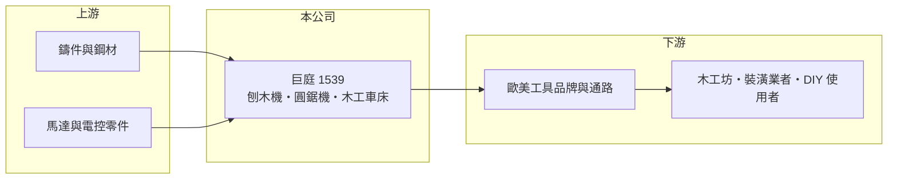

# 1539 巨庭

> 上市｜[[產業索引-電機機械|電機機械]]｜上市（櫃）日期 2002/10/29

# 第一章：企業模式與商業藍圖

> [!info] 撰寫說明
> 精簡版，由 Claude 依公開資料整理，架構比照 [[2330台積電]]，資料截至 2026-10-08。來源：證交所開放資料快照（基本資料、2026 年第二季資產負債與損益、股利）、MoneyDJ 年度財務比率表、nStock 公司簡介。產品細項與客戶結構公開資料有限，部分為整理性描述。#待校對

巨庭機械（以下簡稱巨庭）是台中太平的木工機械製造商，理解它的關鍵在於：這是一家以整機製造為主、毛利率約一成的出口型工廠，營收跟著歐美居家修繕與木工市場的需求起伏。

- **核心業務：** 巨庭成立於 1981 年，2002 年在證交所上市，主要產品是自動與手動刨木機、圓鋸機、單立軸機、木工車床等[[木工機械]]及其零件，另有五金工具的製造與買賣。這類機器多用於小型木工坊、裝潢業者與居家 [[DIY]] 使用者，屬於輕型木工機，而不是家具廠的大型自動化產線。產品定位決定了它的客戶是工具品牌與通路，而不是終端工廠。
- **營收結構：** 依產品或地區的營收比重公開資料未查得。從毛利率長期只有 9% 至 12% 判斷，業務型態較接近替國外品牌生產的 [[OEM]]，而不是自有品牌銷售（推估）。這代表公司的獲利主要取決於產能利用率與成本控管，議價空間有限。
- **營運據點：** 總部與工廠位於台中市太平區，屬於台中木工機與工具機聚落的一員。是否有海外生產據點公開資料未查得（#待校對）。台中聚落的好處是零件與鈑金、鑄件協力廠集中，壞處是人力與土地成本逐年上升。
- **長期方向：** 2021 年營收約 31 億元，到 2025 年降到約 13 億元，規模縮小超過一半，顯示疫情期間居家修繕需求退潮後，公司尚未找到新的成長來源。長期課題是能否在產品線升級（例如較高單價的機種）或新客戶上取得突破，否則營收將停留在低檔、隨景氣小幅波動。

# 第二章：護城河深度與競爭優勢

巨庭的護城河屬於窄或無：木工機械技術成熟，競爭集中在成本、交期與品質穩定度。

- **競爭優勢：** 公司有 40 多年的木工機製造經驗，熟悉歐美安全規範與品牌客戶的品質要求，這是新進工廠無法短期取得的累積。整機製造牽涉鑄件、馬達、鈑金與組裝的整合，長期合作的客戶換供應商需要重新驗證，形成一定的黏著度。但這種黏著度綁在個別機種上，不足以支撐溢價。
- **主要對手：** 同在台中的木工機業者如 [[1541錩泰]]，電動工具廠如 [[1515力山]]，以及中國大陸大量的低價木工機工廠，都是直接競爭者。中國工廠在價格上具優勢，使台灣業者必須往品質與中高階機種移動。具體對手名單與市占率公開資料未查得。
- **觀察重點：** 長期最該追蹤的是毛利率能否回到 11% 至 12% 以上，以及營收是否止跌回升。2025 年毛利率 9.74%、營業利益率 2.45%，都是近年低點，2026 年上半年毛利率再降到 9.42%，代表價格壓力仍在。若營收持續縮小，固定成本攤提會讓獲利更難改善。

# 第三章：財務體質與盈利規模

資料日期：2026-10-08，表格是撰寫當時的快照；最新月營收、毛利率、累計 EPS 由自動排程寫在本筆記的屬性欄位（月營收、毛利率、累計EPS 等）。#待校對

巨庭的財務呈現低毛利整機代工廠的典型樣貌：毛利率約一成，獲利高度依賴營收規模，近四年規模大幅縮小。

| 年度 | 營收（億元，推算） | [[毛利率]] | [[營業利益率]] | EPS（元） | [[ROE]] |
|---|---|---|---|---|---|
| 2021 | 31.4 | 10.69% | 7.40% | 1.35 | 7.92% |
| 2022 | 25.0 | 11.86% | 7.43% | 6.00 | 25.92% |
| 2023 | 15.3 | 11.27% | 5.22% | 0.96 | 3.86% |
| 2024 | 13.4 | 11.76% | 4.26% | 1.41 | 5.73% |
| 2025 | 13.0 | 9.74% | 2.45% | 0.21 | 0.84% |

（來源：MoneyDJ 年度財務比率表；營收以每股營業額乘 6,537 萬股推算，2025 年 13.02 億元與 nStock 數字一致。）

- **營收規模：** 2020 年營收約 22.9 億元（推算），2021 年疫情帶動居家木工需求衝到約 31 億元，之後連續四年下滑。2020 至 2025 年營收年複合成長率約 -10.7%（推算）。這段走勢說明公司營收主要由外部需求決定，屬於典型的景氣循環型。
- **獲利：** 近五年（2021 至 2025）平均 ROE 約 8.9%（推算），但被 2022 年的 25.92% 拉高；當年營業利益率只有 7.43%、EPS 卻達 6 元，代表大部分獲利來自業外收益，性質未查得（#待校對）。扣除這一年，本業 ROE 多在 1% 至 8% 之間，偏低。
- **財務特色：** 依 2026 年第二季資料，總資產約 22.5 億元、股東權益約 16.1 億元、負債約 6.4 億元，負債比率約 28%，較 2021 年的 66% 大幅下降，財務結構保守。保留盈餘約 9.5 億元。2025 年度未配發現金股利，股利會隨獲利大幅調整，不屬於穩定配息股。自由現金流是否長期為正未查得。
- **[[ROIC]] 與 [[WACC]]：** 以 2025 年營業利益約 0.32 億元（13.02 億元 × 2.45%）、稅率 20% 計算，稅後營業利益約 0.26 億元。有息負債未查得，投入資本以股東權益 16.1 億元到總資產 22.5 億元為區間，ROIC 約 1.1% 至 1.6%（推算）。WACC 以 CAPM 推估：無風險利率 1.75%、市場風險溢酬 6%、β 假設 0.8（中小型機械股常見值），權益成本約 6.6%；稅後負債成本 2%、負債占約 25%，WACC 約 5.4%（推算）。ROIC 明顯低於 WACC，代表近年本業未賺回資金成本；只有在 2021 至 2022 年需求高峰時才接近或超過。

# 第四章：總體風險與地緣政治

巨庭的風險集中在需求循環、低毛利結構與來自中國同業的價格競爭。

- **產業週期：** 輕型木工機的需求跟著美國與歐洲的房市、居家修繕支出與消費信心走。疫情期間需求被提前消化，之後出現長時間的庫存調整，2023 年營收年減近四成就是例子。這種循環通常需要數年才能完成，期間工廠的產能利用率偏低。
- **營運風險：** 毛利率只有一成上下，原物料或工資只要上升幾個百分點，就足以吃掉營業利益，屬於典型的[[營運槓桿]]偏高的製造業。客戶集中度公開資料未查得，但代工型態通常集中在少數品牌，失去單一客戶的衝擊會很明顯。
- **其他風險：** 營收以外銷為主，新台幣升值會壓縮毛利；鋼材、鑄件與馬達價格波動直接影響成本。美國對進口工具機與電動工具的關稅政策若變動，台灣與中國工廠之間的相對競爭力也會跟著改變。

# 專有名詞解析

## 應用

- **[[DIY]]**：消費者自己動手做的居家修繕與木工，美國的 DIY 市場是輕型木工機與電動工具的主要需求來源。

## 金融

- **[[營運槓桿]]**：固定成本占比高時，營收小幅變動就會讓營業利益大幅變動的現象。

## 產業

- **[[木工機械]]**：用於鋸切、刨削、鑽孔與成型木材的機械，從家具廠的大型產線到居家 DIY 的桌上型機種都有。
- **[[OEM]]**：原廠委託製造，代工廠依品牌客戶的設計生產，產品掛客戶品牌，毛利率通常低於自有品牌。

# 核心供應鏈

- 上游：台中地區的鑄件、鈑金與機械加工協力廠，以及馬達與電控零件供應商（具體名單公開資料未查得）。
- 下游／客戶：歐美工具品牌與居家修繕通路，最終使用者為小型木工坊、裝潢業者與 DIY 消費者（具體客戶未查得，#待校對）。
- 同業：[[1541錩泰]]、[[1515力山]]，以及中國大陸的木工機製造商。

## 最新新聞
<!-- news:start -->
<!-- news:end -->

## 相關連結
- [公開資訊觀測站](https://mopsov.twse.com.tw/mops/web/t05st03?step=1&firstin=1&co_id=1539)
- [Goodinfo](https://goodinfo.tw/tw/StockDetail.asp?STOCK_ID=1539)
- [Yahoo 股市](https://tw.stock.yahoo.com/quote/1539)
- [鉅亨網新聞](https://www.cnyes.com/twstock/1539/news)
