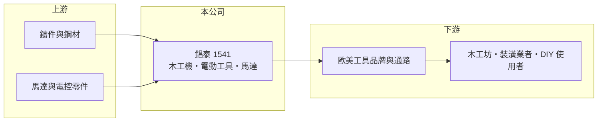

# 1541 錩泰

> 上市｜[[產業索引-電機機械|電機機械]]｜上市（櫃）日期 2003/03/19

# 第一章：企業模式與商業藍圖

> [!info] 撰寫說明
> 精簡版，由 Claude 依公開資料整理，架構比照 [[2330台積電]]，資料截至 2026-10-08。來源：證交所開放資料快照（基本資料、2026 年第二季資產負債與損益、股利）、MoneyDJ 年度財務比率表、nStock 公司簡介、CMoney 投資快訊標題。產品比重與客戶公開資料有限。#待校對

錩泰工業（以下簡稱錩泰）是台中后里的木工機械與電動工具製造商，理解它的關鍵在於：營收規模比同業大，但同樣高度受歐美居家修繕需求循環影響，而且公司採取保留盈餘、少配息的資本政策。

- **核心業務：** 錩泰成立於 1989 年，2003 年在證交所上市，營業項目涵蓋[[木工機械]]、電動工具、馬達、自動控制系統與五金零件，財經媒體常以「亞洲木工機領導者」稱呼。產品以輕型與中型的桌上型木工機為主，供木工坊、裝潢業與居家 [[DIY]] 使用者，具體機種比重未查得（#待校對）。從營業項目看，公司具備馬達與電控的整合能力，而不只是機械組裝。
- **營收結構：** 依產品或地區的營收比重公開資料未查得。毛利率長期在 12% 至 20% 之間，高於純組裝廠，但仍屬替品牌客戶生產的 [[OEM]]／[[ODM]] 型態（推估）。這代表公司獲利同時取決於訂單量與產品組合，高階機種占比提升時毛利率較好。
- **營運據點：** 總部與工廠位於台中市后里區，鄰近中部工具機與機械零件聚落。海外生產據點公開資料未查得（#待校對）。
- **長期方向：** 公司章程寫明「屬資本密集行業且處於營運成長階段，採取剩餘股利政策」，代表經營層傾向把盈餘留在公司投資，而不是發放給股東。2025 年營收回升到約 36 億元，但距離 2021 年約 62 億元的高峰仍遠，2026 年前九個月營收又年減約 38%。長期能否擺脫單一終端市場的循環，是評估這家公司的核心問題。

# 第二章：護城河深度與競爭優勢

錩泰的護城河屬於窄護城河，來自整機設計與製造的整合能力，以及與品牌客戶的長期合作。

- **競爭優勢：** 木工機要整合鑄件、馬達、電控與安全裝置，並通過歐美安全認證，整機廠需要長期累積的設計與品管能力。錩泰的營收規模在台灣同業中較大，可以分攤研發與模具成本，並承接大型品牌的量產訂單。這讓它在台灣木工機業者中有規模優勢，但面對國際品牌時議價力仍有限。
- **主要對手：** 台灣同業如 [[1539巨庭]]、電動工具廠 [[1515力山]]，以及中國大陸大量低價木工機與電動工具工廠。中國工廠在價格與供應鏈完整度上有優勢，台灣業者主要以品質穩定與中高階機種區隔。具體市占率公開資料未查得。
- **觀察重點：** 長期應追蹤毛利率能否維持在 18% 以上，以及營收能否在下一次需求循環中超越過去高點。2023 年營收下滑時毛利率反而升到 19.62%，顯示產品組合調整有效；但 2024 年營業利益率掉到 -0.05%，說明營收縮小時費用壓力很快浮現。

# 第三章：財務體質與盈利規模

資料日期：2026-10-08，表格是撰寫當時的快照；最新月營收、毛利率、累計 EPS 由自動排程寫在本筆記的屬性欄位（月營收、毛利率、累計EPS 等）。#待校對

錩泰的財務特徵是營收波動大、毛利率中等，而且業外收益在獲利中占相當比重。

| 年度 | 營收（億元，推算） | [[毛利率]] | [[營業利益率]] | EPS（元） | [[ROE]] |
|---|---|---|---|---|---|
| 2021 | 62.0 | 12.59% | 6.37% | 3.80 | 17.19% |
| 2022 | 40.6 | 14.65% | 4.21% | 3.45 | 14.93% |
| 2023 | 33.8 | 19.62% | 8.44% | 1.46 | 6.08% |
| 2024 | 29.9 | 16.47% | -0.05% | 1.06 | 4.29% |
| 2025 | 36.3 | 18.39% | 6.58% | 2.32 | 8.89% |

（來源：MoneyDJ 年度財務比率表；營收以每股營業額乘 7,880 萬股推算，2025 年 36.29 億元與 nStock 數字一致。）

- **營收規模：** 2020 年營收約 52.7 億元（推算），2021 年衝上約 62 億元後連續三年下滑，2025 年回升 21%。2020 至 2025 年營收年複合成長率約 -7.2%（推算）。走勢與 [[1539巨庭]] 相似，反映整個輕型木工機產業在疫情後的需求退潮。
- **獲利：** 近五年（2021 至 2025）平均 ROE 約 10.3%（推算）。2022 年與 2024 年 EPS 都明顯高於本業可支撐的水準，例如 2024 年營業利益率為負、EPS 仍有 1.06 元，代表業外收益（性質未查得，可能含匯兌或投資收益，#待校對）是獲利的重要來源。評估本業時應以營業利益為準。
- **財務特色：** 依 2026 年第二季資料，總資產約 31.3 億元、股東權益約 21.7 億元、負債約 9.7 億元，負債比率約 31%，比 2021 年的 66% 明顯下降。2025 年度 EPS 2.32 元，但董事會決議不配發現金股利，符合章程的剩餘股利政策；對重視現金回報的投資人，這是重要的資本配置特徵。自由現金流是否長期為正未查得。
- **[[ROIC]] 與 [[WACC]]：** 以 2025 年營業利益約 2.39 億元（36.29 億元 × 6.58%）、稅率 20% 計算，稅後營業利益約 1.91 億元。有息負債未查得，投入資本以股東權益 21.7 億元到總資產 31.3 億元為區間，ROIC 約 6.1% 至 8.8%（推算）。WACC 以 CAPM 推估：無風險利率 1.75%、市場風險溢酬 6%、β 假設 0.9（中小型機械股常見值），權益成本約 7.2%；稅後負債成本 2%、負債占約三成，WACC 約 5.6%（推算）。2025 年 ROIC 略高於 WACC，屬小幅創造價值；但 2024 年本業幾乎無營業利益，ROIC 遠低於 WACC，長期看價值創造並不穩定。

# 第四章：總體風險與地緣政治

錩泰的風險在於需求循環、業外收益依賴，以及保留盈餘能否轉化為更高的報酬。

- **產業週期：** 木工機與電動工具的需求跟著歐美房市與居家修繕支出循環，疫情帶來的需求高峰之後，產業經歷數年庫存調整。2026 年前九個月營收再度年減近四成，說明這個循環仍未穩定。
- **營運風險：** 營收規模縮小時，營業費用不易同步下降，2024 年就出現本業虧損。公司採剩餘股利政策、把盈餘留在公司，若保留下來的資金無法投入報酬率高於資金成本的項目，股東權益會累積但 ROE 下降。客戶集中度公開資料未查得。
- **其他風險：** 以外銷為主，新台幣升值會壓縮毛利，匯兌損益也會讓業外收益大幅波動。鋼材、鑄件與馬達零件價格影響成本，美國關稅政策則影響台灣、中國與東南亞工廠之間的訂單分配。

# 專有名詞解析

## 應用

- **[[DIY]]**：消費者自己動手做的居家修繕與木工，美國的 DIY 市場是輕型木工機與電動工具的主要需求來源。

## 金融

- **[[剩餘股利政策]]**：公司先保留投資所需資金，剩下的盈餘才發放股利，因此配息金額會隨投資計畫大幅變動。

## 產業

- **[[木工機械]]**：用於鋸切、刨削、鑽孔與成型木材的機械，從家具廠的大型產線到居家 DIY 的桌上型機種都有。
- **[[OEM]]**：原廠委託製造，代工廠依品牌客戶的設計生產，產品掛客戶品牌，毛利率通常低於自有品牌。
- **[[ODM]]**：原廠委託設計製造，代工廠負責設計與生產、產品掛客戶品牌，附加價值高於單純 OEM。

# 核心供應鏈

- 上游：鑄件、鋼材、鈑金與機械加工協力廠，以及馬達、開關與電控零件供應商（具體名單公開資料未查得）。
- 下游／客戶：歐美工具品牌與居家修繕通路，最終使用者為木工坊、裝潢業者與 DIY 消費者（具體客戶未查得，#待校對）。
- 同業：[[1539巨庭]]、[[1515力山]]，以及中國大陸的木工機與電動工具製造商。

## 最新新聞
<!-- news:start -->
<!-- news:end -->

## 相關連結
- [公開資訊觀測站](https://mopsov.twse.com.tw/mops/web/t05st03?step=1&firstin=1&co_id=1541)
- [Goodinfo](https://goodinfo.tw/tw/StockDetail.asp?STOCK_ID=1541)
- [Yahoo 股市](https://tw.stock.yahoo.com/quote/1541)
- [鉅亨網新聞](https://www.cnyes.com/twstock/1541/news)
