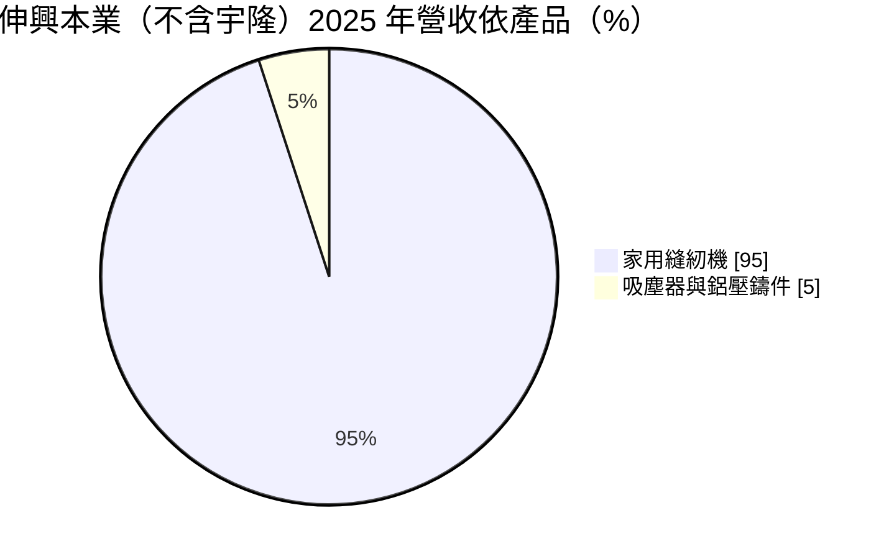
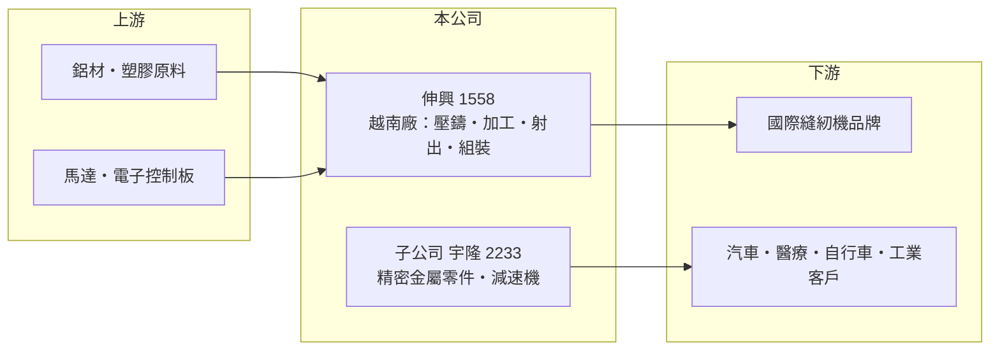

# 1558 伸興

> 上市｜[[產業索引-電機機械|電機機械]]｜上市（櫃）日期 2014/12/23

# 第一章：企業模式與商業藍圖

> [!info] 撰寫說明
> 精簡版，由 Claude 依公開資料整理，架構比照 [[2330台積電]]，資料截至 2026-10-08。來源：證交所開放資料快照（基本資料、2026 年第二季資產負債與損益、股利）、MoneyDJ 年度財務比率表、富果 2025 年 12 月法說會整理。#待校對

伸興工業（以下簡稱伸興）是全球主要的家用縫紉機代工廠，理解它的關鍵在於：本業是一個成熟、需求平穩的利基市場，公司靠越南的垂直整合工廠維持成本優勢，並透過併購子公司 [[2233宇隆]] 把觸角延伸到汽車、醫療與機器人零件。

- **核心業務：** 伸興成立於 1975 年，2014 年在證交所上市，主要替國際品牌 [[OEM]] 生產家用縫紉機。依 2025 年 12 月法說會，家用縫紉機占本業營收約 95%，吸塵器與[[壓鑄]]件約 5%；縫紉機中機械式低階機種占六至七成、毛利率約 18% 至 22%，電腦、刺繡與拷克等高階機種約三成、毛利率約 25%。2025 年前三季縫紉機出貨 167 萬台，年增 14%。
- **營收結構：** 合併營收由伸興本業與子公司宇隆組成，2025 年前三季合併營收 64.72 億元，其中伸興本業 39.63 億元、宇隆 25.09 億元。依出貨地區，歐洲約占 51%、亞洲約 20%、北美約 16%。歐洲是最大市場，代表伸興的需求與歐洲消費景氣連動較深。
- **營運據點：** 伸興自 2005 年起在越南設廠，目前約 92% 產能在越南、約 8% 在中國張家港，台灣廠已於 2024 年第三季後停產。越南廠從壓鑄、CNC 加工、塑膠射出、印刷到組裝一條龍完成，這種[[垂直整合]]是它能以低價承接品牌訂單、又維持兩成以上毛利率的關鍵。
- **長期方向：** 本業方面，公司持續把產品組合往 WiFi 連網家用機與商用刺繡機等高附加價值機種移動。集團方面，2022 年取得宇隆經營權（#待校對），宇隆生產汽車、醫療、自行車與工業用精密金屬零件，並開發機器人關節用[[減速機]]，是伸興在縫紉機之外的長期成長選項。

# 第二章：護城河深度與競爭優勢

伸興的護城河來自全球家用縫紉機代工的規模與越南垂直整合的成本結構，屬於窄但穩定的護城河。

- **競爭優勢：** 家用縫紉機是全球規模不大、成長平緩的市場，新進者缺乏投資動機，既有代工廠的規模經濟因此不易被挑戰。伸興把零件自製率拉高，在越南完成大部分製程，比依賴外購零件的組裝廠更能控制成本與品質。品牌客戶的機種從開發到量產需要長期配合，轉換代工廠的成本與風險都高。
- **主要對手：** 主要競爭來自中國大陸的縫紉機製造商，以及日本品牌自有的海外工廠。全球家用縫紉機品牌集中在少數歐美日業者，伸興的客戶與對手常有重疊（品牌本身也可能自製），具體客戶與對手名單法說會未點名。
- **觀察重點：** 長期應追蹤高階機種占比能否持續提升，帶動本業毛利率由兩成出頭往 25% 移動；以及宇隆的減速機與醫療零件能否成為集團新的獲利來源。美國關稅方面，公司預估給客戶的約 5% 折讓可由供應商降價抵銷，影響有限，但需觀察實際結果。

# 第三章：財務體質與盈利規模

資料日期：2026-10-08，表格是撰寫當時的快照；最新月營收、毛利率、累計 EPS 由自動排程寫在本筆記的屬性欄位（月營收、毛利率、累計EPS 等）。#待校對

伸興的財務特色是毛利率穩定在兩成以上、財務結構保守、配息率高，屬於成熟期的現金型公司。

| 年度 | 營收（億元，推算） | [[毛利率]] | [[營業利益率]] | EPS（元） | [[ROE]] |
|---|---|---|---|---|---|
| 2021 | 76.9 | 20.61% | 9.23% | 8.67 | 10.53% |
| 2022 | 71.7 | 20.21% | 5.01% | 8.03 | 8.90% |
| 2023 | 75.3 | 25.37% | 6.86% | 3.81 | 7.25% |
| 2024 | 83.1 | 29.45% | 11.17% | 6.81 | 10.41% |
| 2025 | 80.8 | 26.93% | 9.01% | 5.52 | 7.15% |

（來源：MoneyDJ 年度財務比率表；2025 年營收以每股營業額乘約 6,454 萬股推算，其餘年度依營收成長率回推，與實際數字可能有出入。）

- **營收規模：** 2020 年營收約 69 億元（推算），2020 至 2025 年營收年複合成長率約 3.1%（推算），成長幅度溫和，符合成熟產業的特性。2022 年本業營收下滑，但合併宇隆後總營收大致持平（推估）。
- **獲利：** 近五年（2021 至 2025）平均 ROE 約 8.9%（推算），比 2018 至 2020 年的 14% 至 20% 低，部分原因是宇隆併入後股東權益擴大、而宇隆的獲利率低於本業。2022 年營業利益率只有 5.01% 但 EPS 有 8.03 元，代表當年業外收益占比高（性質未查得，#待校對）。2026 年上半年合併營收 42.18 億元、EPS 4.44 元。
- **財務特色：** 依 2026 年第二季資料，總資產約 141.8 億元、權益總計約 86.9 億元（其中非控制權益約 34.9 億元，主要屬宇隆其他股東）、負債約 54.9 億元，負債比率約 39%。2025 年度配發現金股利 5 元，以 EPS 5.52 元計，配息率約九成；章程寫明「企業生命週期正值成熟期，採取股利穩定暨平衡政策」，法說會揭露的配息目標為 65% 至 75%。自由現金流是否長期為正未查得。
- **[[ROIC]] 與 [[WACC]]：** 以 2025 年營業利益約 7.28 億元（80.8 億元 × 9.01%）、稅率 20% 計算，稅後營業利益約 5.82 億元。有息負債未查得，投入資本以權益總計 86.9 億元到總資產 141.8 億元為區間，ROIC 約 4.1% 至 6.7%（推算）。WACC 以 CAPM 推估：無風險利率 1.75%、市場風險溢酬 6%、β 假設 0.8（成熟製造業常見值），權益成本約 6.6%；稅後負債成本 2%、負債占約 35%，WACC 約 5.0%（推算）。ROIC 大致在 WACC 上下，本業單獨看應高於資金成本，但合併宇隆後整體報酬被稀釋；宇隆的新事業能否提高報酬率，是集團長期價值的關鍵。

# 第四章：總體風險與地緣政治

伸興的風險主要來自成熟市場的需求天花板、地區集中與越南生產集中。

- **產業週期：** 家用縫紉機屬於興趣與家庭消費品，2020 至 2021 年疫情居家需求帶來高峰，之後回到平穩。市場長期成長有限，伸興的成長主要靠搶市占與產品升級，而不是市場擴大。歐洲占出貨一半，歐洲消費景氣轉弱時影響最直接。
- **營運風險：** 產能約九成集中在越南，越南的工資上升、電力供應或政策變化都會影響成本。品牌客戶數量有限，客戶若改變外包策略或轉向中國代工廠，衝擊會很明顯。宇隆的機器人減速機仍在開發階段，能否量產有不確定性。
- **其他風險：** 營收以美元與歐元計價，新台幣升值會壓縮毛利；鋁材與塑膠原料價格影響成本。美國關稅政策若擴大到越南，伸興需要與客戶、供應商重新分攤成本。

# 專有名詞解析

## 產業

- **[[OEM]]**：原廠委託製造，代工廠依品牌客戶的設計生產，產品掛客戶品牌，毛利率通常低於自有品牌。
- **[[壓鑄]]**：把熔融的鋁或鋅合金高壓注入模具成型的金屬加工方式，用於製作機殼與結構件。
- **[[減速機]]**：降低馬達轉速、放大扭力的傳動元件，精密減速機是機器人關節的核心零件。
- **[[垂直整合]]**：把上游零件與加工製程納入自家工廠，以降低成本、掌握品質與交期。

# 核心供應鏈

- 上游：鋁錠與塑膠原料、馬達與電子控制板供應商；越南廠自製壓鑄、加工與射出件，外購比重較低。
- 下游／客戶：歐洲、亞洲與北美的國際家用縫紉機品牌（法說會未點名，#待校對）；宇隆的客戶為汽車、醫療、自行車與工業設備廠。
- 同業：中國大陸縫紉機製造商與日本品牌的海外工廠；集團內精密零件業務可對照 [[2233宇隆]]。

## 最新新聞
<!-- news:start -->
<!-- news:end -->

## 相關連結
- [公開資訊觀測站](https://mopsov.twse.com.tw/mops/web/t05st03?step=1&firstin=1&co_id=1558)
- [Goodinfo](https://goodinfo.tw/tw/StockDetail.asp?STOCK_ID=1558)
- [Yahoo 股市](https://tw.stock.yahoo.com/quote/1558)
- [鉅亨網新聞](https://www.cnyes.com/twstock/1558/news)
