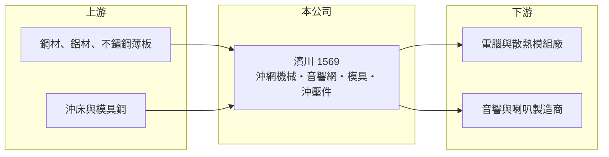

# 1569 濱川

> 上櫃｜[[產業索引-電腦及週邊設備業|電腦及週邊設備業]]｜上市（櫃）日期 2005/07/29

# 第一章：企業模式與商業藍圖

> [!info] 撰寫說明
> 精簡版，由 Claude 依公開資料整理，架構比照 [[2330台積電]]，資料截至 2026-10-08。來源：櫃買中心開放資料快照（基本資料、2026 年第二季資產負債與損益）、Goodinfo 經營績效頁、nStock 公司簡介。櫃買中心產業別為電腦及週邊設備業。公開資料有限，主要客戶與虧損原因未查得。#待校對

濱川是一家以金屬沖壓與[[沖網]]為核心的零件製造商，理解它的關鍵在於：它的技術是把金屬薄板沖成網孔與外殼，產品過去用在音響網罩與電腦、散熱器的周邊零件，而近三年營運陷入嚴重虧損，正處於需要重新定位的階段。

- **核心業務：** 濱川於 1983 年在高雄大發工業區設立，2005 年在櫃買中心掛牌。依 nStock 的公司簡介，公司業務為半自動沖網機械、音響裝飾網與模具的製造、加工與銷售，以及電腦與散熱器周邊產品的[[沖壓]]件買賣。換句話說，濱川同時具備「做模具與沖網設備」和「用這些設備大量生產零件」兩種能力。
- **營收結構：** 各產品線的營收比重公開資料未查得。從櫃買中心把它歸在電腦及週邊設備業來看，電腦與散熱相關的金屬件應占相當比重（推估）。音響網罩則用於喇叭與汽車音響等產品（#待校對）。
- **營運據點：** 總部與發源地在高雄大發工業區；依 2026 年第二季資料，公司[[非控制權益]]約 1.75 億元，代表旗下有非百分之百持有的子公司，但子公司名稱與海外據點公開資料未查得（#待校對）。
- **長期方向：** 營收由 2022 年的 50 億元降到 2024 年的 31 億元，毛利率由約兩成降到 2025 年的負值，原有業務的獲利模式顯然受到嚴重挑戰。公司未來能否透過新產品、新客戶或產能調整回到損益兩平，是判斷其長期價值的核心問題；具體的轉型方向公開資料未查得。

# 第二章：護城河深度與競爭優勢

濱川的護城河相當有限，沖壓與沖網屬於技術成熟、可替代性高的製程。

- **競爭優勢：** 濱川的潛在優勢在於模具與沖網設備的自製能力：能自己設計模具與沖網機械的公司，在開發新零件時的速度與成本控制優於單純代工廠。數十年的經營也累積了一定的客戶基礎。不過從 2023 年起連續三年虧損來看，這些優勢不足以抵擋價格競爭或訂單流失。
- **主要對手：** 電腦機殼與散熱金屬件的競爭者包括 [[3013晟銘電]]、[[6117迎廣]]、[[8210勤誠]] 等機殼廠，以及散熱模組廠 [[3017奇鋐]]、[[3324雙鴻]] 的自製或協力沖壓廠，中國當地也有大量沖壓廠。這些對手多半規模更大，並已切入 AI 伺服器等高成長市場。
- **觀察重點：** 長期最該追蹤的是毛利率能否回到兩成附近的歷史水準，以及營收能否止跌。2026 年上半年毛利率約 6.8%，雖然比 2025 年的負值改善，但營業利益率仍約 -10.7%。若無法回到正的營業利益，持續的虧損會侵蝕淨值與財務彈性。

# 第三章：財務體質與盈利規模

資料日期：2026-10-08，表格是撰寫當時的快照；最新月營收、毛利率、累計 EPS 由自動排程寫在本筆記的屬性欄位（月營收、毛利率、累計EPS 等）。#待校對

濱川的財務呈現由盈轉虧的明顯斷層：2020 至 2022 年仍有一成以上的 ROE，2023 年起營收下滑、毛利率崩落，2025 年虧損擴大到每股 5.61 元。

| 年度 | 營收（億元） | [[毛利率]] | [[營業利益率]] | EPS（元） | [[ROE]] |
|---|---|---|---|---|---|
| 2020 | 49.4 | 22.0% | 12.0% | 3.42 | 13.5% |
| 2021 | 47.7 | 21.3% | 8.56% | 2.62 | 9.94% |
| 2022 | 50.0 | 19.4% | 7.37% | 3.23 | 11.6% |
| 2023 | 36.1 | 9.39% | -5.60% | -0.95 | -3.00% |
| 2024 | 31.0 | 2.92% | -14.1% | -2.57 | -9.40% |
| 2025 | 32.6 | -0.44% | -17.5% | -5.61 | -23.2% |

（來源：Goodinfo 經營績效頁。2026 年上半年依櫃買中心資料：營收 16.2 億元、毛利率約 6.8%、營業利益率約 -10.7%、EPS -1.67 元。）

- **營收規模：** 2020 至 2025 年營收由 49.4 億元降至 32.6 億元，年複合成長率約 -8%（推算），2023 年單年衰退近三成。營收下滑的同時毛利率大幅下降，代表不只是量的減少，價格或產品組合也明顯惡化。
- **獲利：** 近五年（2021 至 2025）平均 ROE 約 -2.8%（推算），前兩年的獲利被後三年的虧損完全抵銷。毛利率降到接近零之後，製造費用與營業費用都無法被覆蓋，這是製造業[[營業槓桿]]反向作用的典型：營收少一成，虧損可能擴大好幾倍。虧損的具體原因（訂單流失、跌價、存貨或資產減損）公開資料未查得。
- **財務特色：** 依 2026 年第二季資料，總資產約 69.9 億元、股東權益約 31.5 億元（歸屬母公司約 29.7 億元）、負債約 38.5 億元，其中流動負債約 31.0 億元，負債比已超過五成。保留盈餘約 -2.6 億元，已出現[[累積虧損]]，依法須先彌補才能配發股利。每股淨值約 20.6 元，較 2022 年明顯縮水（推估）。
- **[[ROIC]] 與 [[WACC]]：** 2025 年營業損失約 5.7 億元（32.6 億元 × -17.5%）。虧損期間不考慮稅盾，投入資本以股東權益 31.5 億元到「權益加全部負債」69.9 億元為區間，ROIC 約 -8% 至 -18%（推算），為負值。WACC 以 [[CAPM]] 推估：無風險利率 1.75%、市場風險溢酬 6%、β 假設 1.2（虧損且波動大的中小型股），權益成本約 8.95%；稅後負債成本假設 2%、負債占四成，WACC 約 6.2%（推算）。ROIC 遠低於 WACC，代表近三年持續在摧毀股東價值；2020 至 2022 年 ROIC 約 4% 至 15%（推算，以當時營業利益與目前投入資本粗估）曾高於資金成本，顯示問題出在近年的結構性變化，而非一直如此。

# 第四章：總體風險與地緣政治

濱川的風險集中在持續虧損、財務彈性與缺乏明確的轉型方向。

- **產業週期：** 電腦與散熱金屬件的需求跟著 PC、伺服器的出貨循環走，終端庫存調整會透過[[長鞭效應]]放大到沖壓零件廠。不過濱川 2023 年後的衰退幅度遠大於產業平均，顯示除了週期之外，還有公司特有的競爭力問題。
- **營運風險：** 毛利率長期為個位數甚至負值時，任何折舊、人力與閒置產能成本都會直接轉成虧損。流動負債約 31 億元，若營運現金流持續為負，可能需要依賴銀行展延、處分資產或增資，稀釋現有股東。客戶與產品結構公開資料有限，投資人難以判斷訂單流失是否可逆。
- **其他風險：** 鋼材、鋁材等金屬原料價格波動影響成本；海外生產據點（若在中國，#待校對）面臨美中貿易與關稅風險。新台幣與人民幣匯率也會影響換算後的獲利。

# 專有名詞解析

## 金融

- **[[累積虧損]]**：歷年虧損累積後尚未彌補的金額，依公司法須先彌補完畢才能分配盈餘。
- **[[營業槓桿]]**：固定成本占比高的公司，營收增加時利潤增幅大於營收增幅，反之亦然。
- **[[非控制權益]]**：子公司中不屬於母公司的股權，其分得的淨利不計入母公司股東的 EPS。
- **[[長鞭效應]]**：終端需求的小幅變動，沿供應鏈往上游傳遞時被逐級放大，造成上游庫存與訂單劇烈波動。

## 產業

- **[[沖壓]]**：用沖床與模具把金屬板材剪切、彎曲或拉伸成形的加工方式，適合大量生產形狀固定的零件。
- **[[沖網]]**：在金屬薄板上連續沖出大量規則孔洞的加工方式，產品用於喇叭網罩、散熱孔板與過濾網。

# 核心供應鏈

- 上游：鋼材、鋁材與不鏽鋼薄板供應商，以及沖床與模具鋼材。
- 下游／客戶：電腦、伺服器與散熱模組製造商，以及音響、喇叭製造商（具體名單公開資料未點名，#待校對）。
- 同業：[[3013晟銘電]]、[[6117迎廣]]、[[8210勤誠]]（機殼與金屬件），[[3017奇鋐]]、[[3324雙鴻]]（散熱模組）。

## 最新新聞
<!-- news:start（自動產生，請勿手動編輯此範圍） -->
- 2026-10-12 📰 媒體 17:52｜營收速報 - 濱川(1569)9月營收4.01億元年增率高達39.11％｜[鉅亨網](https://news.cnyes.com/news/id/6628259)

完整紀錄：[[1569濱川 新聞]]
<!-- news:end -->

## 相關連結
- [公開資訊觀測站](https://mopsov.twse.com.tw/mops/web/t05st03?step=1&firstin=1&co_id=1569)
- [Goodinfo](https://goodinfo.tw/tw/StockDetail.asp?STOCK_ID=1569)
- [Yahoo 股市](https://tw.stock.yahoo.com/quote/1569)
- [鉅亨網新聞](https://www.cnyes.com/twstock/1569/news)
