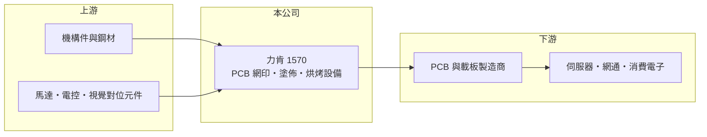

# 1570 力肯

> 上櫃｜[[產業索引-電機機械|電機機械]]｜上市（櫃）日期 2005/06/30

# 第一章：企業模式與商業藍圖

> [!info] 撰寫說明
> 精簡版，由 Claude 依公開資料整理，架構比照 [[2330台積電]]，資料截至 2026-10-08。來源：櫃買中心開放資料快照（基本資料、2026 年第二季資產負債與損益）、MoneyDJ 年度財務比率表、nStock 公司簡介。公開資料有限：產品內容主要依 Claude 既有知識整理，nStock 列出的營業登記項目為氣動、手動與電動工具及機械零件，兩者需比對公司年報。#待校對

力肯實業（以下簡稱力肯）是新北八里的設備商，一般認為主力產品是[[PCB]]（印刷電路板）製程用的網版印刷與塗佈設備（待校對）。理解它的關鍵在於：這是一家規模小、幾乎無負債的利基設備廠，營收跟著 PCB 廠的擴產循環大起大落。

- **核心業務：** 力肯成立於 1983 年，2005 年在櫃買中心掛牌。依 Claude 既有知識，公司產品以 PCB [[防焊]]油墨的自動網印機、塗佈機、烘烤與周邊自動化設備為主（待校對）。這類設備用在 PCB 製程後段，把保護線路的防焊層均勻覆蓋在板面上，塗佈的均勻度與對位精度直接影響良率。設備銷售屬於一次性收入，客戶擴產時才會大量採購。
- **營收結構：** 依產品、地區或客戶的營收比重公開資料未查得。營收規模在 4 億至 7 億元之間，年度間波動可達五成以上，2024 年營收年增 85%、2025 年又年減 32%，是典型的[[CapEx]]（資本支出）循環型設備股。
- **營運據點：** 公司登記地址位於新北市八里區。PCB 產業的主要產能在中國大陸、台灣與東南亞，設備商通常需要在客戶工廠附近提供安裝與維修服務，力肯的海外服務據點公開資料未查得（#待校對）。
- **長期方向：** PCB 產業正由一般消費電子板往 AI 伺服器、高速網通與 IC 載板等高階產品移動，這些板子層數多、線路細，對防焊塗佈的精度要求更高。力肯能否跟上高階製程的設備規格，決定它在下一輪擴產循環中的接單能力。具體技術布局公開資料未查得。

# 第二章：護城河深度與競爭優勢

力肯的護城河屬於窄護城河，來自製程設備的客戶驗證與長期服務關係，但規模小、議價能力有限。

- **競爭優勢：** PCB 製程設備需要通過客戶的產線驗證，一旦導入，客戶在同一條產線擴充時傾向沿用相同機型，以減少製程參數調整。公司有 40 年的經營歷史，累積的安裝基礎帶來耗材、零件與維修需求。毛利率長年維持在 23% 至 28%，顯示產品具有一定的技術附加價值。
- **主要對手：** 台灣 PCB 設備同業如 [[6664群翊]]（烘烤與塗佈設備）、[[2467志聖]]（壓膜與烘烤設備），以及日本與中國大陸的網印、塗佈設備商（待校對）。中國設備商近年以價格與交期快速搶占當地 PCB 廠的訂單，是台灣中小型設備商的主要壓力。
- **觀察重點：** 長期應追蹤營業利益率能否在景氣高峰時回到 15% 以上，以及營收能否突破過去 7 億元左右的高點。設備股的獲利對營收規模非常敏感：2023 年營收約 3.9 億元時營業利益率只剩 2.40%，2024 年營收回到 7.3 億元時就回升到 15.86%。

# 第三章：財務體質與盈利規模

資料日期：2026-10-08，表格是撰寫當時的快照；最新月營收、毛利率、累計 EPS 由自動排程寫在本筆記的屬性欄位（月營收、毛利率、累計EPS 等）。#待校對

力肯的財務特色是毛利率穩定、負債極低，但營收與獲利隨客戶擴產循環大幅擺盪。

| 年度 | 營收（億元，推算） | [[毛利率]] | [[營業利益率]] | EPS（元） | [[ROE]] |
|---|---|---|---|---|---|
| 2021 | 6.91 | 26.73% | 15.31% | 2.61 | 16.41% |
| 2022 | 6.41 | 27.81% | 16.29% | 2.10 | 12.16% |
| 2023 | 3.94 | 23.17% | 2.40% | 0.36 | 2.06% |
| 2024 | 7.30 | 27.57% | 15.86% | 2.25 | 12.03% |
| 2025 | 4.94 | 24.89% | 7.14% | 0.59 | 2.97% |

（來源：MoneyDJ 年度財務比率表；營收以每股營業額乘 5,150 萬股推算，2025 年 4.94 億元與 nStock 數字一致。）

- **營收規模：** 2020 年營收約 5.6 億元（推算），2020 至 2025 年營收年複合成長率約 -2.3%（推算），長期大致在 4 億至 7 億元之間來回，沒有明顯的長期成長趨勢。營收高低主要反映 PCB 客戶當年的擴產規模。
- **獲利：** 近五年（2021 至 2025）平均 ROE 約 9.1%（推算），景氣好的年度可達 12% 至 16%，景氣差的年度只有 2% 至 3%。這種「一年好、一年差」的節奏，是小型設備商[[營運槓桿]]高的結果：營收多一成，營業利益可能多好幾成。2026 年上半年營收 2.88 億元、EPS 0.54 元。
- **財務特色：** 依 2026 年第二季資料，總資產約 11.9 億元、股東權益約 10.4 億元、負債僅約 1.6 億元，負債比率約 13%，流動資產約 8.8 億元，財務非常保守。其他權益約 0.95 億元，且 2026 年上半年其他綜合損益達 0.46 億元，顯示公司持有一定的金融資產投資。配息紀錄與自由現金流公開資料未查得。
- **[[ROIC]] 與 [[WACC]]：** 以 2025 年營業利益約 0.35 億元（4.94 億元 × 7.14%）、稅率 20% 計算，稅後營業利益約 0.28 億元。公司幾乎沒有有息負債（推估），投入資本以股東權益 10.4 億元到總資產 11.9 億元為區間，ROIC 約 2.4% 至 2.7%（推算）；2024 年同法約 8% 至 9%（推算）。WACC 以 CAPM 推估：無風險利率 1.75%、市場風險溢酬 6%、β 假設 1.0（設備股常見值），因幾乎無負債，WACC 約等於權益成本 7.75%（推算）。景氣高峰年度 ROIC 略高於 WACC，低谷年度遠低於 WACC，跨循環平均大致與資金成本相當；而且帳上大量現金拉低了 ROIC，若只計算營運資產，本業報酬率會較高。

# 第四章：總體風險與地緣政治

力肯的風險集中在客戶擴產循環、規模劣勢與技術跟進能力。

- **產業週期：** PCB 設備需求取決於 PCB 廠的資本支出，而 PCB 廠又跟著手機、PC、伺服器與網通需求循環。2023 年 PCB 產業去庫存時，力肯營收年減近四成，就是這種循環的典型表現。AI 伺服器帶動的高階 PCB 擴產能否擴及力肯的產品線，是未來幾年的關鍵。
- **營運風險：** 公司營收規模只有數億元，研發與業務資源有限，面對中國大陸設備商的價格競爭與國際大廠的技術領先，兩面受壓。設備訂單集中在少數客戶的擴產專案，單一大單的有無就可能讓年度營收大幅變動。
- **其他風險：** 主要客戶產能在中國大陸與東南亞，兩岸關係與出口管制會影響接單與售後服務；PCB 產能外移東南亞時，設備商需要跟著建立當地服務能力。匯率波動影響外銷報價與毛利。

# 專有名詞解析

## 金融

- **[[CapEx]]**：資本支出，企業購買廠房與設備的投資，設備商的營收直接取決於客戶的資本支出循環。
- **[[營運槓桿]]**：固定成本占比高時，營收小幅變動就會讓營業利益大幅變動的現象。

## 產業

- **[[PCB]]**：印刷電路板，用銅線路連接電子元件的基板，是所有電子產品的骨架。
- **[[防焊]]**：在 PCB 表面塗上一層防焊油墨保護線路，只露出需要焊接的位置，避免短路與氧化。

# 核心供應鏈

- 上游：機構件、鋼材與加工協力廠，以及馬達、氣動元件、電控與影像對位元件供應商（具體名單未查得）。
- 下游／客戶：台灣、中國大陸與東南亞的 PCB 與載板製造商，終端應用為伺服器、網通與消費電子（具體客戶未查得，#待校對）。
- 同業：[[6664群翊]]、[[2467志聖]]，以及日本與中國大陸的 PCB 網印與塗佈設備商。

## 最新新聞
<!-- news:start -->
<!-- news:end -->

## 相關連結
- [公開資訊觀測站](https://mopsov.twse.com.tw/mops/web/t05st03?step=1&firstin=1&co_id=1570)
- [Goodinfo](https://goodinfo.tw/tw/StockDetail.asp?STOCK_ID=1570)
- [Yahoo 股市](https://tw.stock.yahoo.com/quote/1570)
- [鉅亨網新聞](https://www.cnyes.com/twstock/1570/news)
