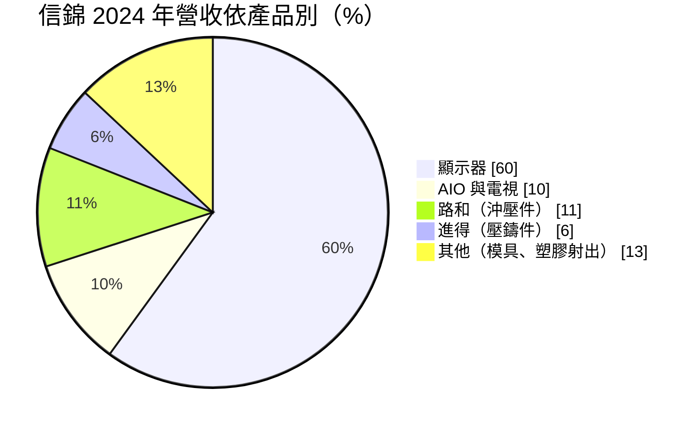
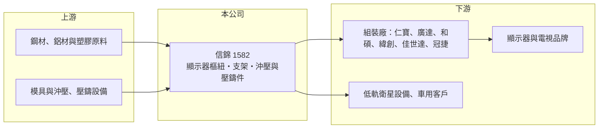

# 1582 信錦

> 上市｜[[產業索引-電子零組件業|電子零組件業]]｜上市（櫃）日期 2009/12/17

# 第一章：企業模式與商業藍圖

> [!info] 撰寫說明
> 精簡版，由 Claude 依公開資料整理，架構比照 [[2330台積電]]，資料截至 2026-10-08。來源：證交所開放資料快照（基本資料、2026 年第二季資產負債與損益、股利）、Goodinfo 經營績效頁、富果研究 2025 年 3 月法說會整理。#待校對

信錦企業（以下簡稱信錦）是全球主要的顯示器[[樞紐]]與支架供應商之一，理解它的關鍵是：一個看似簡單的轉軸零件，如何靠設計能力與貼近代工廠的產能布局，長期賺取比一般機構件更高的毛利。

- **核心業務：** 信錦成立於 1979 年，2009 年上市，核心產品是顯示器、一體成型電腦（[[AIO]]）與電視使用的腳架、樞紐與轉軸。這類零件決定螢幕能否升降、旋轉、傾仰，需要兼顧手感、耐用度與外觀，客戶通常在產品設計初期就與信錦共同開發。也因此信錦賣的不只是金屬件，而是一套機構設計方案。
- **營收結構：** 依富果整理的 2024 年資料，顯示器約占 60%，AIO 與電視合計約 10%，沖壓子公司路和約 11%，[[壓鑄]]子公司進得約 6%，其餘為模具與塑膠射出（圓餅圖中 AIO 與電視、其他兩項由來源數字推估湊整，#待校對）。顯示器占比高，代表信錦的營收和全球顯示器出貨量高度連動。
- **營運據點：** 生產基地分布在中國（蘇州、福州、東莞、中山）、台灣（龜山、觀音、台中）與越南，泰國新廠投資約 2,000 萬美元，預計 2026 年年中前後投產。工廠刻意設在 [[2324仁寶]]、[[2382廣達]]、[[4938和碩]]、[[3231緯創]]、[[2352佳世達]] 等組裝廠附近，方便即時供料與共同開發。
- **長期方向：** 信錦正在把生產從中國分散到越南與泰國，以符合客戶「中國以外」的供應鏈需求。新事業方面，路和供應[[低軌衛星]]設備的 EMI 遮蔽蓋，進得生產方向盤、馬達蓋等車用壓鑄件，另投資電視壁掛架廠商。這些布局的目的，是讓公司不再只靠顯示器單一市場成長。

# 第二章：護城河深度與競爭優勢

信錦的護城河屬於「窄而實在」：在樞紐這個利基市場累積了設計、模具與量產經驗，但終端市場本身成熟。

- **競爭優勢：** 樞紐的扭力設計與耐久測試需要長期累積的經驗，信錦與品牌、代工廠在產品開發初期就合作，一旦設計定案便很少更換供應商。加上集團內有沖壓、壓鑄、塑膠射出與模具能力，可以一次提供整組腳架與機構件，這是單一製程廠難以複製的整合優勢。這讓信錦在景氣好時毛利率可達 26% 至 29%，明顯高於一般機構件廠。
- **主要對手：** 筆電樞紐領域的 [[3376新日興]]、[[3548兆利]]、[[6805富世達]] 是技術相近的同業，但它們以筆電與摺疊手機為主，與信錦的顯示器腳架市場重疊有限。顯示器支架的主要競爭來自中國在地的機構件廠，以價格搶攻中低階產品。
- **觀察重點：** 長期應追蹤非顯示器營收（衛星、車用、壁掛架）的比重能否持續提升，以及泰國、越南產能能否承接客戶轉移的訂單。2025 年營收降到 86.8 億元、毛利率從 29.1% 降到 23.5%，顯示產線轉移與需求放緩的成本，未來幾年的毛利率能否回到 25% 以上，是檢驗護城河的指標。

# 第三章：財務體質與盈利規模

資料日期：2026-10-08，表格是撰寫當時的快照；最新月營收、毛利率、累計 EPS 由自動排程寫在本筆記的屬性欄位（月營收、毛利率、累計EPS 等）。#待校對

信錦的財務特徵是營收規模穩定在 90 億元上下，但獲利隨顯示器景氣與產品組合起伏很大，同時維持高配息。

| 年度 | 營收（億元） | [[毛利率]] | [[營業利益率]] | EPS（元） | [[ROE]] |
|---|---|---|---|---|---|
| 2020 | 96.6 | 26.3% | 15.9% | 7.81 | 16.3% |
| 2021 | 102 | 15.7% | 3.87% | 2.03 | 3.94% |
| 2022 | 98.1 | 16.5% | 3.50% | 3.00 | 6.37% |
| 2023 | 87.7 | 22.1% | 8.90% | 5.12 | 9.87% |
| 2024 | 94.0 | 29.1% | 14.6% | 7.13 | 13.9% |
| 2025 | 86.8 | 23.5% | 8.67% | 3.45 | 6.81% |

（來源：Goodinfo 經營績效頁。）

- **營收規模：** 2020 至 2025 年營收年複合成長率約 -2.1%（推算），營收長期在 87 億到 102 億元之間，沒有明顯成長。這反映顯示器市場已經成熟，公司的成長要靠新事業與市占率，而不是市場擴張。
- **獲利：** 近五年（2021 至 2025）平均 ROE 約 8.2%（推算）。2021 至 2022 年原物料與運費上漲，毛利率一度跌到 15% 至 16%，2024 年回到 29.1%，可見獲利對原料成本與產品組合非常敏感。2026 年上半年營業利益率僅約 1.8%，獲利多靠業外收入，顯示產能轉移期的壓力。
- **財務特色：** 2026 年第二季股東權益約 75.9 億元，每股淨值約 51 元，負債總計約 57.3 億元。2025 年度配發現金股利 3.0 元，配息率約 87%（推算），Goodinfo 統計的歷年平均現金股利約 4.32 元，屬於願意把大部分盈餘發給股東的公司。自由現金流是否長期為正未查得。
- **[[ROIC]] 與 [[WACC]]：** 以 2025 年營業利益約 7.53 億元（86.8 億元 × 8.67%）、稅率 20% 計算，稅後營業利益約 6.0 億元；有息負債未查得，投入資本以權益 75.9 億元到「權益加全部負債」133.2 億元為區間，ROIC 約 4.5% 至 7.9%（推算）；2024 年同法約 8% 至 14.5%（推算）。WACC 以 CAPM 推估：無風險利率 1.75%、市場風險溢酬 6%、β 假設 0.9（電子零組件常見值），權益成本約 7.2%；稅後負債成本 2%、負債占 25%，WACC 約 5.9%（推算）。景氣好的年份 ROIC 明顯高於 WACC，景氣差的年份則接近或低於資金成本，長期平均大致略高於資金成本，屬於溫和創造價值的公司。

# 第四章：總體風險與地緣政治

信錦的長期風險集中在終端市場成熟、產能轉移與原物料成本。

- **產業週期：** 顯示器需求隨 PC 換機潮與企業採購週期起伏，2020 年遠距辦公帶動的高峰後即出現修正。顯示器占營收約六成，終端需求的放緩會沿供應鏈放大，直接影響信錦的稼動率與毛利率。
- **營運風險：** 把產能從中國移往越南、泰國，初期會有重複的固定成本與良率爬坡期，2025 年至 2026 年上半年的獲利下滑即與此有關。客戶集中於少數台灣組裝廠，議價空間有限。
- **其他風險：** 鋼材、鋁材等金屬原料價格與運費上漲會直接壓縮毛利，2021 至 2022 年即是例子。美國關稅與地緣政治迫使客戶頻繁調整產地，新台幣與人民幣匯率波動也會影響獲利。

# 專有名詞解析

## 應用

- **[[AIO]]**：All-in-One 一體成型電腦，把主機與螢幕整合在同一機身。
- **[[低軌衛星]]**：在距地面約 500 至 2,000 公里軌道運行的通訊衛星群，用於全球寬頻上網，帶動地面接收設備需求。

## 產業

- **[[樞紐]]**：讓螢幕或筆電上蓋能開合、旋轉並固定在任意角度的轉軸機構，需兼顧扭力、手感與耐用度。
- **[[壓鑄]]**：把熔融的鋁、鋅等金屬高壓注入模具成形的製程，用於車用零件與設備外殼。

# 核心供應鏈

- 上游：鋼材、鋁材、鋅合金與工程塑膠原料，以及模具與沖壓、壓鑄設備供應商。
- 下游／客戶：顯示器與 AIO 組裝廠 [[2324仁寶]]、[[2382廣達]]、[[4938和碩]]、[[3231緯創]]、[[2352佳世達]]、冠捷；子公司路和供應低軌衛星設備廠，進得供應車用零件客戶。
- 同業：筆電與手機樞紐廠 [[3376新日興]]、[[3548兆利]]、[[6805富世達]]，以及中國在地的顯示器支架與機構件廠。

## 最新新聞
<!-- news:start -->
<!-- news:end -->

## 相關連結
- [公開資訊觀測站](https://mopsov.twse.com.tw/mops/web/t05st03?step=1&firstin=1&co_id=1582)
- [Goodinfo](https://goodinfo.tw/tw/StockDetail.asp?STOCK_ID=1582)
- [Yahoo 股市](https://tw.stock.yahoo.com/quote/1582)
- [鉅亨網新聞](https://www.cnyes.com/twstock/1582/news)
