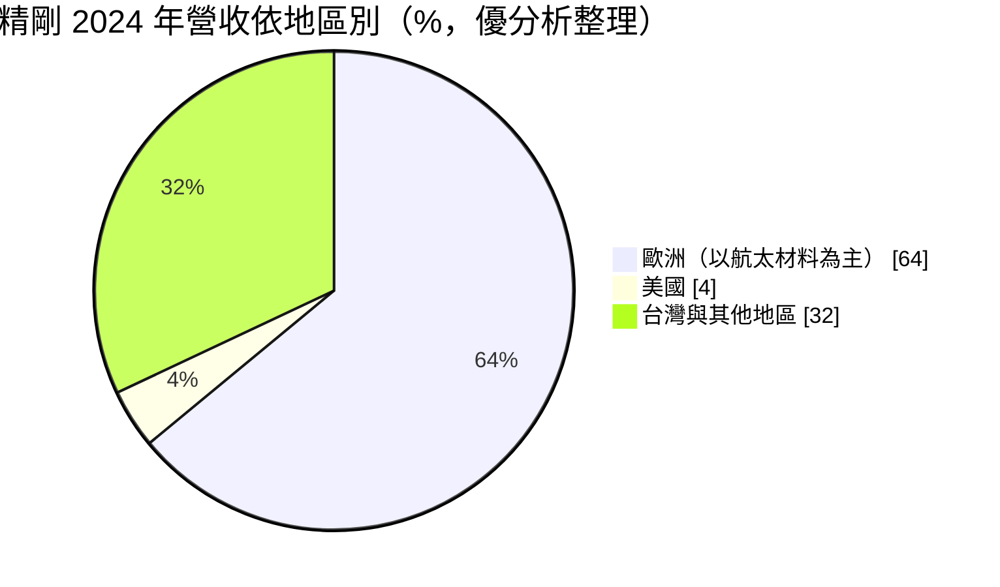
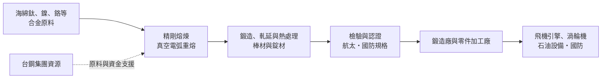
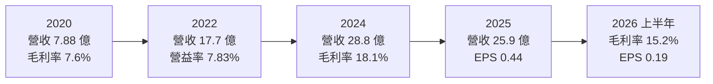
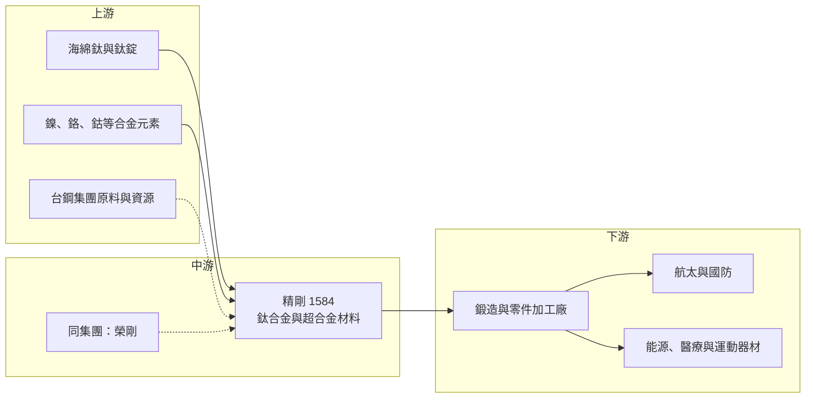

# 1584 精剛

> 上櫃｜[[產業索引-其他業|其他業]]｜上市（櫃）日期 2007/11/28

# 第一章：企業模式與商業藍圖

> [!info] 撰寫說明
> 本文由 Claude 依公開資料整理，架構比照 [[2330台積電]] 的四章研究，資料截至 2026-10-08。財務數字來源：櫃買中心開放資料（基本資料、2026 年第二季綜合損益與資產負債、本益比殖利率）、Goodinfo 經營績效與股利政策頁、優分析 2023 年與 2025 年個股分析、理財周刊 2024 年 12 月報導；產業描述為整理性內容，尚未逐條比對原始文件。#待校對

在評估單一個股的長期投資價值時，首要步驟是拆解企業的底層獲利邏輯。本章針對精剛精密科技（股票代號：1584，以下簡稱精剛）的商業模式進行定性分析，說明一家從高爾夫球頭與骨釘材料起家的鈦合金廠，如何轉向航太、國防與能源用的高階特殊合金。

## 一、核心定位：台灣少數的鈦合金與超合金材料廠

依櫃買中心基本資料，精剛成立於 2002 年 5 月 15 日，2007 年上櫃，實收資本額約 23.25 億元，工廠位於台南柳營，董事長為王炯棻。理財周刊與優分析的報導都指出，精剛隸屬台鋼集團，與同集團的 [[5009榮剛]] 同為特殊合金材料廠，報導並以「台灣唯一」的鈦合金加工製造廠形容精剛的產業地位（此說法來自媒體與公司說法，尚未比對官方文件）。

精剛的產品是[[鈦合金]]與[[鎳基超合金]]的[[棒材]]、錠材與相關材料。這類材料的共同特性是輕、強、耐高溫、耐腐蝕，但冶煉與加工難度遠高於一般鋼材，因此用在對材料性能要求最嚴格的地方：飛機引擎與機身結構件、燃氣渦輪機、石油天然氣設備、國防裝備與醫療植入物。

精剛的發展可以分成兩個階段：

* **第一階段：消費與醫療用鈦材。** 優分析 2023 年的分析指出，精剛早期以高爾夫球頭用鈦材與生醫植入物（骨釘）為主，並延伸到自行車產業。這些市場量大但價格競爭激烈，加上公司當時以進口海綿鈦與鈦錠加工為主，附加價值有限，2019 年幾乎全年虧損，營業成本占營收高達 98%。
* **第二階段：航太、國防與能源用特殊合金。** 公司逐步調整產品組合，擴展到超合金與[[粉末高速鋼]]，並在 2024 年啟用鈦合金[[真空電弧重熔]]產線與自主熔煉技術。這讓精剛從「買鈦錠來加工」走向「自己熔煉、自己加工」，掌握更多製程價值。

## 二、終端應用／產品板塊：歐洲航太客戶為主力

優分析 2025 年 4 月的分析指出，精剛約 64% 營收來自歐洲，主要是航太材料；美國市場在 2024 年約占 4%，是公司積極拓展的方向。依此可以畫出主要市場的大致分布（其餘比重未拆分）：

依應用與產品，精剛的業務大致分為四類：

* **航太：** 飛機引擎與結構件使用的鈦合金與鎳基超合金材料。航太材料必須通過客戶與適航體系的認證，一旦認證通過，就能長期供貨，是精剛轉型的主軸。優分析 2025 年的分析指出，美國航太客戶已認證精剛的航太鋼材，超合金與鈦合金料號的認證也在進行中。
* **國防：** 台灣國防支出提高與國防自主政策，帶動軍用材料需求。精剛作為本土的特殊合金供應者，在供應鏈在地化上有一定優勢。
* **能源與工業：** 發電用渦輪機、石油天然氣設備使用的耐高溫、耐腐蝕合金。
* **消費與醫療：** 高爾夫球頭、自行車與生醫植入物用鈦材，是早期的基本盤，比重逐漸下降。

## 三、資本轉化邏輯（營運模式）：從加工走向熔煉的垂直整合

* **認證是真正的門檻：** 特殊合金的商業模式不是賣「重量」，而是賣「認證過的規格」。同一種合金，要能用在飛機引擎上，從試料、驗證到正式下單往往需要數年。這段時間公司要持續投入設備、樣品與人力，但認證一旦通過，客戶更換供應商的成本極高。
* **長週期、重庫存：** 高階合金生產週期長，從熔煉、鍛造到熱處理與檢驗往往需要數月，加上要預先備料，存貨與營運資金需求很大。優分析 2023 年的分析指出，2022 年存貨週轉天數拉長到約 350 天，營運現金流明顯不足。這是這門生意的結構性特徵，也是精剛需要集團與資本市場支持的原因。
* **產能利用率與產品組合：** 優分析 2025 年的分析指出，鎳基產能利用率約 60%、鈦合金約 80%，公司並擴充精整、二次精煉、熱處理與檢驗產能。產能利用率與高階產品比重同時提升，才是毛利率改善的來源。

## 四、企業長期藍圖：搶進全球高階特殊合金供應鏈

* **鈦合金為核心：** 公司以提高鈦合金產品比重為長期方向，2024 年啟用的鈦熔煉產線是關鍵基礎。
* **美國市場：** 透過航太認證打開美國市場，並受惠美國航太與國防供應鏈分散中國來源的趨勢。
* **地緣政治帶來的轉單機會：** 中國收緊部分金屬出口管制，以及歐美客戶降低對俄羅斯、中國鈦材的依賴，使非中俄的鈦材供應者重要性提高。精剛若能取得足夠認證，這是長期的結構性機會。
* **集團綜效：** 與台鋼集團內的特殊鋼廠共享原料採購、設備與客戶資源，提升營運效率。

# 第二章：護城河深度與競爭優勢

在長期價值投資中，「護城河」指企業抵禦競爭、維持超額利潤的保護機制。本章分析精剛的護城河構成、全球主要競爭對手，以及它在轉型過程中能守住多少。

## 一、護城河的核心組成要素

精剛的護城河目前屬於「建構中的窄護城河」，核心在於認證與製程能力，而不是規模：

* **1. 航太與國防認證：** 航太材料的認證流程長、成本高，一旦被列入客戶的合格供應商名單，就能享有長期穩定的訂單。這是特殊合金業最主要的轉換成本來源，也是精剛轉型的核心。
* **2. 熔煉與加工的製程能力：** 鈦合金與超合金的熔煉需要真空環境與精密控制，雜質與成分偏差都會影響材料性能。精剛 2024 年啟用自主熔煉，代表它掌握了從原料到成品更多的製程環節，這種能力需要多年累積。
* **3. 非中俄供應來源的地位：** 全球鈦材產能有相當比例集中在中國與俄羅斯，歐美航太與國防客戶基於供應安全，偏好分散來源。位於台灣、隸屬本土鋼鐵集團的精剛，在這個趨勢下具有地理與政治上的相對優勢。
* **4. 集團支持：** 台鋼集團提供原料採購、資金與客戶資源，讓精剛能承擔特殊合金業長週期、重庫存的資金壓力。

## 二、全球主要競爭對手格局

| 對手 | 定位 | 對精剛的威脅 |
|---|---|---|
| ATI、Carpenter Technology（美國） | 全球航太特殊合金與鈦材大廠 | 規模、認證與客戶關係都遠勝精剛，主導高階市場 |
| VSMPO-AVISMA（俄羅斯） | 全球最大鈦材供應商之一 | 受制裁影響，部分歐美客戶轉單，對精剛反而是機會 |
| 寶鈦等中國鈦材廠 | 中國大型鈦材供應者 | 以價格與產能主導中低階鈦材市場 |
| Haynes 等超合金廠 | 鎳基與鈷基超合金專業廠 | 在高溫合金市場競爭 |
| [[5009榮剛]] | 同屬台鋼集團的特殊鋼與合金廠 | 產品部分重疊，但多屬集團內分工 |

## 三、優勢轉化：哪些市場守得住、哪些守不住

* **守得住：** 已通過認證的航太與國防料號。這類訂單價格敏感度較低，交期與品質穩定才是關鍵，只要品質不出問題，訂單具延續性。
* **守不住：** 高爾夫、自行車等消費性鈦材。這些市場規格門檻較低，中國供應者以價格競爭，精剛很難取得超額利潤。
* **觀察重點：** 第一，美國航太客戶的超合金與鈦合金料號認證進度；第二，鈦合金與鎳基產能利用率能否持續提高；第三，毛利率能否穩定站上兩成以上。2024 年毛利率 18.1%、2025 年回落到 11.9%，代表轉型仍未完成，獲利能力尚未穩定。

# 第三章：財務體質與盈利規模

資料日期：2026-10-08。數字取自櫃買中心開放資料、Goodinfo 經營績效與股利政策頁與優分析，表格是撰寫當時的快照；最新月營收、毛利率、累計 EPS 由自動排程寫在本筆記的屬性欄位（月營收、毛利率、累計EPS 等）。#待校對

財務報表是檢驗護城河是否真實存在的最終標準。本章用多年度的三率、ROE、現金流與資本報酬，檢視精剛轉型過程的獲利品質。

## 一、獲利能力的基石：三率

| 年度 | 營收（新台幣） | [[毛利率]] | [[營業利益率]] | EPS（元） | [[ROE]] |
|---|---|---|---|---|---|
| 2020 | 7.88 億 | 7.6% | 0.54% | 0.41 | 4.07% |
| 2021 | 11.1 億 | 9.52% | 1.26% | 0.46 | 4.94% |
| 2022 | 17.7 億 | 14.2% | 7.83% | 1.12 | 8.5% |
| 2023 | 27.5 億 | 13.0% | 6.48% | 3.01 | 17.2% |
| 2024 | 28.8 億 | 18.1% | 9.0% | 1.57 | 6.95% |
| 2025 | 25.9 億 | 11.9% | 3.31% | 0.44 | 1.86% |
| 2026 上半年 | 10.8 億 | 15.2% | 6.83% | 0.19 | 未查得 |

註：2020 至 2025 年取自 Goodinfo 經營績效頁；2026 上半年取自櫃買中心開放資料（2026 年第二季累計）。

* **營收規模：** 2020 至 2025 年營收由 7.88 億元成長到 25.9 億元，年複合成長率約 27%（推算），反映產品轉型與產能擴充的成果。不過 2025 年營收較 2024 年下滑，成長並不平順。
* **[[毛利率]]：** 由 2020 年的 7.6% 提升到 2024 年的 18.1%，說明高階產品比重提高確實改善了獲利結構；但 2025 年又回落到 11.9%，代表產能利用率、原料價格與產品組合的波動仍大。
* **[[營業利益率]]：** 長期在 1% 至 9% 之間，屬於薄利的材料業。特殊合金的研發、認證與推廣費用高，在營收規模還不夠大之前，費用率會壓低營益率。
* **業外與 EPS 的落差：** 2023 年稅後淨利約 5.06 億元，高於當年營業利益約 1.78 億元（推算），代表當年有可觀的業外收益，原因本次未查得。此外，股本擴大使每股盈餘被稀釋（推估），比較不同年度 EPS 時需要留意。

## 二、[[ROE]]：資本效率

2021 至 2025 年平均 ROE 約 7.9%（推算），但其中 2023 年的 17.2% 有業外收益的貢獻，扣除後本業 ROE 多在 2% 至 9% 之間。依櫃買中心 2026 年第二季資料，股東權益約 47.3 億元、每股淨值 20.70 元，總負債約 29.5 億元，其中非流動負債約 24.0 億元。特殊合金業資本密集、存貨重，在營收規模還沒放大、產能利用率還沒拉滿之前，ROE 很難穩定處於高檔。

## 三、資本支出與自由現金流

* **[[CapEx]]：** 2024 年完成鈦熔煉產線，2025 年再擴充精整、二次精煉、熱處理與檢驗產能，近年屬於投資期，具體金額未查得。
* **[[自由現金流]]：** 優分析 2023 年的分析指出，2022 年存貨週轉天數約 350 天、營運現金流明顯不足。高階合金需要大量備料，營收成長期往往伴隨營運資金增加，自由現金流長期為正的把握不高（推估）。
* **股利：** 依 Goodinfo 股利政策頁，2015 至 2020 年度未配息，2021 至 2025 年度現金股利分別為 0.2、0.7、1.5、0.7、約 0.26 元，2023 至 2025 年度配息率約 45% 至 60%（推算）。股利隨獲利大幅波動，不適合作為穩定收息標的。

## 四、[[ROIC]] 與 [[WACC]]：價值創造利差

* **ROIC（推算）：** 2025 年營業利益約 0.86 億元（營收 25.9 億元乘營益率 3.31%），以稅率 20% 計算，稅後營業利益約 0.69 億元。官方快照沒有拆出有息負債，以非流動負債約 24 億元作為有息負債的近似值（推估），投入資本約 71 億元，2025 年 ROIC 約 1%（推算）。若以 2024 年營業利益約 2.59 億元計算，ROIC 約 3%（推算）。
* **WACC（推算）：** 無風險利率取 1.75%，市場風險溢酬 6%，β 取金屬材料同業常見值 1.0（本次未查得來源數字），股東權益成本約 7.75%；負債成本假設 2.5%、稅後 2.0%，資本結構約權益 65%、負債 35%，WACC 約 5.7%（推算）。
* **結論：** 近年 ROIC 約 1% 至 3%，低於約 5.7% 的 WACC（推算），代表精剛目前仍處於「投入大於回收」的轉型期，帳面上尚未創造經濟價值。要讓利差轉正，營益率需要穩定提升到 8% 以上（推算），這取決於航太認證帶來的高階訂單能否放量。

# 第四章：總體風險與地緣政治

任何企業都無法脫離宏觀環境獨立存在。本章分析精剛未來必須面對的地緣政治、產業週期、營運與技術風險。

## 一、地緣政治

* **鈦材供應鏈重組：** 俄羅斯受制裁、中國收緊部分金屬出口，使歐美客戶積極尋找替代來源。這對精剛是機會，但也代表原料（海綿鈦等）取得可能更困難、價格更不穩定。
* **美國關稅與在地化：** 美國若對進口金屬材料課徵關稅，或要求國防供應鏈在地化，可能影響精剛打入美國市場的速度與成本。
* **國防政策：** 台灣國防支出與國防自主政策有利國內需求，但國防預算受政治因素影響，需求的時點不一定穩定。

## 二、產業週期與市場結構

* **航太週期：** 航太材料需求跟著飛機交機量與引擎維修需求走，2020 年疫情使航空業停擺、鈦需求與價格急跌，就是一次劇烈的下行週期。長期來看，全球航空客運成長與飛機訂單積壓是支撐，但短期仍可能受經濟衰退或疫情衝擊。
* **原料價格：** 鎳、鈦等金屬價格波動大，原料成本變動若無法即時轉嫁，毛利率會大幅擺盪，2025 年毛利率回落即是例子。
* **能源產業投資：** 石油天然氣設備用合金需求，與國際油價與能源投資週期連動。

## 三、營運環境的隱性風險

* **存貨與營運資金：** 高階合金生產週期長、需要大量備料，存貨跌價與資金壓力是長期存在的風險。
* **認證失敗或延後：** 航太認證若延後或未通過，前期投入的設備與費用無法回收，會拉低 ROIC。
* **對歐洲客戶的集中度：** 約六成營收來自歐洲，主要客戶的訂單變動會對營收造成明顯影響。
* **匯率：** 以外銷為主，新台幣升值會壓縮報價與毛利。

## 四、科技或法規演進

航太材料的技術正朝向更高溫、更輕量的方向發展，例如[[積層製造]]（金屬 3D 列印）使用的合金粉末，以及複合材料在部分機身結構取代金屬。精剛的粉末高速鋼與熔煉技術，可以作為延伸到金屬粉末的基礎；但若無法跟上新材料與新製程的規格，長期可能只能停留在傳統棒材市場。此外，航太與國防材料的品質規範與追溯要求持續提高，資訊系統、檢驗設備與品質管理的投入也會持續增加。

# 專有名詞解析

## 金融

- **[[毛利率]]**：營收扣除銷貨成本後的毛利占營收比例，反映產品本身的獲利能力。
- **[[ROE]]**：股東權益報酬率，稅後淨利除以股東權益，衡量股東投入資金的報酬。
- **[[ROIC]]**：投入資本報酬率，稅後營業利益除以股東權益與有息負債的合計，衡量本業資本效率。
- **[[WACC]]**：加權平均資金成本，股東權益成本與負債成本依資本結構加權的結果，是投資報酬的門檻。
- **[[CapEx]]**：資本支出，企業購買土地、廠房與設備的支出。
- **[[自由現金流]]**：營業活動現金流減去資本支出，代表企業可自由用於配息、還債或併購的現金。

## 產業

- **[[鈦合金]]**：以鈦為主並加入其他金屬的合金，重量輕、強度高且耐腐蝕，用於航太、醫療與運動器材。
- **[[鎳基超合金]]**：以鎳為基礎、能在高溫下維持強度的合金，是飛機引擎與燃氣渦輪機熱端零件的關鍵材料。
- **[[棒材]]**：截面為圓形或方形的長條金屬材料，供下游鍛造或切削加工使用。
- **[[粉末高速鋼]]**：以金屬粉末燒結製成的高速工具鋼，組織均勻、耐磨性高，用於高階刀具與模具。
- **[[真空電弧重熔]]**：在真空中以電弧把金屬重新熔化凝固的精煉製程，可去除雜質，是航太級鈦合金與超合金的必要製程。
- **[[積層製造]]**：俗稱金屬 3D 列印，以逐層堆疊方式製造零件，可做出傳統加工難以完成的複雜形狀。

# 核心供應鏈

## 1. 上游：原料
- 海綿鈦、鈦錠與鎳、鉻、鈷等合金元素：供應商名稱未揭露
- 集團資源：台鋼集團

## 2. 中游：特殊合金同業
- 同集團特殊鋼與合金：[[5009榮剛]]
- 國際同業：ATI、Carpenter Technology、VSMPO-AVISMA、寶鈦

## 3. 下游：應用產業
- 航太材料客戶以歐洲為主，美國客戶認證中，客戶名稱未揭露
- 國防、能源設備、生醫植入物與高爾夫、自行車產業

## 最新新聞
<!-- news:start -->
<!-- news:end -->

## 相關連結
- [公開資訊觀測站](https://mopsov.twse.com.tw/mops/web/t05st03?step=1&firstin=1&co_id=1584)
- [Goodinfo](https://goodinfo.tw/tw/StockDetail.asp?STOCK_ID=1584)
- [Yahoo 股市](https://tw.stock.yahoo.com/quote/1584)
- [鉅亨網新聞](https://www.cnyes.com/twstock/1584/news)
