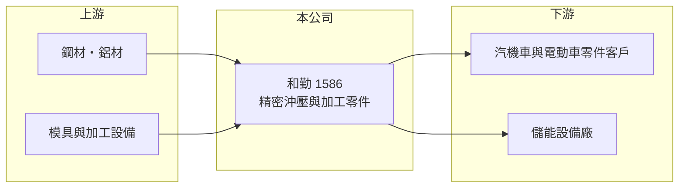

# 1586 和勤

> 上櫃｜[[產業索引-電機機械|電機機械]]｜上市（櫃）日期 2012/01/09

# 第一章：企業模式與商業藍圖

> [!info] 撰寫說明
> 精簡版，由 Claude 依公開資料整理，架構比照 [[2330台積電]]，資料截至 2026-10-08。來源：櫃買中心開放資料快照（基本資料、2026 年第二季資產負債與損益）、MoneyDJ 年度財務比率表、nStock 公司簡介、中央社 2022 年 10 月與 2023 年 11 月報導標題。公開資料有限，產品與客戶細節多為整理性描述。#待校對

和勤精機（以下簡稱和勤）是彰化伸港的精密金屬零件製造商，理解它的關鍵在於：這是一家以汽車與機械零件代工為主、近年嘗試轉進電動車與儲能零件的公司，但本業獲利長期在損益兩平附近徘徊。

- **核心業務：** 和勤成立於 1992 年，2012 年在櫃買中心掛牌，營業項目為五金零件、機械五金零件與模具零件的製造加工。依財經媒體報導，公司產品以[[沖壓]]與機械加工的精密金屬零件為主，應用於汽車與機車，2022 年起報導多次提到電動車零件出貨（#待校對）。這類零件由客戶提供圖面、和勤負責模具開發與量產，屬於 [[OEM]] 型態。
- **營收結構：** 依產品、應用或地區的營收比重公開資料未查得。依 2023 年 11 月中央社報導標題，台灣廠正切入新能源[[儲能]]零件，並看好商用車與電動車需求，代表公司試圖把營收重心由傳統燃油車零件移往新能源領域。
- **營運據點：** 總部與工廠位於彰化縣伸港鄉，鄰近彰濱工業區與中部汽機車零件聚落。是否有中國大陸或其他海外生產據點公開資料未查得（#待校對）。
- **長期方向：** 公司 2025 年營收約 23 億元，與 2020 年大致相同，五年間沒有成長。長期能否靠電動車與儲能零件打開新局，取決於能否打進具規模的國際客戶供應鏈。依櫃買中心基本資料，公司辦理過 2,000 萬股私募，實收資本額約 12.95 億元，高於 2026 年第二季資產負債表上的股本約 10.68 億元，顯示近期有增資引進資金（#待校對）。

# 第二章：護城河深度與競爭優勢

和勤屬於規模中等的金屬零件代工廠，護城河主要來自客戶認證與模具開發經驗，屬於窄或無護城河。

- **競爭優勢：** 汽車零件必須通過車廠或一階供應商的品質認證，從打樣、試產到量產往往需要一至兩年，一旦導入同一車型，通常會供貨到該車型停產。這種認證週期構成一定的轉換成本。和勤 30 多年的模具與量產經驗，讓它能承接尺寸精度要求較高的零件。
- **主要對手：** 台灣的汽車金屬零件與沖壓同業眾多，例如 [[4551智伸科]]（精密金屬加工）、[[2228劍麟]]（汽車沖壓件）、[[2231為升]] 等，加上中國大陸大量零件廠，競爭以價格與交期為主。具體與和勤直接競爭的名單公開資料未查得。
- **觀察重點：** 長期應追蹤毛利率能否穩定在 15% 以上、營業利益率能否轉正並持續。近五年毛利率在 11% 至 19% 之間擺盪，營業利益率有三年為負，代表費用結構偏重、規模不足以攤提。電動車與儲能零件的營收占比是否明顯提升，是判斷轉型是否成功的關鍵。

# 第三章：財務體質與盈利規模

資料日期：2026-10-08，表格是撰寫當時的快照；最新月營收、毛利率、累計 EPS 由自動排程寫在本筆記的屬性欄位（月營收、毛利率、累計EPS 等）。#待校對

和勤的財務顯示一家規模停滯、毛利率偏低、本業多年在損益兩平附近的公司。

| 年度 | 營收（億元，推算） | [[毛利率]] | [[營業利益率]] | EPS（元） | [[ROE]] |
|---|---|---|---|---|---|
| 2021 | 26.4 | 19.38% | 7.02% | 1.29 | 6.75% |
| 2022 | 25.4 | 12.94% | -0.82% | 0.53 | 2.73% |
| 2023 | 23.1 | 11.08% | -2.93% | -0.67 | -3.62% |
| 2024 | 25.7 | 15.62% | 1.27% | 0.43 | 2.36% |
| 2025 | 23.0 | 12.27% | -2.99% | -0.35 | -1.98% |

（來源：MoneyDJ 年度財務比率表；2025 年營收 22.97 億元取自 nStock，其餘年度依營收成長率回推。）

- **營收規模：** 2020 年營收約 22.9 億元（推算），2020 至 2025 年營收年複合成長率約 0%（推算），規模在 23 億至 26 億元之間來回。2026 年前九個月營收年增約 7.8%，但幅度不足以改變長期停滯的格局。
- **獲利：** 近五年（2021 至 2025）平均 ROE 約 1.2%（推算），其中 2023 年與 2025 年虧損。2020 至 2021 年營業利益率可達 7% 至 10%，之後明顯下滑，顯示 2022 年後原物料、人工成本或產品組合轉變吃掉了利潤。2026 年上半年營業利益率約 3.1%、EPS 0.32 元，略有改善。
- **財務特色：** 依 2026 年第二季資料，總資產約 37.1 億元、股東權益約 20.1 億元、負債約 17.0 億元，負債比率約 46%，較 2020 至 2024 年的六成以上下降，主要來自增資引進股本。公司持有庫藏股約 555 萬股。配息紀錄與自由現金流公開資料未查得，但連年低獲利下配息能力有限。
- **[[ROIC]] 與 [[WACC]]：** 2025 年營業損失約 0.69 億元（22.97 億元 × -2.99%），ROIC 為負；以股東權益 20.1 億元到總資產 37.1 億元為投入資本區間，約 -1.9% 至 -3.4%（推算，未計稅盾）。2024 年營業利益約 0.33 億元、稅後約 0.26 億元，ROIC 約 0.7% 至 1.3%（推算）。WACC 以 CAPM 推估：無風險利率 1.75%、市場風險溢酬 6%、β 假設 0.9（汽車零件股常見值），權益成本約 7.2%；稅後負債成本 2%、負債占約 45%，WACC 約 4.8%（推算）。ROIC 長期明顯低於 WACC，代表近年營運持續在消耗股東價值，轉型能否把 ROIC 拉回 5% 以上是長期投資的前提。

# 第四章：總體風險與地緣政治

和勤的風險集中在獲利能力不足、汽車產業轉型與新事業的執行。

- **產業週期：** 汽車零件需求跟著全球車市與車廠的庫存週期走，傳統燃油車零件在電動化趨勢下長期萎縮。新能源儲能需求成長快，但價格競爭激烈，中國大陸供應鏈在成本上具明顯優勢。
- **營運風險：** 公司規模不大，毛利率低，營收一下滑就容易出現營業虧損，屬於[[營運槓桿]]偏高的製造業。轉型新產品需要投入模具與設備，若新客戶放量不如預期，折舊與費用會先壓低獲利。客戶集中度公開資料未查得。
- **其他風險：** 鋼材與鋁材價格波動直接影響成本；外銷比重若高，匯率與美國關稅政策會影響競爭力。增資與私募引進資金會稀釋既有股東，需觀察資金是否投入報酬率夠高的項目。

# 專有名詞解析

## 應用

- **[[儲能]]**：把電力儲存在電池等系統中，在需要時釋放，用於電網調節、再生能源搭配與備援電力。

## 金融

- **[[營運槓桿]]**：固定成本占比高時，營收小幅變動就會讓營業利益大幅變動的現象。

## 產業

- **[[沖壓]]**：用沖床與模具把金屬板材剪切、彎曲或拉伸成形的加工方式，適合大量生產形狀固定的零件。
- **[[OEM]]**：原廠委託製造，代工廠依品牌客戶的設計生產，產品掛客戶品牌，毛利率通常低於自有品牌。

# 核心供應鏈

- 上游：鋼捲、鋁材等金屬原料供應商（例如 [[2002中鋼]] 等鋼廠，#待校對），以及模具鋼與沖床、CNC 設備供應商。
- 下游／客戶：汽車、機車與電動車零件的一階供應商與車廠，以及新能源儲能設備廠（具體客戶未查得，#待校對）。
- 同業：[[4551智伸科]]、[[2228劍麟]]、[[2231為升]] 等汽車金屬零件業者。

## 最新新聞
<!-- news:start -->
<!-- news:end -->

## 相關連結
- [公開資訊觀測站](https://mopsov.twse.com.tw/mops/web/t05st03?step=1&firstin=1&co_id=1586)
- [Goodinfo](https://goodinfo.tw/tw/StockDetail.asp?STOCK_ID=1586)
- [Yahoo 股市](https://tw.stock.yahoo.com/quote/1586)
- [鉅亨網新聞](https://www.cnyes.com/twstock/1586/news)
