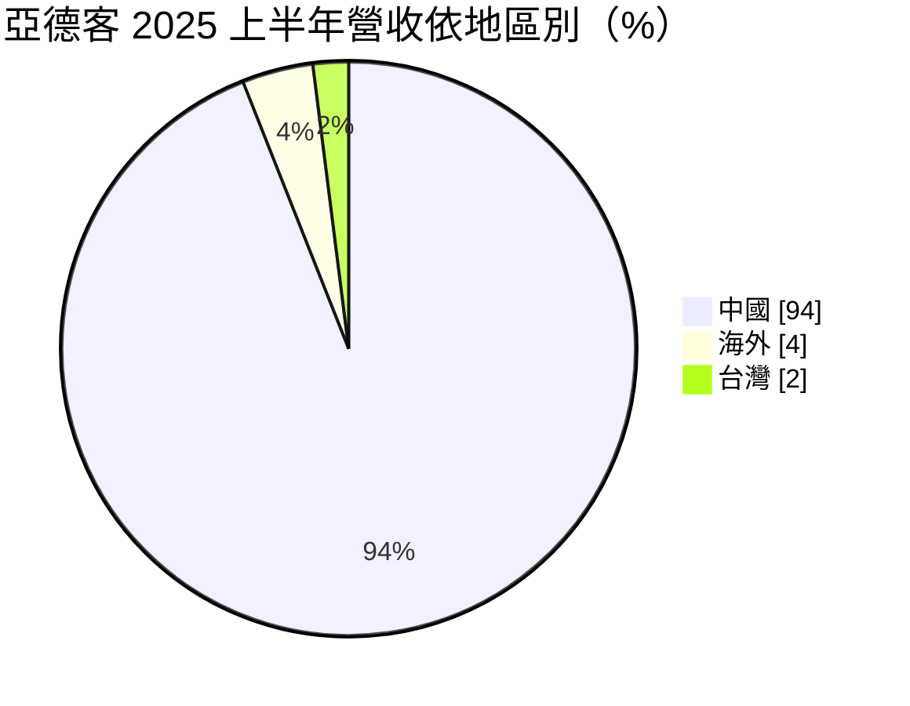
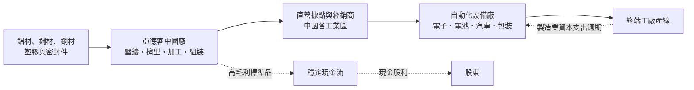
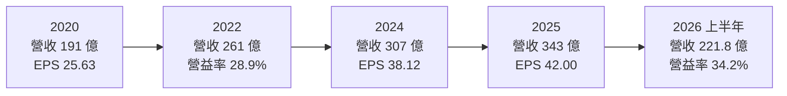
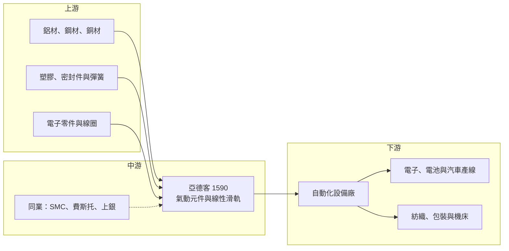

# 1590 亞德客-KY

> 上市｜[[產業索引-電機機械|電機機械]]｜上市（櫃）日期 2010/12/13

# 第一章：企業模式與商業藍圖

> [!info] 撰寫說明
> 本文由 Claude 依公開資料整理，架構比照 [[2330台積電]] 的四章研究，資料截至 2026-10-08。財務數字來源：證交所開放資料（基本資料、2026 年第二季綜合損益與資產負債、2025 年度股利）、Goodinfo 經營績效與股利政策頁、優分析 2023 年與 2025 年個股分析、工商時報 2026 年 8 月營收報導；產業描述為整理性內容，尚未逐條比對原始文件。#待校對

在評估單一個股的長期投資價值時，首要步驟是拆解企業的底層獲利邏輯。本章針對亞德客國際集團（股票代號：1590，以下簡稱亞德客）的商業模式進行定性分析，說明一家台灣背景的氣動元件廠，如何在中國工業自動化市場與日本龍頭 SMC 分庭抗禮，並長期維持接近五成的毛利率。

## 一、核心定位：中國第二大氣動元件品牌

亞德客是在開曼群島註冊的 KY 公司，依證交所基本資料，控股公司登記成立日為 2009 年 9 月 16 日，實收資本額 20 億元，董事長為王世忠。公司研發、生產並銷售[[氣動元件]]，產品包括控制元件（[[電磁閥]]）、執行元件（[[氣缸]]）、氣源處理元件與各式輔助元件，近十年再延伸到[[線性滑軌]]與電控產品。

氣動元件可以理解為[[工廠自動化]]設備的「肌肉」。它利用壓縮空氣推動機構完成夾取、推送、定位等重複動作，成本低、反應快、耐用，因此大量用在電子組裝、鋰電池、汽車、包裝、紡織與機床設備。一台自動化設備往往需要數十到上百顆氣缸與電磁閥，單價不高但用量極大，是典型「小零件、大市場」的生意。

中國氣動元件市場呈現寡占結構。優分析 2023 年的分析指出，亞德客在中國市占約 26%，與日本 SMC 合計超過五成；2025 年的分析則估計亞德客市占提升到約 30%，僅次於 SMC 的約 33%，公司目標在 2030 年達到 35%。亞德客的定位可以歸納為兩點：

* **以在地化取代進口：** 亞德客的生產與銷售重心都在中國，價格低於日系與歐系品牌，交期與服務反應又比外商快。中國製造業過去二十年從「買進口設備」轉向「自己做設備」，本土設備廠需要性價比高的零件，亞德客正好接住這股進口替代的需求。
* **以標準品規模創造毛利：** 氣動元件品項多，但大部分是標準規格，規模越大，零件共用、模具攤提與自動化生產帶來的成本優勢越明顯。這是亞德客能在比日系便宜的售價下，仍維持接近五成毛利率的原因。

## 二、終端應用／產品板塊：中國市場占九成以上

亞德客的營收高度集中在中國。依優分析整理的 2025 年上半年資料，地區別營收比重如下：

依產品別，氣動元件仍是絕對主力。優分析 2023 年的分析指出，線性滑軌當時占營收不到一成，屬於成長中的第二條產品線。依應用產業，客戶可以分成幾大類：

* **電子與半導體：** 3C 組裝、面板、電子零組件產線的自動化設備，是最大的應用之一。半導體設備用元件是公司近年新開發的高階市場，規格要求更高，若能放量，可以拉高整體產品單價。
* **鋰電池與汽車：** 電動車與電池產線的擴建在 2020 年代前半大量採購自動化設備，是亞德客成長最快的應用。這類需求的特性是成長快、但也跟著產能擴張週期大起大落。
* **傳統產業設備：** 紡織、包裝、機床與通用機械，反映的是中國製造業整體的資本支出景氣。這部分成長不快，但客戶分散、需求穩定，是營收的基本盤。

## 三、資本轉化邏輯（營運模式）：規模化製造加上通路深耕

* **垂直整合的製造：** 優分析的分析指出，亞德客向上游採購鋁、鋼、銅與塑膠等原料，自行完成壓鑄、擠型、成型與加工，再組裝成元件。自己掌握大部分製程，讓成本、品質與交期都比較可控，也是規模經濟能真正轉化成毛利的前提。
* **產能利用率決定獲利彈性：** 氣動元件的機台與人力成本相對固定，訂單增加時，增加的營收大部分直接轉為利潤。工商時報 2026 年 8 月報導指出，氣動元件產線第三季稼動率達 100%，線軌產線則提升到四成以上，公司並評估擴充寧波廠產能與設備。這種「營運槓桿」讓亞德客的獲利在景氣上行時成長得比營收快，景氣下行時也跌得比較深。
* **通路是第二個工廠：** 氣動元件規格繁多，設備廠設計新機台時需要即時選型、打樣與技術支援。亞德客多年經營的直營與經銷網，讓它能在中國各個工業區快速交貨，這種服務密度是外商與新進小廠都難以複製的。
* **人民幣計價：** 銷售以人民幣為主，獲利再換算成新台幣報表。依證交所股利資料，2025 年度現金股利是以每股人民幣 6.28 元決議、再依匯率換算成新台幣發放，因此台灣股東實際領到的股利會受人民幣匯率影響。

## 四、企業長期藍圖：從氣動元件走向自動化零組件平台

* **市占目標：** 公司以 2030 年中國氣動元件市占 35% 為目標，持續拉近與 SMC 的差距。寡占市場中，每提高一個百分點市占，代表的是更大的採購量、更低的單位成本與更強的議價能力。
* **線性滑軌：** 線軌是機床、半導體設備與自動化設備的精密導引零件，市場規模不小於氣動元件。優分析 2023 年的分析估計中國線軌市場規模約人民幣 500 至 600 億元，亞德客已建置約人民幣 20 億元營收規模的線軌產能。線軌的技術門檻比氣動元件高，亞德客以價格與交期挑戰台灣與日本的線軌大廠，能否把產能利用率拉到損益兩平以上，是長期轉型的關鍵。
* **電控與電動化：** 電動缸、伺服與電控產品讓公司能提供「氣動加電動」的完整方案，也是對沖長期電動化趨勢的布局。
* **高階市場：** 半導體設備、精密電子等高規格市場，過去以日系與歐系品牌為主，亞德客逐步以新產品切入，目標是提高產品單價與毛利率。

# 第二章：護城河深度與競爭優勢

在長期價值投資中，「護城河」指企業抵禦競爭、維持超額利潤的保護機制。本章分析亞德客的護城河構成、全球主要競爭對手，以及這些優勢在中國製造業週期與本土品牌崛起之下，能守住多少。

## 一、護城河的核心組成要素

亞德客屬於「中等護城河」，它的超額報酬不是來自專利或獨家技術，而是規模、通路與品牌信任三者疊加的結果：

* **1. 規模經濟：** 在中國市占約三成，量產規模讓單位成本低於多數本土小廠，又能用低於日歐品牌的價格銷售。長期毛利率維持在 45% 至 50% 之間，就是規模經濟最直接的證據；如果只是靠低價搶單，毛利率不可能這麼高。
* **2. 通路與服務網：** 氣動元件單價低、品項多，客戶最在意的是「要的時候馬上有」。亞德客長年建立的經銷與服務網，讓設備廠可以快速取得樣品與技術支援，這種網路需要多年時間與大量庫存才能建立，新進者很難短期複製。
* **3. 設計導入的轉換成本：** 設備廠在設計新機台時，會把元件型號寫進圖面與物料清單。一旦某個品牌被選進標準設計，後續每台設備都會沿用，除非有明顯的價格或品質問題，否則很少更換。這讓亞德客的市占具有累積性。
* **4. 品牌信任：** 在中國工廠端，亞德客已被視為可以替代進口品牌的主要選擇。對終端工廠而言，產線停機一小時的損失遠高於零件價差，因此品質穩定的品牌比低價品牌更受青睞，這是亞德客對抗本土低價品牌的屏障。

## 二、全球主要競爭對手格局

| 對手 | 定位 | 對亞德客的威脅 |
|---|---|---|
| SMC | 日本氣動元件全球龍頭，中國市占約三成多 | 品牌、品質與產品線最完整，在高階與外資工廠占優勢 |
| Festo 費斯托 | 德國氣動與自動化大廠 | 在汽車與高階自動化產線、整合方案上競爭 |
| CKD、Parker 等日美品牌 | 氣動與流體控制廠 | 在特定產業與外資客戶中競爭 |
| 中國本土氣動廠 | 中小型本土品牌 | 以更低價格搶中低階市場 |
| [[2049上銀]] | 台灣線性滑軌龍頭 | 在線軌產品直接競爭，技術與品牌領先 |
| [[4583台灣精銳]]、[[1597直得]] | 台灣傳動與線軌零組件廠 | 在線軌與精密傳動元件局部競爭 |

## 三、優勢轉化：哪些市場守得住、哪些守不住

* **守得住：** 中國中階自動化設備市場。這個市場最大、最看重性價比與交期，亞德客在電子、電池、汽車與通用機械的本土設備廠中已經是標準選項。只要中國製造業持續往自動化升級，這塊需求就會長期存在。
* **守不住或尚未攻下：** 對可靠度要求最高的高階產線，仍以 SMC、Festo 為首選；低階市場則有本土廠以價格競爭。亞德客的位置剛好在中間，優勢是性價比，風險是兩端同時被擠壓。
* **觀察重點：** 第一，中國市占能否如公司目標穩定往 35% 提升；第二，線軌產能利用率能否拉到損益兩平以上，讓第二條產品線開始貢獻利潤；第三，半導體與高階應用能否放量，改善產品組合。這三點決定亞德客能否從「中國氣動元件二哥」，轉型成多產品的自動化零組件平台。

# 第三章：財務體質與盈利規模

資料日期：2026-10-08。數字取自證交所開放資料、Goodinfo 經營績效與股利政策頁、優分析與工商時報，表格是撰寫當時的快照；最新月營收、毛利率、累計 EPS 由自動排程寫在本筆記的屬性欄位（月營收、毛利率、累計EPS 等）。#待校對

財務報表是檢驗護城河是否真實存在的最終標準。本章用多年度的三率、ROE、現金流與資本報酬，檢視亞德客在中國製造業循環中的獲利品質。

## 一、獲利能力的基石：三率

| 年度 | 營收（新台幣） | [[毛利率]] | [[營業利益率]] | EPS（元） | [[ROE]] |
|---|---|---|---|---|---|
| 2020 | 191 億 | 49.5% | 31.2% | 25.63 | 23.8% |
| 2021 | 254 億 | 48.6% | 32.3% | 33.67 | 22.3% |
| 2022 | 261 億 | 45.6% | 28.9% | 30.07 | 16.2% |
| 2023 | 298 億 | 46.1% | 29.7% | 34.83 | 17.1% |
| 2024 | 307 億 | 46.7% | 29.4% | 38.12 | 16.8% |
| 2025 | 343 億 | 46.0% | 30.0% | 42.00 | 16.7% |
| 2026 上半年 | 221.8 億 | 48.9% | 34.2% | 29.91 | 未查得 |

註：2020 至 2025 年取自 Goodinfo 經營績效頁；2026 上半年取自證交所開放資料（2026 年第二季累計）。

* **[[毛利率]]：** 六年間毛利率都落在 45% 至 50% 之間，即使 2022 年中國製造業轉弱、毛利率降到 45.6%，仍維持在高檔。這種穩定度說明亞德客的定價能力不是靠景氣，而是來自結構性的規模與品牌優勢。
* **[[營業利益率]]：** 長期在 29% 至 32% 之間，2026 年上半年因產能利用率滿載提高到 34.2%。營業費用相對固定，營收成長期間營益率會擴張，這是前面提到的營運槓桿。
* **成長性：** 2020 至 2025 年營收由 191 億元成長到 343 億元，年複合成長率約 12.4%（推算）；EPS 由 25.63 元成長到 42 元，年複合成長率約 10.4%（推算）。在一個以中國製造業為主的市場，這是相當穩健的成長。

## 二、[[ROE]]：資本效率

亞德客 2021 至 2025 年的平均 ROE 約 17.8%（推算，取 Goodinfo 各年數字平均）。2020 年以前 ROE 超過 20%，之後降到 16% 至 17%，主要原因不是獲利變差，而是股東權益隨著保留盈餘持續累積而擴大。依證交所 2026 年第二季資料，股東權益約 548.2 億元、每股淨值 274.08 元，總負債只有 112.1 億元，其中非流動負債僅 2.7 億元，幾乎沒有長期借款。換句話說，亞德客的高 ROE 完全來自高營益率，而不是財務槓桿，這是品質較好的 ROE。

## 三、資本支出與自由現金流

* **[[CapEx]]：** 工商時報 2026 年 8 月報導指出，公司 2026 年原訂資本支出約新台幣 20 至 30 億元，並評估上修以擴充寧波廠。以營收規模 300 多億元計算，資本支出約占營收一成以內（推算），屬於輕度資本密集的製造業。
* **[[自由現金流]]：** 歷年完整現金流量數字本次未查得。但從股東權益持續累積、幾乎沒有長期負債、現金股利逐年提高三點推估，亞德客的自由現金流長期為正（推估）。
* **股利：** 依 Goodinfo 股利政策頁，現金股利由 2019 年度的 4.74 元、2021 年度 13.3 元、2023 年度 17.68 元、2024 年度 19.55 元，提高到 2025 年度約 28.59 元（證交所資料，以人民幣 6.28 元換算）。以 EPS 計算，2023 與 2024 年度配息率約五成，2025 年度提高到約 68%（推算）。股利隨獲利穩定成長，且配息率有提高空間，是長期股東的重要報酬來源。

## 四、[[ROIC]] 與 [[WACC]]：價值創造利差

* **ROIC（推算）：** 2025 年營收 343 億元、營益率約 30%，營業利益約 103 億元；以稅率 20% 計算，稅後營業利益約 82 億元。投入資本以 2026 年第二季股東權益 548 億元加上有息負債（近乎為零，非流動負債僅 2.7 億元，推估）計算，ROIC 約 15%（推算）。若扣除帳上大量的營運以外現金，實際營運資產的報酬率會更高。
* **WACC（推算）：** 無風險利率取台灣 10 年期公債約 1.75%，市場風險溢酬 6%，β 取工業自動化零組件同業常見值 1.0（本次未查得來源數字），股東權益成本約 7.75%。由於幾乎沒有有息負債，WACC 約等於股東權益成本，約 7.5% 至 8%（推算）。
* **結論：** ROIC 約 15%、WACC 約 8%，利差約 7 個百分點（推算）。即使在 2022 年的景氣低谷，營益率仍有 28.9%，代表亞德客跨越完整景氣循環都在創造價值。真正的挑戰是線軌等新事業的投入資本能否達到同樣的報酬率，否則新投資會稀釋整體 ROIC。

# 第四章：總體風險與地緣政治

任何企業都無法脫離宏觀環境獨立存在。本章分析亞德客未來必須面對的地緣政治、產業週期、營運與技術風險。

## 一、地緣政治

* **高度依賴中國：** 約九成以上營收來自中國，生產基地也以中國為主。中國的經濟成長、產業政策與兩岸關係，都會直接影響營運。對台灣投資人而言，這是一家「在台上市、在中國賺錢」的公司，地緣政治風險無法分散。
* **中美貿易衝突的兩面性：** 美國對中國製品課徵關稅、供應鏈外移，可能減少部分中國工廠的擴產；但中國工廠為了降低人工成本、提高競爭力，也可能加速導入自動化。中國的「十五五」規劃強調智慧製造與產業升級，長期對自動化需求是支撐。
* **盈餘匯回：** 主要獲利在中國，盈餘匯回台灣發放股利需經過中國的外匯管理程序，屬於所有 KY 公司共同的結構性風險。

## 二、產業週期與市場結構

* **製造業資本支出週期：** 氣動元件需求跟著中國製造業設備投資起伏。設備投資通常比終端需求波動更大，景氣下行時，設備廠會先砍零件訂單，這就是[[長鞭效應]]。2022 年營益率降到 28.9%，就是一次週期下行的例子。
* **單一產業過熱：** 鋰電池與電動車在 2020 年代前半是主要成長來源。中國電池產能若長期過剩、擴產停止，相關設備需求會明顯下滑，亞德客需要靠其他產業的需求補位。
* **寡占結構的穩定性：** 中國氣動市場由 SMC 與亞德客主導，結構相對穩定。但若本土品牌在政策扶植下快速崛起，中低階市場可能出現價格戰。

## 三、營運環境的隱性風險

* **匯率：** 人民幣兌新台幣貶值，會降低以台幣計的營收、獲利與股利。這不影響公司實際的競爭力，但會影響台灣股東的報酬。
* **新事業的資本效率：** 線軌產能已大幅建置，若需求不如預期，折舊與固定成本會拉低整體毛利率與 ROIC。
* **公司治理與資訊揭露：** KY 公司的主要資產與營運在海外，投資人取得第一手資訊的難度較高，需依賴公司的法說與財報揭露。

## 四、科技或法規演進

工廠自動化正從氣動逐步走向電動化與智慧化，電動缸、伺服馬達在部分高精度與高潔淨度的應用中取代氣缸。不過氣動元件在成本、耐用度與出力上仍有優勢，兩者長期較可能是並存而非完全取代。亞德客若電控產品發展不夠快，可能在高階市場失去份額；反過來說，電控與線軌的布局，也是它從單一氣動元件廠轉型為自動化零組件平台的機會。此外，中國對工業節能與碳排的要求提高，壓縮空氣系統的耗能問題可能成為客戶選擇電動方案的理由，是長期需要觀察的變數。

# 專有名詞解析

## 金融

- **[[毛利率]]**：營收扣除銷貨成本後的毛利占營收比例，反映產品本身的獲利能力。
- **[[營業利益率]]**：營業利益占營收比例，反映扣除研發、管銷費用後的本業獲利能力。
- **[[ROE]]**：股東權益報酬率，稅後淨利除以股東權益，衡量股東投入資金的報酬。
- **[[ROIC]]**：投入資本報酬率，稅後營業利益除以股東權益與有息負債的合計，衡量本業資本效率。
- **[[WACC]]**：加權平均資金成本，股東權益成本與負債成本依資本結構加權的結果，是投資報酬的門檻。
- **[[CapEx]]**：資本支出，企業購買土地、廠房與設備的支出。
- **[[自由現金流]]**：營業活動現金流減去資本支出，代表企業可自由用於配息、還債或併購的現金。
- **[[長鞭效應]]**：終端需求的小幅變動，沿供應鏈往上游傳遞時被逐級放大，造成上游庫存與訂單劇烈波動。

## 產業

- **[[氣動元件]]**：以壓縮空氣驅動的元件，包括氣缸、電磁閥與氣源處理器，是工廠自動化設備的基本動力零件。
- **[[電磁閥]]**：以電訊號控制氣體流向的閥門，是氣動系統的控制核心。
- **[[氣缸]]**：把壓縮空氣的能量轉為直線運動的執行元件，用於推、拉、夾取等動作。
- **[[線性滑軌]]**：讓機構沿直線精準移動的導軌與滑塊，用於機床、半導體設備與自動化設備。
- **[[電動缸]]**：以馬達驅動的直線運動元件，可取代氣缸用於需要精準定位的場合。
- **[[工廠自動化]]**：以機器與控制系統取代人工完成生產作業，常見英文縮寫為 FA。

# 核心供應鏈

## 1. 上游：原料與零件
- 鋁材、鋼材、銅材、塑膠、密封件與電子零件：供應商名稱未揭露

## 2. 中游：自動化零組件同業
- 氣動元件：SMC、Festo 費斯托、CKD、中國本土品牌
- 線性滑軌與傳動元件：[[2049上銀]]、[[4583台灣精銳]]、[[1597直得]]

## 3. 下游：應用產業
- 電子組裝、鋰電池、汽車、紡織、包裝與機床設備的自動化設備廠，以中國為主，客戶名稱未揭露

## 最新新聞
<!-- news:start（自動產生，請勿手動編輯此範圍） -->
- 2026-10-20 🏛️ 重訊 15:21｜公告本公司受邀參加瑞銀證券舉辦之線上法人說明會｜[觀測站](https://mops.twse.com.tw/mops/#/web/t05st01)
- 2026-10-15 🏛️ 重訊 17:45｜公告本公司受邀參加花旗環球證券股份有限公司舉辦之法人說明會｜[觀測站](https://mops.twse.com.tw/mops/#/web/t05st01)
- 2026-10-15 🏛️ 重訊 17:45｜公告本公司受邀參加凱基證券股份有限公司舉辦之法人說明會｜[觀測站](https://mops.twse.com.tw/mops/#/web/t05st01)
- 2026-10-15 🏛️ 重訊 17:44｜公告本公司受邀參加永豐金證券匯立分公司舉辦之法人說明會｜[觀測站](https://mops.twse.com.tw/mops/#/web/t05st01)
- 2026-10-15 🏛️ 重訊 17:44｜公告本公司受邀參加摩根大通證券股份有限公司舉辦之法人說明會｜[觀測站](https://mops.twse.com.tw/mops/#/web/t05st01)

完整紀錄：[[1590亞德客-KY 新聞]]
<!-- news:end -->

## 相關連結
- [公開資訊觀測站](https://mopsov.twse.com.tw/mops/web/t05st03?step=1&firstin=1&co_id=1590)
- [Goodinfo](https://goodinfo.tw/tw/StockDetail.asp?STOCK_ID=1590)
- [Yahoo 股市](https://tw.stock.yahoo.com/quote/1590)
- [鉅亨網新聞](https://www.cnyes.com/twstock/1590/news)
