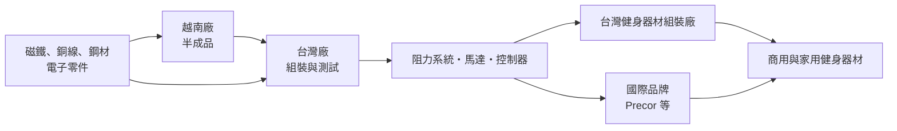
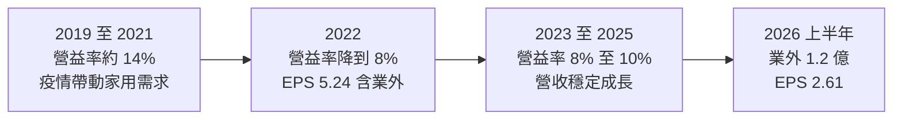
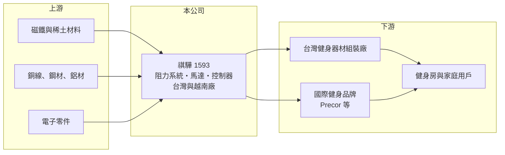

# 1593 祺驊

> 上櫃｜[[產業索引-運動休閒|運動休閒]]｜上市（櫃）日期 2012/06/13

# 第一章：企業模式與商業藍圖

> [!info] 撰寫說明
> 本文由 Claude 依公開資料整理，架構比照 [[2330台積電]] 的四章研究，資料截至 2026-10-08。財務數字來源：Goodinfo 年度經營績效頁、富果研究 2020 年 12 月法說會整理（產品、客戶、終端市場與產能，屬較舊資料）、證交所與櫃買中心開放資料（基本資料、2026 年第二季資產負債與綜合損益、每月營收、本益比）；最新營收比重與客戶結構未查得，引用的比重為 2019 至 2020 年資料。#待校對

在評估單一個股的長期投資價值時，首要步驟是拆解企業的底層獲利邏輯。本章針對祺驊（股票代號：1593）的商業模式進行定性分析，說明一家專做健身器材「心臟」的零組件廠，如何在品牌大廠的供應鏈裡建立穩定的獲利能力。

## 一、核心定位：健身器材阻力系統的專業供應商

祺驊成立於 1997 年，2012 年在櫃買中心掛牌，實收資本額約 3.98 億元，董事長為李佳蓉。祺驊不做健身器材品牌，而是供應健身器材裡最關鍵的零組件：[[阻力系統]]。

飛輪、划船機、橢圓機、健身車等有氧器材，運動時的「重量感」都來自阻力系統，常見的是以磁力或電磁方式產生可調整的阻力。阻力系統決定了器材的騎乘手感、靜音程度與耐用性，品牌廠通常不會輕易更換供應商。依 2020 年法說會資料，祺驊的產品結構如下（富果整理）：

* **阻力系統：** 約占營收 80%，應用於飛輪、跑步機、划船機、橢圓機等。
* **周邊產品：** 約占營收 20%，包括馬達、顯示表與控制器。

## 二、客戶與終端市場

* **客戶：** 依 2020 年資料，全球知名健身品牌幾乎都是祺驊的客戶，其中商用健身器材大廠 Precor 約占營收 20%，祺驊是其有氧器材的獨家供應商。Precor 在 2021 年被 Peloton 收購（富果整理），祺驊因此間接進入 Peloton 集團供應鏈（後續訂單變化未查得）。
* **終端市場：** 2019 年商用（健身房）占 59%、家用占 22%；2020 年疫情期間家用升到 34%、商用降到 46%。商用市場比重高，是祺驊與純家用器材廠最大的差別，商用器材的汰換週期較規律、受疫情後需求崩落的影響較小。
* **計價幣別：** 約 70% 營收以新台幣計價（2020 年資料），匯率影響較小，這也代表不少客戶是台灣的健身器材組裝廠。

## 三、資本轉化邏輯：小而專的零組件廠

* **台越分工：** 越南廠生產半成品運回台灣加工組裝，台灣廠負責最終組裝與測試（2020 年資料）。2021 至 2022 年台灣擴產約 30%、越南新增產線（富果整理，實際完成情況待校對），並降低對中國產線的依賴。
* **輕資本、高配息：** 零組件廠的資本需求不大，依 2020 年法說資料，過往現金股利平均配發率約 85%。

## 四、企業長期方向

祺驊的長期方向是跟著健身器材產業成長，並維持在商用市場的比重。健身器材的長期需求受健康意識、高齡化與健身房普及推動，而阻力系統是每一台有氧器材都需要的零組件，只要祺驊保持技術與品質，就能分享整體產業成長。由於本文未查得近年的新產品或新市場計畫，具體策略以 2020 年法說會為準。

# 第二章：護城河深度與競爭優勢

本章分析祺驊的競爭優勢，說明零組件廠如何在品牌廠的議價壓力下維持穩定毛利。

## 一、護城河的核心組成要素

* **[[轉換成本]]：** 阻力系統影響器材的手感與耐用度，品牌廠更換供應商需要重新設計、測試與認證，成本高、時間長，這是祺驊能維持約 30% 毛利率的主因。
* **專業化與規模：** 祺驊專注在阻力系統這個利基市場，規模足以服務全球主要品牌，新進者難以在品質與成本上同時追上。
* **商用客戶比重：** 商用健身房器材使用強度高、對耐用性要求嚴格，供應商的品質紀錄比價格更重要。
* **台越雙據點：** 越南生產半成品可降低成本，也提供非中國的供應鏈選項。

## 二、主要競爭對手與客戶格局

| 對象 | 性質 | 與祺驊的關係 |
|---|---|---|
| [[1736喬山]] | 健身器材品牌與製造 | 台灣最大健身器材廠，可能是客戶也可能自製零件（待校對） |
| [[1598岱宇]] | 健身器材品牌與製造 | 台灣健身器材品牌廠，屬潛在客戶（是否為客戶未查得） |
| Precor（Peloton 集團） | 商用健身器材品牌 | 2020 年約占祺驊營收 20% 的主要客戶 |
| 中國阻力系統與馬達廠 | 零組件 | 以低價競爭家用中低階市場 |

## 三、優勢轉化：守得住、守不住與觀察重點

* **守得住：** 商用器材的阻力系統訂單。2021 至 2025 年祺驊毛利率始終維持在 28% 至 32%，營業利益率也一直為正，證明它的議價能力在疫情後的需求波動中依然穩定。
* **守不住：** 家用市場的需求與價格。家用器材疫情後需求崩落，2023 年營業利益率從 14% 降到 8% 左右。
* **觀察重點：** 主要客戶的集中度與訂單穩定性、商用健身房的設備更新週期，以及越南產能的成本效益。

# 第三章：財務體質與盈利規模

資料日期：2026-10-08。數字取自 Goodinfo 年度經營績效頁與櫃買中心開放資料，表格是撰寫當時的快照；最新月營收、毛利率、累計 EPS 由自動排程寫在本筆記的屬性欄位（月營收、毛利率、累計EPS 等）。#待校對

財務報表是檢驗護城河是否真實存在的最終標準。本章用多年度的三率、ROE 與資本報酬，檢視祺驊的獲利穩定度，以及業外收益的角色。

## 一、獲利能力的基石：三率

| 年度 | 營收（新台幣） | [[毛利率]] | [[營業利益率]] | EPS（元） | [[ROE]] |
|---|---|---|---|---|---|
| 2019 | 8.15 億 | 31.0% | 14.2% | 3.74 | 13.5% |
| 2020 | 8.69 億 | 28.6% | 13.5% | 4.49 | 15.4% |
| 2021 | 11.8 億 | 27.9% | 14.8% | 4.90 | 16.2% |
| 2022 | 8.75 億 | 28.9% | 8.32% | 5.24 | 15.8% |
| 2023 | 10.7 億 | 31.1% | 8.46% | 1.28 | 5.80% |
| 2024 | 11.2 億 | 31.9% | 8.49% | 1.70 | 6.90% |
| 2025 | 12.6 億 | 31.3% | 9.96% | 2.18 | 8.33% |
| 2026 上半年 | 6.47 億 | 30.2% | 7.9% | 2.61 | 未查得 |

註：2026 年上半年毛利率與營業利益率依櫃買中心綜合損益資料（營業毛利 1.95 億元、營業利益 0.51 億元）推算。

* **[[毛利率]]：** 七年來都在 28% 至 32% 之間，是健身器材供應鏈中最穩定的一群，反映阻力系統的轉換成本與議價能力。
* **[[營業利益率]]：** 2022 年起從約 14% 降到 8% 至 10%，主要是營收規模與產品組合變化（推估），但始終維持正值。
* **業外收益：** 2022 年營業利益約 0.73 億元，EPS 卻有 5.24 元；2026 年上半年營業利益約 0.51 億元，[[業外收益]]卻有約 1.22 億元（櫃買中心開放資料），EPS 因此達 2.61 元。這些業外收益的來源未查得（推估為處分資產或投資收益），屬於[[一次性收益]]的可能性高，評估本業時應以營業利益為準。
* **營收趨勢：** 2021 至 2025 年營收從 11.8 億元增至 12.6 億元，年複合成長率約 1.7%（推算）；2026 年 1 至 8 月累計營收約 8.84 億元，年增約 12.5%（櫃買中心每月營收）。

## 二、[[ROE]]：資本效率

2021 至 2025 年平均 ROE 約 10.6%（推算），但 2023 年以後降到 6% 至 8%，低於疫情前約 13% 至 16% 的水準。2026 年第二季底總負債只有約 4.17 億元、權益總計約 14.69 億元，負債比約 22%（櫃買中心開放資料），財務結構非常保守，低槓桿也讓 ROE 不容易拉高。股價淨值比約 0.92 倍（2026 年 10 月初）。

## 三、資本支出、自由現金流與股利

祺驊屬於輕資產的零組件廠，資本支出以台灣與越南的產線擴充為主，自由現金流長期為正（推估，具體金額未查得）。股利方面，依 2020 年法說會資料，過往平均[[配發率]]約 85%；最近一次現金股利為每股 2.0 元，2026 年 10 月初殖利率約 6.32%（櫃買中心本益比資料）。

## 四、[[ROIC]] 與 [[WACC]]：價值創造利差

**ROIC 推算：** 2025 年營業利益約 1.26 億元（12.6 億 × 9.96%），扣除 20% 稅率後約 1.00 億元。2026 年第二季底權益總計約 14.69 億元，總負債約 4.17 億元，假設約 30% 為有息負債（推估，約 1.25 億元），投入資本約 15.9 億元，ROIC 約 6.3%（推算）。以同樣資本基礎回推 2021 年（營業利益約 1.75 億元），ROIC 約 8.8%（推算）。

**WACC 推算：** 假設台灣 10 年期公債殖利率 1.75%、市場風險溢酬 6%、β 取 0.9（健身器材零組件，景氣敏感度略低於大盤），股東權益成本約 7.15%。負債成本假設 2.5%，稅後約 2.0%；以帳面價值計，權益約占 92%，WACC 約 6.7%（推算）。

**結論：** 祺驊的本業 ROIC 大約與 WACC 相當，2025 年略低、2021 年略高。帳上權益中有部分可能是非營業資產（業外收益的來源），若只計算實際營運使用的資本，本業 ROIC 會更高（推估）。整體而言，祺驊的本業大致維持價值，若能把營業利益率拉回疫情前約 14% 的水準，ROIC 將明顯超過資金成本。

# 第四章：總體風險與地緣政治

任何企業都無法脫離宏觀環境獨立存在。本章分析祺驊長期必須面對的產業週期、客戶、地緣政治與匯率風險。

## 一、產業週期

* **健身器材需求循環：** 家用健身器材在疫情期間需求透支，之後需要長時間消化；商用健身房的設備更新則受健身房展店與經營狀況影響。
* **[[長鞭效應]]：** 健身器材品牌與組裝廠去庫存時，零組件的訂單下滑會比終端銷售更劇烈。

## 二、客戶集中與議價

* **主要客戶依賴：** 2020 年單一客戶約占營收 20%，主要客戶的訂單調整、被併購後的採購策略改變，都可能大幅影響祺驊。
* **品牌廠議價：** 健身器材品牌在需求疲弱時會壓縮零組件採購價格，或引進第二供應商。

## 三、地緣政治與成本

* **美國關稅：** 終端產品多銷往美國，美國對中國與東南亞的關稅政策會影響品牌廠的生產布局與零組件採購地點。
* **原物料：** 磁鐵（稀土）、銅與鋼材價格波動會影響成本，稀土供應受中國出口政策影響。
* **越南營運：** 越南的工資上漲、電力與勞動法規變化，會影響半成品的成本優勢。

## 四、技術演進

* **智慧化：** 健身器材朝向連網、互動與 AI 教練發展，阻力系統需要與電子控制更緊密整合，祺驊若無法跟上電控與軟體整合，附加價值可能被系統廠吸走。

# 專有名詞解析

## 金融

- **[[業外收益]]**：本業以外的收入，例如投資收益、處分資產利益或匯兌利益，通常不具持續性。
- **[[一次性收益]]**：處分資產或投資等不會每年重複發生的收益，評估長期獲利時應排除。
- **[[配發率]]**：現金股利占每股盈餘的比例，代表公司把多少獲利以現金發給股東。
- **[[長鞭效應]]**：終端需求的小幅變動，沿供應鏈往上游傳遞時被逐級放大，造成上游庫存與訂單劇烈波動。
- **[[ROIC]]**：投入資本報酬率，稅後營業利益除以股東權益與有息負債的合計，衡量本業對所有資金提供者的報酬。
- **[[WACC]]**：加權平均資金成本，依股東權益與負債的比重加權計算的資金成本，ROIC 高於它才代表創造價值。

## 產業

- **[[阻力系統]]**：健身器材中產生運動阻力的核心零組件，常以磁控或電磁方式調整阻力，決定器材的手感與耐用度。
- **[[轉換成本]]**：客戶更換供應商時需要付出的重新設計、測試與認證等成本，轉換成本愈高，供應商的地位愈穩固。

# 核心供應鏈

## 1. 上游：原料與電子零件
- 磁鐵與稀土材料、銅線、鋼材、電子零件

## 2. 中游：祺驊本身
- 台灣與越南生產據點

## 3. 下游：健身器材品牌與組裝廠
- 國際品牌：Precor（Peloton 集團）等
- 台灣健身器材廠：[[1736喬山]]、[[1598岱宇]]（是否為客戶未查得）

## 最新新聞
<!-- news:start -->
<!-- news:end -->

## 相關連結
- [公開資訊觀測站](https://mopsov.twse.com.tw/mops/web/t05st03?step=1&firstin=1&co_id=1593)
- [Goodinfo](https://goodinfo.tw/tw/StockDetail.asp?STOCK_ID=1593)
- [Yahoo 股市](https://tw.stock.yahoo.com/quote/1593)
- [鉅亨網新聞](https://www.cnyes.com/twstock/1593/news)
