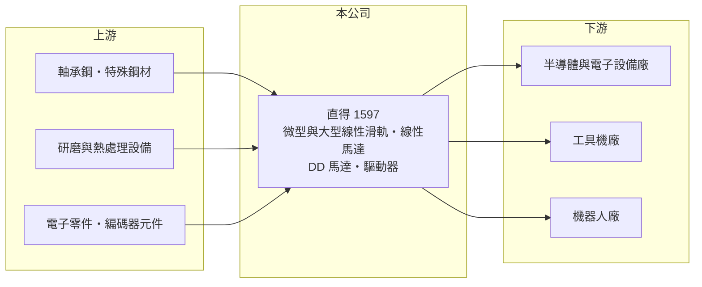

# 1597 直得

> 上市｜[[產業索引-電機機械|電機機械]]｜上市（櫃）日期 2020/12/23

# 第一章：企業模式與商業藍圖

> [!info] 撰寫說明
> 精簡版，由 Claude 依公開資料整理，架構比照 [[2330台積電]]，資料截至 2026-10-08。來源：證交所開放資料快照（基本資料、2026 年第二季資產負債與損益、股利）、MoneyDJ 年度財務比率表、工商時報 2026 年 4 月報導。#待校對

直得科技（以下簡稱直得）是台南的精密傳動元件廠，理解它的關鍵在於：公司以半導體與電子設備用的微型[[線性滑軌]]起家，毛利率長期維持在四成以上，現在正把同一套精密加工能力延伸到大型滑軌與[[機器人]]關節零件。

- **核心業務：** 直得成立於 1998 年，2020 年 12 月在證交所上市。依 2026 年 4 月工商時報報導，起家產品是微型線性滑軌，主要供應半導體與電子設備；近年跨足大型線性滑軌，客戶以[[工具機]]業為主；另有[[線性馬達]]與驅動器等傳動系統產品。線性滑軌是讓機台移動部件沿直線精準運行的元件，精度與剛性直接決定設備的定位能力。
- **營收結構：** 依產品或地區的營收比重公開資料未查得。報導指出半導體是需求主力，公司預估 2026 年機器人相關營收占比有機會超過 10%。這代表直得的營收與半導體設備投資循環高度相關，而機器人是正在成形的第二條成長曲線。
- **營運據點：** 總部位於台南市新市區（南部科學園區周邊），並在台南樹谷園區興建新廠。新廠原規劃生產[[滾珠螺桿]]，依 2026 年 4 月報導，產線已改為生產 [[DD馬達]]（直驅馬達）、編碼器與驅動器，切入人形與非人形機器人市場。
- **長期方向：** 公司的長期方向是從單一元件走向「元件加驅動」的模組化產品：滑軌、線性馬達、直驅馬達、編碼器與驅動器組合起來，就是機器人關節與自動化設備的核心運動模組。這條路若走通，可提高每台設備的單機價值，並降低對半導體單一產業的依賴。

# 第二章：護城河深度與競爭優勢

直得的護城河來自微型滑軌的精密製造能力與半導體設備客戶的認證，屬於窄但有利基的護城河。

- **競爭優勢：** 微型線性滑軌尺寸小、精度要求高，需要研磨、熱處理與檢測能力，全球能穩定量產的廠商不多。半導體設備廠一旦把某家滑軌設計進機台，通常會沿用多年，換供應商需要重新驗證，構成轉換成本。毛利率長期維持在 40% 至 44%，顯示產品具有定價能力；2026 年 4 月公司調漲驅動器、線性滑軌與線性馬達售價 5% 至 15%，也說明客戶接受度不低。
- **主要對手：** 國內最主要的對手是 [[2049上銀]]，產品線涵蓋滑軌、螺桿與機器人，規模遠大於直得；[[4576大銀微系統]] 在直驅馬達與精密定位平台領域重疊。國際上則以日本 THK、NSK 等大廠為主（待校對）。直得的策略是在微型滑軌的利基市場與大廠區隔。
- **觀察重點：** 長期應追蹤營業利益率能否回到 2021 至 2022 年 20% 以上的水準，以及機器人營收占比是否持續提升。毛利率幾年來大致穩定，但營業利益率由 26% 降到 9%，代表新廠折舊與費用增加的速度快於營收；營收放大後能否重新發揮規模效益，是判斷新投資成敗的關鍵。

# 第三章：財務體質與盈利規模

資料日期：2026-10-08，表格是撰寫當時的快照；最新月營收、毛利率、累計 EPS 由自動排程寫在本筆記的屬性欄位（月營收、毛利率、累計EPS 等）。#待校對

直得的財務特色是高而穩定的毛利率，搭配隨半導體設備循環大幅變動的營收與營業利益。

| 年度 | 營收（億元，推算） | [[毛利率]] | [[營業利益率]] | EPS（元） | [[ROE]] |
|---|---|---|---|---|---|
| 2021 | 19.0 | 41.67% | 26.03% | 3.82 | 14.04% |
| 2022 | 16.7 | 43.40% | 22.98% | 3.91 | 14.73% |
| 2023 | 11.0 | 43.61% | 10.94% | 1.12 | 4.11% |
| 2024 | 10.6 | 40.92% | 9.16% | 1.08 | 3.96% |
| 2025 | 11.6 | 40.99% | 9.27% | 0.91 | 3.31% |

（來源：MoneyDJ 年度財務比率表；2023 至 2025 年營收以每股營業額乘約 8,926 萬股推算，2021 至 2022 年依營收成長率回推。）

- **營收規模：** 2020 年營收約 14.1 億元（推算），2021 年衝上約 19 億元高峰，2023 年隨半導體與電子設備庫存調整降到 11 億元左右，之後緩步回升。2020 至 2025 年營收年複合成長率約 -3.8%（推算）。2026 年上半年營收 7.58 億元，已接近 2025 年全年的三分之二，顯示新一輪需求回升。
- **獲利：** 近五年（2021 至 2025）平均 ROE 約 8.0%（推算），高峰兩年約 14% 至 15%，2023 至 2025 年只有 3% 至 4%。2026 年上半年營業利益率回升到約 16%、EPS 1.30 元，已超過 2025 年全年，印證營收放大時的[[營運槓桿]]效果。
- **財務特色：** 依 2026 年第二季資料，總資產約 42.9 億元、股東權益約 24.7 億元、負債約 18.2 億元，負債比率約 42%，非流動資產約 22.3 億元，反映樹谷新廠的投資。公司持有庫藏股 200 萬股。2025 年度現金股利 0.7 元，以 EPS 0.91 元計，配息率約 77%；章程則寫明股利以股票股利搭配部分現金為主，保留彈性支應擴產。自由現金流是否長期為正未查得，新廠投資期間應偏低。
- **[[ROIC]] 與 [[WACC]]：** 以 2025 年營業利益約 1.08 億元（11.64 億元 × 9.27%）、稅率 20% 計算，稅後營業利益約 0.86 億元。有息負債未查得，投入資本以股東權益 24.7 億元到總資產 42.9 億元為區間，ROIC 約 2.0% 至 3.5%（推算）；2022 年營業利益約 3.84 億元，當時 ROIC 推估在 10% 以上。WACC 以 CAPM 推估：無風險利率 1.75%、市場風險溢酬 6%、β 假設 1.1（自動化與半導體設備零組件股常見值），權益成本約 8.4%；稅後負債成本 2%、負債占約四成，WACC 約 5.8%（推算）。2023 至 2025 年 ROIC 低於 WACC，主要是新廠資本先投入、營收尚未跟上；若 2026 年的獲利回升能延續，ROIC 有機會重新超過資金成本。

# 第四章：總體風險與地緣政治

直得的風險主要來自半導體設備循環、新廠投資回收與大廠競爭。

- **產業週期：** 微型滑軌的需求跟著半導體與電子設備的資本支出走，設備廠擴產時訂單大增，景氣反轉時則快速縮減，2023 年營收年減 34% 就是例子。機器人需求仍在早期，訂單規模與時程都有不確定性。
- **營運風險：** 樹谷新廠的產線由滾珠螺桿改為機器人關節零件，代表公司在產品方向上做了調整；若機器人市場放量慢於預期，新廠折舊將持續壓低營業利益率。與上銀、大銀微系統及日本大廠相比，直得規模較小，研發與客戶資源有限。
- **其他風險：** 鋼材等原物料價格上漲會壓縮毛利，2026 年的漲價即反映成本壓力。外銷與半導體客戶分布於各地，匯率波動與美中科技管制可能影響設備需求與出貨地點。

# 專有名詞解析

## 應用

- **[[機器人]]**：包含工業機器人、協作機器人與人形機器人，關節需要馬達、減速機、編碼器與驅動器等精密元件。

## 產業

- **[[線性滑軌]]**：讓機台移動部件沿直線精準運行的傳動元件，廣泛用於半導體設備、工具機與自動化設備。
- **[[滾珠螺桿]]**：把馬達的旋轉運動轉換成直線運動的精密傳動元件，常與線性滑軌搭配使用。
- **[[線性馬達]]**：直接產生直線運動的馬達，不需螺桿轉換，速度快、精度高，用於高階定位平台。
- **[[DD馬達]]**：直驅馬達，馬達直接帶動負載、不經減速機，精度高且無背隙，常用於機器人關節與旋轉平台。
- **[[工具機]]**：用來切削、加工金屬零件的機器，是製造業的母機，台灣中部有完整的工具機聚落。

# 核心供應鏈

- 上游：軸承鋼與特殊鋼材供應商、研磨與熱處理設備，以及馬達與驅動器所需的電子零件。
- 下游／客戶：半導體與電子設備製造商（微型滑軌）、工具機廠（大型滑軌）與機器人廠（具體客戶未查得，#待校對）。
- 同業：[[2049上銀]]、[[4576大銀微系統]]、[[4540全球傳動]]，以及日本 THK、NSK 等國際傳動元件大廠。

## 最新新聞
<!-- news:start（自動產生，請勿手動編輯此範圍） -->
- 2026-10-07 📰 媒體 11:00｜直得(1597) 訂單大爆發，為何營收還衝不上去？產能、人力卡住成長天花板｜[鉅亨網](https://news.cnyes.com/news/id/6623501)

完整紀錄：[[1597直得 新聞]]
<!-- news:end -->

## 相關連結
- [公開資訊觀測站](https://mopsov.twse.com.tw/mops/web/t05st03?step=1&firstin=1&co_id=1597)
- [Goodinfo](https://goodinfo.tw/tw/StockDetail.asp?STOCK_ID=1597)
- [Yahoo 股市](https://tw.stock.yahoo.com/quote/1597)
- [鉅亨網新聞](https://www.cnyes.com/twstock/1597/news)
