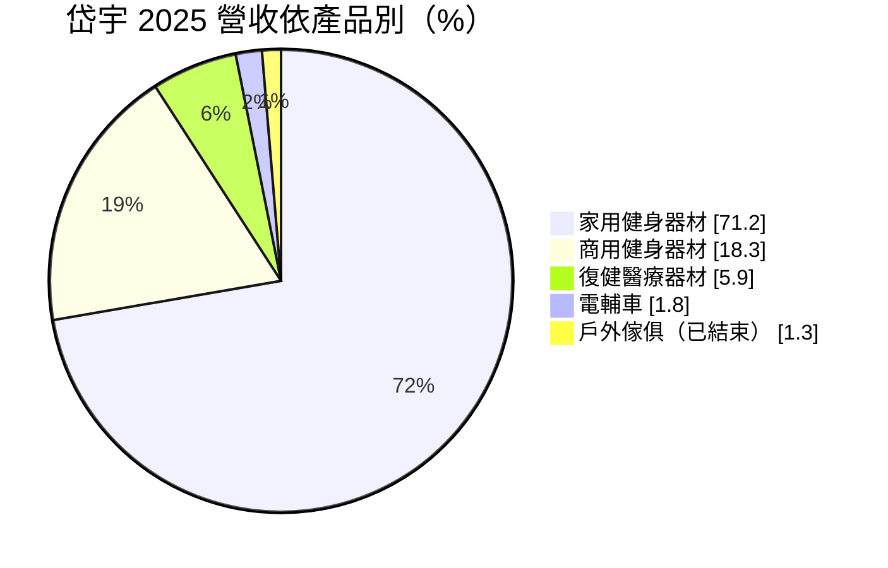
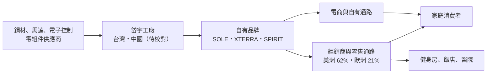
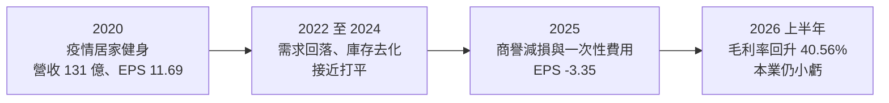
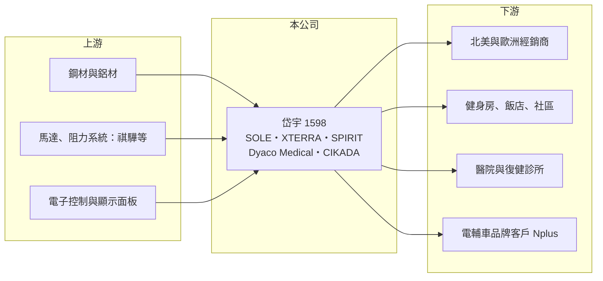

# 1598 岱宇

> 上市｜[[產業索引-運動休閒|運動休閒]]｜上市（櫃）日期 2016/09/20

# 第一章：企業模式與商業藍圖

> [!info] 撰寫說明
> 本文由 Claude 依公開資料整理，架構比照 [[2330台積電]] 的四章研究，資料截至 2026-10-08。財務數字來源：Goodinfo 年度經營績效頁、富果研究 2026 年 3 月法說會整理（品牌、營收結構、各產品毛利率、ReFit 計畫）、證交所開放資料（基本資料、2026 年第二季資產負債與營益分析、股利、本益比）；生產據點部分憑記憶整理，已標「待校對」。#待校對

在評估單一個股的長期投資價值時，首要步驟是拆解企業的底層獲利邏輯。本章針對岱宇國際（股票代號：1598，以下簡稱岱宇）的商業模式進行定性分析，說明這家健身器材廠如何從代工走向自有品牌，以及疫情後的需求崩落為何讓它陷入虧損。

## 一、核心定位：以自有品牌為主的健身器材廠

岱宇成立於 1990 年，2016 年上市，實收資本額約 17.9 億元。岱宇從健身器材製造起家，逐步建立多個[[自有品牌]]，產品涵蓋家用與商用健身器材、復健醫療器材與電動輔助自行車：

* **SOLE：** 家用健身器材品牌，以跑步機、橢圓機為主。
* **XTERRA：** 家用健身器材品牌，定位較平價。
* **SPIRIT：** 商用健身器材品牌，銷售給健身房、飯店與社區。
* **Dyaco Medical：** 復健[[醫療器材]]，8.0 系列於 2026 年初取得歐盟 MDR 認證。
* **CIKADA：** 電動輔助自行車品牌，Urban Cruise 獲 2026 年德國 iF 設計大獎。

2020 年岱宇併購一個終端 B2C 品牌，費用結構因此改變（富果整理），這筆併購後來在 2025 年提列[[商譽]]減損。

## 二、營收結構

2025 年營收 61.21 億元、年減 15%，產品結構如下（富果法說會整理）：

* **家用健身器材：** 占 71.2%、年減 23%，毛利率約 35% 至 39%。疫情期間居家健身需求暴增，之後需求快速回落，是岱宇營收大起大落的主因。
* **商用健身器材：** 占 18.3%、年增 8%，毛利率約 45% 至 50%，是公司最想擴大的業務。
* **復健醫療器材：** 占 5.9%、年增 16%，毛利率約 55% 至 60%，是毛利最高的產品線。
* **電輔車：** 占 1.8%，其中約 95% 為代工，代工毛利率約 18%，自有品牌約 20% 至 30%。
* **地區：** 美洲 62%、歐洲 21%，高度依賴歐美市場。

## 三、資本轉化邏輯：品牌、經銷與費用率

* **經銷模式：** 岱宇主要透過經銷商體系銷售，人事費用比直銷模式低。相較之下，[[1736喬山]] 約 97% 為直銷，費用率約 40%；岱宇 2025 年費用率卻達 42.7%，顯示費用控制出了問題。
* **品牌的代價：** 自有品牌毛利率較高，但需要負擔行銷、庫存與售後服務，需求轉弱時費用無法同步下降，[[營運槓桿]]會讓虧損放大。

## 四、企業長期藍圖：ReFit 計畫與商用轉型

公司在 2026 年 3 月法說會提出的方向（富果整理）：

* **ReFit 營運優化：** 費用率目標壓到 30% 以下，2025 年裁撤約 200 名人力，歐洲子公司每月可節省 1,000 多萬元費用，並導入標準化 ERP 系統。
* **商用市場：** 目前市占率約 0.3%，目標 5 年內提升到 1% 以上、營收挑戰 2 億美元，正與北美前五大連鎖健身房洽談。
* **家用市場：** 以獲利優先，不接虧錢訂單，2026 年營收預期持平。
* **新興業務：** 擴大復健醫療與電輔車自有品牌通路，電輔車目標 2026 年簽下 150 家實體經銷商。
* **資產調整：** 原戶外傢俱廠房改為重訓器材研發與生產基地；泰國土地因關稅優惠不再，不排除處分。
* **長期目標：** ROE 15%。

# 第二章：護城河深度與競爭優勢

本章分析岱宇的競爭優勢，說明健身器材業的護城河從何而來，以及岱宇與主要對手的差距。

## 一、護城河的核心組成要素

* **多品牌組合：** 從平價家用（XTERRA）、中高階家用（SOLE）到商用（SPIRIT）與醫療（Dyaco Medical），岱宇的品牌覆蓋多個價位與用途，能在不同市場分散風險。
* **製造與研發一體：** 岱宇自己設計與生產，可以控制成本與品質，並把技術延伸到復健醫療與電輔車。
* **醫療認證門檻：** 復健醫療器材需要取得歐盟 MDR 等法規認證，取得後具一定的進入門檻，毛利率也最高。

整體而言，岱宇的護城河屬於窄護城河：家用健身器材的品牌忠誠度有限，價格競爭激烈；商用市場則由國際大廠主導，岱宇市占率仍很低。

## 二、主要競爭對手格局

| 競爭對手 | 主要市場 | 與岱宇的比較 |
|---|---|---|
| [[1736喬山]] | 全球商用與家用 | 台灣健身器材龍頭，以 Matrix、Horizon 等品牌與直銷模式經營，規模遠大於岱宇 |
| Life Fitness、Precor、Technogym | 全球商用 | 國際商用健身器材大廠，掌握大型連鎖健身房 |
| Peloton、iFit（NordicTrack） | 北美家用 | 以內容訂閱結合器材的家用品牌 |
| 中國健身器材廠 | 家用代工與平價品牌 | 以低價搶占家用市場 |

## 三、優勢轉化：守得住、守不住與觀察重點

* **守得住：** 醫療復健與商用的高毛利產品。這兩塊需要認證、服務與長期客戶關係，價格競爭較小。
* **守不住：** 家用健身器材的需求與價格。疫情後需求回落、通路庫存去化，家用占營收七成以上，拖累整體獲利。
* **觀察重點：** 費用率能否如期降到 30% 以下；能否打進北美前五大連鎖健身房；以及復健醫療業務的成長速度。

# 第三章：財務體質與盈利規模

資料日期：2026-10-08。數字取自 Goodinfo 年度經營績效頁、富果法說會整理與證交所開放資料，表格是撰寫當時的快照；最新月營收、毛利率、累計 EPS 由自動排程寫在本筆記的屬性欄位（月營收、毛利率、累計EPS 等）。#待校對

財務報表是檢驗護城河是否真實存在的最終標準。本章用多年度的三率、ROE 與資本報酬，檢視岱宇在疫情前後的獲利品質。

## 一、獲利能力的基石：三率

| 年度 | 營收（新台幣） | [[毛利率]] | [[營業利益率]] | EPS（元） | [[ROE]] |
|---|---|---|---|---|---|
| 2019 | 58.5 億 | 29.3% | 5.60% | 2.05 | 10.2% |
| 2020 | 131 億 | 41.8% | 14.1% | 11.69 | 37.1% |
| 2021 | 117 億 | 34.6% | 6.69% | 3.48 | 9.59% |
| 2022 | 71.2 億 | 29.3% | -5.39% | -0.61 | -2.24% |
| 2023 | 77.9 億 | 34.3% | -1.26% | -0.88 | -2.50% |
| 2024 | 72.2 億 | 35.7% | 0.41% | 0.45 | 1.44% |
| 2025 | 61.2 億 | 36.0% | -6.76% | -3.35 | -13.4% |
| 2026 上半年 | 29.2 億 | 40.56% | -2.40% | 0.64 | 未查得 |

* **[[毛利率]]：** 毛利率維持在 29% 至 42% 之間，2026 年上半年回升到 40.56%（證交所營益分析），顯示自有品牌的產品毛利仍在。
* **[[營業利益率]]：** 問題出在費用。2025 年費用率 42.7% 高於毛利率 36%，營業利益率 -6.76%；若加回存貨跌價與一次性費用，營業利益率約 -0.2%（富果整理）。
* **2025 年虧損原因：** 商譽減損約 2.9 億元、匯兌損失約 6,000 萬元、人力精簡與信用減損等一次性費用，以及[[存貨跌價損失]]。公司表示約 5.5 億元的減損屬於非現金項目。
* **營收趨勢：** 2021 至 2025 年營收從 117 億元降到 61.2 億元，年複合成長率約 -15%（推算），等於回到疫情前的水準。

## 二、[[ROE]]：資本效率

2021 至 2025 年平均 ROE 約 -1.4%（推算），與公司 15% 的長期目標差距很大。2026 年第二季底保留盈餘只剩約 0.89 億元，每股淨值約 25.24 元，股價淨值比約 0.79 倍（證交所開放資料）。

## 三、資本支出、自由現金流與股利

岱宇的資本支出以廠房設備與 ERP 系統為主，2025 年起轉向節流，不再擴廠。股利方面，2025 年度虧損，改以資本公積發放每股 0.5 元現金（證交所股利資料）。公司另有約 2 億元的[[可轉換公司債]]將於 2027 年到期，表示銀行額度充裕可償還；2025 年也曾實施 3,000 張[[庫藏股]]（經濟日報報導標題）。

## 四、[[ROIC]] 與 [[WACC]]：價值創造利差

**ROIC 推算：** 2025 年營業虧損約 4.14 億元，ROIC 為負。以 2026 年第二季底權益總計約 44.6 億元、總負債約 52.0 億元，假設其中約 55% 為有息負債（推估，約 28.6 億元），投入資本約 73.2 億元，ROIC 約 -5.7%（推算）。以同樣資本基礎回推 2020 年高峰（營業利益約 18.5 億元，稅後約 14.8 億元），ROIC 約 20%（推算）。

**WACC 推算：** 假設台灣 10 年期公債殖利率 1.75%、市場風險溢酬 6%、β 取 1.0（健身器材業景氣敏感度高），股東權益成本約 7.75%。負債成本假設 2.8%，稅後約 2.2%；以帳面價值計，權益約占 61%，WACC 約 5.6%（推算）。

**結論：** 岱宇在 2020 年疫情高峰時 ROIC 遠高於 WACC，但那是需求暴增帶來的短期現象；2022 至 2025 年 ROIC 多為負值，明顯低於資金成本，代表疫情期間擴張的資本與併購沒有帶來長期回報。若 ReFit 計畫能把費用率降到 30% 以下，以 36% 至 40% 的毛利率推算，營業利益率可回到 6% 以上，ROIC 才有機會重新超過 WACC。

# 第四章：總體風險與地緣政治

任何企業都無法脫離宏觀環境獨立存在。本章分析岱宇長期必須面對的需求週期、地緣政治、財務與營運風險。

## 一、產業週期

* **家用健身的需求循環：** 居家健身器材屬於耐久消費品，買了以後多年不會再買。疫情期間提前透支的需求，需要好幾年才能消化，景氣衰退時消費者也會延後購買。
* **[[長鞭效應]]：** 需求轉弱時，經銷商與零售商同時去庫存，岱宇的出貨下滑幅度會大於終端銷售。

## 二、地緣政治與關稅

* **美國關稅：** 美洲占營收 62%，美國對進口產品的關稅政策直接影響售價與毛利，泰國土地因關稅優惠不再而考慮處分，就是關稅影響布局的例子。
* **生產據點：** 若生產集中在單一國家，面臨關稅或地緣政治衝擊時調整彈性有限（生產據點分布待校對）。

## 三、財務與營運風險

* **費用控制：** 費用率長期高於同業，若 ReFit 計畫成效不如預期，即使營收回升，獲利改善也有限。
* **併購與商譽：** 2025 年已提列商譽減損，未來若其他併購業務表現不佳，仍可能出現減損。
* **匯率：** 以美元與歐元計價的營收占多數，匯率波動曾造成數千萬元的匯兌損失。

## 四、新事業與技術演進

* **商用市場進入障礙：** 商用健身器材市場由國際大廠主導，打進大型連鎖健身房需要長期驗證與售後服務網路。
* **醫療法規：** 復健醫療器材需要符合各國醫療器材法規，認證時程與成本高，但也是門檻。
* **智慧健身：** 結合內容訂閱與 AI 教練的智慧健身器材是長期趨勢，軟體與內容能力不足的硬體廠可能被邊緣化。

# 專有名詞解析

## 金融

- **[[營運槓桿]]**：固定成本占比高的企業，營收小幅變動就會讓營業利益大幅變動的現象。
- **[[存貨跌價損失]]**：存貨的可回收金額低於帳面成本時，依會計規定提列的損失，會壓低當期毛利率。
- **[[商譽]]**：併購價格高於被併公司可辨認淨資產的部分，若被併事業表現不佳，須認列減損。
- **[[可轉換公司債]]**：可依約定價格轉換成公司股票的債券，公司可用較低利率籌資，但轉換後會稀釋股權。
- **[[庫藏股]]**：公司從市場買回自家股票，可用於註銷、員工獎酬或穩定股價。
- **[[長鞭效應]]**：終端需求的小幅變動，沿供應鏈往上游傳遞時被逐級放大，造成上游庫存與訂單劇烈波動。
- **[[ROIC]]**：投入資本報酬率，稅後營業利益除以股東權益與有息負債的合計，衡量本業對所有資金提供者的報酬。
- **[[WACC]]**：加權平均資金成本，依股東權益與負債的比重加權計算的資金成本，ROIC 高於它才代表創造價值。

## 產業

- **[[自有品牌]]**：公司以自己的品牌銷售產品，掌握定價與通路，但需負擔行銷與售後服務成本。
- **[[醫療器材]]**：用於診斷、治療或復健的器材，需取得各國主管機關許可才能銷售，認證門檻高。

# 核心供應鏈

## 1. 上游：零組件
- 鋼材與鋁材、電子控制與顯示面板
- 阻力系統與馬達：[[1593祺驊]]（是否為岱宇供應商未查得，列為產業上游代表）

## 2. 中游：岱宇本身與同業
- 台灣同業：[[1736喬山]]
- 國際同業：Life Fitness、Precor、Technogym、Peloton、iFit

## 3. 下游：通路與使用者
- 北美與歐洲經銷商、電商平台
- 健身房、飯店、社區、醫院與復健診所
- 電輔車代工客戶 Nplus

## 最新新聞
<!-- news:start（自動產生，請勿手動編輯此範圍） -->
- 2026-10-08 🏛️ 重訊 17:37｜本公司受邀參加寬量國際主辦之「20th QIC CEO Week」，向投資人說明本公司之營運概況、財務及業務相關資訊｜[觀測站](https://mops.twse.com.tw/mops/#/web/t05st01)
- 2026-10-08 📰 媒體 10:47｜岱宇受惠商用新客戶推進順利 9月營收5.43億元年增逾2成｜[鉅亨網](https://news.cnyes.com/news/id/6624637)

完整紀錄：[[1598岱宇 新聞]]
<!-- news:end -->

## 相關連結
- [公開資訊觀測站](https://mopsov.twse.com.tw/mops/web/t05st03?step=1&firstin=1&co_id=1598)
- [Goodinfo](https://goodinfo.tw/tw/StockDetail.asp?STOCK_ID=1598)
- [Yahoo 股市](https://tw.stock.yahoo.com/quote/1598)
- [鉅亨網新聞](https://www.cnyes.com/twstock/1598/news)
