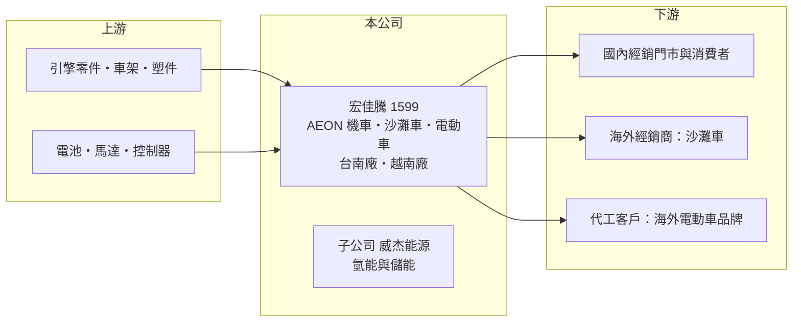

# 1599 宏佳騰

> 上櫃｜[[產業索引-電機機械|電機機械]]｜上市（櫃）日期 2012/12/25

# 第一章：企業模式與商業藍圖

> [!info] 撰寫說明
> 精簡版，由 Claude 依公開資料整理，架構比照 [[2330台積電]]，資料截至 2026-10-08。來源：櫃買中心開放資料快照（基本資料、2026 年第二季資產負債與損益）、MoneyDJ 年度財務比率表、Kingautos 2025 年刊載的 2024 年財報新聞稿。#待校對

宏佳騰動力科技（以下簡稱宏佳騰）是台南的機車與沙灘車品牌廠，以 AEON 為品牌，理解它的關鍵在於：公司同時經營內銷機車、外銷[[沙灘車]]與[[電動機車]]三塊業務，規模遠小於國內機車大廠，因此靠利基車種、外銷與代工尋找生存空間。

- **核心業務：** 宏佳騰成立於 2003 年，2012 年在櫃買中心掛牌，產品包含燃油機車（例如黃牌大型速克達 Brera X、STR 250 系列）、電動機車（例如電動跑旅車款 EV.C1）與外銷為主的沙灘車（[[ATV]]）。依 2024 年財報新聞稿，公司 250cc 以上大型速克達累計銷售近 2,500 台，在 250cc 級距市占率達 75.5%，顯示它在大排氣量速克達的利基市場有一定地位。
- **營收結構：** 依產品或地區的營收比重公開資料未揭露。2024 年全年出車數年增 7%、國內燃油車款銷量成長 14.8%，沙灘車外銷明顯成長。另有代工業務：替韓國品牌 Dotstation 代工 EV.C1，2024 年交付近 2,000 台，合作夥伴 QOODER 的 QV4、QV3 車款也重返市場，公司也預告將替新合作夥伴代工新產品。
- **營運據點：** 總部與主要工廠位於台南。越南廠於 2024 年啟動，初期為引擎與零件組裝，2024 年 7 月取得 ISO 9001 認證，計畫於 2025 年 4 月啟用並擴展到整車製造。越南是全球最大的機車市場之一，也可作為外銷的生產基地。
- **長期方向：** 公司提出「油電共好」策略，燃油與電動車並行，規劃擴大門市，並透過子公司威杰能源發展氫能發電與[[儲能]]系統。這些多角化布局代表公司不把未來押在單一動力，但也意味著有限的資源要分散在多個新事業上。

# 第二章：護城河深度與競爭優勢

宏佳騰在國內機車市場是小眾品牌，護城河有限，主要靠利基車種與代工彈性建立差異。

- **競爭優勢：** 公司在 250cc 大型速克達與沙灘車等大廠較不重視的市場深耕，車種少量多樣，能以較快的開發速度回應利基需求。小廠的另一個優勢是願意接海外品牌的少量代工訂單，例如韓國與瑞士的電動車品牌，這在大廠眼中規模太小，對宏佳騰卻是重要的營收來源。不過這些優勢都不足以抵抗大廠在價格與通路上的壓力。
- **主要對手：** 國內機車市場由光陽、[[2206三陽工業]] 與台灣山葉主導，電動機車則有 Gogoro 等品牌，宏佳騰的市占率很低（具體數字未查得）。外銷沙灘車市場的主要對手為美日品牌與中國大陸車廠。
- **觀察重點：** 長期應追蹤毛利率能否穩定在 22% 以上，以及營業費用能否隨營收調整。2024 年毛利率 22.54% 時營業利益率仍是 -0.98%，代表費用結構偏重；越南廠與門市擴張若不能帶來營收規模，獲利很難轉正。

# 第三章：財務體質與盈利規模

資料日期：2026-10-08，表格是撰寫當時的快照；最新月營收、毛利率、累計 EPS 由自動排程寫在本筆記的屬性欄位（月營收、毛利率、累計EPS 等）。#待校對

宏佳騰的財務在 2022 年後明顯轉弱：營收規模縮小近一半，本業連續三年虧損。

| 年度 | 營收（億元，推算） | [[毛利率]] | [[營業利益率]] | EPS（元） | [[ROE]] |
|---|---|---|---|---|---|
| 2021 | 36.1 | 25.35% | 11.00% | 4.72 | 18.59% |
| 2022 | 33.8 | 22.60% | 8.11% | 3.76 | 13.83% |
| 2023 | 21.4 | 19.36% | -4.05% | -0.06 | -0.23% |
| 2024 | 22.9 | 22.54% | -0.98% | 1.21 | 4.22% |
| 2025 | 18.6 | 19.65% | -8.94% | -0.84 | -4.11% |

（來源：MoneyDJ 年度財務比率表；2023、2024 年營收取自公司新聞稿，其餘年度依營收成長率推算。）

- **營收規模：** 2020 年營收約 32.2 億元（推算），2021 年達約 36 億元高峰，2023 年大減 37%，2025 年再減 19% 至約 18.6 億元。2020 至 2025 年營收年複合成長率約 -10.4%（推算）。2023 年的下滑可能與外銷沙灘車庫存調整及國內電動機車市場轉弱有關（推估）。
- **獲利：** 近五年（2021 至 2025）平均 ROE 約 6.5%（推算），但前兩年貢獻了大部分，2023 年後 ROE 在 -4% 至 4% 之間。2024 年本業虧損、EPS 仍有 1.21 元，代表業外收益支撐獲利。2026 年上半年營業利益率約 -2.5%，歸屬母公司 EPS 0.09 元，非控制權益則認列虧損，顯示部分子公司仍在投入期。
- **財務特色：** 依 2026 年第二季資料，總資產約 26.6 億元、權益總計約 18.8 億元、負債約 7.8 億元，負債比率約 29%，財務結構尚稱保守，非流動資產約 14.4 億元，反映越南廠等長期投資。公司持有庫藏股 100 萬股。配息紀錄與自由現金流公開資料未查得。
- **[[ROIC]] 與 [[WACC]]：** 2025 年營業損失約 1.67 億元（18.6 億元 × -8.94%），ROIC 為負；以權益總計 18.8 億元到總資產 26.6 億元為投入資本區間，約 -6.3% 至 -8.9%（推算，未計稅盾）。對照 2022 年營業利益約 2.74 億元、稅後約 2.19 億元，當時 ROIC 推估在 10% 以上。WACC 以 CAPM 推估：無風險利率 1.75%、市場風險溢酬 6%、β 假設 1.0（機車與消費性製造業常見值），權益成本約 7.75%；稅後負債成本 2%、負債占約 29%，WACC 約 6.1%（推算）。2023 年後 ROIC 持續低於 WACC，公司正在消耗股東價值；越南廠、電動車與氫能等新投資能否讓 ROIC 回到資金成本之上，是長期評估的核心。

# 第四章：總體風險與地緣政治

宏佳騰的風險在於規模劣勢、多頭並進的資源分散，以及機車產業的政策與技術變動。

- **產業週期：** 國內機車市場已飽和，銷量主要跟著換車週期、補助政策與排放法規走；電動機車補助調整時，市場需求會劇烈波動。外銷沙灘車受北美與歐洲休閒消費景氣影響，具有明顯的庫存循環。
- **營運風險：** 公司規模小，研發、通路與採購成本都難與大廠相比，毛利率約兩成，營業費用一高就會虧損。同時經營燃油車、電動車、代工、越南廠與氫能子公司，資源分散，任何一項新事業不如預期都會拖累整體獲利。代工客戶多為小型海外品牌，訂單穩定性有限。
- **其他風險：** 排放法規（例如歐盟 Euro 5+）與各國電動車政策變動，會影響車款開發成本與上市時程。外銷以美元與歐元計價，匯率波動影響毛利；越南的勞動與法規環境也會影響新廠的成本效益。

# 專有名詞解析

## 應用

- **[[沙灘車]]**：全地形車，四輪、適合在沙地與泥地行駛的休閒車輛，主要市場在北美與歐洲。
- **[[電動機車]]**：以電池與馬達驅動的機車，台灣有換電與充電兩種補能模式，市場受補助政策影響大。
- **[[儲能]]**：把電力儲存在電池等系統中，在需要時釋放，用於電網調節、再生能源搭配與備援電力。

## 產業

- **[[ATV]]**：All-Terrain Vehicle，全地形車的英文縮寫，國內常稱沙灘車。

# 核心供應鏈

- 上游：台灣機車零件協力體系（車架、引擎零件、塑件、煞車與燈具），以及電動車所需的電池芯、馬達與控制器供應商（具體名單未查得）。
- 下游／客戶：國內經銷門市與消費者、北美與歐洲的沙灘車經銷商，以及韓國 Dotstation、QOODER 等代工客戶。
- 同業：[[2206三陽工業]]、光陽、台灣山葉、Gogoro，以及中國大陸的沙灘車廠。

## 最新新聞
<!-- news:start（自動產生，請勿手動編輯此範圍） -->
- 2026-10-05 🏛️ 重訊 16:18｜配合法務部調查局臺南市調查處進行調查｜[觀測站](https://mops.twse.com.tw/mops/#/web/t05st01)

完整紀錄：[[1599宏佳騰 新聞]]
<!-- news:end -->

## 相關連結
- [公開資訊觀測站](https://mopsov.twse.com.tw/mops/web/t05st03?step=1&firstin=1&co_id=1599)
- [Goodinfo](https://goodinfo.tw/tw/StockDetail.asp?STOCK_ID=1599)
- [Yahoo 股市](https://tw.stock.yahoo.com/quote/1599)
- [鉅亨網新聞](https://www.cnyes.com/twstock/1599/news)
