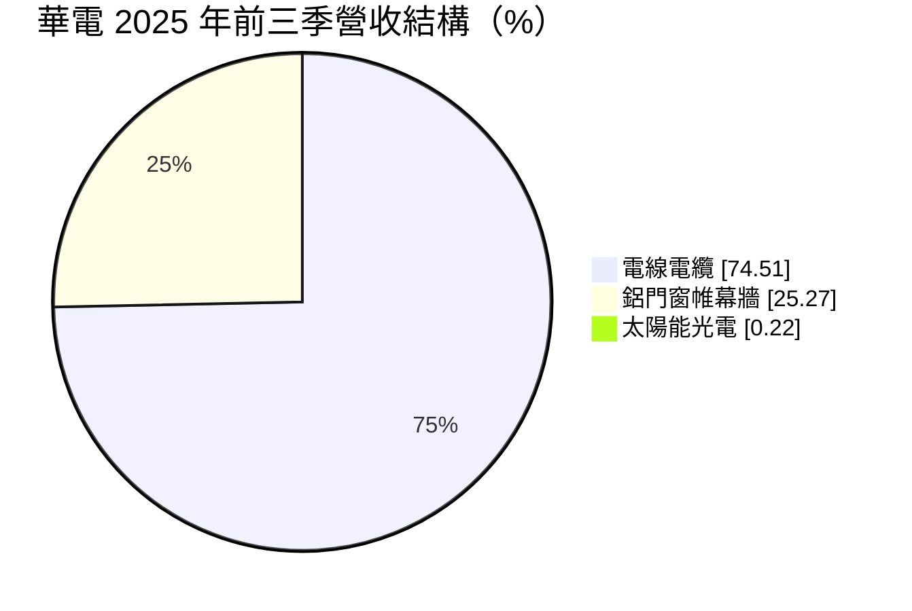
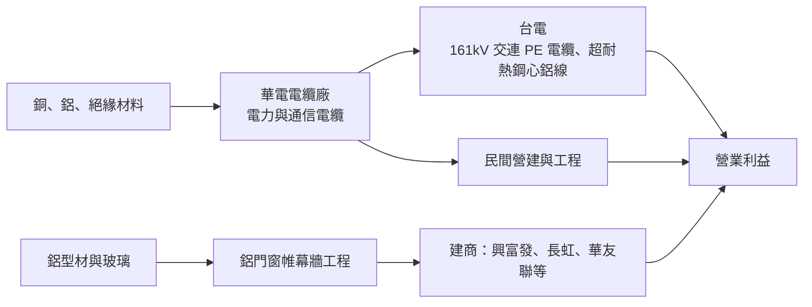
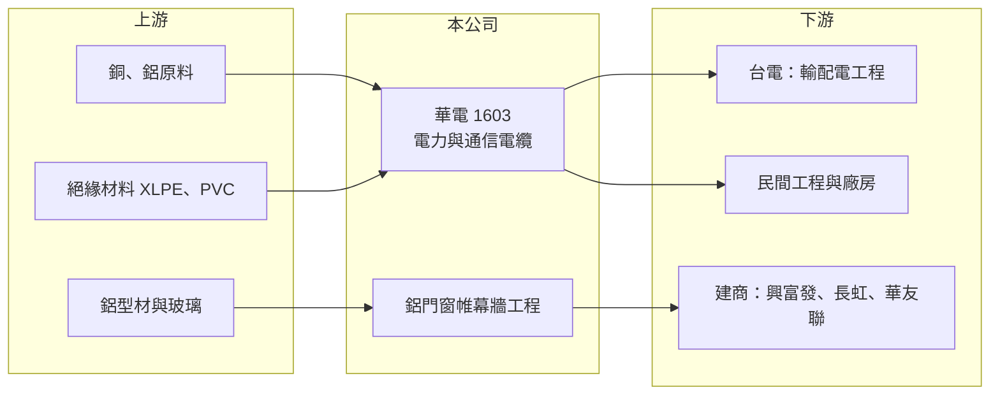

# 1603 華電

> 上市｜[[產業索引-電器電纜|電器電纜]]｜上市（櫃）日期 1968/06/03

# 第一章：企業模式與商業藍圖

> [!info] 撰寫說明
> 本文由 Claude 依公開資料整理，架構比照 [[2330台積電]] 的四章研究，資料截至 2026-10-08。財務數字來源：Goodinfo 年度經營績效頁、富果研究 2025 年 11 月法說會整理、證交所開放資料（基本資料、2026 年第二季資產負債與綜合損益、營益分析、股利、本益比）；產業描述為整理性內容，尚未逐條比對原始文件。#待校對

在評估單一個股的長期投資價值時，首要步驟是拆解企業的底層獲利邏輯。本章說明華電（股票代號：1603）如何以電力電纜為主、鋁門窗帷幕牆為輔，搭上台電電網更新的長期需求。

## 一、核心定位：以台電為主要客戶的國內電纜廠

華電成立於 1961 年，1968 年上市，是台灣歷史最久的上市電線電纜廠之一，實收資本額約 19.17 億元。公司的本業是電力電纜與通信電纜，近年最重要的產品是供應台電的高壓[[交連PE電纜]]與超耐熱鋼心鋁線。2025 年公司陸續取得台電 161kV 交連 PE 電纜與超耐熱鋼心鋁線等訂單，案件涵蓋花東、台中供電區處及輸變電工程處，這代表華電已經進入台電輸電等級電纜的供應名單。

公司在法說會上明確表示以國內市場為核心，目前沒有海外擴張計畫，電纜事業配合台電政策發展。這個定位的好處是需求能見度高、收款穩定；代價是成長幾乎完全取決於台電與國內營建的投資節奏。

## 二、產品板塊：電線電纜與鋁門窗帷幕牆

2025 年前三季的營收結構如下（富果研究整理的法說會資料）：

* **電線電纜：** 包括電力電纜與通信電纜，主要客戶是台電。電纜的售價大部分反映銅、鋁等金屬成本，廠商賺的是加工費，因此營收會隨銅價上下波動，毛利則取決於加工技術等級與[[銅價轉嫁]]的效率。
* **鋁門窗帷幕牆：** 承接建築用鋁門窗與帷幕牆工程，客戶包括桃大建設、[[2542興富發]]、[[5534長虹]]、[[1436華友聯]]等建商，代表案件有台北「IBC 環球企業總部」、台中「富旺千蘊」等。簡報中提到 LIXIL 為合作夥伴。這個事業與住宅與商辦景氣連動，是電纜之外的第二支柱。
* **太陽能光電：** 比重極小，屬於公司拓展再生能源的嘗試。

## 三、資本轉化邏輯：電纜加工費加上工程收入

* **營收規模隨銅價放大：** 2021 至 2025 年營收從 25.6 億元成長到 55.2 億元，一部分是台電訂單增加，一部分是銅價上漲墊高售價。看電纜廠時，毛利金額與營業利益比營收數字更能反映實際成長。
* **工程事業的認列節奏：** 帷幕牆依工程進度認列營收，建案開工與完工時點會讓這部分營收在不同季度間起伏。

## 四、企業長期藍圖

華電在法說會中提出三個方向：第一是持續爭取台電[[強韌電網計畫]]的電纜標案，往更高電壓等級發展；第二是拓展光儲能與再生能源相關業務；第三是考慮與內外銷能力較強的同業策略聯盟，共同開發新市場。整體而言，公司的策略偏保守，以穩健接單與維持獲利為主，沒有大規模擴產或海外布局的計畫。

# 第二章：護城河深度與競爭優勢

本章分析華電的競爭優勢、主要對手，以及在台電標案競爭下哪些優勢守得住。

## 一、護城河的核心組成要素

* **台電供應資格與實績：** 台電輸電等級的電纜需要通過型式試驗與長期使用實績，新廠商難以短期取得。華電已承接 161kV 等級訂單，這個資格是進入門檻，也是在標案中能夠持續參與的基礎。
* **悠久的品牌與通路：** 成立超過 60 年，在國內營建與工程市場累積了長期合作關係，帷幕牆事業也有多個指標建案實績，能互相支撐公司信用。
* **財務穩健：** 2026 年第二季底總負債約 43.9 億元、權益總計約 81.8 億元，負債比約 35%（證交所開放資料），流動比率約 196%（2025 年第三季），足以承受銅價上漲時的營運資金需求。

這些優勢屬於「窄護城河」：電纜是規格化產品，台電以公開招標採購，最終多半仍以價格決勝。

## 二、主要競爭對手格局

| 對手 | 定位 | 對華電的影響 |
|---|---|---|
| [[1605華新]] | 台灣最大線纜廠，兼營不銹鋼 | 規模與產品線最完整，超高壓電纜具優勢 |
| [[1609大亞]] | 電力電纜、漆包線、綠能 | 民間與台電訂單皆強，規模約為華電六倍 |
| [[1618合機]]、[[1612宏泰]] | 高壓與超高壓電力電纜 | 台電標案直接競爭者 |
| [[1615大山]]、[[1616億泰]] | 中高壓電纜 | 在配電等級標案中競爭 |

## 三、優勢轉化：守得住、守不住與觀察重點

* **守得住：** 台電輸電與配電電纜的長期需求。強韌電網計畫屬於十年期的電網投資，只要華電維持供應資格與交期，訂單能見度比一般製造業高。
* **守不住：** 標案價格。八家左右的國內線纜廠同時投標，價格競爭激烈，毛利率長期在 12% 至 16% 之間，很難大幅拉高。
* **觀察重點：** 第一，能否取得 345kV 等更高電壓等級的實績；第二，帷幕牆事業在房市降溫時能否維持接單；第三，策略聯盟或外銷能否打開國內以外的市場。

# 第三章：財務體質與盈利規模

資料日期：2026-10-08。數字取自 Goodinfo 年度經營績效頁、富果研究法說會整理與證交所開放資料，表格是撰寫當時的快照；最新月營收、毛利率、累計 EPS 由自動排程寫在本筆記的屬性欄位（月營收、毛利率、累計EPS 等）。#待校對

財務報表是檢驗護城河是否真實存在的最終標準。本章檢視華電在電網投資循環中的獲利品質與資本效率。

## 一、多年度財務摘要

| 年度 | 營收（新台幣） | [[毛利率]] | [[營業利益率]] | EPS（元） | [[ROE]] |
|---|---|---|---|---|---|
| 2019 | 27.1 億 | 14.6% | 9.03% | 1.46 | 4.64% |
| 2020 | 22.4 億 | 12.3% | 6.41% | 2.05 | 6.18% |
| 2021 | 25.6 億 | 16.3% | 10.7% | 1.78 | 5.03% |
| 2022 | 34.7 億 | 12.9% | 9.35% | 2.07 | 5.61% |
| 2023 | 40.1 億 | 15.1% | 12.3% | 2.99 | 7.65% |
| 2024 | 45.4 億 | 13.6% | 10.9% | 2.85 | 6.64% |
| 2025 | 55.2 億 | 13.2% | 10.4% | 3.26 | 7.06% |
| 2026 上半年 | 28.1 億 | 12.94% | 10.23% | 1.36 | 未查得 |

註：證交所股利資料顯示 2025 年本期淨利約 5.18 億元，以目前約 1.92 億股計算 EPS 約 2.70 元，與 Goodinfo 的 3.26 元不同，推測 2025 至 2026 年間股本有所增加（原因未查得），以年報為準。

* **[[毛利率]]與[[營業利益率]]：** 毛利率長期在 12% 至 16% 之間，營業利益率在 9% 至 12% 之間，兩者差距只有約 3 個百分點，代表營業費用很精簡，獲利幾乎完全取決於電纜加工費與工程毛利。
* **營收成長：** 2020 至 2025 年營收年複合成長率約 19.8%（推算），是同業中成長較快的一家，反映台電訂單增加與銅價上漲。

## 二、[[ROE]]：資本效率

2021 至 2025 年平均 ROE 約 6.4%（推算）。營業利益率已有一成，ROE 卻偏低，原因是股東權益很大：2026 年第二季底保留盈餘約 65.3 億元、其他權益約 11.8 億元，權益總計約 81.8 億元，而上半年營收只有 28 億元。這表示公司帳上累積了大量未運用在本業的資金與金融資產（推估），股價淨值比約 0.6 倍（2026 年 10 月初，證交所本益比資料）也反映了市場對這部分資產報酬的保守看法。

## 三、股利與現金流

2025 年度配發現金股利 2 元（證交所股利資料），以目前股本計算配發率約七成以上（推算）。電纜廠在銅價上漲期需要更多營運資金，自由現金流會因存貨與應收帳款增加而波動，具體金額未查得。

## 四、[[ROIC]] 與 [[WACC]]：價值創造利差

**ROIC 推算：** 2025 年營收 55.2 億元乘以營業利益率 10.4%，營業利益約 5.74 億元，扣除 20% 稅率後約 4.59 億元。2026 年第二季底權益約 81.8 億元，總負債約 43.9 億元，假設其中一半為有息負債（推估，約 22 億元），投入資本約 103.8 億元，ROIC 約 4.4%（推算）。

**WACC 推算：** 台灣 10 年期公債殖利率取 1.75%、市場風險溢酬 6%、β 取電線電纜業常見值 0.8，股東權益成本約 6.55%；負債成本 2.5%，稅後約 2.0%；以帳面計權益約占 79%、負債約占 21%，WACC 約 5.6%（推算）。

**結論：** 華電本業的營業利益率不差，但因帳上權益龐大，整體 ROIC 約低於 WACC 1 個百分點，代表資本使用效率仍有改善空間。若扣除與本業無關的金融資產，本業本身的報酬應高於資金成本（推估）。長期價值能否提升，取決於強韌電網訂單能否持續墊高營業利益，以及公司是否更積極運用閒置資本。

# 第四章：總體風險與地緣政治

任何企業都無法脫離宏觀環境獨立存在。本章分析華電長期必須面對的產業、營運與原物料風險。

## 一、產業週期與市場結構

* **客戶集中於台電：** 電纜業務的主要客戶是台電，台電的預算、招標節奏與財務狀況直接影響訂單。強韌電網計畫若因電價政策或預算排擠而放慢，華電的成長也會跟著放緩。
* **營建景氣：** 帷幕牆與部分電纜需求來自營建業，房市受央行信用管制等政策壓抑時，接單與毛利都可能下滑。
* **標案價格競爭：** 國內線纜廠家數多，台電以最低價得標為主，產能擴充後的價格戰會壓縮利潤。

## 二、原物料與營運風險

* **銅價與鋁價波動：** 銅、鋁占電纜成本的大部分。投標到交貨之間若銅價大漲，而合約未完全反映，就會吃掉利潤；銅價急跌時，則可能提列存貨跌價損失。
* **工程執行風險：** 帷幕牆屬於工程承攬，工期延誤、成本超支或建商財務問題都會影響獲利。
* **股本變動：** 2025 至 2026 年間股本似有增加，若來自現金增資，將稀釋每股盈餘，需追蹤資金用途（原因未查得）。

## 三、法規與技術演進

* **電網技術升級：** 台電往更高電壓等級、地下化與再生能源併網發展，電纜廠需要持續投資測試設備與取得新規格認證，否則會被排除在高附加價值標案之外。
* **再生能源政策：** 公司把光儲能列為發展方向，但目前規模極小，政策補助或電力市場規則的變化都會影響這項業務能否成形。

# 專有名詞解析

## 金融

- **[[毛利率]]**：營業毛利占營收的比例，反映產品定價能力與生產成本控制。
- **[[營業利益率]]**：扣除營業費用後的營業利益占營收的比例，衡量本業整體獲利能力。
- **[[ROE]]**：股東權益報酬率，稅後淨利除以股東權益，衡量公司運用股東資金的效率。
- **[[ROIC]]**：投入資本報酬率，稅後營業利益除以股東權益與有息負債的合計，衡量本業對所有資金提供者的報酬。
- **[[WACC]]**：加權平均資金成本，依股東權益與負債的比重加權計算的資金成本，ROIC 高於它才代表創造價值。

## 產業

- **[[交連PE電纜]]**：以交連聚乙烯（XLPE）作為絕緣層的電力電纜，耐熱與絕緣性能佳，是中高壓與超高壓輸配電的主流電纜。
- **[[強韌電網計畫]]**：台電在 2022 年大停電後提出的十年電網強化計畫，投入大量預算更新輸變電設備。
- **[[銅價轉嫁]]**：電線電纜廠把銅價變動反映到售價的機制，通常以報價時銅價加上加工費計價，轉嫁速度決定毛利穩定度。

# 核心供應鏈

## 1. 上游：金屬與材料
- 銅、鋁等金屬原料（國際市場報價）
- 絕緣與被覆材料：交連聚乙烯、PVC，相關石化供應商如 [[1301台塑]]、[[1304台聚]]
- 帷幕牆用鋁型材與玻璃，合作夥伴 LIXIL

## 2. 本公司與同業
- 同業：[[1605華新]]、[[1609大亞]]、[[1618合機]]、[[1612宏泰]]、[[1615大山]]、[[1616億泰]]、[[1608華榮]]

## 3. 下游：客戶
- 台電：輸配電與強韌電網工程
- 建商：[[2542興富發]]、[[5534長虹]]、[[1436華友聯]]、桃大建設

## 最新新聞
<!-- news:start -->
<!-- news:end -->

## 相關連結
- [公開資訊觀測站](https://mopsov.twse.com.tw/mops/web/t05st03?step=1&firstin=1&co_id=1603)
- [Goodinfo](https://goodinfo.tw/tw/StockDetail.asp?STOCK_ID=1603)
- [Yahoo 股市](https://tw.stock.yahoo.com/quote/1603)
- [鉅亨網新聞](https://www.cnyes.com/twstock/1603/news)
