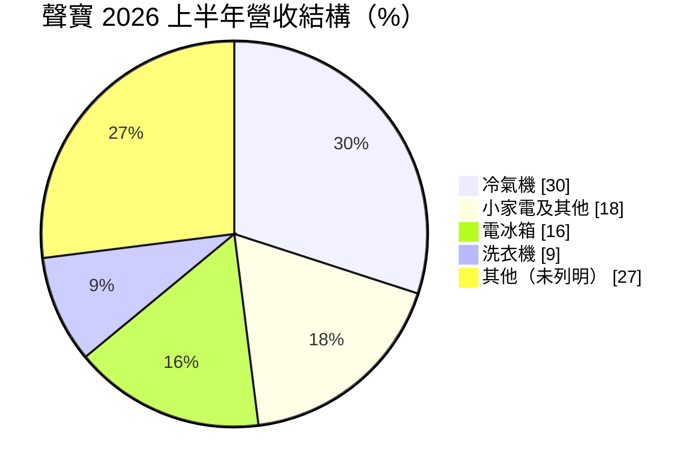
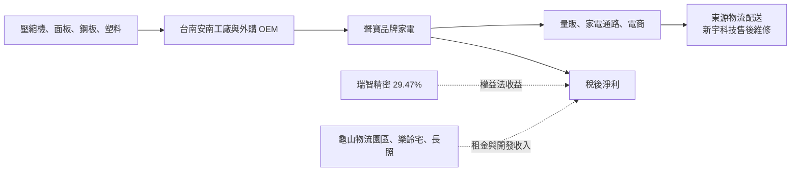
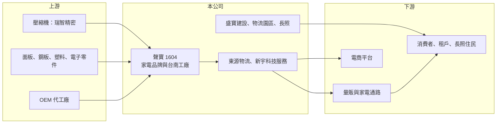

# 1604 聲寶

> 上市｜[[產業索引-電器電纜|電器電纜]]｜上市（櫃）日期 1970/12/14

# 第一章：企業模式與商業藍圖

> [!info] 撰寫說明
> 本文由 Claude 依公開資料整理，架構比照 [[2330台積電]] 的四章研究，資料截至 2026-10-08。財務數字來源：Goodinfo 年度經營績效頁、富果研究 2026 年 9 月法說會整理、證交所開放資料（基本資料、2026 年第二季資產負債與綜合損益、營益分析、股利、本益比）；產業描述為整理性內容，尚未逐條比對原始文件。#待校對

在評估單一個股的長期投資價值時，首要步驟是拆解企業的底層獲利邏輯。本章說明聲寶（股票代號：1604）如何從本土家電品牌，逐步延伸到物流園區、樂齡住宅與長照，以及這些資產對獲利結構的影響。

## 一、核心定位：本土家電品牌，正在轉型為「家電＋資產活化」

聲寶成立於 1962 年，1970 年上市，實收資本額約 38.42 億元，是台灣歷史最久的本土家電品牌之一。公司從事電子及電化產品的研發、製造、銷售與服務，製造基地在台南安南區，全台有 6 個營業據點與 27 處維修服務據點，並透過子公司東源物流負責配送、新宇科技服務負責售後維修，形成從生產、配送到維修一條龍的在地服務體系。

台灣家電市場由日系、韓系與本土品牌共同競爭，聲寶的定位是價格親民、在地服務完善的本土品牌。家電本業的獲利率不高，因此公司近年把重心放在活化桃園龜山等地的土地資產，並跨入樂齡住宅與長照，希望建立比家電更穩定的收入來源。歷史上聲寶曾與 [[6753夏普]] 合資經營品牌代理業務（待校對），這段合作關係對產品線與技術來源有一定影響。

## 二、產品板塊：冷氣是最大單一產品

2026 年上半年的營收結構如下（富果研究整理的法說會資料，未列出項目合併為「其他」）：

* **冷氣機：** 占三成，是最大的單一產品。冷氣需求集中在夏季，受天氣與節能補助政策影響很大，因此聲寶的營收具有明顯季節性，第二、三季通常較強。
* **冰箱與洗衣機：** 合計約四分之一，屬於換機週期較長的大型家電，需求與房屋交易、新成屋交屋量相關。
* **小家電及其他：** 包含電視、廚房與生活家電，競爭者眾，價格壓力大。

## 三、資本轉化邏輯：家電本業、轉投資與不動產三條收入

* **家電本業：** 營業利益率長期只有 4% 至 7%，代表品牌溢價有限，主要靠規模與服務維持市占。
* **轉投資收益：** 聲寶以[[權益法]]認列持股 29.47% 的 [[4532瑞智]]（壓縮機廠）損益。2026 年上半年營業利益約 2.67 億元，營業外收支約 1.67 億元（證交所開放資料），業外占稅前淨利近四成，轉投資是獲利的重要來源。
* **不動產與物流：** 龜山廠區轉型的物流園區 A 區已於 2025 年第三季完工收租，B 區預計 2027 年第一季取得使照並交屋，屬於[[資產活化]]帶來的租金收入。

## 四、企業長期藍圖

聲寶把長期策略歸納為「家電本業為核心，推動資產活化、服務深化、數位轉型與高齡長照事業」。具體專案包括：土城「橘青春」樂齡宅預計 2027 年第二季營運；與日本元氣集團合作成立「聲寶元氣長照社團法人」，台南長照館預計 2028 年營運；台南安平館預計 2029 年完工；子公司東源物流在龜山另有約 3,250 坪閒置土地持續評估活化。這些專案若順利完成，十年後聲寶的獲利結構將由家電、租金與長照服務三者組成，波動度可望低於純家電公司。

# 第二章：護城河深度與競爭優勢

本章分析聲寶在日韓品牌夾擊下的競爭優勢，以及轉型事業能否構成新的護城河。

## 一、護城河的核心組成要素

* **在地服務網絡：** 自有物流與 27 處維修據點，讓聲寶能提供到府安裝與快速維修。冷氣與大型家電高度依賴安裝與售後服務，這是外國品牌較難複製的優勢。
* **品牌認知：** 超過一甲子的品牌歷史，在中高齡消費者與中南部市場有穩定的認知度，適合發展樂齡住宅等延伸事業。
* **土地資產：** 桃園龜山等早期取得的工業用地帳面成本低，轉作物流園區或住宅後能產生穩定租金，是家電同業少有的資產優勢。

整體而言，家電本業屬於「窄護城河」甚至無明顯護城河，聲寶真正的長期價值較多來自土地與轉投資。

## 二、主要競爭對手格局

| 對手 | 定位 | 對聲寶的影響 |
|---|---|---|
| 日系品牌（[[6753夏普]]、Panasonic、日立、大金） | 高階家電與[[變頻空調]] | 品牌溢價與技術領先，主導高價市場 |
| 韓系品牌（[[005930三星電子]]、LG） | 冰箱、洗衣機、電視 | 設計與規模優勢，持續擴大市占 |
| [[1614三洋電]]、[[2371大同]]、[[1504東元]] | 本土家電與空調 | 同屬平價本土品牌，直接競爭 |
| 中國品牌 | 小家電與電視 | 低價搶市，壓縮小家電毛利 |

## 三、優勢轉化：守得住、守不住與觀察重點

* **守得住：** 售後服務與在地通路，以及土地活化帶來的租金收入。這部分不受家電價格戰影響。
* **守不住：** 家電產品本身的價格與毛利。毛利率長期在 16% 至 20% 之間，2025 年營業利益率降到 4.98%，說明本業議價能力有限。
* **觀察重點：** 第一，龜山物流園區 B 區與樂齡宅能否如期完工並滿租；第二，長照事業能否建立可複製的營運模式；第三，瑞智的獲利穩定度。

# 第三章：財務體質與盈利規模

資料日期：2026-10-08。數字取自 Goodinfo 年度經營績效頁、富果研究法說會整理與證交所開放資料，表格是撰寫當時的快照；最新月營收、毛利率、累計 EPS 由自動排程寫在本筆記的屬性欄位（月營收、毛利率、累計EPS 等）。#待校對

財務報表是檢驗護城河是否真實存在的最終標準。本章檢視聲寶本業與業外收益的比重，以及資本效率。

## 一、多年度財務摘要

| 年度 | 營收（新台幣） | [[毛利率]] | [[營業利益率]] | EPS（元） | [[ROE]] |
|---|---|---|---|---|---|
| 2019 | 71.2 億 | 15.7% | 4.18% | 2.00 | 11.7% |
| 2020 | 76.7 億 | 18.3% | 6.87% | 4.86 | 24.7% |
| 2021 | 89.0 億 | 17.2% | 6.68% | 4.52 | 20.7% |
| 2022 | 89.4 億 | 18.4% | 6.32% | 1.82 | 8.37% |
| 2023 | 88.9 億 | 19.5% | 6.86% | 2.00 | 9.15% |
| 2024 | 94.9 億 | 19.6% | 6.92% | 2.09 | 9.20% |
| 2025 | 90.5 億 | 18.7% | 4.98% | 1.70 | 7.33% |
| 2026 上半年 | 48.0 億 | 18.99% | 5.58% | 0.98 | 未查得 |

* **本業獲利：** 營業利益率長期在 4% 至 7% 之間，毛利率雖然逐年改善到接近兩成，但行銷、通路與服務費用高，能留下來的利潤有限。
* **業外貢獻：** 2020 至 2021 年 EPS 達 4.5 元以上、ROE 超過兩成，明顯高於營業利益所能支撐的水準，推測與轉投資收益或處分利益有關（推估，具體來源未查得）。2026 年上半年稅前純益率 9.07%，高於營業利益率 5.58%（證交所營益分析），也顯示業外的重要性。
* **營收成長：** 2020 至 2025 年營收年複合成長率約 3.4%（推算），屬成熟市場的低成長。

## 二、[[ROE]]：資本效率

2021 至 2025 年平均 ROE 約 10.9%（推算），但 2022 年以後穩定落在 7% 至 9%。2026 年第二季底總負債約 110.4 億元，其中非流動負債約 71.4 億元，權益總計約 94.9 億元，負債比約 54%（證交所開放資料）。非流動負債偏高，推測與物流園區開發的長期借款有關（推估）。財務槓桿撐起了部分 ROE，代表不動產專案的資金成本需要被租金收入覆蓋。

## 三、股利與現金流

2025 年度配發現金股利 1.5 元，以 EPS 1.70 元計算配發率約 88%（推算）。不動產開發期間資本支出較大，自由現金流可能為負（推估），完工後租金收入有助於改善現金流。

## 四、[[ROIC]] 與 [[WACC]]：價值創造利差

**ROIC 推算：** 2025 年營收 90.5 億元乘以營業利益率 4.98%，營業利益約 4.51 億元，扣除 20% 稅率後約 3.61 億元。權益約 94.9 億元，假設總負債中一半為有息負債（推估，約 55 億元），投入資本約 150 億元，ROIC 約 2.4%（推算）。這個投入資本包含瑞智股權與尚未產生收益的開發中不動產，若把權益法收益計入報酬，整體資本報酬約 4% 至 5%（推估）。

**WACC 推算：** 台灣 10 年期公債殖利率取 1.75%、市場風險溢酬 6%、β 取家電業常見值 0.8，股東權益成本約 6.55%；負債成本 2.5%，稅後約 2.0%；權益約占 63%、負債約占 37%，WACC 約 4.9%（推算）。

**結論：** 以本業計算，聲寶的 ROIC 低於資金成本；加計轉投資收益後大致打平。這代表聲寶目前處於「維持價值、尚未明顯創造價值」的階段，轉型能否成功的關鍵在於物流園區、樂齡宅與長照完工後，能否以穩定租金與服務收入把整體報酬拉高到 WACC 以上。

# 第四章：總體風險與地緣政治

任何企業都無法脫離宏觀環境獨立存在。本章分析聲寶長期面對的市場、營運與轉型風險。

## 一、產業週期與市場結構

* **成熟市場與品牌競爭：** 台灣家電市場成長有限，日韓品牌在高階市場、中國品牌在低價市場同時擠壓，本土品牌的市占與毛利長期承壓。
* **天氣與政策：** 冷氣占營收三成，涼夏或節能補助政策結束都會造成營收明顯波動。
* **房市連動：** 大型家電需求與新成屋交屋量相關，房市降溫時冰箱、洗衣機等換購需求會減少。

## 二、營運環境的隱性風險

* **原物料與匯率：** 壓縮機、面板、鋼板與塑料多為進口或與國際價格連動，新台幣貶值或原物料上漲時，若無法即時漲價就會壓縮毛利。
* **轉投資波動：** 瑞智的壓縮機業務受全球空調景氣影響，權益法收益不穩定，會放大聲寶 EPS 的波動。
* **財務槓桿：** 不動產開發使負債比提高，利率上升或專案延誤時，利息負擔會侵蝕獲利。

## 三、轉型與法規風險

* **開發執行：** 物流園區 B 區、土城樂齡宅、台南安平館與長照館的時程都在 2027 至 2029 年，建照、使照取得與營建成本上升都可能造成延誤。
* **長照法規：** 長照事業受衛福部法規、補助制度與人力供給限制，台灣照護人力長期短缺，營運模式能否獲利仍待驗證。
* **能效法規：** 政府逐步提高家電能源效率標準，廠商需要持續投入變頻與節能技術，研發能力較弱的品牌可能被淘汰。

# 專有名詞解析

## 金融

- **[[權益法]]**：持股約兩成至五成的轉投資，依持股比例認列被投資公司損益的會計方法，收益列在業外。
- **[[毛利率]]**：營業毛利占營收的比例，反映產品定價能力與生產成本控制。
- **[[營業利益率]]**：扣除營業費用後的營業利益占營收的比例，衡量本業整體獲利能力。
- **[[ROE]]**：股東權益報酬率，稅後淨利除以股東權益，衡量公司運用股東資金的效率。
- **[[ROIC]]**：投入資本報酬率，稅後營業利益除以股東權益與有息負債的合計，衡量本業對所有資金提供者的報酬。
- **[[WACC]]**：加權平均資金成本，依股東權益與負債的比重加權計算的資金成本，ROIC 高於它才代表創造價值。

## 產業

- **[[資產活化]]**：企業將閒置或低度使用的土地、建物，透過改建、出租、合建或出售等方式提高收益。
- **[[變頻空調]]**：以變頻壓縮機調整轉速、依需求輸出冷氣的空調，比定頻機種省電，是目前主流規格。

# 核心供應鏈

## 1. 上游：零組件與代工
- 壓縮機：[[4532瑞智]]（聲寶持股 29.47%）
- 面板、鋼板、塑料與電子零件供應商；部分產品委託 OEM 代工

## 2. 本公司與同業
- 子公司：德寶家電、年隆企業、東源物流、新宇科技服務、盛寶建設
- 本土同業：[[1614三洋電]]、[[2371大同]]、[[1504東元]]
- 外國品牌：[[6753夏普]]、[[005930三星電子]]、LG、Panasonic、日立

## 3. 下游：通路與消費者
- 量販店、家電連鎖通路如 [[2430燦坤]]、電商平台
- 物流園區租戶、樂齡宅住戶與長照服務使用者

## 最新新聞
<!-- news:start -->
<!-- news:end -->

## 相關連結
- [公開資訊觀測站](https://mopsov.twse.com.tw/mops/web/t05st03?step=1&firstin=1&co_id=1604)
- [Goodinfo](https://goodinfo.tw/tw/StockDetail.asp?STOCK_ID=1604)
- [Yahoo 股市](https://tw.stock.yahoo.com/quote/1604)
- [鉅亨網新聞](https://www.cnyes.com/twstock/1604/news)
