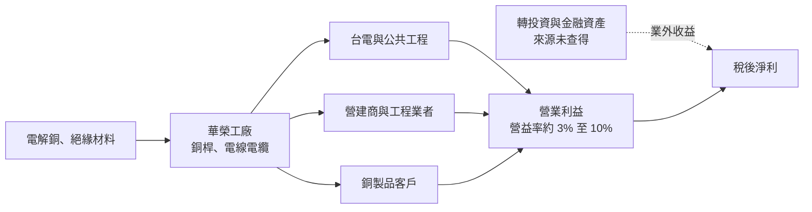
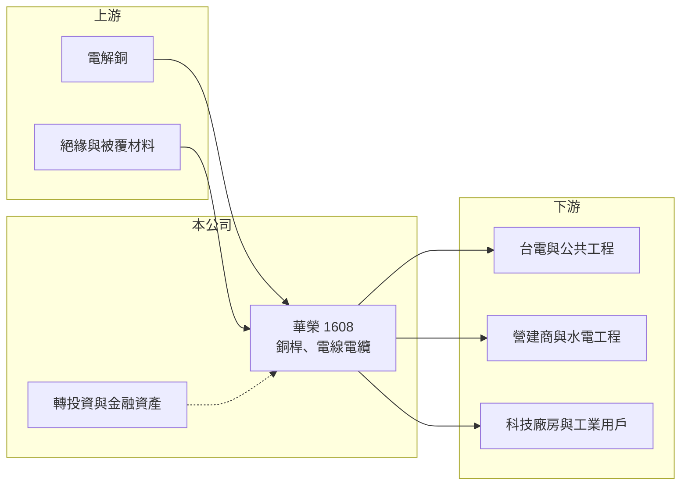

# 1608 華榮

> 上市｜[[產業索引-電器電纜|電器電纜]]｜上市（櫃）日期 1988/07/11

# 第一章：企業模式與商業藍圖

> [!info] 撰寫說明
> 本文由 Claude 依公開資料整理，架構比照 [[2330台積電]] 的四章研究，資料截至 2026-10-08。財務數字來源：Goodinfo 年度經營績效頁、nStock 公司頁、證交所開放資料（基本資料、2026 年第二季資產負債與綜合損益、營益分析、股利、本益比）。公開資料有限，查得的資料未揭露產品營收比重與業外收益來源，產業描述為整理性內容。#待校對

在評估單一個股的長期投資價值時，首要步驟是拆解企業的底層獲利邏輯。本章說明華榮電線電纜（股票代號：1608，以下簡稱華榮）的本業性質，以及為什麼它的獲利有很大一部分來自本業以外。

## 一、核心定位：高雄起家的電線電纜與銅製品廠

華榮成立於 1956 年，總部位於高雄，1988 年上市，目前實收資本額約 63.28 億元，董事長為王宏仁。公司的主要營業項目是各種電線電纜及銅製品的加工、製造、銷售與施工，產品涵蓋電力電纜、建築用電線與銅材加工品（產品細項依一般產業分類整理，待校對）。

華榮的財報有一個非常明顯的特徵：本業營業利益率只有個位數，但稅後淨利經常遠高於營業利益。以 2026 年上半年為例，營收約 67.2 億元、營業利益約 7.0 億元，營業外收支卻高達約 25.3 億元，稅後純益率達 46%（證交所開放資料）。2025 年全年營業利益約 9.2 億元（推算），EPS 卻達 5.5 元。因此分析華榮必須把「電纜本業」與「[[業外收益]]」分開看。本文查得的資料未說明業外收益的具體來源，可能來自轉投資、金融資產或資產處分（推估，需以財報附註確認）。

## 二、產品與收入結構

公開資料未揭露華榮的產品營收比重，因此本章不放圓餅圖。以產業常見結構推估，華榮的收入可分成兩類：

* **電線電纜：** 電力電纜與建築用電線，客戶包括台電、營建商與工程業者。這類產品的售價以銅價加上加工費計算，營收規模隨銅價上下浮動。
* **銅製品加工：** 銅桿、銅線等半成品，加工層次較低、毛利較薄，主要賺取加工價差。

這種結構使華榮的[[毛利率]]偏低，2019 年甚至只有 1.25%，2025 年才回升到 10.4%。毛利率的高低大致反映兩件事：銅價上漲期間的庫存利益，以及高附加價值電纜占比的變化。

## 三、資本轉化邏輯：薄利的加工本業加上資產收益

* **加工費模式：** 電纜廠買進銅、加工成電纜再賣出，利潤來自加工費與[[銅價轉嫁]]的時間差。銅價上漲時，庫存成本低於售價，會產生額外利益；銅價下跌時則相反。
* **業外是獲利的主力：** 2019 年營業利益率為負，EPS 仍有 1.87 元；2025 年與 2026 年上半年也都是業外大於本業。長期投資人需要了解這些業外資產的性質與持續性。

## 四、企業長期藍圖

華榮未在本文查得的資料中揭露具體的長期策略。從產業趨勢看，台電[[強韌電網計畫]]與 AI 資料中心、半導體廠擴建帶動的電力電纜需求，是華榮本業的主要成長來源，2026 年 1 至 9 月營收約 102.7 億元、年增約 19%（nStock 整理），反映了這股需求與銅價上漲。另外，2025 至 2026 年間股本由約 42 億元增加到 63.28 億元（依 EPS 與淨利推算，原因未查得），這個資本結構的變化對未來每股盈餘的影響需要追蹤。

# 第二章：護城河深度與競爭優勢

本章分析華榮的競爭地位，以及它與其他線纜廠的差異。

## 一、護城河的核心組成要素

* **長期經營的產業地位：** 華榮在南部經營電纜業超過 60 年，與當地營建與工程業者有長期關係，地理上接近南部科學園區與工業區的需求。
* **銅加工的一貫生產：** 從銅桿到電線的加工能力，讓公司在原料取得上有一定的成本彈性（推估）。
* **資產與投資收益：** 龐大的業外收益在本業景氣低迷時提供緩衝，讓公司能持續配息。

不過，電線電纜屬於規格化產品，華榮本業的護城河相對薄弱，毛利率長期低於同業平均，顯示議價能力有限。

## 二、主要競爭對手格局

| 對手 | 定位 | 對華榮的影響 |
|---|---|---|
| [[1605華新]] | 台灣最大線纜與銅材廠 | 規模與銅原料採購優勢明顯 |
| [[1609大亞]] | 電力電纜、漆包線、綠能 | 民間與台電訂單皆強 |
| [[1603華電]]、[[1618合機]]、[[1612宏泰]] | 高壓與超高壓電纜 | 台電標案直接競爭 |
| [[1615大山]]、[[1616億泰]] | 中高壓電纜 | 中南部市場與配電標案競爭 |

## 三、優勢轉化：守得住、守不住與觀察重點

* **守得住：** 南部營建與工程客戶的長期關係，以及業外資產帶來的財務彈性。
* **守不住：** 本業毛利。在銅價下跌或標案價格競爭時，華榮的毛利率曾跌到 1% 至 5%，說明本業缺乏定價能力。
* **觀察重點：** 第一，業外收益的來源與持續性；第二，高壓電纜等高附加價值產品占比能否提升，讓營業利益率穩定在 8% 以上；第三，股本擴大後每股盈餘能否維持。

# 第三章：財務體質與盈利規模

資料日期：2026-10-08。數字取自 Goodinfo 年度經營績效頁、nStock 公司頁與證交所開放資料，表格是撰寫當時的快照；最新月營收、毛利率、累計 EPS 由自動排程寫在本筆記的屬性欄位（月營收、毛利率、累計EPS 等）。#待校對

財務報表是檢驗護城河是否真實存在的最終標準。本章把華榮的本業獲利與業外收益分開檢視。

## 一、多年度財務摘要

| 年度 | 營收（新台幣） | [[毛利率]] | [[營業利益率]] | EPS（元） | [[ROE]] |
|---|---|---|---|---|---|
| 2019 | 78.3 億 | 1.25% | -0.98% | 1.87 | 9.64% |
| 2020 | 74.4 億 | 4.67% | 2.31% | 0.76 | 4.70% |
| 2021 | 105 億 | 9.45% | 7.49% | 3.27 | 19.5% |
| 2022 | 107 億 | 4.92% | 3.17% | -0.09 | 1.05% |
| 2023 | 97.5 億 | 7.14% | 5.15% | 2.23 | 11.2% |
| 2024 | 113 億 | 8.41% | 6.46% | 1.55 | 9.26% |
| 2025 | 113.3 億 | 10.4% | 8.15% | 5.50 | 24.5% |
| 2026 上半年 | 67.2 億 | 12.75% | 10.42% | 7.04 | 未查得 |

註：Goodinfo 顯示 2024 與 2025 年營收同為約 113 億元，2025 年依 nStock 為 113.31 億元，2024 年數字建議以年報核對。

* **本業：** 毛利率與營業利益率波動很大，2022 年銅價回落時營業利益率只有 3.17%，2025 年起受惠電纜需求與銅價上漲，回升到 8% 至 10%。
* **業外：** 2025 年與 2026 年上半年的 EPS 主要由業外收益撐起，2026 年上半年稅前純益率 48.11%，營業利益率卻只有 10.42%（證交所營益分析）。這類收益的持續性通常低於本業，評估長期獲利能力時應以營業利益為主。
* **營收成長：** 2020 至 2025 年營收年複合成長率約 8.7%（推算），主要來自銅價上漲與電纜需求增加。

## 二、[[ROE]]：資本效率

2021 至 2025 年平均 ROE 約 13.1%（推算），但年度間從 1% 到 24.5% 大幅跳動，主要是業外收益不穩定所致。2026 年第二季底總負債約 74.8 億元、權益總計約 125.3 億元（其中非控制權益約 12.3 億元），負債比約 37%（證交所開放資料），財務結構穩健。

## 三、股利與現金流

2025 年度配發現金股利 2 元，2024 年度為 1 元（nStock）。以 2025 年 EPS 5.5 元計算配發率約 36%（推算），偏低的配發率可能與股本擴大或保留資金有關。電纜廠在銅價上漲期間需要大量營運資金，自由現金流的穩定度未查得。

## 四、[[ROIC]] 與 [[WACC]]：價值創造利差

**ROIC 推算：** 2025 年營收 113.3 億元乘以營業利益率 8.15%，營業利益約 9.21 億元，扣除 20% 稅率後約 7.37 億元。權益約 125.3 億元，假設總負債中六成為有息負債（推估，約 44.9 億元），投入資本約 170.2 億元，ROIC 約 4.3%（推算）。若改以 2022 年營業利益率 3.17% 計算，ROIC 只有約 1% 至 2%（推算）。

**WACC 推算：** 台灣 10 年期公債殖利率取 1.75%、市場風險溢酬 6%、β 取 1.0（華榮股價波動較大，推估），股東權益成本約 7.75%；負債成本 2.5%，稅後約 2.0%；權益約占 74%、負債約占 26%，WACC 約 6.3%（推算）。

**結論：** 只看電纜本業，華榮的 ROIC 長期低於資金成本，本業本身並未創造價值；公司整體 ROE 偏高主要來自業外收益。這意味著華榮的長期價值較多取決於業外資產的品質與管理，而不是電纜事業的競爭力。投資人應把它視為「低毛利加工業加上投資收益」的組合來評估。

# 第四章：總體風險與地緣政治

任何企業都無法脫離宏觀環境獨立存在。本章分析華榮長期面對的產業、原物料與財務結構風險。

## 一、產業週期與市場結構

* **電網與營建投資週期：** 電纜需求來自台電電網投資、公共工程與民間營建。強韌電網計畫提供了數年的需求能見度，但計畫結束後需求可能回落。
* **同業競爭：** 國內線纜廠家數多，產品規格化，價格競爭激烈，本業毛利長期偏低。

## 二、原物料與營運風險

* **銅價波動：** 銅是最大的成本項目。銅價上漲時有庫存利益，下跌時有存貨損失，2019 年與 2022 年本業接近虧損，都與銅價和加工費條件有關。
* **匯率：** 銅以美元計價，新台幣升貶會影響進料成本。

## 三、財務結構與資訊揭露風險

* **業外收益的不確定性：** 獲利高度依賴業外，若相關資產價值下跌或處分完畢，EPS 可能大幅回落。投資人需要從財報附註了解業外收益的組成。
* **股本變動：** 2025 至 2026 年間股本明顯增加（原因未查得），若涉及合併或發行新股，會改變公司的資產結構與每股價值，需要持續追蹤。

## 四、法規與技術演進

台電與科技廠對電纜的耐熱、阻燃與電壓等級要求持續提高，廠商若沒有持續投資新製程與測試能力，可能只能停留在低附加價值的建築用線市場。

# 專有名詞解析

## 金融

- **[[業外收益]]**：營業活動以外的收益，例如投資收益、處分利益、股利與匯兌利益，持續性通常低於本業。
- **[[毛利率]]**：營業毛利占營收的比例，反映產品定價能力與生產成本控制。
- **[[營業利益率]]**：扣除營業費用後的營業利益占營收的比例，衡量本業整體獲利能力。
- **[[ROE]]**：股東權益報酬率，稅後淨利除以股東權益，衡量公司運用股東資金的效率。
- **[[ROIC]]**：投入資本報酬率，稅後營業利益除以股東權益與有息負債的合計，衡量本業對所有資金提供者的報酬。
- **[[WACC]]**：加權平均資金成本，依股東權益與負債的比重加權計算的資金成本，ROIC 高於它才代表創造價值。

## 產業

- **[[銅價轉嫁]]**：電線電纜廠把銅價變動反映到售價的機制，通常以報價時銅價加上加工費計價，轉嫁速度決定毛利穩定度。
- **[[強韌電網計畫]]**：台電在 2022 年大停電後提出的十年電網強化計畫，投入大量預算更新輸變電設備。

# 核心供應鏈

## 1. 上游：原料
- 電解銅（國際報價）、絕緣與被覆材料，石化供應商如 [[1301台塑]]、[[1304台聚]]

## 2. 本公司與同業
- 同業：[[1605華新]]、[[1609大亞]]、[[1603華電]]、[[1618合機]]、[[1612宏泰]]、[[1615大山]]、[[1616億泰]]

## 3. 下游：客戶
- 台電、公共工程、營建商、科技廠房與工業用戶

## 最新新聞
<!-- news:start -->
<!-- news:end -->

## 相關連結
- [公開資訊觀測站](https://mopsov.twse.com.tw/mops/web/t05st03?step=1&firstin=1&co_id=1608)
- [Goodinfo](https://goodinfo.tw/tw/StockDetail.asp?STOCK_ID=1608)
- [Yahoo 股市](https://tw.stock.yahoo.com/quote/1608)
- [鉅亨網新聞](https://www.cnyes.com/twstock/1608/news)
