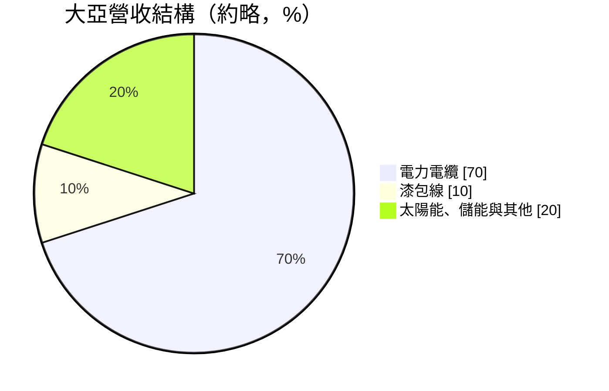
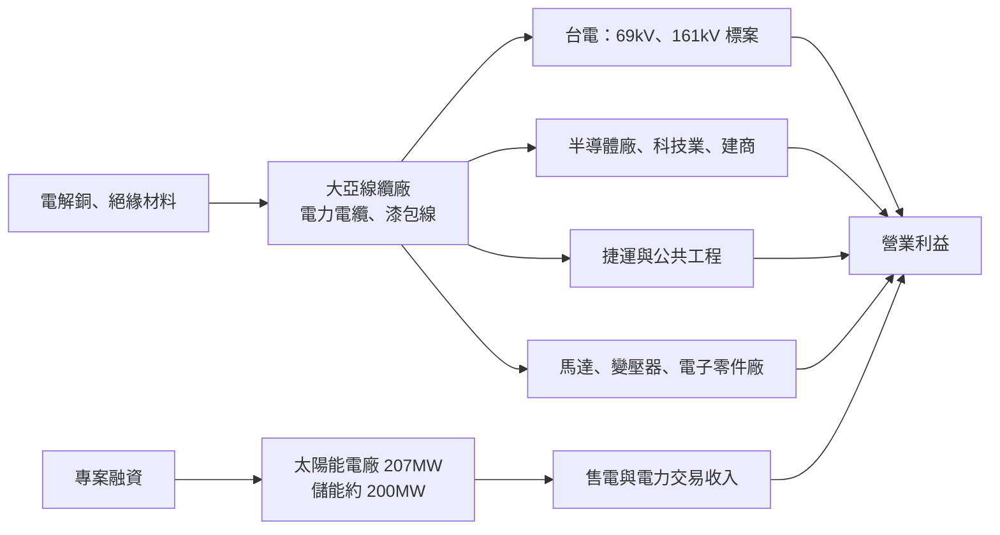
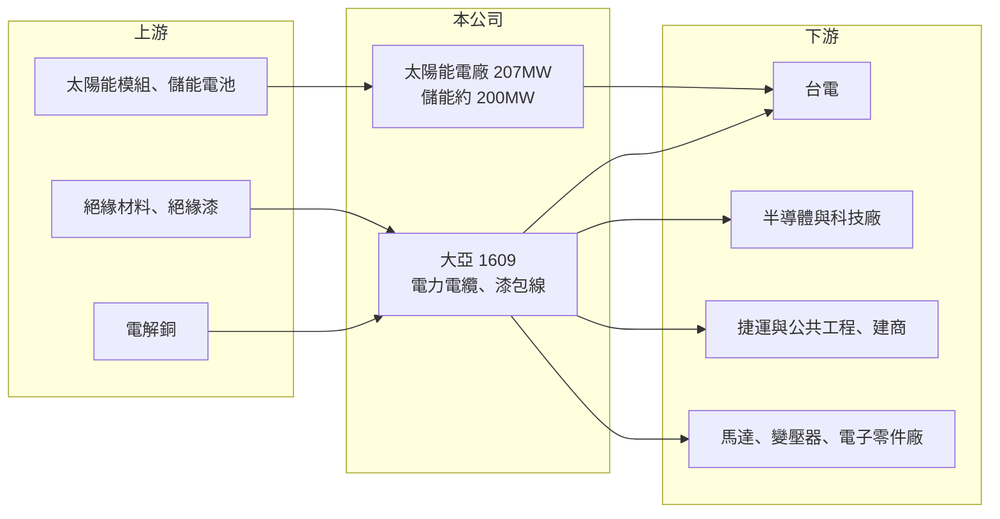

# 1609 大亞

> 上市｜[[產業索引-電器電纜|電器電纜]]｜上市（櫃）日期 1988/12/12

# 第一章：企業模式與商業藍圖

> [!info] 撰寫說明
> 本文由 Claude 依公開資料整理，架構比照 [[2330台積電]] 的四章研究，資料截至 2026-10-08。財務數字來源：Goodinfo 年度經營績效頁、科技新報 2026 年 4 月法說會報導與 2026 年 5 月報導、證交所開放資料（基本資料、2026 年第二季資產負債與綜合損益、營益分析、股利、本益比）；產業描述為整理性內容，尚未逐條比對原始文件。#待校對

在評估單一個股的長期投資價值時，首要步驟是拆解企業的底層獲利邏輯。本章說明大亞電線電纜（股票代號：1609，以下簡稱大亞）如何以電力電纜為核心，同時經營漆包線、太陽能電廠與儲能，形成「線纜製造＋能源資產」的雙軌模式。

## 一、核心定位：台灣主要電力電纜廠之一，延伸到綠能資產

大亞成立於 1962 年，總部位於台南關廟，1988 年上市，實收資本額約 78.53 億元，董事長為沈尚弘。2025 年合併營收約 311 億元，是台灣營收規模僅次於 [[1605華新]] 的線纜廠之一。

大亞的營收約七成來自電力電纜，客戶同時包括台電與民間的半導體、科技業與建設公司。2026 年 5 月董事長受訪時表示，受惠 AI 帶動的半導體建廠潮，電線電纜需求倍增，在手訂單已突破百億元，晶圓大廠的訂單也較過去翻倍。2026 年 4 月法說會則提到，在手訂單一度達 150 億元，並延續到未來數年出貨，其中包括約 50 億元的高雄捷運黃線中壓電纜訂單。

## 二、產品板塊：電力電纜、漆包線與能源事業

依 2026 年 4 月法說會報導，營收結構大致如下（綠能與其他為推算的剩餘比重）：

* **電力電纜：** 包括中壓、高壓與 69kV、161kV 等級的[[交連PE電纜]]，用於台電輸配電、捷運與科技廠房。這是大亞的獲利主力，也是受惠[[強韌電網計畫]]與半導體擴廠的核心業務。
* **[[漆包線]]：** 用於馬達、變壓器與電子零件的線圈，約占一成。漆包線的需求與家電、工業馬達、電動車與無人機等應用相關，可分散對電網投資的依賴。
* **太陽能電廠：** 已建置約 70 座、裝置容量約 207MW，以售電給台電賺取穩定收入。公司表示新案開發難度提高，將放緩擴張。
* **[[儲能]]：** 在手案場規模接近 200MW，台中大甲智浦儲能 100MW 案場已於 2025 年開始營運，大蓄能源 75MW 案場預計 2026 年加入台電電力交易平台。

## 三、資本轉化邏輯：製造業的營運資金加上能源資產的長期融資

* **線纜事業：** 以銅價加上加工費報價，利潤取決於加工層次與[[銅價轉嫁]]效率。高壓與科技廠的特殊規格電纜加工費較高，是近年毛利率從 8% 提升到 14% 的主因。
* **能源資產：** 太陽能與儲能屬於前期投入大、後期長期收租的模式，需要大量借款支應。2026 年第二季底大亞總負債約 458.7 億元，權益總計約 212.9 億元，負債比約 68%（證交所開放資料），負債大部分推估與能源專案融資有關。

## 四、企業長期藍圖

大亞的長期方向可以分成三條：第一，在線纜本業持續爭取台電輸電等級與民間科技廠訂單，提升高壓電纜比重；第二，漆包線往高導熱、特殊規格產品發展，切入新興應用；第三，在能源事業上把重心從太陽能電廠轉向儲能，參與台電的電力交易市場。這三條路線讓大亞同時具有「電網投資受惠者」與「能源資產經營者」兩種身分。

# 第二章：護城河深度與競爭優勢

本章分析大亞的競爭優勢、主要對手，以及能源事業對護城河的影響。

## 一、護城河的核心組成要素

* **規模與產品線完整：** 營收超過 300 億元，從中壓到 161kV 電力電纜都能供應，加上漆包線，產品線完整度在國內僅次於華新。規模讓大亞能同時承接多個大型案件，交期也較有保障。
* **民間大客戶實績：** 半導體與科技廠對電纜的品質、交期與現場服務要求很高，大亞取得晶圓大廠訂單並持續加倍，代表已經通過嚴格的供應商評選，這是轉換成本的來源。
* **能源資產的穩定收入：** 207MW 太陽能電廠與儲能案場提供與線纜景氣無關的長期收入，降低整體獲利波動。

## 二、主要競爭對手格局

| 對手 | 定位 | 對大亞的影響 |
|---|---|---|
| [[1605華新]] | 台灣最大線纜廠，具超高壓與海纜布局 | 345kV 超高壓與大型標案的主要對手 |
| [[1618合機]]、[[1612宏泰]] | 高壓與超高壓電力電纜 | 台電輸電標案直接競爭 |
| [[1603華電]]、[[1615大山]]、[[1616億泰]]、[[1608華榮]] | 中高壓與建築用電纜 | 配電與民間市場競爭 |
| [[1617榮星]] | 漆包線 | 在漆包線市場競爭 |

## 三、優勢轉化：守得住、守不住與觀察重點

* **守得住：** 科技廠與大型公共工程的電纜訂單。這類客戶重視品質與交期，大亞的規模與實績是優勢。
* **守不住：** 一般建築用線與標案的價格競爭，以及太陽能新案的開發條件，後者公司已表示放緩。
* **觀察重點：** 第一，在手訂單能否維持百億元以上；第二，儲能參與電力交易的收益是否穩定；第三，高負債結構下的利息負擔能否被營業利益充分覆蓋。

# 第三章：財務體質與盈利規模

資料日期：2026-10-08。數字取自 Goodinfo 年度經營績效頁、科技新報法說會報導與證交所開放資料，表格是撰寫當時的快照；最新月營收、毛利率、累計 EPS 由自動排程寫在本筆記的屬性欄位（月營收、毛利率、累計EPS 等）。#待校對

財務報表是檢驗護城河是否真實存在的最終標準。本章檢視大亞的本業獲利、財務槓桿與資本報酬。

## 一、多年度財務摘要

| 年度 | 營收（新台幣） | [[毛利率]] | [[營業利益率]] | EPS（元） | [[ROE]] |
|---|---|---|---|---|---|
| 2019 | 182 億 | 7.19% | 1.69% | 0.86 | 7.09% |
| 2020 | 183 億 | 8.75% | 2.34% | 1.45 | 11.8% |
| 2021 | 275 億 | 10.2% | 5.49% | 2.30 | 16.0% |
| 2022 | 267 億 | 8.13% | 3.16% | 1.24 | 8.89% |
| 2023 | 264 億 | 13.1% | 5.82% | 3.91 | 21.6% |
| 2024 | 301 億 | 13.7% | 7.36% | 2.09 | 11.7% |
| 2025 | 311 億 | 14.0% | 8.78% | 1.65 | 8.53% |
| 2026 上半年 | 177.6 億 | 18.72% | 12.94% | 2.24 | 未查得 |

* **本業持續改善：** 毛利率從 2019 年的 7.19% 提升到 2026 年上半年的 18.72%，營業利益率從 1.69% 提升到 12.94%，代表產品組合明顯往高壓與科技廠電纜移動。
* **EPS 與營業利益背離：** 2025 年營業利益約 27.3 億元（推算），稅後淨利只有約 12.9 億元，差距主要來自能源專案的利息費用、所得稅與非控制權益（推估）。2023 年 EPS 3.91 元高於本業水準，推估含有一次性收益（具體來源未查得）。
* **營收成長：** 2020 至 2025 年營收年複合成長率約 11.2%（推算）。

## 二、[[ROE]]：資本效率

2021 至 2025 年平均 ROE 約 13.3%（推算），在線纜同業中屬於中上。不過大亞的 ROE 有相當部分來自財務槓桿：負債比約 68%，遠高於多數同業的 20% 至 40%。槓桿在獲利成長時能放大 ROE，但利率上升或能源收益下滑時，也會放大獲利下修幅度。

## 三、股利與現金流

2025 年度配發現金股利 0.7 元（證交所股利資料），以 EPS 1.65 元計算配發率約 42%（推算）。大亞把較多盈餘留在公司，用於能源資產投資與營運資金。能源專案的前期資本支出大，自由現金流長期可能偏低（推估，金額未查得）。

## 四、[[ROIC]] 與 [[WACC]]：價值創造利差

**ROIC 推算：** 2025 年營業利益約 27.3 億元（營收 311 億元乘以營業利益率 8.78%），扣除 20% 稅率後約 21.8 億元。權益約 212.9 億元，假設總負債中六成為有息負債（推估，約 275 億元），投入資本約 488 億元，ROIC 約 4.5%（推算）。若以 2026 年上半年 12.94% 的營業利益率估算全年，ROIC 可提升到 6% 至 7%（推算）。

**WACC 推算：** 台灣 10 年期公債殖利率取 1.75%、市場風險溢酬 6%、β 取 1.0（推估），股東權益成本約 7.75%；負債成本 2.5%，稅後約 2.0%；權益約占 44%、負債約占 56%，WACC 約 4.5%（推算）。

**結論：** 2025 年大亞的 ROIC 約與 WACC 打平，本業改善的成果有一部分被龐大的能源資產資本基礎稀釋。若 2026 年起高毛利電纜訂單持續，ROIC 有機會穩定高於 WACC，進入創造價值的階段；反之，若能源資產報酬偏低，則會長期拖累整體資本效率。

# 第四章：總體風險與地緣政治

任何企業都無法脫離宏觀環境獨立存在。本章分析大亞長期面對的產業、財務與能源政策風險。

## 一、產業週期與市場結構

* **科技廠擴建週期：** 民間訂單高度依賴半導體與 AI 相關廠房建設，資本支出週期一旦反轉，訂單可能快速下滑。
* **台電投資節奏：** 強韌電網計畫是中長期需求的支撐，但台電財務壓力大，預算與標案時程可能調整。
* **同業擴產：** 需求熱絡時同業紛紛擴充產能，數年後可能造成供過於求與價格競爭。

## 二、財務與營運風險

* **高財務槓桿：** 負債比約 68%，利率上升會直接增加利息支出，壓縮淨利。
* **銅價波動：** 銅價急漲時營運資金需求增加，急跌時則可能產生存貨損失；長期合約若未完全轉嫁，會影響毛利。
* **大型專案執行：** 捷運與科技廠的大型訂單交期長，延遲交貨或規格變更都可能影響認列與獲利。

## 三、能源政策與法規風險

* **太陽能開發條件：** 公司已表示新案開發難度提高，土地取得、併網容量與躉購費率的變化都會影響能源事業的成長。
* **電力交易規則：** 儲能收入依賴台電輔助服務市場的價格與規則，市場參與者增加後，調頻服務價格可能下降，影響儲能投資的報酬率。
* **技術演進：** 電池技術與成本快速變化，早期建置的儲能系統可能面臨效能衰退與汰換成本。

# 專有名詞解析

## 金融

- **[[毛利率]]**：營業毛利占營收的比例，反映產品定價能力與生產成本控制。
- **[[營業利益率]]**：扣除營業費用後的營業利益占營收的比例，衡量本業整體獲利能力。
- **[[ROE]]**：股東權益報酬率，稅後淨利除以股東權益，衡量公司運用股東資金的效率。
- **[[ROIC]]**：投入資本報酬率，稅後營業利益除以股東權益與有息負債的合計，衡量本業對所有資金提供者的報酬。
- **[[WACC]]**：加權平均資金成本，依股東權益與負債的比重加權計算的資金成本，ROIC 高於它才代表創造價值。

## 產業

- **[[交連PE電纜]]**：以交連聚乙烯（XLPE）作為絕緣層的電力電纜，耐熱與絕緣性能佳，是中高壓與超高壓輸配電的主流電纜。
- **[[漆包線]]**：在銅線或鋁線表面塗上絕緣漆的導線，用來繞製馬達、變壓器與電感的線圈，需求與家電、工業與電動車相關。
- **[[強韌電網計畫]]**：台電在 2022 年大停電後提出的十年電網強化計畫，投入大量預算更新輸變電設備。
- **[[銅價轉嫁]]**：電線電纜廠把銅價變動反映到售價的機制，通常以報價時銅價加上加工費計價，轉嫁速度決定毛利穩定度。
- **[[儲能]]**：以電池等設備儲存電力，在用電尖峰或電網需要時釋放，可參與電力交易市場賺取收入。

# 核心供應鏈

## 1. 上游：原料與能源設備
- 電解銅（國際報價）、絕緣材料與絕緣漆
- 太陽能模組與儲能電池供應商

## 2. 本公司與同業
- 線纜同業：[[1605華新]]、[[1618合機]]、[[1612宏泰]]、[[1603華電]]、[[1615大山]]、[[1616億泰]]、[[1608華榮]]
- 漆包線同業：[[1617榮星]]

## 3. 下游：客戶
- 台電：69kV、161kV 輸配電標案，以及太陽能與儲能的售電、電力交易
- 半導體與科技廠、建商、高雄捷運黃線等公共工程
- 馬達、變壓器與電子零件製造商

## 最新新聞
<!-- news:start（自動產生，請勿手動編輯此範圍） -->
- 2026-10-08 📰 媒體 18:21｜營收速報 - 大亞(1609)9月營收35.73億元年增率高達30.32％｜[鉅亨網](https://news.cnyes.com/news/id/6625146)

完整紀錄：[[1609大亞 新聞]]
<!-- news:end -->

## 相關連結
- [公開資訊觀測站](https://mopsov.twse.com.tw/mops/web/t05st03?step=1&firstin=1&co_id=1609)
- [Goodinfo](https://goodinfo.tw/tw/StockDetail.asp?STOCK_ID=1609)
- [Yahoo 股市](https://tw.stock.yahoo.com/quote/1609)
- [鉅亨網新聞](https://www.cnyes.com/twstock/1609/news)
