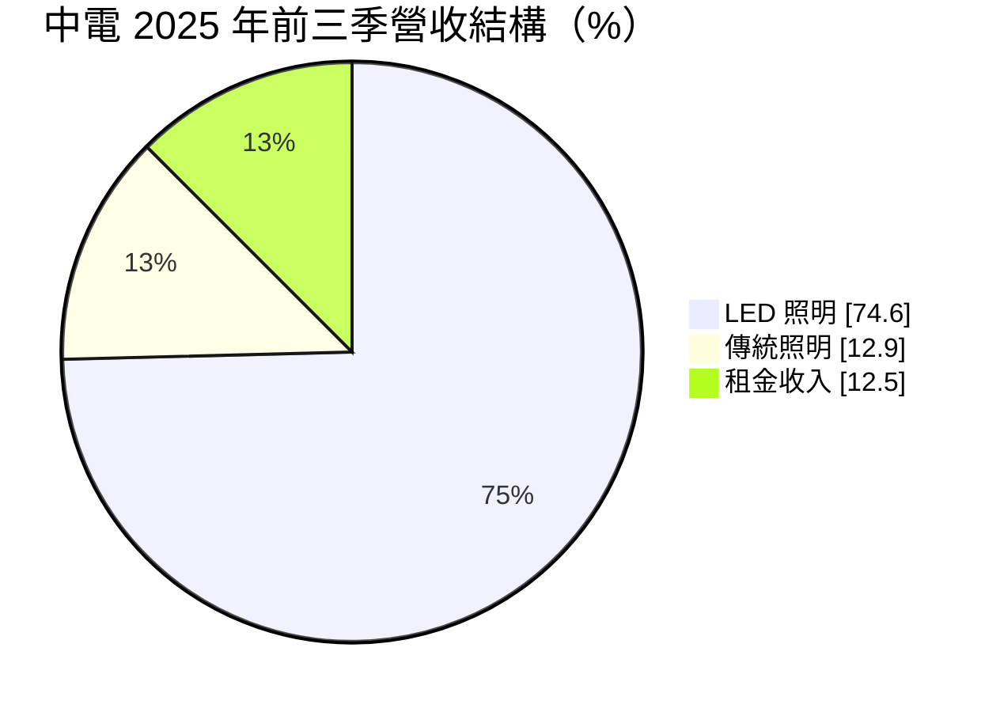
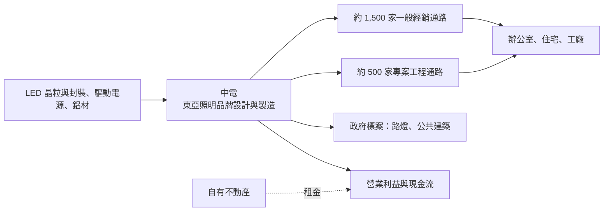
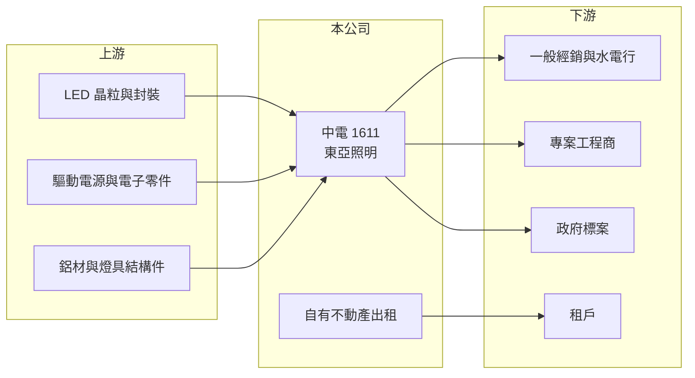

# 1611 中電

> 上市｜[[產業索引-電器電纜|電器電纜]]｜上市（櫃）日期 1990/01/16

# 第一章：企業模式與商業藍圖

> [!info] 撰寫說明
> 本文由 Claude 依公開資料整理，架構比照 [[2330台積電]] 的四章研究，資料截至 2026-10-08。財務數字來源：Goodinfo 年度經營績效頁、富果研究 2025 年 11 月法說會整理、證交所開放資料（基本資料、2026 年第二季資產負債與綜合損益、營益分析、股利、本益比）；產業描述為整理性內容，尚未逐條比對原始文件。#待校對

在評估單一個股的長期投資價值時，首要步驟是拆解企業的底層獲利邏輯。本章說明中國電器（股票代號：1611，以下簡稱中電）如何從傳統燈管大廠轉型為 LED 照明供應商，以及租金收入在它的獲利結構中的角色。

## 一、核心定位：「東亞照明」品牌的本土照明廠

中電成立於 1955 年，1990 年上市，實收資本額約 32.27 億元，以「東亞照明」品牌經營，自我定位為全方位照明解決方案供應商。東亞照明在台灣是家喻戶曉的燈管品牌，過去以白熱燈泡、螢光燈管為主，隨著 [[LED照明]] 全面取代傳統光源，公司的產品線也轉向 LED 光源與燈具。

這場技術轉換對中電的影響非常大。LED 燈具壽命長達傳統燈管的數倍，換燈頻率大幅降低，加上中國與其他亞洲廠商以低價進入市場，中電的營收從 2019 年的 23.5 億元一路降到 2025 年的 10.7 億元。公司目前的經營重點是守住專業照明與政府標案市場，同時以帳上不動產收取租金，維持穩定的現金收入。

## 二、產品板塊：LED 照明為主，租金占一成以上

2025 年前三季的營收結構如下（富果研究整理的法說會資料）：

* **LED 照明：** 包括 LED 光源，以及室內燈具（平板燈、T-BAR 燈、高天井燈）與戶外燈具（景觀燈、投光燈、路燈）。截至 2025 年第三季，共有 246 款產品取得[[節能標章]]。
* **傳統照明：** 螢光燈、HID 光源等，屬於逐年萎縮的舊產品，但仍有部分既有場域的替換需求。
* **租金收入：** 占營收約 12.5%，來自公司持有的不動產出租。這部分毛利高、波動低，是中電毛利率能維持在三成左右的原因之一。

## 三、資本轉化邏輯：通路與標案加上不動產收租

* **雙通路：** 約 1,500 家一般經銷商負責零售與水電行市場，約 500 家專案工程通路負責商辦、廠房等案場，這個通路網絡是本土品牌的主要資產。
* **政府標案：** 長期承攬公部門照明工程，例如 2016 至 2017 年承攬雲林、嘉義、彰化等地共 6.7 萬盞 LED 路燈更換案。

## 四、企業長期藍圖

中電的研發聚焦在四個方向：人因照明（零頻閃燈具）、智慧照明（聲控與居家控制）、健康環境（抗菌抗病毒照明）與專業照明（高演色性產品）。公司也希望受惠 AI 帶動的電力需求與 ESG 節能政策，推廣高效率照明。不過，以目前的營收規模與獲利水準看，中電的長期價值較多取決於不動產資產的運用，以及能否在專業照明利基市場維持一定的毛利。

# 第二章：護城河深度與競爭優勢

本章分析中電在 LED 時代的競爭優勢，以及哪些優勢已經被技術轉換削弱。

## 一、護城河的核心組成要素

* **品牌認知：** 東亞照明在台灣有數十年的品牌歷史，在水電行與工程業者之間有高度認知，這是新進品牌難以短期建立的。
* **通路與標案實績：** 2,000 家左右的經銷與工程通路，加上公部門標案的履約實績，讓中電在專案市場仍有競爭力。
* **不動產資產：** 租金收入提供穩定的高毛利現金流，降低本業衰退對整體獲利的衝擊。

不過 LED 照明的技術門檻低、產品標準化，品牌溢價有限，中電的護城河在技術轉換後明顯變窄。

## 二、主要競爭對手格局

| 對手 | 定位 | 對中電的影響 |
|---|---|---|
| 飛利浦（Signify）、歐司朗等國際品牌 | 高階與專業照明 | 技術與品牌領先，主導高階市場 |
| [[2393億光]]、[[2301光寶科]] 等 LED 廠 | 上游 LED 元件與照明 | 掌握上游技術，也經營照明產品 |
| 中國照明品牌 | 平價 LED 燈具 | 以低價搶占零售與標案市場 |
| 國內中小型照明廠 | 區域型燈具 | 在工程與標案市場削價競爭 |

## 三、優勢轉化：守得住、守不住與觀察重點

* **守得住：** 專業工程與政府標案市場，以及租金收入。
* **守不住：** 一般零售光源市場。LED 產品壽命長、價格持續下降，營收規模長期萎縮，2020 至 2025 年營收年複合成長率約 -12.4%（推算）。
* **觀察重點：** 第一，營收能否止跌；第二，智慧照明與專業照明能否提高毛利；第三，不動產是否有進一步活化或開發的計畫。

# 第三章：財務體質與盈利規模

資料日期：2026-10-08。數字取自 Goodinfo 年度經營績效頁、富果研究法說會整理與證交所開放資料，表格是撰寫當時的快照；最新月營收、毛利率、累計 EPS 由自動排程寫在本筆記的屬性欄位（月營收、毛利率、累計EPS 等）。#待校對

財務報表是檢驗護城河是否真實存在的最終標準。本章檢視中電在營收萎縮下的獲利品質與資本效率。

## 一、多年度財務摘要

| 年度 | 營收（新台幣） | [[毛利率]] | [[營業利益率]] | EPS（元） | [[ROE]] |
|---|---|---|---|---|---|
| 2019 | 23.5 億 | 26.5% | -0.63% | 1.94 | 16.2% |
| 2020 | 20.7 億 | 26.7% | 4.32% | 0.23 | 1.73% |
| 2021 | 17.8 億 | 28.1% | 0.34% | 0.86 | 6.48% |
| 2022 | 15.7 億 | 27.9% | 5.68% | 0.24 | 1.80% |
| 2023 | 13.6 億 | 27.4% | 4.89% | 0.46 | 3.50% |
| 2024 | 11.6 億 | 30.5% | 7.34% | 0.50 | 3.63% |
| 2025 | 10.7 億 | 31.9% | 6.84% | 0.03 | 0.21% |
| 2026 上半年 | 5.1 億 | 34.49% | 6.09% | 0.41 | 未查得 |

* **毛利率上升、營收下降：** 毛利率從 26.5% 提高到 30% 以上，主要因為低毛利的傳統光源占比下降、高毛利的租金收入占比提高。但營收規模縮小，營業費用難以同步下降，營業利益率只有個位數。
* **業外影響大：** 2019 年營業利益為負、EPS 卻有 1.94 元，推估含有資產處分等一次性收益（具體來源未查得）。2025 年前三季業外淨損約 1,255 萬元，主要是新台幣匯率波動造成的未實現匯兌損失；2026 年上半年業外收入約 1.23 億元，又使稅前純益率達 30.29%（證交所營益分析）。

## 二、[[ROE]]：資本效率

2021 至 2025 年平均 ROE 只有約 3.1%（推算）。2026 年第二季底資產總計約 50.7 億元、權益約 40.4 億元、總負債約 10.3 億元（證交所開放資料），資產規模是年營收的近五倍，代表大量資本停留在不動產與金融資產上，本業只用到一小部分。股價淨值比約 0.9 倍（2026 年 10 月初）。

## 三、股利與現金流

2025 年度配發現金股利 0.8 元，但當年度本期淨利只有約 920 萬元（證交所股利資料），代表股利主要動用以前年度累積的盈餘，配發率遠超過 100%。這種配息方式短期對股東有利，但長期若本業獲利沒有改善，配息水準難以維持。

## 四、[[ROIC]] 與 [[WACC]]：價值創造利差

**ROIC 推算：** 2025 年營收 10.7 億元乘以營業利益率 6.84%，營業利益約 0.73 億元，扣除 20% 稅率後約 0.59 億元。權益約 40.4 億元，假設總負債中約兩成為有息負債（推估，約 2.1 億元），投入資本約 42.5 億元，ROIC 約 1.4%（推算）。

**WACC 推算：** 台灣 10 年期公債殖利率取 1.75%、市場風險溢酬 6%、β 取 0.7（推估），股東權益成本約 5.95%；負債成本 2.5%，稅後約 2.0%；權益約占 95%、負債約占 5%，WACC 約 5.8%（推算）。

**結論：** 中電的 ROIC 遠低於資金成本，本業長期沒有創造價值。公司的價值主要存在於不動產與累積的資本上，而不是照明事業的獲利能力。長期投資人應把它視為「資產股」，關注不動產活化或資本運用方式是否改變。

# 第四章：總體風險與地緣政治

任何企業都無法脫離宏觀環境獨立存在。本章分析中電長期面對的技術、市場與資本運用風險。

## 一、科技演進風險

* **LED 的長壽命效應：** LED 燈具壽命長，換燈需求大幅下降，照明市場從「耗材」變成「耐久財」，這是中電營收長期下滑的結構性原因。
* **智慧照明的技術門檻：** 智慧照明需要軟體、通訊與系統整合能力，若無法跟上，可能被具系統能力的大廠取代。

## 二、產業與市場結構

* **價格競爭：** LED 燈具高度標準化，中國廠商的低價產品持續壓縮售價。
* **標案依賴：** 政府標案以價格為主要評選條件，獲利率有限，且受預算週期影響。

## 三、營運環境的隱性風險

* **匯率：** LED 元件多為進口，新台幣升貶會影響成本，也會產生匯兌損益，2025 年即因匯率波動出現業外損失。
* **規模不經濟：** 營收持續萎縮時，固定成本難以下降，營業利益率可能進一步受壓。

## 四、資本運用風險

* **高配息的持續性：** 以累積盈餘支付超過當年獲利的股利，長期將消耗保留盈餘。
* **資產運用效率：** 帳上大量資產若持續低度使用，股東權益報酬率將長期偏低；反之，若進行開發或出售，則可能帶來一次性收益，但也會改變公司性質。

# 專有名詞解析

## 金融

- **[[毛利率]]**：營業毛利占營收的比例，反映產品定價能力與生產成本控制。
- **[[營業利益率]]**：扣除營業費用後的營業利益占營收的比例，衡量本業整體獲利能力。
- **[[ROE]]**：股東權益報酬率，稅後淨利除以股東權益，衡量公司運用股東資金的效率。
- **[[ROIC]]**：投入資本報酬率，稅後營業利益除以股東權益與有息負債的合計，衡量本業對所有資金提供者的報酬。
- **[[WACC]]**：加權平均資金成本，依股東權益與負債的比重加權計算的資金成本，ROIC 高於它才代表創造價值。

## 產業

- **[[LED照明]]**：以 LED 作為光源的燈具與照明系統，耗電低、壽命長，已取代大部分傳統燈泡與燈管。
- **[[節能標章]]**：經濟部能源署核發的節能產品認證，取得標章的產品較容易進入政府採購與補助範圍。

# 核心供應鏈

## 1. 上游：LED 元件與零件
- LED 晶粒與封裝：[[2393億光]]、[[2301光寶科]] 等台灣與中國供應商
- 驅動電源、鋁材與結構件

## 2. 本公司與同業
- 國際品牌：Signify（飛利浦照明）、歐司朗
- 中國與國內中小型照明廠

## 3. 下游：通路與客戶
- 約 1,500 家一般經銷通路、約 500 家專案工程通路
- 政府機關：路燈與公共建築照明標案
- 不動產租戶

## 最新新聞
<!-- news:start -->
<!-- news:end -->

## 相關連結
- [公開資訊觀測站](https://mopsov.twse.com.tw/mops/web/t05st03?step=1&firstin=1&co_id=1611)
- [Goodinfo](https://goodinfo.tw/tw/StockDetail.asp?STOCK_ID=1611)
- [Yahoo 股市](https://tw.stock.yahoo.com/quote/1611)
- [鉅亨網新聞](https://www.cnyes.com/twstock/1611/news)
