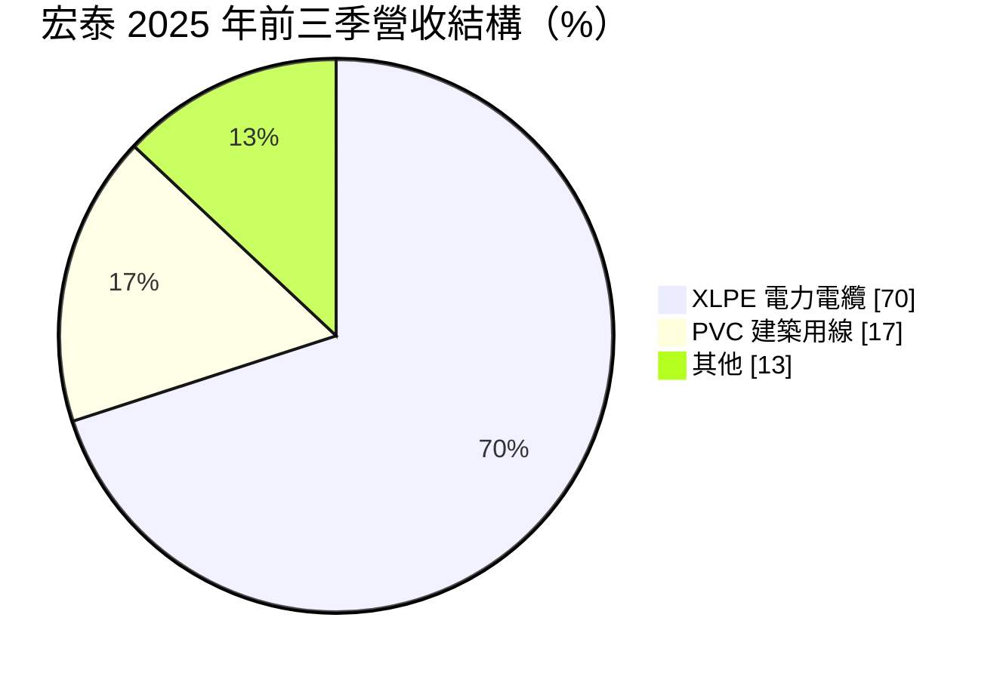
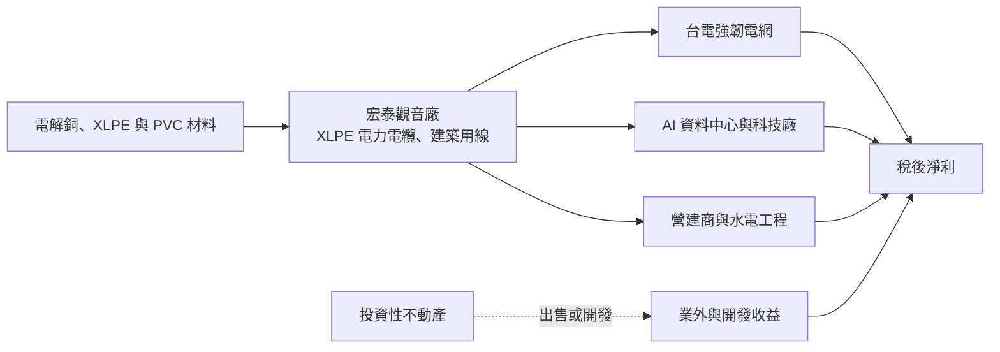
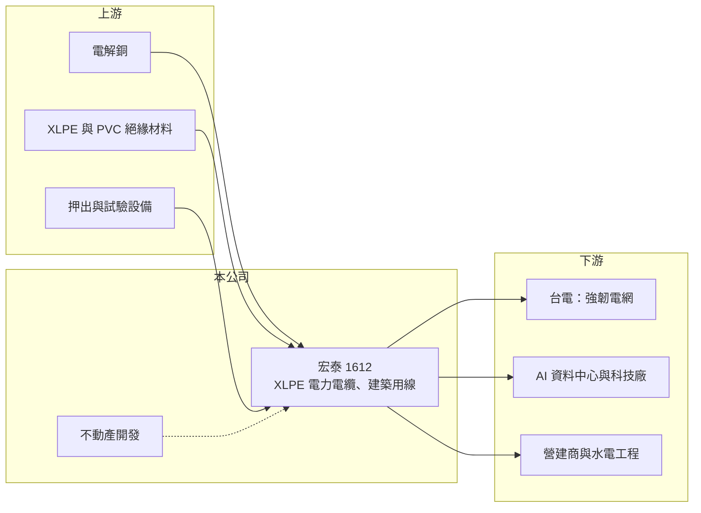

# 1612 宏泰

> 上市｜[[產業索引-電器電纜|電器電纜]]｜上市（櫃）日期 1993/05/08

# 第一章：企業模式與商業藍圖

> [!info] 撰寫說明
> 本文由 Claude 依公開資料整理，架構比照 [[2330台積電]] 的四章研究，資料截至 2026-10-08。財務數字來源：Goodinfo 年度經營績效頁、經濟日報 2025 年 11 月法說會報導、證交所開放資料（基本資料、2026 年第二季資產負債與綜合損益、營益分析、股利、本益比）；產業描述為整理性內容，尚未逐條比對原始文件。#待校對

在評估單一個股的長期投資價值時，首要步驟是拆解企業的底層獲利邏輯。本章說明宏泰電工（股票代號：1612，以下簡稱宏泰）如何以 XLPE 電力電纜為主力，並計畫跨入 345kV 超高壓電纜，以及不動產開發對它獲利的影響。

## 一、核心定位：桃園觀音的電力電纜廠，目標進入超高壓供應鏈

宏泰成立於 1968 年，1993 年上市，總部與工廠位於桃園觀音工業區，實收資本額約 31.61 億元。公司主力產品是[[交連PE電纜]]（XLPE 電力電纜），2025 年前三季占營收約七成，另有約 17% 來自 PVC 建築用線。

宏泰目前最重要的長期策略，是把觀音原本的銅箔基板廠改建為超高壓電纜廠，目標成為 345kV [[超高壓電纜]]的供應商。依 2025 年 11 月法說會說明，改建預計最快 2026 年底完工，完工後還需要一年半到兩年取得認證。345kV 是台灣電網的主幹等級，國內只有少數廠商能供應，若宏泰順利取得資格，將從中高壓電纜廠升級到輸電主幹供應商。

## 二、產品板塊：XLPE 電力電纜為主

2025 年前三季的營收結構如下（經濟日報法說會報導，其他為推算的剩餘比重）：

* **XLPE 電力電纜：** 用於台電輸配電、科技廠房與 AI 資料中心的供電系統，比重較前一年全年增加 3 個百分點。這類產品技術門檻與加工費較高，是宏泰毛利率提升的主因。
* **PVC 建築用線：** 用於住宅與一般建築的室內配線，比重較前一年減少 3 個百分點。公司表示 2025 年房市受政策壓抑，建築用線需求稍微放緩。
* **其他：** 包括其他線材與不動產相關收入（推估）。

## 三、資本轉化邏輯：電纜加工加上不動產開發

* **電纜本業：** 以銅價加上加工費報價，[[銅價轉嫁]]的效率與產品組合決定毛利。2020 年以後 XLPE 比重提升，營業利益率從不到 1% 提高到 12% 左右。
* **不動產開發：** 公司表示會評估[[投資性不動產]]的發展性與投資報酬率，視獲利情況出售，再開發基期較低的物件，並協助觀音鄰近廠區所需的土地開發。這使宏泰的獲利中有一部分來自不動產處分，具有一次性的性質。

## 四、企業長期藍圖

宏泰的長期藍圖可以歸納為兩條主線。第一是產品升級：從中高壓 XLPE 電纜往 345kV 超高壓邁進，切入台電輸電主幹與大型資料中心的需求。台電能源開發計畫在 2025 至 2035 年的商機規模約 7,889 億元（法說會引述），這是宏泰超高壓布局的需求基礎。第二是資產活化：以不動產買賣與開發提高資本報酬。公司對 2026 年的態度是審慎穩健，將持續關注庫存與銅價變化。

# 第二章：護城河深度與競爭優勢

本章分析宏泰的競爭優勢、主要對手，以及超高壓布局能否成為新的護城河。

## 一、護城河的核心組成要素

* **XLPE 電纜的認證與實績：** 台電與科技廠對電力電纜有嚴格的型式試驗與使用實績要求，宏泰在 XLPE 電纜累積了長期供貨紀錄，是參與標案的基本門檻。
* **345kV 認證的潛在門檻：** 超高壓電纜需要專用的立式押出設備、長時間的型式試驗與現場實績，國內能供應的廠商很少。宏泰若在 2027 至 2028 年完成認證，將進入一個競爭者更少的市場。
* **財務與土地資源：** 2026 年第二季底總負債約 20.3 億元、權益約 93.6 億元，負債比約 18%（證交所開放資料），財務非常保守；觀音的自有廠房與土地讓擴產不必另外購地。

## 二、主要競爭對手格局

| 對手 | 定位 | 對宏泰的影響 |
|---|---|---|
| [[1605華新]] | 台灣最大線纜廠，已供應超高壓電纜 | 345kV 市場的主要既有供應商 |
| [[1618合機]] | 69kV 以上超高壓電纜，已有 345kV 實績 | 宏泰升級超高壓後的直接對手 |
| [[1609大亞]] | 電力電纜、漆包線、綠能 | 民間科技廠與台電標案競爭 |
| [[1603華電]]、[[1615大山]]、[[1616億泰]] | 中高壓與配電電纜 | 在中壓與配電市場競爭 |

## 三、優勢轉化：守得住、守不住與觀察重點

* **守得住：** XLPE 電纜在台電與科技廠的既有市場。強韌電網與 AI 資料中心的需求提供數年的訂單能見度。
* **守不住：** 建築用線的價格。PVC 建築用線產品標準化，隨房市景氣起伏，毛利較低。
* **觀察重點：** 第一，觀音新廠能否在 2026 年底如期完工；第二，345kV 認證能否在兩年內取得；第三，不動產處分收益在獲利中的比重是否下降，讓本業成為主要獲利來源。

# 第三章：財務體質與盈利規模

資料日期：2026-10-08。數字取自 Goodinfo 年度經營績效頁、經濟日報法說會報導與證交所開放資料，表格是撰寫當時的快照；最新月營收、毛利率、累計 EPS 由自動排程寫在本筆記的屬性欄位（月營收、毛利率、累計EPS 等）。#待校對

財務報表是檢驗護城河是否真實存在的最終標準。本章檢視宏泰本業的升級成果與不動產收益的影響。

## 一、多年度財務摘要

| 年度 | 營收（新台幣） | [[毛利率]] | [[營業利益率]] | EPS（元） | [[ROE]] |
|---|---|---|---|---|---|
| 2019 | 35.0 億 | 6.13% | 0.79% | 0.64 | 4.42% |
| 2020 | 45.7 億 | 11.9% | 6.77% | 1.64 | 10.4% |
| 2021 | 63.1 億 | 11.9% | 6.14% | 8.54 | 41.2% |
| 2022 | 63.9 億 | 12.0% | 8.19% | 1.12 | 4.75% |
| 2023 | 62.0 億 | 14.1% | 9.78% | 1.99 | 8.58% |
| 2024 | 65.8 億 | 15.8% | 12.2% | 2.38 | 9.94% |
| 2025 | 75.5 億 | 14.9% | 11.7% | 2.77 | 10.9% |
| 2026 上半年 | 39.7 億 | 16.46% | 12.77% | 2.62 | 未查得 |

* **本業穩定升級：** 毛利率從 2019 年的 6.13% 提高到 2026 年上半年的 16.46%，營業利益率從 0.79% 提高到 12.77%，反映 XLPE 電纜比重提升與電網需求增加。
* **一次性收益：** 2021 年 EPS 8.54 元、ROE 41.2%，遠高於當年 6.14% 的營業利益率所能支撐的水準，推估來自不動產處分利益（具體來源未查得）。2026 年上半年營業外收支約 4.34 億元，稅前純益率 23.71%（證交所營益分析），業外再度占稅前淨利的近一半。
* **營收成長：** 2020 至 2025 年營收年複合成長率約 10.6%（推算）。

## 二、[[ROE]]：資本效率

2021 至 2025 年平均 ROE 約 15.1%（推算），但若排除 2021 年的異常值，平均約 8.5%（推算）。宏泰的股東權益中有約 11.6 億元的其他權益（2026 年第二季底），推估包含金融資產的未實現評價，這部分不產生營業利益，會稀釋本業的資本報酬。

## 三、股利與現金流

2025 年度配發現金股利 2.5 元（證交所股利資料），以 EPS 2.77 元計算配發率約 90%（推算），屬於高配息的電纜股。觀音新廠改建與超高壓設備投資會在 2026 至 2027 年增加資本支出，但低負債的財務結構足以支應。

## 四、[[ROIC]] 與 [[WACC]]：價值創造利差

**ROIC 推算：** 2025 年營收 75.5 億元乘以營業利益率 11.7%，營業利益約 8.83 億元，扣除 20% 稅率後約 7.07 億元。權益約 93.6 億元，假設總負債中約四成為有息負債（推估，約 8.1 億元），投入資本約 101.8 億元，ROIC 約 6.9%（推算）。

**WACC 推算：** 台灣 10 年期公債殖利率取 1.75%、市場風險溢酬 6%、β 取 0.9（推估），股東權益成本約 7.15%；負債成本 2.5%，稅後約 2.0%；權益約占 92%、負債約占 8%，WACC 約 6.7%（推算）。

**結論：** 宏泰的 ROIC 已從 2019 年的接近零，提升到 2025 年略高於 WACC，代表電纜本業開始創造價值，但利差仍小。若 345kV 超高壓順利量產，加工費與產品組合進一步改善，利差有機會擴大；反之，若帳上大量資本持續停留在低報酬的不動產與金融資產，整體資本效率仍會受限。

# 第四章：總體風險與地緣政治

任何企業都無法脫離宏觀環境獨立存在。本章分析宏泰長期面對的產業、執行與原物料風險。

## 一、產業週期與市場結構

* **台電與科技廠的投資週期：** XLPE 電纜需求依賴台電電網投資與科技廠擴建。強韌電網計畫與 AI 資料中心提供了中期需求，但若計畫延後或科技業資本支出反轉，訂單可能下滑。
* **房市景氣：** 建築用線約占營收 17%，央行信用管制與房市降溫會直接影響這部分需求。
* **同業擴產：** 多家線纜廠同時擴充高壓與超高壓產能，未來數年可能出現價格競爭。

## 二、執行與營運風險

* **超高壓認證：** 345kV 電纜的認證時間長、技術要求高，若新廠延誤或認證未通過，前期投資將無法回收。
* **銅價波動：** 銅價急漲時，若標案價格無法調整，毛利會受壓；銅價急跌時，則可能產生存貨損失。

## 三、不動產與財務風險

* **處分收益不穩定：** 不動產出售的時點與金額不固定，會造成 EPS 年度間大幅波動，不應視為經常性獲利。
* **不動產市場：** 宏泰的開發策略以買進低基期物件為主，房地產景氣反轉時可能面臨去化與評價壓力。

# 專有名詞解析

## 金融

- **[[毛利率]]**：營業毛利占營收的比例，反映產品定價能力與生產成本控制。
- **[[營業利益率]]**：扣除營業費用後的營業利益占營收的比例，衡量本業整體獲利能力。
- **[[ROE]]**：股東權益報酬率，稅後淨利除以股東權益，衡量公司運用股東資金的效率。
- **[[ROIC]]**：投入資本報酬率，稅後營業利益除以股東權益與有息負債的合計，衡量本業對所有資金提供者的報酬。
- **[[WACC]]**：加權平均資金成本，依股東權益與負債的比重加權計算的資金成本，ROIC 高於它才代表創造價值。

## 產業

- **[[交連PE電纜]]**：以交連聚乙烯（XLPE）作為絕緣層的電力電纜，耐熱與絕緣性能佳，是中高壓與超高壓輸配電的主流電纜。
- **[[超高壓電纜]]**：電壓等級在 69kV 以上、特別是 161kV 與 345kV 的輸電電纜，需要專用設備與長期型式試驗，國內供應商少。
- **[[銅價轉嫁]]**：電線電纜廠把銅價變動反映到售價的機制，通常以報價時銅價加上加工費計價，轉嫁速度決定毛利穩定度。
- **[[投資性不動產]]**：企業持有、用來賺取租金或等待增值而非自用的土地與建物，可依公允價值衡量。

# 核心供應鏈

## 1. 上游：原料與設備
- 電解銅（國際報價）
- 絕緣材料：交連聚乙烯、PVC，石化供應商如 [[1301台塑]]、[[1304台聚]]
- 電纜押出與型式試驗設備

## 2. 本公司與同業
- 同業：[[1605華新]]、[[1618合機]]、[[1609大亞]]、[[1603華電]]、[[1615大山]]、[[1616億泰]]、[[1608華榮]]

## 3. 下游：客戶
- 台電：強韌電網與輸配電工程
- AI 資料中心、半導體與科技廠房
- 營建商與水電工程業者

## 最新新聞
<!-- news:start -->
<!-- news:end -->

## 相關連結
- [公開資訊觀測站](https://mopsov.twse.com.tw/mops/web/t05st03?step=1&firstin=1&co_id=1612)
- [Goodinfo](https://goodinfo.tw/tw/StockDetail.asp?STOCK_ID=1612)
- [Yahoo 股市](https://tw.stock.yahoo.com/quote/1612)
- [鉅亨網新聞](https://www.cnyes.com/twstock/1612/news)
