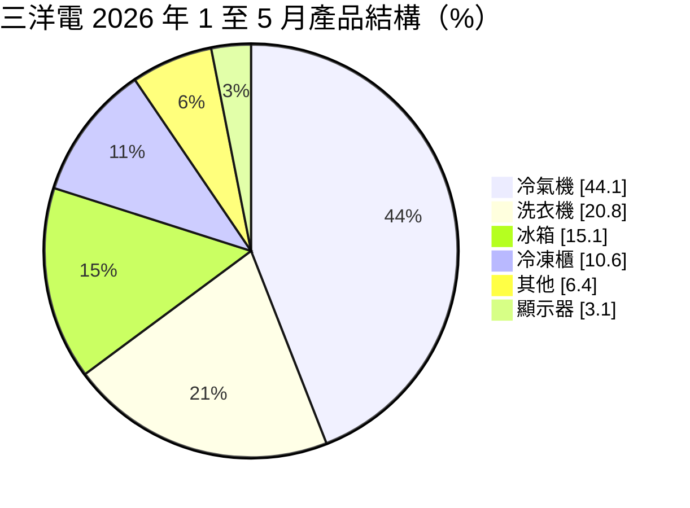
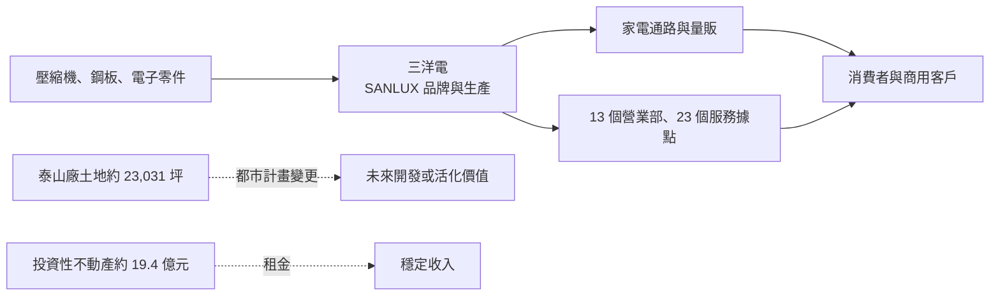
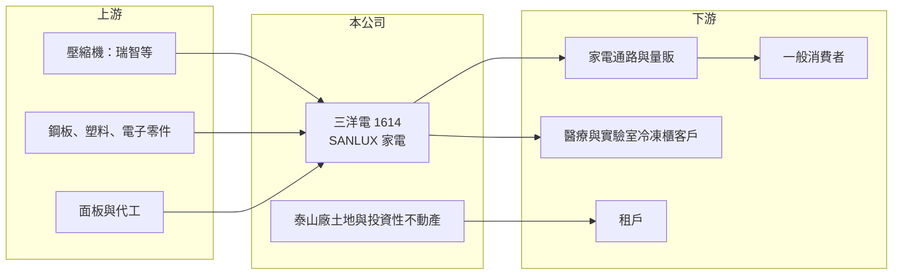

# 1614 三洋電

> 上市｜[[產業索引-電器電纜|電器電纜]]｜上市（櫃）日期 1997/09/18

# 第一章：企業模式與商業藍圖

> [!info] 撰寫說明
> 本文由 Claude 依公開資料整理，架構比照 [[2330台積電]] 的四章研究，資料截至 2026-10-08。財務數字來源：Goodinfo 年度經營績效頁、poorstock 法說會與財報整理頁、證交所開放資料（基本資料、2026 年第二季資產負債與綜合損益、營益分析、股利、本益比）；產業描述為整理性內容，尚未逐條比對原始文件。#待校對

在評估單一個股的長期投資價值時，首要步驟是拆解企業的底層獲利邏輯。本章說明台灣三洋電機（股票代號：1614，以下簡稱三洋電）的家電本業，以及新北泰山廠土地變更對它長期價值的意義。

## 一、核心定位：以冷氣為主的本土家電品牌，手握大面積工業用地

三洋電成立於 1963 年，1997 年上市，實收資本額約 26.91 億元，總部位於台北，目前以 SANLUX 品牌經營家電（公司網站為 sanlux.com.tw）。公司最早與日本三洋電機合作發展，日本三洋被 Panasonic 收購後，台灣三洋改以 SANLUX 品牌延續經營（待校對）。

三洋電的家電本業以冷氣為主，搭配洗衣機、冰箱與冷凍櫃，並擁有全台 13 個營業部、23 個服務據點的自營維修體系。和多數本土家電品牌一樣，它的本業利潤率不高，但帳上有一項重要資產：新北泰山廠約 23,031 坪的土地，目前正在進行[[都市計畫變更]]。這塊土地的未來用途，可能比家電本業更能決定三洋電十年後的價值。

## 二、產品板塊：冷氣過四成，洗衣機居次

以 2026 年 1 至 5 月各產品銷售金額計算的營收結構如下（poorstock 整理，比重為推算）：

* **冷氣機：** 最大產品線，以一級能效機種為主。冷氣需求集中在夏季，受天氣與政府節能補助影響大。
* **洗衣機：** 2026 年 1 至 5 月是唯一較前一年同期微幅成長的產品，三洋在直立式洗衣機市場有長期的品牌認知。
* **冰箱與冷凍櫃：** 冷凍櫃產品涵蓋 -18 至 -70 度的全溫域，可用於商用、醫療與實驗室，是相對利基的產品線。
* **租賃收入：** 2025 年租賃收入占營收約 4.75%，來自[[投資性不動產]]出租。

## 三、資本轉化邏輯：家電本業加上土地資產

* **家電本業：** 毛利率約兩成，營業利益率長期在 4% 至 8% 之間，屬於薄利的品牌製造業。
* **土地資產：** 泰山廠土地規劃由乙種工業區變更為特定專用區，變更後的兩區合計約占計畫面積 59.7%（約 4.64 公頃），案件仍在內政部都委會審議中，尚未定案。另有三峽廠區的遷廠規劃。2026 年第一季投資性不動產淨額約 19.37 億元。

## 四、企業長期藍圖

三洋電的長期價值取決於兩件事。第一是家電本業能否在日韓品牌與其他本土品牌的競爭下維持市占與毛利，重點在節能冷氣與利基型冷凍櫃。第二是泰山廠都市計畫變更若通過，土地可透過[[資產活化]]（合建、開發或出售）釋放價值，這可能帶來遠高於家電本業多年獲利的一次性或長期收益。由於審議尚未定案，時程與規模都存在不確定性。

# 第二章：護城河深度與競爭優勢

本章分析三洋電在家電市場的競爭優勢，以及土地資產對護城河的意義。

## 一、護城河的核心組成要素

* **品牌與服務網絡：** 三洋在台灣有數十年的品牌歷史，洗衣機與冷氣有穩定的消費者認知；自營的維修體系讓售後服務品質較能掌握。
* **利基產品：** 超低溫冷凍櫃（-70 度）切入醫療與實驗室市場，競爭者較少，價格敏感度較低。
* **財務保守與土地資產：** 2026 年第二季底總負債約 17.6 億元、權益約 57.0 億元，負債比約 24%（證交所開放資料），加上大面積自有土地，財務彈性很高。

整體而言，家電本業屬於窄護城河，三洋電的獨特性主要來自土地資產。

## 二、主要競爭對手格局

| 對手 | 定位 | 對三洋電的影響 |
|---|---|---|
| 日系品牌（Panasonic、日立、大金、[[6753夏普]]） | 高階冷氣與家電 | 技術與品牌溢價，主導高階市場 |
| 韓系品牌（[[005930三星電子]]、LG） | 冰箱、洗衣機 | 設計與規模優勢 |
| [[1604聲寶]]、[[2371大同]]、[[1504東元]] | 本土家電與空調 | 平價市場直接競爭 |
| 中國品牌 | 小家電與平價冷氣 | 以低價搶占市占 |

## 三、優勢轉化：守得住、守不住與觀察重點

* **守得住：** 洗衣機與冷凍櫃的利基市場，以及自營服務體系的客戶黏著度。
* **守不住：** 冷氣與冰箱的價格競爭。2026 年 1 至 5 月除洗衣機外，各產品銷售金額都較前一年同期下滑。
* **觀察重點：** 第一，泰山廠都市計畫變更的審議進度；第二，冷氣銷售能否回穩；第三，三峽廠遷廠後的生產效率。

# 第三章：財務體質與盈利規模

資料日期：2026-10-08。數字取自 Goodinfo 年度經營績效頁、poorstock 整理與證交所開放資料，表格是撰寫當時的快照；最新月營收、毛利率、累計 EPS 由自動排程寫在本筆記的屬性欄位（月營收、毛利率、累計EPS 等）。#待校對

財務報表是檢驗護城河是否真實存在的最終標準。本章檢視三洋電的本業獲利與資本效率。

## 一、多年度財務摘要

| 年度 | 營收（新台幣） | [[毛利率]] | [[營業利益率]] | EPS（元） | [[ROE]] |
|---|---|---|---|---|---|
| 2019 | 52.0 億 | 19.2% | 5.13% | 0.95 | 3.88% |
| 2020 | 54.9 億 | 21.3% | 7.47% | 1.36 | 5.51% |
| 2021 | 58.0 億 | 21.4% | 7.69% | 1.42 | 5.50% |
| 2022 | 61.4 億 | 19.0% | 5.72% | 1.13 | 4.29% |
| 2023 | 57.6 億 | 21.2% | 6.52% | 1.24 | 4.71% |
| 2024 | 56.9 億 | 19.3% | 4.49% | 0.83 | 3.12% |
| 2025 | 53.9 億 | 20.3% | 4.58% | 0.97 | 4.42% |
| 2026 上半年 | 26.5 億 | 19.11% | 3.42% | 0.67 | 未查得 |

* **營收停滯：** 2020 至 2025 年營收年複合成長率約 -0.4%（推算），在 52 億至 61 億元之間來回，屬於成熟市場的典型表現。
* **獲利率偏低：** 毛利率穩定在 19% 至 21%，但營業費用率約 15%，營業利益率只有 4% 至 8%，2024 年以後降到 5% 以下。
* **業外比重上升：** 2026 年上半年營業外收支約 1.26 億元，超過營業利益 0.91 億元（證交所開放資料），業外收益的來源未查得。

## 二、[[ROE]]：資本效率

2021 至 2025 年平均 ROE 約 4.4%（推算），在家電同業中偏低。原因是權益規模大（約 57 億元）而本業獲利小，帳上的土地與投資性不動產占用大量資本卻只產生少量租金。股價淨值比約 1.43 倍（2026 年 10 月初，證交所本益比資料），高於本業報酬所能解釋的水準，推估市場已部分反映土地變更的潛在價值。

## 三、股利與現金流

2025 年度配發現金股利約 0.97 元（證交所股利資料），與當年 EPS 相當，配發率接近 100%（推算）。低負債與穩定的營業現金流支撐了高配發率，自由現金流長期應為正（推估，金額未查得）。

## 四、[[ROIC]] 與 [[WACC]]：價值創造利差

**ROIC 推算：** 2025 年營業利益約 2.47 億元（poorstock 整理的財報數字），扣除 20% 稅率後約 1.97 億元。權益約 57.0 億元，假設總負債中約一成為有息負債（推估，約 1.8 億元），投入資本約 58.8 億元，ROIC 約 3.4%（推算）。

**WACC 推算：** 台灣 10 年期公債殖利率取 1.75%、市場風險溢酬 6%、β 取 0.7（推估），股東權益成本約 5.95%；負債成本 2.5%，稅後約 2.0%；權益約占 97%、負債約占 3%，WACC 約 5.8%（推算）。

**結論：** 三洋電的 ROIC 長期低於資金成本，家電本業並未創造價值。公司的長期價值較多取決於土地資產，若泰山廠變更通過並妥善開發，可能一次性大幅提升股東權益與報酬；若審議延宕，資本將持續停留在低報酬狀態。

# 第四章：總體風險與地緣政治

任何企業都無法脫離宏觀環境獨立存在。本章分析三洋電長期面對的市場、營運與土地開發風險。

## 一、產業週期與市場結構

* **成熟市場競爭：** 台灣家電市場規模有限，日韓品牌主導高階、中國品牌搶攻平價，本土品牌兩面受壓。
* **天氣與補助：** 冷氣占營收四成以上，涼夏或節能補助縮減都會讓營收明顯下滑。
* **房市連動：** 洗衣機、冰箱需求與新成屋交屋量有關，房市降溫會影響換購需求。

## 二、營運環境的隱性風險

* **原物料與匯率：** 壓縮機、鋼板與電子零件價格上漲，或新台幣貶值使進口成本上升，都會壓縮毛利。
* **遷廠影響：** 三峽廠區遷廠期間可能影響生產效率與成本。

## 三、土地開發與法規風險

* **都市計畫審議：** 泰山廠土地變更仍在內政部都委會審議，回饋比例、容積與用途限制都可能改變，最終價值存在不確定性。
* **開發執行：** 變更通過後，選擇自行開發、合建或出售，會帶來不同的資本需求與風險，公司過去缺乏大型開發經驗（推估）。

## 四、科技與法規演進

政府逐步提高家電能源效率標準，冷媒也從高溫室效應氣體轉向環保冷媒，廠商需要持續投入研發與產線調整，否則可能失去補助資格與通路上架機會。

# 專有名詞解析

## 金融

- **[[毛利率]]**：營業毛利占營收的比例，反映產品定價能力與生產成本控制。
- **[[營業利益率]]**：扣除營業費用後的營業利益占營收的比例，衡量本業整體獲利能力。
- **[[ROE]]**：股東權益報酬率，稅後淨利除以股東權益，衡量公司運用股東資金的效率。
- **[[ROIC]]**：投入資本報酬率，稅後營業利益除以股東權益與有息負債的合計，衡量本業對所有資金提供者的報酬。
- **[[WACC]]**：加權平均資金成本，依股東權益與負債的比重加權計算的資金成本，ROIC 高於它才代表創造價值。

## 產業

- **[[投資性不動產]]**：企業持有、用來賺取租金或等待增值而非自用的土地與建物，可依公允價值衡量。
- **[[資產活化]]**：企業將閒置或低度使用的土地、建物，透過改建、出租、合建或出售等方式提高收益。
- **[[都市計畫變更]]**：依都市計畫法調整土地使用分區，例如工業區改為住宅或商業區，通常需提供回饋並經主管機關審議。

# 核心供應鏈

## 1. 上游：零組件
- 壓縮機供應商如 [[4532瑞智]]（待校對）、鋼板與塑料、電子零件與面板

## 2. 本公司與同業
- 本土同業：[[1604聲寶]]、[[2371大同]]、[[1504東元]]
- 外國品牌：[[6753夏普]]、[[005930三星電子]]、Panasonic、日立、大金、LG

## 3. 下游：通路與客戶
- 家電通路如 [[2430燦坤]]、量販與電商
- 醫療、實驗室與商用冷凍櫃客戶
- 投資性不動產租戶

## 最新新聞
<!-- news:start -->
<!-- news:end -->

## 相關連結
- [公開資訊觀測站](https://mopsov.twse.com.tw/mops/web/t05st03?step=1&firstin=1&co_id=1614)
- [Goodinfo](https://goodinfo.tw/tw/StockDetail.asp?STOCK_ID=1614)
- [Yahoo 股市](https://tw.stock.yahoo.com/quote/1614)
- [鉅亨網新聞](https://www.cnyes.com/twstock/1614/news)
