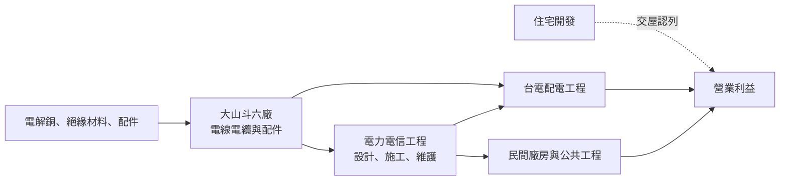
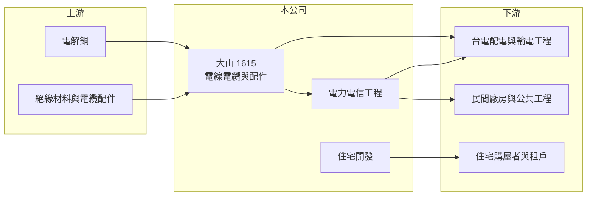

# 1615 大山

> 上市｜[[產業索引-電器電纜|電器電纜]]｜上市（櫃）日期 2000/03/30

# 第一章：企業模式與商業藍圖

> [!info] 撰寫說明
> 本文由 Claude 依公開資料整理，架構比照 [[2330台積電]] 的四章研究，資料截至 2026-10-08。財務數字來源：Goodinfo 年度經營績效頁、nStock 公司頁、證交所開放資料（基本資料、2026 年第二季資產負債與綜合損益、營益分析、股利、本益比）。公開資料有限，查得的資料未揭露產品營收比重與主要客戶，產業描述為整理性內容。#待校對

在評估單一個股的長期投資價值時，首要步驟是拆解企業的底層獲利邏輯。本章說明大山電線電纜（股票代號：1615，以下簡稱大山）的業務組成，以及它為何能在線纜同業中維持較高的獲利率。

## 一、核心定位：雲林斗六的電纜廠，兼做電力工程

大山成立於 1974 年，總部位於雲林斗六，2000 年上市，實收資本額約 19.86 億元，董事長由蘇文彬兼任總經理。公司的營業項目有三類：電線電纜及配件器材的製造與銷售；電力與電信工程的設計、施工與維護；以及住宅大樓的開發租售。

這個組合讓大山和單純賣電纜的同業有所不同。電力工程服務讓公司能把電纜、配件與施工一起提供，在台電配電工程與民間案場中，整合交付能力本身就是附加價值。大山也是近年線纜同業中獲利率最高的公司之一，2025 年營業利益率達 18.6%，明顯高於多數同業的 8% 至 12%。

## 二、業務板塊

查得的資料未揭露各業務的營收比重，因此本章不放圓餅圖。依營業項目整理如下：

* **電線電纜與配件：** 主力產品推估為中高壓[[交連PE電纜]]與配電用電纜，客戶包括台電與民間工程（產品細項待校對）。售價以銅價加上加工費計算，營收隨銅價波動。
* **電力電信工程：** 承接電力與電信線路的設計、施工與維護，收入依工程進度認列，與台電配電工程與電信網路建設相關。
* **住宅開發：** 在雲林等地從事住宅大樓開發租售（推估地點），收入在建案完工交屋時集中認列，會造成個別年度獲利跳動。

## 三、資本轉化邏輯：產品加施工的整合服務

* **[[銅價轉嫁]]：** 和同業一樣，電纜售價隨銅價調整，大山賺取加工費與工程服務費。
* **工程整合提高附加價值：** 同時供應電纜、配件與施工，客戶可以減少協調成本，大山也能在加工費之外多賺一層工程利潤，這可能是營業利益率高於同業的原因之一（推估）。

## 四、企業長期藍圖

台電[[強韌電網計畫]]帶動配電與輸電電纜的長期需求，2026 年 1 至 9 月大山營收約 46.1 億元、年增約 11.4%，9 月單月營收 7.17 億元創五年新高（nStock 整理）。查得的資料未揭露公司具體的擴產或轉型計畫。以業務結構看，大山的長期成長來自三個方向：電網投資帶動的電纜需求、工程服務的接案量，以及住宅開發的推案節奏。

# 第二章：護城河深度與競爭優勢

本章分析大山的競爭優勢與主要對手。

## 一、護城河的核心組成要素

* **產品與工程的整合：** 從電纜製造到施工維護一次提供，讓大山在配電工程市場有差異化的服務能力，也提高了客戶的轉換成本。
* **地理位置：** 位於雲嘉南地區，靠近中南部的工業區與科學園區，對區域客戶的交貨與服務有地利（推估）。
* **財務健全：** 2026 年第二季底總負債約 19.2 億元、權益約 47.0 億元，負債比約 29%（證交所開放資料），足以支應銅價上漲時的營運資金。

由於電纜產品本身規格化，大山的護城河主要來自服務整合與營運效率，屬於窄護城河。

## 二、主要競爭對手格局

| 對手 | 定位 | 對大山的影響 |
|---|---|---|
| [[1605華新]] | 台灣最大線纜廠 | 規模與產品線最完整 |
| [[1609大亞]] | 電力電纜、漆包線、綠能 | 南部同業，民間與台電訂單皆強 |
| [[1618合機]]、[[1612宏泰]] | 高壓與超高壓電力電纜 | 台電輸電標案競爭 |
| [[1603華電]]、[[1616億泰]]、[[1608華榮]] | 中高壓與建築用電纜 | 配電與民間市場競爭 |

## 三、優勢轉化：守得住、守不住與觀察重點

* **守得住：** 配電工程與區域客戶的長期關係，以及整合服務帶來的較高利潤率。
* **守不住：** 純電纜標案的價格競爭，以及住宅開發收入的穩定性。
* **觀察重點：** 第一，營業利益率能否維持在 15% 以上；第二，住宅開發收入占比是否擴大，影響獲利品質；第三，台電標案的接單量。

# 第三章：財務體質與盈利規模

資料日期：2026-10-08。數字取自 Goodinfo 年度經營績效頁、nStock 公司頁與證交所開放資料，表格是撰寫當時的快照；最新月營收、毛利率、累計 EPS 由自動排程寫在本筆記的屬性欄位（月營收、毛利率、累計EPS 等）。#待校對

財務報表是檢驗護城河是否真實存在的最終標準。本章檢視大山在線纜同業中偏高的獲利率與資本報酬。

## 一、多年度財務摘要

| 年度 | 營收（新台幣） | [[毛利率]] | [[營業利益率]] | EPS（元） | [[ROE]] |
|---|---|---|---|---|---|
| 2019 | 31.5 億 | 13.6% | 9.44% | 2.18 | 14.1% |
| 2020 | 31.7 億 | 17.1% | 12.7% | 2.67 | 17.1% |
| 2021 | 45.2 億 | 14.5% | 11.0% | 3.27 | 20.1% |
| 2022 | 44.3 億 | 14.7% | 10.7% | 2.90 | 17.2% |
| 2023 | 49.4 億 | 16.3% | 12.3% | 3.21 | 19.0% |
| 2024 | 58.7 億 | 19.0% | 15.2% | 3.96 | 22.7% |
| 2025 | 57.2 億 | 22.7% | 18.6% | 4.81 | 23.6% |
| 2026 上半年 | 29.3 億 | 23.12% | 18.84% | 2.53 | 未查得 |

* **獲利率持續提升：** 毛利率從 2019 年的 13.6% 提高到 2025 年的 22.7%，營業利益率從 9.44% 提高到 18.6%，七年間幾乎翻倍。營業費用率約 4%，成本控制相當精簡。
* **獲利品質：** 2026 年上半年稅前純益率 21.46%、營業利益率 18.84%（證交所營益分析），業外占比低，獲利主要來自本業，品質優於多數同業。
* **營收成長：** 2020 至 2025 年營收年複合成長率約 12.5%（推算）。

## 二、[[ROE]]：資本效率

2021 至 2025 年平均 ROE 約 20.5%（推算），是線纜同業中最高的一群，而且在 2019 年以來每年都超過 14%，穩定度也高。這個 ROE 主要來自本業獲利率，而不是財務槓桿或業外收益，屬於較高品質的資本報酬。

## 三、股利與現金流

2025 年度配發現金股利 2.5 元與股票股利 0.1 元，2024 年度為現金 2 元與股票 0.5 元；近五年平均現金股利約 1.89 元（nStock 整理）。以 2025 年 EPS 4.81 元計算現金配發率約 52%（推算）。公司同時發放股票股利，股本逐年小幅擴大，會稀釋每股盈餘的成長。

## 四、[[ROIC]] 與 [[WACC]]：價值創造利差

**ROIC 推算：** 2025 年營收 57.2 億元乘以營業利益率 18.6%，營業利益約 10.64 億元，扣除 20% 稅率後約 8.51 億元。權益約 47.0 億元，假設總負債中約四成為有息負債（推估，約 7.7 億元），投入資本約 54.6 億元，ROIC 約 15.6%（推算）。

**WACC 推算：** 台灣 10 年期公債殖利率取 1.75%、市場風險溢酬 6%、β 取 0.9（推估），股東權益成本約 7.15%；負債成本 2.5%，稅後約 2.0%；權益約占 86%、負債約占 14%，WACC 約 6.4%（推算）。

**結論：** 大山的 ROIC 比 WACC 高出約 9 個百分點，是本次整理的線纜公司中價值創造能力最明顯的一家。不過，2024 至 2025 年的高利潤率處在電網投資與銅價上漲的有利環境，投資人需要觀察景氣回落時利潤率能否維持在 12% 以上，才能確認這是結構性的競爭力而不只是週期紅利。

# 第四章：總體風險與地緣政治

任何企業都無法脫離宏觀環境獨立存在。本章分析大山長期面對的產業、營運與業務組合風險。

## 一、產業週期與市場結構

* **電網投資週期：** 台電強韌電網計畫是近年需求的重要來源，計畫的預算與執行進度若放緩，訂單會減少。
* **同業擴產：** 需求熱絡時多家線纜廠擴充產能，未來可能出現供過於求與價格競爭，壓縮目前偏高的利潤率。

## 二、原物料與營運風險

* **銅價波動：** 銅價急漲時營運資金需求增加，若合約價格未能及時反映，會壓縮毛利；銅價急跌時則有存貨跌價風險。
* **工程執行：** 電力工程受工期、天候與人力影響，延誤或成本超支會影響獲利。台灣營建與電力工程人力長期吃緊。

## 三、業務組合與資訊揭露風險

* **住宅開發的波動：** 建案收入在交屋時集中認列，可能讓特定年度獲利大幅跳動，也受房市景氣與信用管制政策影響。
* **公開資訊有限：** 公司未公開詳細的產品與客戶結構，外部投資人難以判斷高利潤率的具體來源，需要從年報與股東會資料補充。

# 專有名詞解析

## 金融

- **[[毛利率]]**：營業毛利占營收的比例，反映產品定價能力與生產成本控制。
- **[[營業利益率]]**：扣除營業費用後的營業利益占營收的比例，衡量本業整體獲利能力。
- **[[ROE]]**：股東權益報酬率，稅後淨利除以股東權益，衡量公司運用股東資金的效率。
- **[[ROIC]]**：投入資本報酬率，稅後營業利益除以股東權益與有息負債的合計，衡量本業對所有資金提供者的報酬。
- **[[WACC]]**：加權平均資金成本，依股東權益與負債的比重加權計算的資金成本，ROIC 高於它才代表創造價值。

## 產業

- **[[交連PE電纜]]**：以交連聚乙烯（XLPE）作為絕緣層的電力電纜，耐熱與絕緣性能佳，是中高壓與超高壓輸配電的主流電纜。
- **[[強韌電網計畫]]**：台電在 2022 年大停電後提出的十年電網強化計畫，投入大量預算更新輸變電設備。
- **[[銅價轉嫁]]**：電線電纜廠把銅價變動反映到售價的機制，通常以報價時銅價加上加工費計價，轉嫁速度決定毛利穩定度。

# 核心供應鏈

## 1. 上游：原料
- 電解銅（國際報價）、絕緣材料，石化供應商如 [[1301台塑]]、[[1304台聚]]
- 電纜接頭與配件

## 2. 本公司與同業
- 同業：[[1605華新]]、[[1609大亞]]、[[1618合機]]、[[1612宏泰]]、[[1603華電]]、[[1616億泰]]、[[1608華榮]]

## 3. 下游：客戶
- 台電：配電與輸電工程
- 民間廠房、公共工程與電信業者
- 住宅購屋者與租戶

## 最新新聞
<!-- news:start（自動產生，請勿手動編輯此範圍） -->
- 2026-10-07 📰 媒體 18:53｜營收速報 - 大山(1615)9月營收7.17億元年增率高達63.36％｜[鉅亨網](https://news.cnyes.com/news/id/6623857)

完整紀錄：[[1615大山 新聞]]
<!-- news:end -->

## 相關連結
- [公開資訊觀測站](https://mopsov.twse.com.tw/mops/web/t05st03?step=1&firstin=1&co_id=1615)
- [Goodinfo](https://goodinfo.tw/tw/StockDetail.asp?STOCK_ID=1615)
- [Yahoo 股市](https://tw.stock.yahoo.com/quote/1615)
- [鉅亨網新聞](https://www.cnyes.com/twstock/1615/news)
